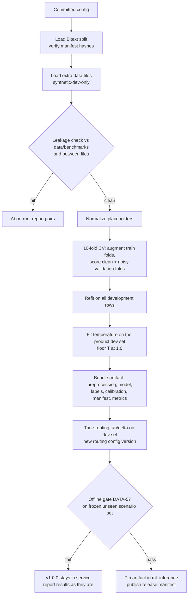

# Design: Intent model retraining for robustness and product label semantics

- **Status:** Draft
- **Owner:** ML engineer
- **Reviewers:** team; Group 2 contact for the shared evaluation procedure (CST-02)
- **Last reviewed:** 2026-11-12
- **Related:** FR-01, FR-05, NFR-01, NFR-02, ESC-01, ESC-02; [DATA-03](../rules/data-and-ml.md#sources-and-acceptable-use), [DATA-20 to DATA-35](../rules/data-and-ml.md#splits-and-evaluation-protocol), [DATA-56 to DATA-59](../rules/data-and-ml.md); [ADR-0010](../decisions/0010-pseudonymization-and-egress-control.md); [autoeval](../autoeval.md)

## Summary

The released intent classifier (DistilBERT, artifact `v1.0.0`) scores a cross-validated Macro-F1 of 0.995 on Bitext but fails the automated evaluation gates on human-written support messages. This design retrains it with four changes: label-preserving noise augmentation, extra training rows written to the product's label definitions, outlier exposure for out-of-domain text, and temperature calibration fitted on validation data. It also defines the conditions that a retrained artifact must meet before it may replace `v1.0.0`, because an exploratory prototype trained on 2026-11-06 did not meet them (see [Background](#background)).

## Goals and non-goals

### Goals

- Meet NFR-01 and NFR-02 on a frozen scenario set that nobody involved in training has seen.
- Keep the label set at exactly 46 Bitext intents, so the contract and the routing policy do not change shape.
- Train on the same kind of text that `ai-service` receives: pseudonymized text with placeholders mapped to their type (DATA-59).
- Make every run reproducible from a committed configuration (DATA-29 to DATA-31) and report it next to the TF-IDF baseline (DATA-32, DATA-33).

### Non-goals

- Changing the routing policy logic, the KB, the LLM prompt, or retrieval. A new routing configuration version for the new artifact is in scope (DATA-58); new routing rules are not.
- Adding an out-of-scope label or multi-label output (requirements §3.1).
- Editing Bitext or its split (DATA-06, DATA-23).

## Background

**Current release.** The autoeval report for `v1.0.0` on 2026-11-06 (`artifacts/evaluation/autoeval/20261106-213342-local/report.md`) fails these blocking gates:

| Gate | Target | `v1.0.0` |
|---|---|---|
| Macro-F1 on human-written queries | ≥ 0.75 | 0.611 |
| Supported (12) vs escalated (34) decided correctly | ≥ 0.90 | 0.861 |
| Macro-F1 drop on noisy text (NFR-02) | ≤ 0.10 | 0.159 |
| Must-not-draft cases forwarded to drafting | 0 | 1 |

Warnings: out-of-scope low-confidence rate 0.7625 (target ≥ 0.90), expected calibration error 0.106 (≤ 0.08), confident errors 11 (≤ 5), clarify rate 0.307 (≤ 0.15).

**Cause.** Bitext labels follow Bitext's own conventions, which differ from the product's for several supported intents. In the training CSV, `track_order` is mostly about tracking a replacement item, "where is my package" is `track_delivery`, and `refund_policy` is "where can I read your refund policy" rather than refund timelines. Bitext also has no order identifiers in its instructions, and the model has never seen out-of-domain text, so it assigns one of the 46 labels to anything with high confidence.

**Exploratory prototype (not admissible).** On 2026-11-06 a prototype was trained with the changes in this design. It is kept in a local folder outside the repository and is not part of this design's deliverables, for three reasons:

- The product-semantics rows and the out-of-domain texts were written after viewing about 50 failure cases from `data/benchmarks/system/v1` and `data/benchmarks/autoeval/v1`. No benchmark text was copied (token Jaccard < 0.7 against every benchmark file), but the label boundaries were influenced by test results. Its benchmark scores are therefore not valid evidence (DATA-25, DATA-28).
- Its augmentation inserted raw order identifiers (`ORD-4821`), which `ai-service` never sees (DATA-59).
- Its data files are not labeled `synthetic-dev-only` (DATA-03) and it ran from command-line arguments, not a committed configuration (DATA-29).

The prototype showed that each change moves its intended metric. That is the only conclusion this design takes from it.

## Design

### Components and responsibilities

| Component | Change |
|---|---|
| `pipeline/preparation/intent_extra.py` (new) | Loads and validates the extra data files; checks every file against `data/benchmarks/` and against each other for near-duplicates and fails the run on a hit. |
| `apps/ml_inference/preprocessing.py` (new) | One normalization function that maps `[ORDER_ID_1]` to `[ORDER_ID]` and likewise for every placeholder type in [ADR-0010](../decisions/0010-pseudonymization-and-egress-control.md#placeholder-syntax). It has no third-party imports, so training, the autoeval backends, and `ModelContainer.predict` call the same function (DATA-59). |
| `pipeline/training/augment.py` (new) | Label-preserving noise for training rows only: typos, lowercase without punctuation, abbreviations, fillers, keyword style, and placeholder insertion (`[ORDER_ID]`, never raw identifiers). |
| `pipeline/training/train_distilbert_robust.py` (new) | 10-fold cross-validation and a full refit with augmentation, extra rows, outlier exposure, and temperature calibration. Reads only a committed configuration file. |
| `pipeline/configs/training_robust.json` (new) | Every hyperparameter, data file, and seed for a run (DATA-29). |
| `apps/ml_inference/app.py` | Applies the placeholder normalization before tokenization; pins the new artifact checksum and version after the gate passes. |
| `apps/core_backend/config/policies/` | A new routing configuration version with τ and δ tuned on the dev set for the new artifact version (DATA-58). |

### Flow

### Data and contracts

No API contract changes: the classifier still returns 46 labels with probabilities.

| Data | Purpose | Written by | Rules |
|---|---|---|---|
| Bitext split `06-11-2026-00` | Training and 10-fold CV | Existing script | Same hashes as split `03-11-2026-02`; unchanged (DATA-23). |
| Product-semantics training rows | Teach the product's label boundaries | The 2026-11-06 AI-assisted rows, kept by team decision on 2026-11-12, with identifiers replaced by placeholders | `synthetic-dev-only` in the file name and manifest (DATA-03, DATA-09). |
| Dev set (in-domain + out-of-domain) | Calibration and τ/δ tuning only | Same origin as the training rows | Validation data, never reported as a test result (DATA-03, DATA-34, DATA-58). |
| Out-of-domain training texts | Outlier exposure | Same origin as the training rows | Avoid topics of `ml_oos.jsonl`; `synthetic-dev-only`. |
| Frozen scenario set `data/benchmarks/intent/v1` | Gate and reported results | An author with no access to the training data or failure analysis ([ADR-0016](../decisions/0016-frozen-intent-scenario-set.md)) | Training and dev rows that are near-duplicates of it are removed, never rewritten (DATA-24, DATA-25). |

Because the training rows were written after earlier test failures had been read, their origin is recorded in
`data/intent/README.md`, and only the independently written set may support a release decision.

The label definitions document is a prerequisite. It must be approved by the team before any data is written.

### Errors and guardrails

| Failure | Behavior | Test |
|---|---|---|
| A data file resembles a benchmark text or another file (Jaccard ≥ 0.7) | The run aborts and lists the pairs | `tests/unit/test_intent_extra.py` |
| A data file has an unknown intent or duplicate rows | The loader raises; nothing is trained | `tests/unit/test_intent_extra.py` |
| Bitext split hashes differ from the manifest | The run aborts | Existing split tests |
| Out-of-domain rows push in-domain confidence down too far | Detected by the dev-set in-domain low-confidence rate and the clarify-rate gate | Dev-set report; autoeval `ml_clarify_rate` |
| The artifact checksum does not match the pinned manifest | `ml_inference` refuses to load (DATA-35, ERR-17) | autoeval `ml_model_integrity` |
| The gate fails | `v1.0.0` stays in service; results are reported as measured (DATA-48, DATA-57) | autoeval exit code 1 |

The classifier only feeds routing. Staff approval, abstention without evidence, and the escalation rules are unchanged (FR-04, FR-05).

## Alternatives considered

- **Retrain with the current recipe.** Cross-validation is already 0.995; the failures come from data, not capacity. A 10-fold rerun on 2026-11-06 reproduced the same gate failures.
- **Relabel Bitext rows to product semantics.** Rejected: raw data is never edited (DATA-06), and both groups share the dataset (CST-02).
- **Add an out-of-scope label.** Rejected: the contract and requirements fix 46 labels; outlier exposure lowers confidence without a new label.
- **Tune only the routing thresholds.** Thresholds cannot fix confident errors (confidence ≥ 0.8 on wrong labels).
- **Fit the temperature on Bitext out-of-fold logits.** The prototype fitted T = 0.82, which sharpened scores that are already overconfident on human-written text. Calibration uses the product dev set instead, with T floored at 1.0 because that set shares its author with the training rows and so understates real-world overconfidence.
- **A larger base model.** Deferred: capacity is not the bottleneck; it can be compared later in an ADR (DATA-33).

## Testing and evaluation

- Unit tests: augmentation preserves labels and never inserts raw identifiers; placeholder normalization is identical in training and serving; the outlier-exposure loss moves out-of-domain predictions toward uniform; the temperature fit reduces calibration error; leakage checks fail on a planted duplicate.
- Baseline: TF-IDF with logistic regression, trained and reported with the same protocol (DATA-32, DATA-33).
- Re-measured: NFR-01 (Macro-F1, per-class F1, confusion matrix), NFR-02 (noise drop, out-of-scope flag rate), calibration error and reliability diagram (DATA-34), and every autoeval gate, on the frozen unseen scenario set.
- Comparison: against `v1.0.0` in `pipeline/configs/autoeval_baseline.json`, within the tolerances of the evaluation protocol (DATA-20).

## Observability

Each run writes its configuration, code commit, data manifest hashes, seed, environment, fold metrics, out-of-fold predictions, calibration, and metrics to a run folder (DATA-30). The released artifact's version appears in every suggestion's `release_id` (DATA-56).

## Security and privacy

All training data is synthetic. No data leaves the machine during training; no LLM is called. Training text uses placeholders only, as `ai-service` receives it (DATA-59, SEC-36).

## Rollout

1. PR: label definitions approved; this design approved.
2. PR: ADR for the new frozen scenario set; the set written and committed by a member outside the training work.
3. PR: `intent_extra.py`, `placeholders.py`, `augment.py`, the training script, the configuration, and their tests.
4. PR: the extra data files with manifests, written by team members.
5. PR: trained artifact checksum pin, new routing configuration version, autoeval report.

Rollback: re-pin `v1.0.0` in `apps/ml_inference/app.py`; earlier artifacts stay available (DATA-36).

## Open questions

- Label boundaries still to decide in [the label definitions](intent-label-definitions.md): merging `track_order` with `track_delivery`, channel-specific returns, and multi-intent messages.
- [DATA-20](../rules/data-and-ml.md#splits-and-evaluation-protocol) requires an evaluation protocol design doc with tolerances before the first experiment. None exists yet; this design depends on it.
- Name of the new scenario set: several documents reference `data/benchmarks/system/v3`, which was never committed.
- DATA-30 names `ml/runs/<run_id>/`, while the repository stores runs under `artifacts/training/`. One of them needs to change.
- `apps/ml_inference/app.py` falls back to a regex classifier when the model files are missing and still reports the pinned checksum. Evaluations must run with `SUPPORTIQ_DEV_FALLBACK_MODEL=false`, or the fallback must change (ERR-17).
- GPU training (ROCm on Windows) is not bit-reproducible; the run must document this source of nondeterminism (DATA-31).
- Group 2 must agree that the shared procedure allows extra training rows (CST-02).
