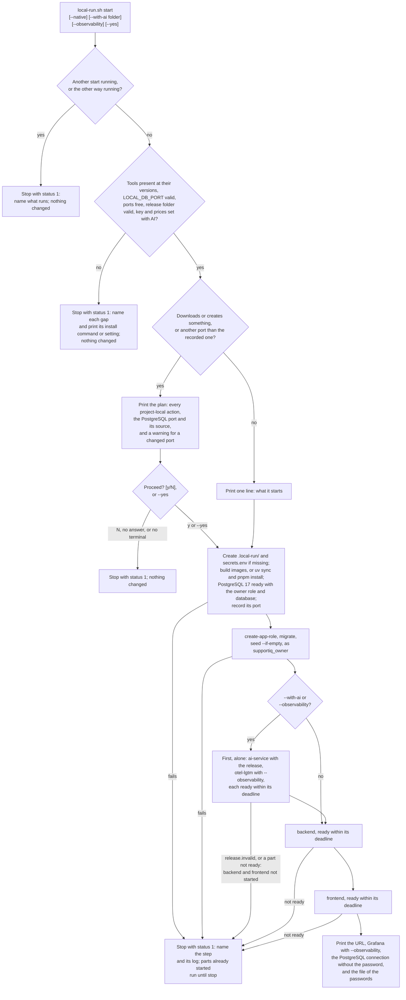
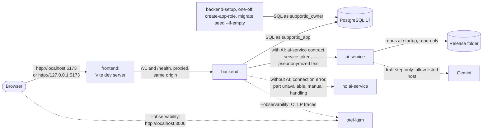

# Design: Local run of the whole system

- **Status:** Approved
- **Owner:** project lead
- **Reviewers:** backend engineer, frontend engineer, ML engineer, RAG engineer
- **Last reviewed:** 2026-11-20
- **Related:** [WF-30](../rules/workflow.md#dependencies), [WF-32, WF-33](../rules/workflow.md#reproducibility), [ADR-0003](../decisions/0003-tech-stack.md), [ADR-0007](../decisions/0007-observability-stack.md), [ADR-0016](../decisions/0016-hosting-on-free-tiers.md), [ADR-0018](../decisions/0018-hosting-of-ai-service-on-modal.md), [ADR-0021](../decisions/0021-repository-layout-and-ai-ml-migration.md), [backend foundation design, Rollout](backend-foundation.md#rollout), [repository checks, Workflow convention](../guides/repository-checks.md#workflow-convention), [#41](https://github.com/ml-system-design-nhom-5/SupportIQ/issues/41), [#4](https://github.com/ml-system-design-nhom-5/SupportIQ/issues/4)

## Summary

Today each part of SupportIQ runs on its own, and no command starts the whole system, so WF-32 and WF-33 are not met. This design adds one command, `deploy/local/local-run.sh start`, which starts PostgreSQL 17, `backend` with the simulated demo data, `frontend`, and optionally `ai-service` and the local Grafana stack. By default it runs Docker Compose, so a tester installs only Docker; `--native` runs each part natively on Linux, macOS, or WSL2 for developers, with the same ports, settings, and demo data. Windows users use WSL2. Before it downloads or creates anything, the command prints its plan and asks one question, which `--yes` answers; a start that only starts what already exists asks nothing. It replaces `scripts/start-app.ps1` of `main`, which ran natively on Windows only and which the join deleted ([ADR-0021, Target layout](../decisions/0021-repository-layout-and-ai-ml-migration.md#target-layout)). The project lead decided the two ways and the two modes on 2026-11-18, and decided the points of the first review the same day; this document records those decisions. **Amendment of 2026-11-18:** after the approval, the project lead amended these points the same day: `backend` allows both loopback origins of the page; the question comes only when a start downloads or creates something, or when the host port of PostgreSQL changed; `LOCAL_DB_PORT` can change that port, which `.local-run/db-port` records; and, after a second review, the script refuses to run as root, an interrupted start stops the parts that it launched, `logs` follows the logs of the parts, and the native way stops each part through its process group, with `SIGKILL` only after a deadline and never for PostgreSQL. After the review of the implementation, the project lead turned off the anonymous access of Grafana and made `local-run-compose` a required check.

## Goals and non-goals

### Goals

- One command starts the whole system from a fresh clone, and one command stops it (WF-32, WF-33).
- Docker Compose by default, and a native way with `--native`, both with the same ports, settings, and demo data.
- At most one confirmation per start: when the start downloads or creates something, the plan of every project-local action, then one question.
- Two modes: without AI, where suggestions go to manual handling, and with AI, from a published release folder that the user names.
- The local Grafana stack of [ADR-0007](../decisions/0007-observability-stack.md), statement 4, as the opt-in Compose profile `observability`.
- No secret in the repository, and every published port bound to `127.0.0.1` only.
- The script never installs system software and never runs `sudo`.
- CI smoke tests start each way, check its health, and stop it.

### Non-goals

- Downloading a release. The download script of a release comes with [#41](https://github.com/ml-system-design-nhom-5/SupportIQ/issues/41) ([ADR-0018, Deploy](../decisions/0018-hosting-of-ai-service-on-modal.md#deploy)).
- Any change to the code of `ai-service` ([Background](#background)).
- A production image of `frontend` ([#4](https://github.com/ml-system-design-nhom-5/SupportIQ/issues/4)) and any change to the demo deployment of [ADR-0016](../decisions/0016-hosting-on-free-tiers.md).
- Measuring the memory or start time of the whole stack. The deviation of ADR-0016 from ASM-06 and CST-07 stands ([Changes to approved documents](#changes-to-approved-documents)).
- Hot reload of code inside containers, and native Windows without WSL2.
- Any change to AI behavior, routing, prompts, or the release check of `ai-service`.

## Background

- [ADR-0003](../decisions/0003-tech-stack.md) names Docker Compose as the local runtime: "one command starts the whole system". No Compose file exists yet.
- On 2026-11-05 the project lead left Docker Compose out of the scaffold until ADR-0011 or the hosting ADR was accepted ([backend foundation design, Rollout](backend-foundation.md#rollout), item 4). ADR-0016 was accepted on 2026-11-12.
- `backend/Dockerfile` and `ai-service/Dockerfile` exist, pin their base images by digest, run as non-root users, hold no secret (SEC-29), and start their servers on `0.0.0.0:8000`. CI builds both. `frontend` has no Dockerfile ([#4](https://github.com/ml-system-design-nhom-5/SupportIQ/issues/4)).
- [`eval/release/gate/`](../../eval/release/gate/run-gate.sh) already runs Compose from a bash script with `set -euo pipefail`, requires Compose v2 and BuildKit, runs containers as the user who runs the script, and pins PostgreSQL 17.11 by the digest of the CI job `backend-tests` ([release command README, Run in Docker](../../eval/release/README.md#run-in-docker)). This design follows that pattern (CODE-52).
- The Vite dev server of `frontend` proxies `/v1` and `/health` to `SUPPORTIQ_BACKEND_URL`, so the session cookie stays on the page's origin ([frontend README, Settings](../../frontend/README.md#settings)). `pnpm run dev:mock` uses POSIX process groups (`process.kill(-pid)` in `frontend/scripts/dev-with-mock.ts`), so it does not run on native Windows.
- The readiness check of `backend` checks only the database. When `ai-service` cannot be reached, a suggestion part ends `unavailable` with `ai_service_unavailable`, and staff handle the ticket manually ([backend ticket workflow design](backend-ticket-workflow.md#the-ai-service-client)).
- `backend seed` fails on a seeded database and changes nothing ([backend README, Commands](../../backend/README.md#commands)), so a second start cannot run it again.
- `backend` exports traces over OTLP when `TRACE_EXPORTER` is `otlp`, to the required `OTLP_TRACES_ENDPOINT`, within `OTLP_EXPORT_TIMEOUT_MS`. It exports no logs or metrics yet, and `ai-service` sends no span out of its process ([backend README, Known limits](../../backend/README.md#known-limits); [ai-service README, Events](../../ai-service/README.md#events)).
- `ai-service serve` does not start without a verified release on the machine, and it needs torch, which `ai-service/uv.lock` locks for Linux only, with wheels for `x86_64` and `aarch64` ([ADR-0021, Python and dependencies](../decisions/0021-repository-layout-and-ai-ml-migration.md#python-and-dependencies), statement 2). The first release, `release-2026-11-18-02`, serves no KB document, so no request gets a draft and no LLM call happens ([ai-service README, Known limits](../../ai-service/README.md#known-limits)).
- `ai-service` requires `GEMINI_API_KEY` and the two `LLM_*_PRICE_MICRO_USD_PER_MILLION_TOKENS` settings at startup, without defaults ([`settings.py`](../../ai-service/app/platform/settings.py)). The code of `ai-service` stays as it is: the offline evaluation gate passed on the code of commit `86f73df` ([`gate-run.json`](../../eval/releases/release-2026-11-18-02/gate-run.json)), and a change would need a new gate run on a new release ID ([ARCH-40](../rules/architecture.md#versioned-assets)).
- Neither `backend` nor `ai-service` reads a `.env` file by itself: only `uv run --env-file` loads one.

## Design

### Components and responsibilities

The files of the local run live in `deploy/local/`, because deployment configuration lives in `deploy/` ([ARCH-42](../rules/architecture.md#component-boundaries)) and the tree after the join has no root `scripts/` ([ADR-0021, Target layout](../decisions/0021-repository-layout-and-ai-ml-migration.md#target-layout)). No component reads them at runtime; each receives values through its settings.

| Path | Holds |
|---|---|
| `deploy/local/local-run.sh` | The one command: `start`, `stop`, `status`, and `logs [part]`. Compose by default; `--native`, `--with-ai <release folder>`, `--observability`, and `--yes` |
| `deploy/local/compose.yaml` | The Compose project `supportiq-local`: PostgreSQL 17, the one-off `backend-setup`, `backend`, `frontend`, `ai-service` in the profile `ai`, and `otel-lgtm` in the profile `observability` |
| `deploy/local/local-run.env` | The non-secret values that both ways share: the ports, the allowed origin, and the build version. Committed |
| `deploy/local/frontend.Dockerfile` and its `.dockerignore` | The local image of `frontend`: Node.js of `.nvmrc`, pinned by digest, pnpm of `packageManager`, `pnpm install --frozen-lockfile`, the dependencies pre-bundled with `vite optimize`, so the first request after a start does not wait for the bundling, and the Vite dev server, as the user `node`. The build context is an allow-list, so it holds no `.env` file, no `node_modules/`, and no build output. It is not the production image of ARCH-10, so [#4](https://github.com/ml-system-design-nhom-5/SupportIQ/issues/4) stays open |
| `deploy/local/postgres-init.sh` | Creates the role `supportiq_owner` (`LOGIN CREATEDB CREATEROLE`, not a superuser) and the database `supportiq`, as in step 3 of the [backend README](../../backend/README.md#set-up), with the generated owner password |
| `deploy/local/tests/` | The script tests, in bash, with stub tools on `PATH` |
| `.local-run/`, git-ignored | Everything the script writes: `secrets.env`, and for the native way the PostgreSQL data folder, the logs, the PID files, and a lock |
| `backend` | One new option, `backend seed --if-empty` ([Data and contracts](#data-and-contracts)) |
| `.pre-commit-config.yaml` | The shellcheck hook for `deploy/local/` and `eval/release/gate/`, and the `apt-get install` pattern of `workflow-frozen-installs` |
| `.github/workflows/local-run.yml` | The smoke tests of the new area `local-run` ([Testing and evaluation](#testing-and-evaluation)) |
| `docs/guides/local-run.md` | The guide: requirements, the commands, the demo accounts, Grafana and whether its image allows anonymous access, how to remove the local data, and, in "Move data between the ways", the `pg_dump` and `pg_restore` commands that the user runs. On Windows, it says to run `local-run.sh` inside WSL2, with the WSL integration of Docker Desktop turned on for the Compose way |

### Ports and settings

Both ways publish the same ports, on `127.0.0.1` only. Only one way runs at a time. In Compose, `frontend`, `backend`, `ai-service`, and Grafana listen on `0.0.0.0` inside their containers, because a published port reaches a container through its own network interface; only the published host ports are bound to `127.0.0.1`. In the native way, every part binds `127.0.0.1` explicitly, the dev server too, so a `localhost` that resolves to `::1` never matters.

| Part | Host port | In Compose | Native |
|---|---|---|---|
| `frontend` | 5173 | The dev server on `0.0.0.0:5173` in its container, published on `127.0.0.1:5173` | `pnpm run dev --host 127.0.0.1 --port 5173 --strictPort` |
| `backend` | 8000 | `0.0.0.0:8000` of the image, published on `127.0.0.1:8000` | `backend serve --host 127.0.0.1 --port 8000` |
| `ai-service`, with AI only | 8001 | `0.0.0.0:8000` of the image, published on `127.0.0.1:8001` | `ai-service serve --host 127.0.0.1 --port 8001` |
| PostgreSQL 17 | 5434, or `LOCAL_DB_PORT` | Port 5432 of the container, published on `127.0.0.1` at the host port | Its own cluster in `.local-run/postgres/`, on `127.0.0.1` at the host port |
| Grafana, with `--observability` only | 3000 | Port 3000 of `otel-lgtm`, published on `127.0.0.1:3000`. Its OTLP ports are not published | Not available: the profile needs Compose |

The host port of PostgreSQL is 5434 by default, which leaves 5432 and the port 5433 of the backend README to a teammate's own PostgreSQL ([Alternatives considered](#alternatives-considered)). `LOCAL_DB_PORT` in the user's environment changes it; `start` stops before it asks anything when the value is not a port number from 1 to 65535 or when the port is taken. Inside Compose, PostgreSQL stays on 5432. The last message of `start` prints the connection details without the password: host `127.0.0.1`, the port, the database `supportiq`, and the user `supportiq_owner`, and it names `.local-run/secrets.env` for the password. Publishing the port lets a teammate run `uv run pytest` of `backend` against the local database, with the two URLs built from `.local-run/secrets.env`.

The local run sets only the settings that differ from each component's defaults. Every other setting keeps the default of its settings class.

| Component | Setting | Value |
|---|---|---|
| `backend` | `DATABASE_URL_APP` | `supportiq_app` with the generated app password, on `postgres:5432` in Compose and `127.0.0.1` at the host port natively |
| `backend`, setup steps only | `DATABASE_URL_OWNER`, `SEED_PASSWORD_*` | The generated owner and seed passwords. `backend serve` never receives them ([ADR-0016, `backend` on Render](../decisions/0016-hosting-on-free-tiers.md#backend-on-render), item 3) |
| `backend` | `DATABASE_TLS` | `disable`: the database runs on the same host ([SEC-28](../rules/security-and-privacy.md#transport-and-runtime), local development) |
| `backend` | `SESSION_COOKIE_SECURE` | `false`, because the browser uses plain HTTP on `localhost` (ARCH-37, as `backend/.env.example`) |
| `backend` | `ALLOWED_ORIGINS` | `["http://localhost:5173", "http://127.0.0.1:5173"]`: both loopback origins of the page. The proxy keeps the browser's `Origin`, so a teammate who opens either one signs in and keeps the session |
| `backend` | `AI_SERVICE_BASE_URL` | `http://ai-service:8000` in Compose and `http://127.0.0.1:8001` natively, in both modes |
| `backend` | `AI_SERVICE_TOKEN` | The generated service token |
| `backend` | `BACKEND_BUILD_VERSION` | `local`, as `backend/.env.example` |
| `backend` | `TRACE_EXPORTER`, `OTLP_TRACES_ENDPOINT` | `none` by default. With `--observability`: `otlp` and `http://otel-lgtm:4318/v1/traces` |
| `ai-service` | `SERVICE_TOKEN` | The same generated service token |
| `ai-service` | `RELEASE_MANIFEST_PATH` | `release-manifest.json` in the release folder that the user names, mounted read-only at `/srv/release` in Compose |
| `ai-service` | `GEMINI_API_KEY`, `LLM_INPUT_PRICE_MICRO_USD_PER_MILLION_TOKENS`, `LLM_OUTPUT_PRICE_MICRO_USD_PER_MILLION_TOKENS` | From the user's environment only, required with AI ([Two modes](#two-modes)) |
| `ai-service` | `GEMINI_MODEL` | `gemini-3.5-flash-lite`, the value of `ai-service/.env.example` |
| `frontend` | `SUPPORTIQ_BACKEND_URL` | `http://backend:8000` in Compose and `http://127.0.0.1:8000` natively. The dev server keeps dev mode available ([UI-35](../rules/ui.md#developer-views)) |

On the first start, the script writes `.local-run/secrets.env` with mode `0600`, before Compose reads any value. Each value is 32 random bytes from `/dev/urandom`, written as 64 hexadecimal characters, so it is safe inside a URL. A value already in the file is never changed; a value that a later option needs first, such as the Grafana password, is added to the file then. Its values are never printed.

| Name | Used by |
|---|---|
| `LOCAL_DB_SUPERUSER_PASSWORD` | The `postgres` superuser of the local database |
| `LOCAL_DB_OWNER_PASSWORD` | `supportiq_owner`, for `create-app-role`, `migrate`, and `seed` |
| `LOCAL_DB_APP_PASSWORD` | `supportiq_app`, for `backend serve` |
| `LOCAL_SERVICE_TOKEN` | `AI_SERVICE_TOKEN` of `backend` and `SERVICE_TOKEN` of `ai-service` |
| `SEED_PASSWORD_CUSTOMER`, `SEED_PASSWORD_STAFF`, `SEED_PASSWORD_MANAGER`, `SEED_PASSWORD_ADMIN` | The demo accounts of the [backend README](../../backend/README.md#demo-accounts). The last message of `start` names this file and the login names |
| `LOCAL_GRAFANA_ADMIN_PASSWORD` | Grafana of `otel-lgtm`, with `--observability` only, when the user's environment does not set it ([Observability profile](#observability-profile)) |

### Two modes

- **Without AI**, the default. No `ai-service` runs. The call of `backend` fails with a connection error, so each suggestion part ends `unavailable` with `ai_service_unavailable`, and staff handle the ticket manually. Tickets keep the handling mode `assisted`, because `manual` is the mode of the product-value study, not a sign that the AI is off ([glossary, Manual handling](../glossary.md#terms)).
- **With AI**: `start --with-ai <release folder>`. The folder holds `release-manifest.json` and every asset that it names, as `publish-candidate` writes it. `ai-service` checks it at startup with `verify_release` and stops on any mismatch ([ai-service README, Release manifest](../../ai-service/README.md#release-manifest)). `ai-service` requires `GEMINI_API_KEY` and both price settings at startup and its code does not change ([Background](#background)), so `start --with-ai` reads them from the user's environment and stops, naming each missing one, before it asks anything; without them, the user runs the mode without AI. With the first release, every request abstains or is escalated, without an LLM call. Natively, this mode runs only on Linux and WSL2, because torch is locked for Linux only; on macOS the script stops and says to drop `--native`.

### Observability profile

`start --observability` adds the Compose profile `observability`, which runs one `grafana/otel-lgtm` container, as [ADR-0007](../decisions/0007-observability-stack.md), statement 4, decides for local development.

- The image is `grafana/otel-lgtm:0.41.0`, pinned by its index digest `sha256:2e3290657f2f2a256c7a9175f097424a3ac5b54840741ace433e108e109348b6`, which holds `linux/amd64` and `linux/arm64` (Docker Hub, read on 2026-11-18).
- `backend` exports its traces to `http://otel-lgtm:4318/v1/traces` and starts after `otel-lgtm` is healthy: the check of the image, and `GET /api/health` of Grafana, which the check of the image skips while Grafana does not listen yet. Only Grafana is published, on `127.0.0.1:3000`.
- The container runs as the user 10001 in group 0, which the image supports, with its data in tmpfs: `/data`, and `/var/tempo`, where Tempo 3.1.1 also writes. Nothing leaves the machine: Grafana sends no usage statistics, checks for no update, and installs no plugin at startup (`GF_ANALYTICS_REPORTING_ENABLED`, `GF_ANALYTICS_CHECK_FOR_UPDATES`, `GF_ANALYTICS_CHECK_FOR_PLUGIN_UPDATES`, `GF_PLUGINS_PREINSTALL_DISABLED`); by default, the image would install `grafana-llm-app` from grafana.com at every start.
- The admin password of Grafana is `LOCAL_GRAFANA_ADMIN_PASSWORD` from the user's environment when it is set, so a teammate can choose one; otherwise it is the value generated once into `secrets.env`, as the other secrets. The script passes it to `otel-lgtm` as `GF_SECURITY_ADMIN_PASSWORD` and never prints it. The project lead decided this on 2026-11-18. The image turns on anonymous access with the role Admin by default, as the implementation found in its `docker/run-grafana.sh`, so the project lead decided the same day to turn it off with `GF_AUTH_ANONYMOUS_ENABLED=false`: only the Grafana account `admin` signs in, which is not the demo account `admin-1`.
- Only what exists today is exported: the traces of `backend`. Its logs and metrics stay on standard output (#2), `ai-service` sends no span, and no dashboard file exists in the repository yet ([LOG-27](../rules/logging-and-observability.md#dashboards)), so traces are read in Grafana's Explore view.
- Without the profile, `TRACE_EXPORTER` stays `none` and no `otel-lgtm` container runs. The native way has no such profile, and `--native --observability` stops with that reason.

### Flow

1. Every command stops with status 1 before anything else when it runs as root (`EUID` 0), and says to run it as the normal user, so a `sudo` run never leaves `.local-run/` owned by root. `start` takes a lock in `.local-run/`. It stops when another start holds it, when the other way runs, or when the requested way already runs in another mode. When every part of the requested mode already runs, it prints the URL and exits 0, so `start` is idempotent; the message says that the parts keep the code of their last start, and that `stop`, then `start`, runs the changes of the working tree. Every command first clears the names that the script sets for Compose, such as the generated secrets, `COMPOSE_PROJECT_NAME`, and `COMPOSE_FILE`, because a value of the environment would win over `secrets.env` and `local-run.env` when Compose interpolates; only the documented settings of the user stay: `LOCAL_DB_PORT`, `LOCAL_GRAFANA_ADMIN_PASSWORD` when it is not empty, `GEMINI_API_KEY`, and the two prices. Every call of Compose names the project `supportiq-local`.
2. It checks every requirement before it changes anything: bash, and Docker Engine 25 or later, whose API is 1.44 or later, with Compose 2.20.2 or later and BuildKit, for Compose, because `compose.yaml` uses `depends_on.required`, which needs Compose 2.20.2, and `healthcheck.start_interval`, which needs Docker Engine 25; a message names both minimums and the versions found, and on Linux it points to the installation page of Docker, because the `docker.io` package of a distribution can be older; uv 0.11.11 or later, Node.js of `.nvmrc`, pnpm of `packageManager`, and PostgreSQL 17 binaries for `--native`; the ports; `LOCAL_DB_PORT`, when set, as a port number from 1 to 65535; with AI, that the folder exists, is readable, and holds `release-manifest.json`, and that `GEMINI_API_KEY` and both price settings are set. It reports every gap at once, with the command that the user runs, such as `brew install postgresql@17` or `corepack enable pnpm`, or the name of the missing setting. A taken port stops the start with the port and its setting; for PostgreSQL, the message suggests `LOCAL_DB_PORT`. The script never picks another port by itself.
3. A question is due when this start downloads or creates something. In Compose: `.local-run/` and `secrets.env` when missing, an image that is not present yet, which is built or pulled, and the database volume when missing, which brings the first load of the demo data. Natively: `.local-run/` and `secrets.env` when missing, `uv sync --locked` in `backend/`, and `uv sync --locked --group torch` in `ai-service/` with AI, when `uv sync --locked --check` reports a difference, `pnpm install --frozen-lockfile` in `frontend/` when its packages differ from the lockfile, and the PostgreSQL folder with `initdb` when missing, which brings the first load of the demo data. A question is also due when the host port of PostgreSQL differs from the one that `.local-run/db-port` recorded when the database was created; the plan then warns that tools connected to the old port must change. When a question is due, `start` prints the plan: each project-local action of this start, the migrations included, and the PostgreSQL port with its source, the default 5434 or `LOCAL_DB_PORT`. When none is due, it prints one line that names what it starts, rebuilds the images from the cache, runs the pending migrations, and goes on without a question. When a file that an image installs its dependencies from changed (`pyproject.toml`, `uv.lock`, or `README.md` of `backend/` or `ai-service/`, which their Dockerfiles copy before `uv sync`; `package.json`, `pnpm-lock.yaml`, or `pnpm-workspace.yaml` of `frontend/`, which its Dockerfile copies before `pnpm install`), that rebuild downloads every package of that image again, torch included, without a question.
4. When a question is due, it asks once: `Proceed? [y/N]`. Only `y` goes on. `N`, an empty answer, or a start without a terminal stops before any change. `--yes` answers this question; it answers nothing else, because the script has no other question. A start without a terminal and without `--yes` goes on when no question is due. A missing system tool always stops at step 2, before the question, so `--yes` never installs anything. The script never installs system software and never runs `sudo`.
5. PostgreSQL starts. In Compose, `postgres-init.sh` creates the owner role and the database on the first start of the volume. The start that creates the database, or that a changed port was confirmed for, writes the host port to `.local-run/db-port`. Natively, `initdb` writes into a temporary folder inside `.local-run/`, which is renamed when it succeeds, so a failed `initdb` leaves no half-made cluster.
6. The setup runs `backend create-app-role`, `backend migrate`, and `backend seed --if-empty` on every start: each is idempotent. In Compose it is the one-off service `backend-setup` of the `backend` image, which `backend` waits for with `service_completed_successfully`.
7. With AI, `ai-service` starts first, in an `up --wait` of its own, and so does `otel-lgtm` with `--observability`, so a release that fails its check, or a Grafana stack that does not get healthy, stops the start before `backend` and `frontend` run. A start of their own is needed because `backend` depends on them only optionally (`required: false`), as they belong to profiles, and Compose starts an optional dependent even when the dependency failed. In Compose, they start before PostgreSQL and the setup, so a release that fails its check leaves only its own container. In Compose, the `ai-service` container runs as the user who runs the script, as in the gate, so the bind mount reads like the user's own files.
8. `backend`, then `frontend`, start. Each step waits until one `GET /health/ready` answers within a deadline; for `frontend`, through its proxy, together with the entry module of the app, so a dev server that cannot transform the code is never healthy. Compose uses `docker compose up --wait`. The deadlines are named constants of the script, set from the first measured runs in CI; no value is measured yet.
9. `stop` ends whichever way runs: `docker compose down`, which removes the containers and keeps the volumes, or, natively, `SIGTERM` to the process group of each part and `pg_ctl stop -m fast`. macOS has no `setsid`, so the native way starts each part as its own process group with the job control of bash (`set -m` around `command &`, so the group ID equals the process ID), records the group ID in `.local-run/`, and stops it with `kill -TERM -- -<group ID>`; the children of `uv run` and `pnpm`, such as python and node, end with their wrapper, and no orphan keeps 5173, 8000, or 8001. After `SIGTERM`, it waits up to a named deadline that holds the graceful shutdown of `backend` ([ADR-0023](../decisions/0023-graceful-shutdown-of-suggestion-progress-streams.md)); only then does it send `SIGKILL` to the group, and it says so in one line. PostgreSQL never gets `SIGKILL`: `pg_ctl stop -m fast`, then `-m immediate` only when fast does not finish within its deadline; a stale `postmaster.pid` after a crash is left to `pg_ctl`. It deletes no data and asks nothing. With nothing running, it says so and exits 0. `status` prints each part, its way, and its readiness.
10. While `start` runs, it traps `INT` and `TERM`, and runs each docker command as a process group of its own, so the Ctrl+C of a terminal reaches only the script. Compose prints its progress as plain text, because with the progress of a terminal, Compose 5.0.0 in a process group of its own did not end within 60 s of an `INT` or a `TERM`. On Ctrl+C or a `TERM` signal, the script ends that group, the Compose plugin included, waits for it, and only then stops the parts that this start launched: in Compose, `docker compose down` for the project, which keeps the volume, or, when parts already ran before this start, only the others; natively, the process groups started in this run. It prints one line and exits with status 130. Parts that ran before this start stay as they were.
11. `logs [part]` follows the logs of every part or of one part: `docker compose logs --follow` in Compose, and `tail -f` of `.local-run/logs/<part>.log` natively. Ctrl+C there ends only the viewing, never a part. The guide recommends it for watching the logs.

### Data and contracts

- No contract changes.
- The demo data is the simulated seed of `backend`, labeled `synthetic-dev-only` ([backend README, Demo accounts](../../backend/README.md#demo-accounts)). Both ways start from the same seed file.
- The two ways keep separate databases, and they stay separate: Compose in the named volume `supportiq-local_postgres-data`, the native way in `.local-run/postgres/`. The script never copies a data folder from one to the other. PostgreSQL in a Linux container and a native PostgreSQL on macOS sort text with different locale and collation libraries, so an index built by one can be broken when the other reads the same data folder.
- To move data between the ways, the user runs `pg_dump` against one database and `pg_restore` into the other, as the section "Move data between the ways" of `docs/guides/local-run.md` shows. It is an option for the user; the script does not run it.
- `backend seed --if-empty` is the one component change. When the seed tables hold no row, it loads the seed as `backend seed` does. When they hold rows, it changes nothing, logs the new event `seed.skipped`, and exits 0. Without the option, `backend seed` keeps its behavior. The backend README lists the option in its Commands table.

### Errors and guardrails

| Failure | Behavior | Test |
|---|---|---|
| The script runs as root | Every command stops with status 1 before anything and says to run it as the normal user | Script test with a stub `id` |
| A tool is missing or has another version | `start` stops with status 1 before the question, names each tool, and prints its install command | Script test with stub tools on `PATH` |
| Compose is older than 2.20.2, or the Docker API older than 1.44 | `start` stops with status 1 before the question, names the minimum and the version found | Script tests with Compose 2.20.1 and with the API 1.43 |
| The volume holds a database, and `.local-run/secrets.env` is missing | `start` stops with status 1 before the question: new passwords would not open that database. The message points to the section Remove the local data of the guide | Script test |
| The environment holds a name that the script sets, such as `SEED_PASSWORD_CUSTOMER` or `COMPOSE_PROJECT_NAME` | The script clears it, so Compose takes the value of `secrets.env` or `local-run.env`, and the project stays `supportiq-local`; an empty `LOCAL_GRAFANA_ADMIN_PASSWORD` counts as not set | Script tests |
| Ctrl+C or `TERM` during `start` | The parts that this start launched stop, the volume stays, one line is printed, and the status is 130 | Script tests with each signal; one interrupted real start, recorded in the PR |
| Ctrl+C during `logs` | Only the viewing ends; every part keeps running | One real run, recorded in the PR |
| A port is taken | `start` stops with status 1 before the question and names the port and its setting; for PostgreSQL, it suggests `LOCAL_DB_PORT`. It never picks another port | Script tests that hold the port of `backend` and the port of PostgreSQL |
| `LOCAL_DB_PORT` is not a port number from 1 to 65535 | `start` stops with status 1 before the question and names `LOCAL_DB_PORT` | Script test |
| `LOCAL_DB_PORT` differs from the port in `.local-run/db-port` | `start` warns that tools connected to the old port must change and asks the question, which `--yes` answers; on `y`, it records the new port | Script tests with each answer |
| A later start with nothing to download or create | One line names what it starts; no question, also without a terminal | Script test; the second start of the smoke test |
| With AI, `GEMINI_API_KEY` or a price setting is not set | `start` stops with status 1 before the question and names each missing setting | Script test |
| With AI, `--native` on macOS | `start` stops before the question and says to drop `--native` | Script test with a stub `uname` |
| `--native --observability` | `start` stops before the question: the profile needs Compose | Script test |
| A question is due, and the answer is `N`, empty, or there is no terminal without `--yes` | `start` stops with status 1; nothing changed | Script tests with each answer and with stdin closed |
| `--yes` | Answers the one question; a missing tool or setting still stops the start at the requirement check | Script test |
| `secrets.env` lacks a value | `start` stops and names the value; it never rewrites the file | Script test |
| `initdb`, `migrate`, or the seed fails | `backend` does not start; status 1 with the log path. In Compose, `backend-setup` exits non-zero and `up --wait` fails | Script test with a failing stub; smoke test |
| The seed or a migration is interrupted | It rolls back: the seed runs in one transaction (`seed_commands.py`), and `migrate` runs with `transactional_ddl=True` (`migrations/env.py`), so the next start finds the database as it was | Existing integration tests of the seed and of the migrations |
| A native part does not end within its deadline after `SIGTERM` | Its process group gets `SIGKILL`, and one line says so; PostgreSQL gets `pg_ctl stop -m immediate` instead, never `SIGKILL` | Script test with a stub that ignores `SIGTERM`; the port check after `stop` |
| The database already holds the demo data | `backend seed --if-empty` changes nothing, logs `seed.skipped`, and exits 0 | Integration test of `backend` on a seeded database, and one on an empty database |
| A part is not ready within its deadline | Status 1 with the part and its log; parts already started run until `stop` | Script test with a stub that never gets ready |
| The release folder is missing, unreadable, or lacks `release-manifest.json` | `start` stops before the question | Script test |
| The release fails `verify_release`, for example an extra file such as `.DS_Store` | `ai-service` exits with status 2 and `release.invalid`; `start` stops before `backend` starts | Existing tests of the release check; script test with a stub |
| Without AI, `backend` calls `ai-service` | Each part `unavailable` with `ai_service_unavailable`; staff handle the ticket manually | Existing use-case and consumer tests of `backend`; smoke test that `backend` is ready |
| With `--observability`, `otel-lgtm` is not healthy within its deadline | `start` stops with status 1 before `backend` starts | Script test with a stub |
| Docker is not running | `start` stops with status 1 before the question | Script test with a stub `docker` |
| `stop` with nothing running, or a stale PID file | Exits 0 and says that nothing runs; a stale PID file is replaced at the next start | Script test |

The local run changes no guardrail. Staff still approve every reply, nothing is sent or transacted without a staff action (FR-04, FR-06), drafts still need cited evidence or abstain (FR-03, FR-05), and pseudonymization still runs in `backend` before any text leaves it (FR-09). Without AI, no text leaves `backend` at all. CI still runs every guardrail test of `backend` on the change that adds `seed --if-empty`.

## Alternatives considered

- **The native way by default.** A tester would install uv, Node.js, pnpm, and PostgreSQL 17, and macOS would get no real model. The project lead chose Compose by default on 2026-11-18, so a tester installs only Docker.
- **A question before each project-local action.** The project lead chose one plan and one confirmation on 2026-11-18, so a start is one command and one answer.
- **A question on every start.** A start that downloads and creates nothing has nothing to confirm, so the project lead amended the design on 2026-11-18: the question comes only when one is due, and the migrations run without one.
- **5432 as the default host port of PostgreSQL.** A PostgreSQL that a teammate installed listens on 5432 by default, and the backend README sets its own cluster up on 5433, so either would clash with the local run at its first start. 5434 is the default, and `LOCAL_DB_PORT` changes it.
- **Picking a free port by itself.** Tools connected to the database, such as a `psql` session or a test run, would point at a port that silently changed. The script stops instead and names `LOCAL_DB_PORT`.
- **Plain `docker compose up`, with an init container that writes the secrets.** Compose reads interpolated values before any container runs, and a container that writes into a bind mount on Linux needs the user's IDs or root. Windows users run WSL2, so bash exists everywhere, and the gate already drives Compose from bash. The project lead chose `local-run.sh` on 2026-11-18. The guide still shows the plain `docker compose` command for when `secrets.env` exists.
- **A marker of the first seed in `.local-run/` or in a volume.** It can go out of step with the database. The project lead chose `backend seed --if-empty`.
- **`ai-service` without a key: no LLM call, `llm_unavailable`.** It would change the code that passed the gate on `86f73df`, so the merged code would differ from the gated code, and a new gate run on a new release ID would follow. Rejected by the project lead on 2026-11-18.
- **Leaving `otel-lgtm` out, with a `tech-debt` issue.** It would leave ADR-0007, statement 4, unmet, and the project lead wants no new issue. Rejected.
- **PostgreSQL 17 from the apt repository without a version.** It breaks rule 9 of the workflow convention. Rejected for an exact version ([Testing and evaluation](#testing-and-evaluation)).
- **Restoring `scripts/start-app.ps1` of `main`.** It ran natively on Windows only, where torch is not locked, and the tree after the join has no `scripts/`.
- **`DEFAULT_HANDLING_MODE=manual` without AI.** It would mark every ticket `manual`, the mode of the product-value study, and skew its reports.
- **The Prism mock of `ai-service` without AI.** It answers every request with a fixed example, whatever the message says, so its drafts would look like AI output. A developer can still point `AI_SERVICE_BASE_URL` at it by hand ([contracts README, The `ai-service` mock](../../contracts/README.md#the-ai-service-mock)).
- **`frontend` through `vite preview` of a production build, the Pages Function under Wrangler, or Nginx.** Wrangler and Nginx add a dependency and an image, and a production build adds a build step to every start. The dev server is the one that both ways can run, and CI already tests the production build.
- **Fixed throwaway passwords in the Compose file, as the gate does.** The gate's data lives in tmpfs for one run; the local data persists in a volume, so the project lead chose random passwords in a git-ignored file.

## Testing and evaluation

- **Smoke tests in CI**, in `.github/workflows/local-run.yml`, one job per way, without AI, on `ubuntu-24.04`: `local-run-compose` runs `start --yes`, and `local-run-native` runs `start --native --yes`. Each then sends one `GET /health/ready` to `backend` on port 8000 and one through the proxy on port 5173, loads the entry module of the app once, signs in as `customer-1` through the proxy once at `localhost` and once at `127.0.0.1`, which proves the seed and both allowed origins, runs `stop`, and checks that no container or process of the local run remains and that the ports are free. A second `start` without `--yes` and without a terminal then proves that a start with nothing to download or create asks nothing, and the data of the first start is still there. The checks run once: no retry and no `continue-on-error` ([repository checks, Workflow convention](../guides/repository-checks.md#workflow-convention), rule 10). The waits for readiness belong to `start` and end at their deadlines. The smoke test with AI waits for the download script of [#41](https://github.com/ml-system-design-nhom-5/SupportIQ/issues/41) ([Rollout](#rollout), step 4).
- **PostgreSQL 17 in the native job.** The runner image has no PostgreSQL 17, and the native way runs its own cluster. The job adds the apt repository of the PostgreSQL project for Ubuntu 24.04 (`noble-pgdg`), with its signing key checked against the fingerprint `B97B 0AFC AA1A 47F0 44F2 44A0 7FCC 7D46 ACCC 4CF8`, and installs `postgresql-17=17.11-1.pgdg24.04+2` and `postgresql-client-17=17.11-1.pgdg24.04+2`: PostgreSQL 17.11, the version of the image of the CI job `backend-tests` (WF-20). The repository index listed 17.10, 17.11, and 17.12 on 2026-11-18. When it drops 17.11, the job fails, and the package pin moves together with the image digests of `backend-tests`, the gate, and the local Compose.
- **Script tests**, in bash under `deploy/local/tests/`, with stub tools on `PATH`, for every row of [Errors and guardrails](#errors-and-guardrails) that names a script test, and for the printed plan in each way and mode. They need no new dependency and run in both CI jobs.
- **shellcheck** checks `deploy/local/` and `eval/release/gate/` as a pre-commit hook, on each commit and in the job `repository-checks`, with `shellcheck-py` 0.11.0.1, which installs shellcheck 0.11.0. A finding in `eval/release/gate/run-gate.sh` is fixed in the same change.
- **`backend`:** integration tests of `backend seed --if-empty` on an empty and on a seeded database, and the existing guardrail tests in CI.
- **By hand, before the implementation PR is ready:** one Compose run with AI on macOS, one on WSL2, and one native run on Linux, each recorded in the PR, and one Compose run with `--observability` that shows a trace of `backend` in Grafana. Before that, check that every pinned base image digest is a multi-platform index with `linux/amd64` and `linux/arm64`.
- **Metrics:** none to re-measure, because no model, threshold, prompt, routing, or retrieval changes (TEST-01). The memory and start time of the stack are not measured.

## Observability

- `backend` gets one new event, `seed.skipped`, at `info`, with no attribute beyond those of the seed events ([backend README, Events](../../backend/README.md#events)). No other component gets a new event, span, or metric.
- In Compose, each part writes its JSON lines to standard output, read with `docker compose logs`. Natively, each part writes to `.local-run/logs/<part>.log`, and PostgreSQL to `.local-run/logs/postgres.log`.
- The script writes its own messages to standard error. They name parts, ports, files, and settings, never a value of `secrets.env`, of `GEMINI_API_KEY`, of a price setting, or of `LOCAL_GRAFANA_ADMIN_PASSWORD`.
- With `--observability`, the traces of `backend` reach Grafana on `127.0.0.1:3000` ([Observability profile](#observability-profile)). Dev mode is available with the dev server, and its developer details show the trace ID, so the log lines and the trace of a request can be found by it ([UI-35](../rules/ui.md#developer-views)).

## Security and privacy

- **Network:** every published port is bound to `127.0.0.1`. Inside Compose, the networks let `frontend` reach only `backend`, let only `backend` and `backend-setup` reach PostgreSQL, let only `backend` reach `ai-service` and the OTLP port of `otel-lgtm`, and let `ai-service` reach outside for the LLM provider.
- **Secrets:** generated values live only in `.local-run/secrets.env`, mode `0600`, which `.gitignore` ignores; they reach containers at run time, never an image (SEC-09, SEC-29). gitleaks still scans every commit. `GEMINI_API_KEY` comes only from the user's environment, goes only to `ai-service`, and is never written to a file by the local run. A `LOCAL_GRAFANA_ADMIN_PASSWORD` from the user's environment goes only to `otel-lgtm` and is not written to `secrets.env` either. A teammate's own `backend/.env` or `ai-service/.env` is never read or changed.
- **Telemetry:** with `--observability`, spans go only to the local `otel-lgtm` container, after `backend` drops every attribute outside its allow-list ([backend README, Events](../../backend/README.md#events)), so telemetry stays on the machine (ADR-0007, decision driver 5).
- **Containers:** the images of `backend` and `ai-service` run as their non-root users; the local `frontend` image runs as `node`; `ai-service` in Compose runs as the user who runs the script; PostgreSQL runs as the `postgres` user of its image after its entrypoint.
- **Data:** simulated only. Without AI, no text leaves `backend`. With AI, pseudonymized and masked text goes to the Gemini host of the egress allow-list when a draft step calls the LLM, as in the deployment ([ADR-0010](../decisions/0010-pseudonymization-and-egress-control.md)); the first release makes no such call.
- **Untrusted input:** the release folder is mounted read-only, and `verify_release` checks every file against the checksums of its manifest before anything loads.
- **The script:** `set -euo pipefail`, runs with the bash 3.2 of macOS, never runs `sudo`, installs no system software, and deletes nothing outside `.local-run/`. `stop` deletes no data; the guide gives the commands that remove the local data, for the user to run.
- **shellcheck:** GPL-3.0, outside the licenses of [WF-30](../rules/workflow.md#dependencies). The team approved it on 2026-11-18 as a development tool that runs only in pre-commit and is never shipped. The tools table of the repository checks records the approval and the reason (WF-27).

## Changes to approved documents

| Document | What it says now | Change |
|---|---|---|
| [ai-service/README.md](../../ai-service/README.md#set-up), line 49 | "Docker is not part of local development" | Replaced by a link to the guide, for the real model on macOS and Windows |
| [backend/README.md](../../backend/README.md#set-up), line 66 | The same sentence | Replaced by a link to the guide. The Commands table gets `backend seed --if-empty`, and the Events table `seed.skipped` |
| `backend/Dockerfile`, lines 1 and 2 | Docker Compose comes with `deploy/` once the hosting ADR is accepted | Points to `deploy/local/compose.yaml` |
| [Backend foundation design, Rollout](backend-foundation.md#rollout), item 4 | Compose is left out until ADR-0011 or the hosting ADR is accepted | Not edited: its condition was met on 2026-11-12, and this design takes over the local Compose |
| [ADR-0016, Deviations](../decisions/0016-hosting-on-free-tiers.md#deviations-from-the-requirements) | "No single machine and no Compose file" for the demo stack | Not edited: the local Compose is a development tool, the demo deployment stays as it is, and no RAM figure is claimed |
| [ADR-0021, Python and dependencies](../decisions/0021-repository-layout-and-ai-ml-migration.md#python-and-dependencies), statement 3 | Docker is used only where nothing else works | Not edited: [ADR-0003](../decisions/0003-tech-stack.md) makes Docker Compose the local runtime ("one command starts the whole system"), and the local Compose fulfills that statement. Statement 3 concerns testing `ai-service` on a machine without torch, which stays as it is |
| [ADR-0007](../decisions/0007-observability-stack.md), statement 4 | One `grafana/otel-lgtm` container in the local Compose | Not edited: the profile `observability` fulfills it |
| [Repository checks](../guides/repository-checks.md#workflow-convention), rules 1, 9, and 11 | Six workflow areas; tools only from the pinned files; job names prefixed with their area | Rules 1 and 11 add the area `local-run` and its prefix `local-run-`. Rule 9 also allows packages of the apt repository of the PostgreSQL project, each at an exact version, because the native smoke job needs PostgreSQL 17 binaries that no pinned file provides ([RULE-06](../rules/README.md#changing-a-rule)). The hook `workflow-frozen-installs` refuses an `apt-get install` of a package without `=<version>` |
| [Repository checks, What runs where](../guides/repository-checks.md#what-runs-where) | The tools and jobs of each check | Adds the shellcheck hook with its license approval, and the two smoke jobs |
| [README.md](../../README.md#run-and-test-on-your-machine) | "One command that starts the whole system: planned, not available yet." | Names the command and links the guide, in rollout step 2, and adds the guide to the table of documents |
| [Repository checks, Branch protection and The first CI run](../guides/repository-checks.md#branch-protection) | Eleven required checks, five workflows on a push, and `backend/Dockerfile` built only by CI | Adds `local-run-compose` to the required checks, as the project lead decided on 2026-11-18, and to the checks of the first CI run |
| [AGENTS.md](../../AGENTS.md), Commands | No command of the local run | Adds the script tests and `local-run.sh start --yes`, then `stop` |

## Rollout

1. The project lead approves this design and sets its status. The owner of `backend` approves `backend seed --if-empty`.
2. Compose: `compose.yaml` with the profiles `ai` and `observability`, the `frontend` image, `postgres-init.sh`, `local-run.env`, `local-run.sh` with the plan, the one question, and the secrets file, `backend seed --if-empty` with its tests, `.gitignore`, the shellcheck hook, `local-run.yml` with the job `local-run-compose`, rules 1 and 11 of the workflow convention, the guide, and the document changes above, the root README included.
3. The native way of `local-run.sh`, its script tests, the job `local-run-native` with PostgreSQL 17.11 from the apt repository, rule 9 of the workflow convention and its hook, and the guide updated.
4. With [#41](https://github.com/ml-system-design-nhom-5/SupportIQ/issues/41): a smoke test with AI on the downloaded release.

Each step is one reviewable change. Rolling back a step deletes its files and reverts its document changes; no component depends on them, and `backend seed` without the option keeps its behavior.

## Open questions

None.
