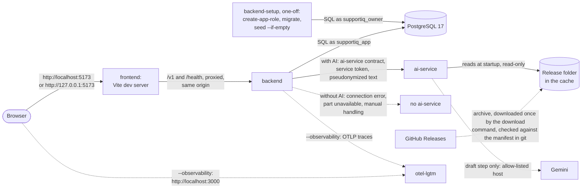

# Design: Local run of the whole system

- **Status:** Approved
- **Owner:** project lead
- **Reviewers:** backend engineer, frontend engineer, ML engineer, RAG engineer
- **Last reviewed:** 2026-11-23
- **Related:** [WF-30](../rules/workflow.md#dependencies), [WF-32, WF-33](../rules/workflow.md#reproducibility), [ADR-0003](../decisions/0003-tech-stack.md), [ADR-0007](../decisions/0007-observability-stack.md), [ADR-0016](../decisions/0016-hosting-on-free-tiers.md), [ADR-0018](../decisions/0018-hosting-of-ai-service-on-modal.md), [ADR-0021](../decisions/0021-repository-layout-and-ai-ml-migration.md), [backend foundation design, Rollout](backend-foundation.md#rollout), [repository checks, Workflow convention](../guides/repository-checks.md#workflow-convention), [CON-19, CON-20](../rules/contracts.md#evolution), [release download design](release-download-and-modal-deploy.md), [#41](https://github.com/ml-system-design-nhom-5/SupportIQ/issues/41), [#4](https://github.com/ml-system-design-nhom-5/SupportIQ/issues/4)

## Summary

Today each part of SupportIQ runs on its own, and no command starts the whole system, so WF-32 and WF-33 are not met. This design adds one command, `deploy/local/local-run.sh start`, which starts PostgreSQL 17, `backend` with the simulated demo data, `frontend`, `ai-service` with the newest published release unless `--without-ai` is given, and optionally the local Grafana stack. By default it runs Docker Compose, so a tester installs only Docker; `--native` runs each part natively on Linux, macOS, or WSL2 for developers, with the same ports, settings, and demo data. Windows users use WSL2. Before it downloads or creates anything, the command prints its plan and asks one question, which `--yes` answers; a start that only starts what already exists asks nothing. It replaces `scripts/start-app.ps1` of `main`, which ran natively on Windows only and which the join deleted ([ADR-0021, Target layout](../decisions/0021-repository-layout-and-ai-ml-migration.md#target-layout)). The project lead decided the two ways and the two modes on 2026-11-18, and decided the points of the first review the same day; this document records those decisions. **Amendment of 2026-11-18:** after the approval, the project lead amended these points the same day: `backend` allows both loopback origins of the page; the question comes only when a start downloads or creates something, or when the host port of PostgreSQL changed; `LOCAL_DB_PORT` can change that port, which `.local-run/db-port` records; and, after a second review, the script refuses to run as root, an interrupted start stops the parts that it launched, `logs` follows the logs of the parts, and the native way stops each part through its process group, with `SIGKILL` only after a deadline and never for PostgreSQL. After the review of the implementation, the project lead turned off the anonymous access of Grafana and made `local-run-compose` a required check.

**Revision of 2026-11-22.** Rollout step 2, the Compose way without AI and with `--with-ai <release folder>`, is implemented; the native way and the smoke test with AI are not. The project lead decided on 2026-11-22 that a start runs the whole system, AI included, with moderate defaults, so that anyone can try it with one command. This revision changes four points and keeps the rest:

1. **AI by default.** `start` runs `ai-service`; `--without-ai` turns it off. This replaces the default without AI of 2026-11-18.
2. **The release is downloaded.** `start` uses the newest published release, or the one that `--release <id>` names, and downloads it once into a cache outside the repository with the shared download command of [#41](https://github.com/ml-system-design-nhom-5/SupportIQ/issues/41). `--release-folder <folder>` replaces `--with-ai <release folder>` for a folder on the machine. This replaces the non-goal "Downloading a release".
3. **The Gemini key is asked once.** Without a key, a start in a terminal shows where to get a free key, which the exception of SEC-07 allows for the local run only, and asks for it with hidden input, or runs without AI on an empty answer; the key is saved in `.local-run/gemini.env` once the start is confirmed, and `set-key` replaces it. The two LLM prices come from a shared price file, not from the user's environment.
4. **The native way on macOS runs without AI** and says why, instead of stopping.

With it, SEC-07 gets one exception: the local run alone may use a key of the free plan of the Gemini API, and every deployment uses a paid plan, as the project lead decided on 2026-11-23 ([Changes to approved documents](#changes-to-approved-documents)). The code of `ai-service` and the contracts do not change. Every replaced decision is kept under [Alternatives considered](#alternatives-considered).

**Amendment of 2026-11-23:** after the review of the implementation of rollout step 4a, the project lead approved four points the same day:

1. The container of the download command mounts only the paths of the repository that the command reads, `RELEASE_TOOL_PATHS` of the script, read-only, with an empty tmpfs over `.local-run/`. It runs packages of PyPI with network access, so it never sees the Gemini key, the generated secrets, or a `.env` file ([Release](#release)).
2. Two new rows of [Errors and guardrails](#errors-and-guardrails): a path that the download command reads is missing, and no SHA-256 tool works. Each stops `start` before the question.
3. Options that contradict each other are wrong usage, with status 2: `--without-ai` with `--release` or `--release-folder`, and `--release` with `--release-folder`. The order of [Release](#release) applies when one source is given.
4. `gemini.env` holds the key in single quotes, so Compose reads a `$` of the key as it is, and a key that holds a single quote is refused before anything is saved, because the file cannot hold it; no key of AI Studio holds one ([Ports and settings](#ports-and-settings)).

The same review made the implementation record the SHA-256 of the dependency files of an image from before its build ([Flow](#flow), step 3), and build the test keys from the seed of the run ([Testing and evaluation](#testing-and-evaluation)).

**Amendment of 2026-11-23, rollout step 4b:** before the job `local-run-compose-ai` was written, the project lead decided two points the same day, because the job as first designed broke two rules of the [workflow convention](../guides/repository-checks.md#workflow-convention):

1. The job runs in every run of `local-run.yml`, without the path filter that rule 3 forbids. The release cache, kept between runs under a key made of the release ID, keeps the download to one per release, and the job is not a required check.
2. It downloads without a token, because rule 13 lets only `deploy.yml` read a secret, and GitHub counts the token of a workflow as one. A `403` or `429` of GitHub ends the start with status 5 of the download command, and the job is run again by hand (rule 10).

## Goals and non-goals

### Goals

- One command starts the whole system from a fresh clone, and one command stops it (WF-32, WF-33).
- Docker Compose by default, and a native way with `--native`, both with the same ports, settings, and demo data.
- At most one confirmation per start: when the start downloads or creates something, the plan of every project-local action, then one question. The only other input is the Gemini key, asked once when no key is known.
- Two modes: with AI, the default, from the newest published release or the one that the user names; and without AI, with `--without-ai`, where suggestions go to manual handling.
- A release is downloaded once, checked against its manifest in git, and kept in a cache outside the repository, so a later start needs no network for it.
- The local Grafana stack of [ADR-0007](../decisions/0007-observability-stack.md), statement 4, as the opt-in Compose profile `observability`.
- No secret in the repository, and every published port bound to `127.0.0.1` only.
- The script never installs system software and never runs `sudo`.
- CI smoke tests start each way, check its health, and stop it.

### Non-goals

- Writing the release download. `local-run.sh` calls the shared download command of [#41](https://github.com/ml-system-design-nhom-5/SupportIQ/issues/41) and does not check, unpack, or choose a release by itself ([Release](#release)).
- Any change to the code of `ai-service` or to the contracts ([Background](#background)). A setting that turns the LLM off waits for the first release that serves KB documents ([Open questions](#open-questions)).
- A production image of `frontend` ([#4](https://github.com/ml-system-design-nhom-5/SupportIQ/issues/4)) and any change to the demo deployment of [ADR-0016](../decisions/0016-hosting-on-free-tiers.md).
- Measuring the memory or start time of the whole stack. The deviation of ADR-0016 from ASM-06 and CST-07 stands ([Changes to approved documents](#changes-to-approved-documents)). One measurement of the peak memory of the Compose way with AI sets the minimum that `start` checks; it is no claim about ASM-06 or CST-07.
- Hot reload of code inside containers, and native Windows without WSL2.
- Any change to AI behavior, routing, prompts, or the release check of `ai-service`.

## Background

- [ADR-0003](../decisions/0003-tech-stack.md) names Docker Compose as the local runtime: "one command starts the whole system". Rollout step 2 added the Compose file, `deploy/local/compose.yaml`.
- On 2026-11-05 the project lead left Docker Compose out of the scaffold until ADR-0011 or the hosting ADR was accepted ([backend foundation design, Rollout](backend-foundation.md#rollout), item 4). ADR-0016 was accepted on 2026-11-12.
- `backend/Dockerfile` and `ai-service/Dockerfile` exist, pin their base images by digest, run as non-root users, hold no secret (SEC-29), and start their servers on `0.0.0.0:8000`. CI builds both. `frontend` has no Dockerfile ([#4](https://github.com/ml-system-design-nhom-5/SupportIQ/issues/4)).
- [`eval/release/gate/`](../../eval/release/gate/run-gate.sh) already runs Compose from a bash script with `set -euo pipefail`, requires Compose v2 and BuildKit, runs containers as the user who runs the script, and pins PostgreSQL 17.11 by the digest of the CI job `backend-tests` ([release command README, Run in Docker](../../eval/release/README.md#run-in-docker)). This design follows that pattern (CODE-52).
- The Vite dev server of `frontend` proxies `/v1` and `/health` to `SUPPORTIQ_BACKEND_URL`, so the session cookie stays on the page's origin ([frontend README, Settings](../../frontend/README.md#settings)). `pnpm run dev:mock` uses POSIX process groups (`process.kill(-pid)` in `frontend/scripts/dev-with-mock.ts`), so it does not run on native Windows.
- The readiness check of `backend` checks only the database. When `ai-service` cannot be reached, a suggestion part ends `unavailable` with `ai_service_unavailable`, and staff handle the ticket manually ([backend ticket workflow design](backend-ticket-workflow.md#the-ai-service-client)).
- `backend seed` fails on a seeded database and changes nothing ([backend README, Commands](../../backend/README.md#commands)), so a second start cannot run it again.
- `backend` exports traces over OTLP when `TRACE_EXPORTER` is `otlp`, to the required `OTLP_TRACES_ENDPOINT`, within `OTLP_EXPORT_TIMEOUT_MS`. It exports no logs or metrics yet, and `ai-service` sends no span out of its process ([backend README, Known limits](../../backend/README.md#known-limits); [ai-service README, Events](../../ai-service/README.md#events)).
- `ai-service serve` does not start without a verified release on the machine, and it needs torch, which `ai-service/uv.lock` locks for Linux only, with wheels for `x86_64` and `aarch64` ([ADR-0021, Python and dependencies](../decisions/0021-repository-layout-and-ai-ml-migration.md#python-and-dependencies), statement 2). The first release, `release-2026-11-18-02`, serves no KB document, so no request gets a draft and no LLM call happens ([ai-service README, Known limits](../../ai-service/README.md#known-limits)).
- `ai-service` requires `GEMINI_API_KEY` and the two `LLM_*_PRICE_MICRO_USD_PER_MILLION_TOKENS` settings at startup, without defaults ([`settings.py`](../../ai-service/app/platform/settings.py)). The code of `ai-service` stays as it is: the offline evaluation gate passed on the code of commit `86f73df` ([`gate-run.json`](../../eval/releases/release-2026-11-18-02/gate-run.json)), and a change would need a new gate run on a new release ID ([ARCH-40](../rules/architecture.md#versioned-assets)). After the package rename of `6a73d14`, the gate ran again on `9dcc06a` for `release-2026-11-21-01`, with the assets of `release-2026-11-18-02`, and passed; that release is not published ([`gate-run.json`](../../eval/releases/release-2026-11-21-01/gate-run.json)).
- `ai-service` checks only that `GEMINI_API_KEY` is not empty, and sends it only in the header of an LLM call ([`settings.py`](../../ai-service/app/platform/settings.py); [`gemini.py`](../../ai-service/app/drafting/adapters/gemini.py)). Gemini answers a wrong key with an error status, which ends the draft as `llm_unavailable`. `ai-service/.env.example` holds the placeholder `replace-with-a-gemini-api-key`.
- The reason code `llm_unavailable` means that the LLM timed out, failed, or was rate-limited, that a call to a host outside the egress allow-list was refused, or that the circuit breaker is open ([`AiReasonCode.yaml`](../../contracts/schemas/AiReasonCode.yaml)). Giving it another meaning is a breaking change (CON-20); a new reason code is a compatible one (CON-19).
- The organization repository is public, so the assets of its GitHub Releases download without a token (checked on 2026-11-22). A published release is one whose `eval/releases/<release_id>/release-manifest.json` is in git ([release command README, Publish](../../eval/release/README.md#publish)). Only `release-2026-11-18-02` is published.
- [#41](https://github.com/ml-system-design-nhom-5/SupportIQ/issues/41) adds one download command for both the Modal deploy and the local run, as a subcommand of `supportiq-release` in `eval/release`. Its design is written in parallel with this revision, and this design depends on the interface listed in [Release](#release).
- Neither `backend` nor `ai-service` reads a `.env` file by itself: only `uv run --env-file` loads one.

## Design

### Components and responsibilities

The files of the local run live in `deploy/local/`, because deployment configuration lives in `deploy/` ([ARCH-42](../rules/architecture.md#component-boundaries)) and the tree after the join has no root `scripts/` ([ADR-0021, Target layout](../decisions/0021-repository-layout-and-ai-ml-migration.md#target-layout)). No component reads them at runtime; each receives values through its settings.

| Path | Holds |
|---|---|
| `deploy/local/local-run.sh` | The one command: `start`, `stop`, `status`, `logs [part]`, `releases`, and `set-key`. Compose by default; `--native`, `--without-ai`, `--release <id>`, `--release-folder <folder>`, `--observability`, and `--yes` |
| `deploy/local/compose.yaml` | The Compose project `supportiq-local`: PostgreSQL 17, the one-off `backend-setup`, `backend`, `frontend`, `ai-service` in the profile `ai`, and `otel-lgtm` in the profile `observability` |
| `deploy/local/local-run.env` | The non-secret values that both ways share: the ports, the allowed origin, and the build version. Committed |
| `deploy/local/frontend.Dockerfile` and its `.dockerignore` | The local image of `frontend`: Node.js of `.nvmrc`, pinned by digest, pnpm of `packageManager`, `pnpm install --frozen-lockfile`, the dependencies pre-bundled with `vite optimize`, so the first request after a start does not wait for the bundling, and the Vite dev server, as the user `node`. The build context is an allow-list, so it holds no `.env` file, no `node_modules/`, and no build output. It is not the production image of ARCH-10, so [#4](https://github.com/ml-system-design-nhom-5/SupportIQ/issues/4) stays open |
| `deploy/local/postgres-init.sh` | Creates the role `supportiq_owner` (`LOGIN CREATEDB CREATEROLE`, not a superuser) and the database `supportiq`, as in step 3 of the [backend README](../../backend/README.md#set-up), with the generated owner password |
| `deploy/local/tests/` | The script tests, in bash, with stub tools on `PATH` |
| `.local-run/`, git-ignored | Everything the script writes: `secrets.env`, `gemini.env` with the saved Gemini key, and for the native way the PostgreSQL data folder, the logs, the PID files, and a lock |
| The release cache, `$HOME/.cache/supportiq/releases/<release_id>/` by default, or `SUPPORTIQ_RELEASE_CACHE` | The checked release folders. Only `supportiq-release download-release` of #41 writes them, through hidden staging entries in the same folder; the local run reads them and mounts one read-only. It lies under the home folder, because Colima shares only the home folder with its virtual machine |
| `deploy/llm-prices.env`, the price file of #41 | `GEMINI_MODEL` and its two LLM prices, with the source and the date they were read, as an env file that bash and `docker compose --env-file` read. The Modal deploy and the local run read the same file ([release download design, The price file](release-download-and-modal-deploy.md#the-price-file)) |
| `eval/releases/pinned-release.txt`, the pinned file of #41 | Two lines, `release_id=<id>` and `archive_size_bytes=<decimal>`, written only by `supportiq-release pack-release --pin` ([release download design, The pinned file](release-download-and-modal-deploy.md#the-pinned-file)) |
| `backend` | One new option, `backend seed --if-empty` ([Data and contracts](#data-and-contracts)) |
| `.pre-commit-config.yaml` | The shellcheck hook for `deploy/local/` and `eval/release/gate/`, and the `apt-get install` pattern of `workflow-frozen-installs` |
| `.github/workflows/local-run.yml` | The smoke tests of the new area `local-run` ([Testing and evaluation](#testing-and-evaluation)) |
| `docs/guides/local-run.md` | The guide: requirements, the commands, the demo accounts, Grafana and whether its image allows anonymous access, how to remove the local data, and, in "Move data between the ways", the `pg_dump` and `pg_restore` commands that the user runs. On Windows, it says to run `local-run.sh` inside WSL2, with the WSL integration of Docker Desktop turned on for the Compose way |

### Ports and settings

Both ways publish the same ports, on `127.0.0.1` only. Only one way runs at a time. In Compose, `frontend`, `backend`, `ai-service`, and Grafana listen on `0.0.0.0` inside their containers, because a published port reaches a container through its own network interface; only the published host ports are bound to `127.0.0.1`. In the native way, every part binds `127.0.0.1` explicitly, the dev server too, so a `localhost` that resolves to `::1` never matters.

| Part | Host port | In Compose | Native |
|---|---|---|---|
| `frontend` | 5173 | The dev server on `0.0.0.0:5173` in its container, published on `127.0.0.1:5173` | `pnpm run dev --host 127.0.0.1 --port 5173 --strictPort` |
| `backend` | 8000 | `0.0.0.0:8000` of the image, published on `127.0.0.1:8000` | `backend serve --host 127.0.0.1 --port 8000` |
| `ai-service`, with AI only | 8001 | `0.0.0.0:8000` of the image, published on `127.0.0.1:8001` | `ai-service serve --host 127.0.0.1 --port 8001` |
| PostgreSQL 17 | 5434, or `LOCAL_DB_PORT` | Port 5432 of the container, published on `127.0.0.1` at the host port | Its own cluster in `.local-run/postgres/`, on `127.0.0.1` at the host port |
| Grafana, with `--observability` only | 3000 | Port 3000 of `otel-lgtm`, published on `127.0.0.1:3000`. Its OTLP ports are not published | Not available: the profile needs Compose |

The host port of PostgreSQL is 5434 by default, which leaves 5432 and the port 5433 of the backend README to a teammate's own PostgreSQL ([Alternatives considered](#alternatives-considered)). `LOCAL_DB_PORT` in the user's environment changes it; `start` stops before it asks anything when the value is not a port number from 1 to 65535 or when the port is taken. Inside Compose, PostgreSQL stays on 5432. The last message of `start` prints the connection details without the password: host `127.0.0.1`, the port, the database `supportiq`, and the user `supportiq_owner`, and it names `.local-run/secrets.env` for the password. Publishing the port lets a teammate run `uv run pytest` of `backend` against the local database, with the two URLs built from `.local-run/secrets.env`.

The local run sets only the settings that differ from each component's defaults. Every other setting keeps the default of its settings class.

| Component | Setting | Value |
|---|---|---|
| `backend` | `DATABASE_URL_APP` | `supportiq_app` with the generated app password, on `postgres:5432` in Compose and `127.0.0.1` at the host port natively |
| `backend`, setup steps only | `DATABASE_URL_OWNER`, `SEED_PASSWORD_*` | The generated owner and seed passwords. `backend serve` never receives them ([ADR-0016, `backend` on Render](../decisions/0016-hosting-on-free-tiers.md#backend-on-render), item 3) |
| `backend` | `DATABASE_TLS` | `disable`: the database runs on the same host ([SEC-28](../rules/security-and-privacy.md#transport-and-runtime), local development) |
| `backend` | `SESSION_COOKIE_SECURE` | `false`, because the browser uses plain HTTP on `localhost` (ARCH-37, as `backend/.env.example`) |
| `backend` | `ALLOWED_ORIGINS` | `["http://localhost:5173", "http://127.0.0.1:5173"]`: both loopback origins of the page. The proxy keeps the browser's `Origin`, so a teammate who opens either one signs in and keeps the session |
| `backend` | `AI_SERVICE_BASE_URL` | `http://ai-service:8000` in Compose and `http://127.0.0.1:8001` natively, in both modes |
| `backend` | `AI_SERVICE_TOKEN` | The generated service token |
| `backend` | `BACKEND_BUILD_VERSION` | `local`, as `backend/.env.example` |
| `backend` | `TRACE_EXPORTER`, `OTLP_TRACES_ENDPOINT` | `none` by default. With `--observability`: `otlp` and `http://otel-lgtm:4318/v1/traces` |
| `ai-service` | `SERVICE_TOKEN` | The same generated service token |
| `ai-service` | `RELEASE_MANIFEST_PATH` | `release-manifest.json` in the release folder: the cached release, or the folder of `--release-folder`, mounted read-only at `/srv/release` in Compose ([Release](#release)) |
| `ai-service` | `GEMINI_API_KEY` | From the user's environment when it is set and is not a placeholder; otherwise the key saved in `.local-run/gemini.env` ([Gemini key](#gemini-key)) |
| `ai-service` | `LLM_INPUT_PRICE_MICRO_USD_PER_MILLION_TOKENS`, `LLM_OUTPUT_PRICE_MICRO_USD_PER_MILLION_TOKENS` | From `deploy/llm-prices.env` |
| `ai-service` | `GEMINI_MODEL` | From `deploy/llm-prices.env`, so the model and its prices change together. `LOCAL_GEMINI_MODEL` leaves `deploy/local/local-run.env` |
| `frontend` | `SUPPORTIQ_BACKEND_URL` | `http://backend:8000` in Compose and `http://127.0.0.1:8000` natively. The dev server keeps dev mode available ([UI-35](../rules/ui.md#developer-views)) |

On the first start, the script writes `.local-run/secrets.env` with mode `0600`, before Compose reads any value. Each value is 32 random bytes from `/dev/urandom`, written as 64 hexadecimal characters, so it is safe inside a URL. A value already in the file is never changed; a value that a later option needs first, such as the Grafana password, is added to the file then. Its values are never printed.

| Name | Used by |
|---|---|
| `LOCAL_DB_SUPERUSER_PASSWORD` | The `postgres` superuser of the local database |
| `LOCAL_DB_OWNER_PASSWORD` | `supportiq_owner`, for `create-app-role`, `migrate`, and `seed` |
| `LOCAL_DB_APP_PASSWORD` | `supportiq_app`, for `backend serve` |
| `LOCAL_SERVICE_TOKEN` | `AI_SERVICE_TOKEN` of `backend` and `SERVICE_TOKEN` of `ai-service` |
| `SEED_PASSWORD_CUSTOMER`, `SEED_PASSWORD_STAFF`, `SEED_PASSWORD_MANAGER`, `SEED_PASSWORD_ADMIN` | The demo accounts of the [backend README](../../backend/README.md#demo-accounts). The last message of `start` names this file and the login names |
| `LOCAL_GRAFANA_ADMIN_PASSWORD` | Grafana of `otel-lgtm`, with `--observability` only, when the user's environment does not set it ([Observability profile](#observability-profile)) |

The Gemini key has a file of its own, `.local-run/gemini.env`, mode `0600`, which holds only `GEMINI_API_KEY`, in single quotes, so Compose reads a `$` of the key as it is; a key that holds a single quote is refused before anything is saved. It is never generated: the key prompt or `set-key` writes the key that the user enters ([Gemini key](#gemini-key)). It is separate from `secrets.env` because the generated values never change while the key can, and because `set-key` on a fresh clone must not create a `secrets.env` without the generated values, which `start` would then refuse. Compose reads it with one more `--env-file` when it exists, and only the environment of `ai-service` in `compose.yaml` names `GEMINI_API_KEY`.

Every write of `secrets.env` or `gemini.env` runs with `umask 077`, writes a temporary file in `.local-run/`, and renames it over the file, so an interrupted write leaves the old file whole.

### Two modes

- **With AI**, the default. `ai-service` runs with one release folder ([Release](#release)) and a Gemini key ([Gemini key](#gemini-key)). `ai-service` checks the folder at startup with `verify_release` and stops on any mismatch ([ai-service README, Release manifest](../../ai-service/README.md#release-manifest)). With the first release, every request abstains or is escalated, without an LLM call, so the start shows analyses and routing recommendations but no draft, as the guide says. Natively, this mode runs only on Linux and WSL2, because torch is locked for Linux only. On macOS, `start --native` runs without AI and prints one line that names the reason and says that the Compose way runs AI on macOS.
- **Without AI**: `start --without-ai`, or an empty answer to the key prompt. No `ai-service` runs. The call of `backend` fails with a connection error, so each suggestion part ends `unavailable` with `ai_service_unavailable`, and staff handle the ticket manually. Tickets keep the handling mode `assisted`, because `manual` is the mode of the product-value study, not a sign that the AI is off ([glossary, Manual handling](../glossary.md#terms)).

#### Release

`start` picks one release folder, in this order:

1. `--release-folder <folder>`: a folder on the machine, such as the output of `publish-candidate`. It is used as it is, without the cache and without a download.
2. `--release <id>`: a published release. `start` first checks the ID against the pattern of `release_id` in the contracts, `^[A-Za-z0-9][A-Za-z0-9._-]{0,63}$` ([`AssetVersions.yaml`](../../contracts/schemas/AssetVersions.yaml)), so no `/` reaches a path, and then accepts it when `eval/releases/<id>/release-manifest.json` exists in the working tree.
3. Otherwise, the newest published release, which `eval/releases/pinned-release.txt` names. The pinned file is plain text with exactly two lines, `release_id=<id>` and `archive_size_bytes=<decimal>`, so bash reads it without a JSON parser; any other line, a comment, or CRLF stops the start. The packaging command of #41 writes the size, and the archive is uploaded before the pinned file is pushed, so the default follows each publish after a `git pull`. `start` checks the pinned ID against the same pattern, and checks that `eval/releases/<id>/release-manifest.json` exists, so a pinned file out of step with git stops the start on the machine, naming both files, before the CI check of #41 would find it. GitHub's `latest` release is never used: it names an old model today, and a GitHub Release can exist for a release that never passed the gate (DATA-57).

Before the question, `start` decides only in bash: the release ID; whether `<cache>/<release_id>/` exists; and the size for the plan, from the pinned file for the default release and unknown for another one. It runs no download command before the question, because on a fresh machine the command itself is not installed yet: its image and its first install are downloads that the question must cover first. A folder in the cache is a checked one as long as nobody edits it or copies a folder there by hand, because the download command creates it only by renaming a temporary folder after the full check. A folder copied by hand skips the byte comparison of its manifest with the one in git, and `verify_release` checks its files only against the folder's own manifest. So the guide says never to copy a folder into the cache, and to use `--release-folder <folder>` for a release folder that is already on the machine. `verify_release` in `ai-service` checks it again at every startup; when it refuses a cached release, `start` names `<cache>/<release_id>/` and says that removing that folder makes the next start download the release again.

`local-run.sh releases` lists the published releases from `eval/releases/*/release-manifest.json`, marks the default one from the pinned file, and marks the ones whose folder is in the cache. It runs in bash, downloads nothing, changes nothing, and needs no network.

`local-run.sh` never reads JSON, unpacks an archive, or checks a checksum by itself: bash 3.2 on macOS has no JSON parser, and the checks of `verify_release` live in Python (CODE-52). After the answer `y`, it runs `supportiq-release download-release [--release <id>] --yes` of #41, which the [release download design](release-download-and-modal-deploy.md#download) specifies and which does the full check. It always passes `--yes`, because the question belongs to `start`. Its exit statuses map to these messages: 5 is a network failure, with "try again, or use `--without-ai`"; 6 is a failed check, naming the cache folder; 2 is an input that cannot be used, with the reason that the command printed. A status 4 cannot happen with `--yes`, so `start` reports it as a bug. The `releases` listing and the cache test skip the hidden staging entries, whose names start with `.`, and match only `<cache>/<release_id>` exactly. The local run needs these properties of it:

| Need | Why |
|---|---|
| The pinned file as plain text with the release ID and the size of the archive | `start` builds its plan in bash, before anything is installed |
| After a download or a cache hit, only the path of the release folder on standard output; every message on standard error | `start` passes the path to `ai-service` |
| No question without a terminal; distinct exit statuses for done, refused, network failure, and a failed check, following the exit statuses of `eval/release` | `start` names the cause, and never waits for an answer that cannot come |
| A cache folder that `SUPPORTIQ_RELEASE_CACHE` can change, `$HOME/.cache/supportiq/releases` otherwise, without `XDG_CACHE_HOME` | CI, and a home folder with little space; bash computes the same default path. The value must be an absolute path: `start` stops before the question on a relative path or on a `~` that the shell did not expand, because `-v "<cache>:<cache>"` needs an absolute path. To compare it with `$HOME`, `start` resolves both with `pwd -P` on the nearest folder that exists, so symbolic links and a trailing `/` do not change the result. In Compose on macOS, `start` stops before the question when the cache path is outside `$HOME`, and names the cache variable and the reason: Colima shares only the home folder with its virtual machine by default, and a bind mount of a path that is not shared silently creates an empty folder inside the virtual machine, so the release would land on the disk of the virtual machine, not on the host |
| In a container: the user's UID and GID; only the paths of the repository that the command reads, each mounted read-only at its path on the host: `.python-version`, `pyproject.toml`, `uv.lock`, `README.md`, and `src` of `eval/release`, `eval/releases`, and `pyproject.toml`, `README.md`, and `app` of `ai-service`; an empty tmpfs over `.local-run/`; the cache mounted writable at the same absolute path as on the host; and the temporary folder on the same file system as the cache, so the final rename is atomic | The container runs packages of PyPI with network access, so it never sees the Gemini key, the generated secrets, or a `.env` file of a teammate; a missing path would become a folder owned by root, so `start` stops before the question when one is missing; a cache owned by root would refuse the next write on Linux; the printed path must be valid on the host, because `ai-service` mounts it from there; Colima shares only the home folder |
| `SUPPORTIQ_RELEASE_TOKEN` from the environment when set, never printed, never sent to another host after a redirect | Anonymous downloads have a rate limit per IP address |

In Compose, `start` runs the download command in a container of the uv image, pinned by digest, so a tester still installs only Docker. Natively, it runs `uv run --locked --project eval/release`, because the native way already needs uv. Both run the same command at the same uv and Python versions, which the design of #41 pins.

The container needs four things that the host run does not:

- **The same cache path.** The cache folder is mounted with `-v "<cache>:<cache>"`, where `<cache>` is the absolute path on the host, and the cache variable holds that host path. Inside the container `HOME` points into the volume of uv, so the default of the command would name a folder there; `start` therefore always passes `SUPPORTIQ_RELEASE_CACHE` with the host path to the container, also when the user did not set it. The path that the command prints is then valid on the host. A script test checks that the printed path exists on the host, and another, with a stub `docker`, checks that the container receives `SUPPORTIQ_RELEASE_CACHE` with the host path when the user's environment does not set it.
- **A writable environment for uv.** The paths of the repository are mounted read-only, so the virtual environment of `eval/release` cannot live in `eval/release/.venv`, and the home folder of a UID without an account inside the image is not writable. `UV_PROJECT_ENVIRONMENT`, `UV_CACHE_DIR`, and `UV_PYTHON_INSTALL_DIR` point into the named volume `supportiq-local_release-tool`, `HOME` points to a writable folder in it, and the command runs with `--locked`. The image is uv 0.11.11, pinned by digest, with the Python of `.python-version` when such an image exists, so that no Python is downloaded; otherwise uv installs that Python into the volume, as part of the first install.
- **A first install in the plan.** The first run installs the packages of `eval/release`, `ai-service` included without torch, into that volume. It is a download, so the plan of step 3 names it, and the question covers it. Natively, `uv sync --locked` in `eval/release/` is planned in the same way when `uv sync --locked --check` reports a difference.
- **Settings by name only.** `SUPPORTIQ_RELEASE_TOKEN` reaches the container as `-e SUPPORTIQ_RELEASE_TOKEN`, without a value on the command line, so `ps` never shows it. The script never runs with `set -x`.

#### Gemini key

`start` with AI resolves the key in this order:

1. `GEMINI_API_KEY` in the user's environment, when it is not empty and is not a placeholder (`replace-with-a-gemini-api-key` of `ai-service/.env.example`, or `YOUR_GEMINI_API_KEY`).
2. `GEMINI_API_KEY` in `.local-run/gemini.env`, saved by an earlier start or by `set-key`.
3. With a terminal and without `--yes`: the key prompt. It prints the address where a free key is created, Google AI Studio, and one line of the warning of the guide: under the free plan, Google may use and read the requests, so only simulated data may be entered ([SEC-07](../rules/security-and-privacy.md#data-sent-to-llm-providers)). Then it reads the key with `read -s`, so it is never shown, never echoed, and never part of a command line. An empty answer runs this start without AI and saves nothing. A key stays in the memory of the script until the start is confirmed. Saving it creates `gemini.env`, so a question is always due after the prompt got a key ([Flow](#flow), step 3); the key is written to `gemini.env` only after the answer `y`. After `N`, nothing is saved.
4. Without a terminal, or with `--yes`: `start` stops before the question and prints the address, `set-key`, and `--without-ai`.

The script checks the form of a key from any of the three sources and warns, once per start, in two cases: the key holds a space, a quote, or a line break, which is a paste mistake; or it does not match `^AIza[0-9A-Za-z_-]{35}$`, with the message "the key does not look like an AI Studio key; ignore this if you are sure". The warning never shows the key or a part of it, and the start goes on. The form is checked because with `release-2026-11-18-02` no LLM call happens, so a wrong key gives no other early sign; the warning is only a warning, so a valid key of another format still works. A wrong key is the user's setting: `ai-service` starts, analyses work, and a draft step ends `llm_unavailable`, as for any failed LLM call. The script never passes a key of its own.

`local-run.sh set-key` asks for the key in the same way and replaces the saved one at once, creating `.local-run/` when it is missing, because the command itself is the user's request. It needs a terminal, and an empty answer keeps the saved key. Removing `gemini.env` forgets the key, and the guide says so. A running `ai-service` keeps its key until the next `start`, and `set-key` says so.

### Observability profile

`start --observability` adds the Compose profile `observability`, which runs one `grafana/otel-lgtm` container, as [ADR-0007](../decisions/0007-observability-stack.md), statement 4, decides for local development.

- The image is `grafana/otel-lgtm:0.41.0`, pinned by its index digest `sha256:2e3290657f2f2a256c7a9175f097424a3ac5b54840741ace433e108e109348b6`, which holds `linux/amd64` and `linux/arm64` (Docker Hub, read on 2026-11-18).
- `backend` exports its traces to `http://otel-lgtm:4318/v1/traces` and starts after `otel-lgtm` is healthy: the check of the image, and `GET /api/health` of Grafana, which the check of the image skips while Grafana does not listen yet. Only Grafana is published, on `127.0.0.1:3000`.
- The container runs as the user 10001 in group 0, which the image supports, with its data in tmpfs: `/data`, and `/var/tempo`, where Tempo 3.1.1 also writes. Nothing leaves the machine: Grafana sends no usage statistics, checks for no update, and installs no plugin at startup (`GF_ANALYTICS_REPORTING_ENABLED`, `GF_ANALYTICS_CHECK_FOR_UPDATES`, `GF_ANALYTICS_CHECK_FOR_PLUGIN_UPDATES`, `GF_PLUGINS_PREINSTALL_DISABLED`); by default, the image would install `grafana-llm-app` from grafana.com at every start.
- The admin password of Grafana is `LOCAL_GRAFANA_ADMIN_PASSWORD` from the user's environment when it is set, so a teammate can choose one; otherwise it is the value generated once into `secrets.env`, as the other secrets. The script passes it to `otel-lgtm` as `GF_SECURITY_ADMIN_PASSWORD` and never prints it. The project lead decided this on 2026-11-18. The image turns on anonymous access with the role Admin by default, as the implementation found in its `docker/run-grafana.sh`, so the project lead decided the same day to turn it off with `GF_AUTH_ANONYMOUS_ENABLED=false`: only the Grafana account `admin` signs in, which is not the demo account `admin-1`.
- Only what exists today is exported: the traces of `backend`. Its logs and metrics stay on standard output (#2), `ai-service` sends no span, and no dashboard file exists in the repository yet ([LOG-27](../rules/logging-and-observability.md#dashboards)), so traces are read in Grafana's Explore view.
- Without the profile, `TRACE_EXPORTER` stays `none` and no `otel-lgtm` container runs. The native way has no such profile, and `--native --observability` stops with that reason.

### Flow

```mermaid
flowchart TD
    Start["local-run.sh start<br/>[--native] [--without-ai] [--release id]<br/>[--release-folder folder]<br/>[--observability] [--yes]"] --> Lock{"Another start running,<br/>or the other way running?"}
    Lock -->|"yes"| Busy["Stop with status 1:<br/>name what runs; nothing changed"]
    Lock -->|"no"| Mac{"--native on macOS<br/>with AI?"}
    Mac -->|"yes"| NoAi["Print one line: without AI,<br/>and why"]
    Mac -->|"no"| Pre
    NoAi --> Pre{"Tools present at their versions, LOCAL_DB_PORT valid,<br/>ports free; with AI: release resolved from the pinned file<br/>or eval/releases, cache inside HOME on macOS,<br/>prices in the price file?"}
    Pre -->|"no"| Missing["Stop with status 1: name each gap<br/>and print its install command or setting;<br/>nothing changed"]
    Pre -->|"yes, with AI"| Key{"Key in the environment<br/>or in gemini.env?"}
    Pre -->|"yes, without AI"| Due
    Key -->|"yes"| Due
    Key -->|"no, no terminal or --yes"| NoKey["Stop with status 1: print where to get a key,<br/>set-key, and --without-ai; nothing changed"]
    Key -->|"no, terminal"| Prompt{"Key prompt,<br/>hidden input"}
    Prompt -->|"empty"| WithoutAi["This start runs without AI:<br/>no release, no download command"]
    Prompt -->|"a key"| Keep["Warn on a space, quote, or line break;<br/>keep the key in memory;<br/>saved only after y"]
    WithoutAi --> Due
    Keep --> Due{"Downloads or creates something,<br/>the release and gemini.env included,<br/>or another port than the recorded one?"}
    Due -->|"no"| Line["Print one line: what it starts"]
    Due -->|"yes"| Plan["Print the plan: every project-local action,<br/>the PostgreSQL port and its source,<br/>and a warning for a changed port"]
    Plan --> Ask{"Proceed? [y/N],<br/>or --yes"}
    Ask -->|"N, no answer, or no terminal"| Declined["Stop with status 1; nothing changed"]
    Ask -->|"y or --yes"| Prep["Create .local-run/, secrets.env, and gemini.env if missing;<br/>build or pull images, or uv sync and pnpm install"]
    Line --> Prep
    Prep -->|"fails"| PartFail["Stop with status 1: name the step<br/>and its log; parts already started<br/>run until stop"]
    Prep --> Mode{"AI or<br/>--observability?"}
    Mode -->|"AI"| Fetch{"Release in the cache<br/>and checked?"}
    Fetch -->|"no"| Download["Download command of #41:<br/>download, unpack, check, rename"]
    Download -->|"network failure or failed check:<br/>temporary folder removed, cache unchanged"| PartFail
    Download --> Ai
    Fetch -->|"yes"| Ai["First, alone: ai-service with the release,<br/>otel-lgtm with --observability,<br/>each ready within its deadline"]
    Mode -->|"--observability only"| Ai
    Ai -->|"release.invalid, out of memory, or a part not ready:<br/>backend and frontend not started"| PartFail
    Mode -->|"neither"| Db
    Ai --> Db["PostgreSQL 17 ready with the owner role and database;<br/>record its port"]
    Db -->|"fails"| PartFail
    Db --> Setup["create-app-role, migrate,<br/>seed --if-empty, as supportiq_owner"]
    Setup -->|"fails"| PartFail
    Setup --> Be["backend, ready within its deadline"]
    Be -->|"not ready"| PartFail
    Be --> Fe["frontend, ready within its deadline"]
    Fe -->|"not ready"| PartFail
    Fe --> Done["Print the URL, Grafana with --observability,<br/>the PostgreSQL connection without the password,<br/>and the file of the passwords"]
```

1. Every command stops with status 1 before anything else when it runs as root (`EUID` 0), and says to run it as the normal user, so a `sudo` run never leaves `.local-run/` owned by root. `start` takes a lock in `.local-run/`. It stops when another start holds it, when the other way runs, or when the requested way already runs in another mode. When every part of the requested mode already runs, it prints the URL and exits 0, so `start` is idempotent; the message says that the parts keep the code of their last start, and that `stop`, then `start`, runs the changes of the working tree. Every command first clears the names that the script sets for Compose, such as the generated secrets, `COMPOSE_PROJECT_NAME`, and `COMPOSE_FILE`, because a value of the environment would win over `secrets.env` and `local-run.env` when Compose interpolates; only the documented settings of the user stay: `LOCAL_DB_PORT`, `LOCAL_GRAFANA_ADMIN_PASSWORD` when it is not empty, `GEMINI_API_KEY` when it is not empty and not a placeholder, `SUPPORTIQ_RELEASE_TOKEN`, and `SUPPORTIQ_RELEASE_CACHE`. `GEMINI_MODEL` and the two price settings are cleared, because they come from `deploy/llm-prices.env`. Every call of Compose names the project `supportiq-local`.
2. It checks every requirement before it changes anything: bash, and Docker Engine 25 or later, whose API is 1.44 or later, with Compose 2.20.2 or later and BuildKit, for Compose, because `compose.yaml` uses `depends_on.required`, which needs Compose 2.20.2, and `healthcheck.start_interval`, which needs Docker Engine 25; a message names both minimums and the versions found, and on Linux it points to the installation page of Docker, because the `docker.io` package of a distribution can be older; uv 0.11.11 or later, Node.js of `.nvmrc`, pnpm of `packageManager`, and PostgreSQL 17 binaries for `--native`; the ports; `LOCAL_DB_PORT`, when set, as a port number from 1 to 65535; with AI, that the release resolves in bash: the pinned file names one, `eval/releases/<id>/release-manifest.json` exists for `--release <id>`, or the folder of `--release-folder` exists, is readable, and holds `release-manifest.json`; in Compose on macOS, that the cache path lies inside `$HOME`; and that `deploy/llm-prices.env` holds `GEMINI_MODEL` and both prices. With AI in Compose, it reads the memory of the Docker engine with `docker info --format '{{.MemTotal}}'` and stops when it is below the named constant of the minimum, with the commands that raise it: `colima start --memory <GiB>` for Colima, and the resource settings of Docker Desktop. `ai-service` loads torch and two models, and the default virtual machine of Colima has 2 GiB. The constant is set from the peak memory of the Compose way with AI, measured once in the by-hand runs before the implementation PR is ready ([Testing and evaluation](#testing-and-evaluation)); no number exists yet. With AI and `--observability` in Compose, when `docker info --format '{{.NCPU}}'` reports 2 CPUs or fewer, it prints one line and goes on: the AI will be too slow, tickets will go to manual handling, the health check of `ai-service` can exceed its 5 s so that Compose marks it unhealthy and the start stops, and the user can raise the CPUs, drop `--observability`, or use `--without-ai`. The [local-run guide](../guides/local-run.md#with-the-local-grafana-stack) records the measurement behind it: on 2 CPUs and 4 GiB with both options, `ai-service` was healthy after 259 to 419 s, each analysis took about 94 s, every ticket went to manual handling, and the health check of `ai-service` took longer than its 5 s. The Gemini key comes after these checks ([Gemini key](#gemini-key)), so a user is never asked for a key by a start that would stop anyway. It reports every gap at once, with the command that the user runs, such as `brew install postgresql@17` or `corepack enable pnpm`, or the name of the missing setting. A taken port stops the start with the port and its setting; for PostgreSQL, the message suggests `LOCAL_DB_PORT`. The script never picks another port by itself.
3. A question is due when this start downloads or creates something. With AI, in both ways: the release, when `<cache>/<release_id>/` does not exist; the plan names its ID, its size from the pinned file or that the size is unknown, and the cache folder; and `gemini.env`, when the key prompt got a key. After an empty answer to the key prompt, this start runs without AI, and the plan holds no release, no image or install of the download command, and no `ai-service`. In Compose: `.local-run/` and `secrets.env` when missing, an image that is not present yet, which is built or pulled, the image of the download command and the first install into `supportiq-local_release-tool`, and the database volume when missing, which brings the first load of the demo data. Natively: `.local-run/` and `secrets.env` when missing, `uv sync --locked` in `backend/`, and, with AI, `uv sync --locked --group torch` in `ai-service/` and `uv sync --locked` in `eval/release/`, when `uv sync --locked --check` reports a difference, `pnpm install --frozen-lockfile` in `frontend/` when its packages differ from the lockfile, and the PostgreSQL folder with `initdb` when missing, which brings the first load of the demo data. A question is also due when the host port of PostgreSQL differs from the one that `.local-run/db-port` recorded when the database was created; the plan then warns that tools connected to the old port must change. When a question is due, `start` prints the plan: each project-local action of this start, the migrations included, and the PostgreSQL port with its source, the default 5434 or `LOCAL_DB_PORT`. When none is due, it prints one line that names what it starts, rebuilds the images from the cache, runs the pending migrations, and goes on without a question. A change of a file that an image installs its dependencies from makes that rebuild download every package of the image again, torch included: `pyproject.toml`, `uv.lock`, or `README.md` of `backend/` or `ai-service/`, which their Dockerfiles copy before `uv sync`, and `package.json`, `pnpm-lock.yaml`, or `pnpm-workspace.yaml` of `frontend/`, which its Dockerfile copies before `pnpm install`. So, when an image builds, the script records in `.local-run/` the SHA-256 that each of these files had before the build, once the build succeeded, and a later start compares them; a file that changed during the build makes the next start ask. When no SHA-256 tool works, `start` stops before the question, because a hidden failure would hide a change. When one differs, or when no record exists yet for an image that is present, the rebuild counts as a download: a question is due, and the plan names the image and the changed file. The script computes the SHA-256 with `shasum -a 256` on macOS and `sha256sum` on Linux, so it runs with bash 3.2. No Dockerfile changes.
4. When a question is due, it asks once: `Proceed? [y/N]`. Only `y` goes on. `N`, an empty answer, or a start without a terminal stops before any change. `--yes` answers this question; it answers nothing else. The key prompt is not a question that `--yes` can answer, so a start with `--yes` and without a key stops ([Gemini key](#gemini-key)). A start without a terminal and without `--yes` goes on when no question is due. A missing system tool always stops at step 2, before the question, so `--yes` never installs anything. The script never installs system software and never runs `sudo`.
5. PostgreSQL starts. In Compose, `postgres-init.sh` creates the owner role and the database on the first start of the volume. The start that creates the database, or that a changed port was confirmed for, writes the host port to `.local-run/db-port`. Natively, `initdb` writes into a temporary folder inside `.local-run/`, which is renamed when it succeeds, so a failed `initdb` leaves no half-made cluster.
6. The setup runs `backend create-app-role`, `backend migrate`, and `backend seed --if-empty` on every start: each is idempotent. In Compose it is the one-off service `backend-setup` of the `backend` image, which `backend` waits for with `service_completed_successfully`.
7. With AI, the download command first downloads the release when it is not in the cache, and prints the path of the folder; a failure stops the start with status 1, names the cause, and leaves the cache as it was. Then `ai-service` starts first, in an `up --wait` of its own, and so does `otel-lgtm` with `--observability`, so a release that fails its check, or a Grafana stack that does not get healthy, stops the start before `backend` and `frontend` run. A start of their own is needed because `backend` depends on them only optionally (`required: false`), as they belong to profiles, and Compose starts an optional dependent even when the dependency failed. They start before PostgreSQL and the setup, as `local-run.sh` does today in Compose, so a release that fails its check leaves only its own container. The native way keeps the same order, and the flow above shows it for both ways. In Compose, the `ai-service` container runs as the user who runs the script, as in the gate, so the bind mount reads like the user's own files.
8. `backend`, then `frontend`, start. Each step waits until one `GET /health/ready` answers within a deadline; for `frontend`, through its proxy, together with the entry module of the app, so a dev server that cannot transform the code is never healthy. Compose uses `docker compose up --wait`. The deadlines are named constants of the script, set from the first measured runs in CI; no value is measured yet.
9. `stop` ends whichever way runs: `docker compose down`, which removes the containers and keeps the volumes, or, natively, `SIGTERM` to the process group of each part and `pg_ctl stop -m fast`. macOS has no `setsid`, so the native way starts each part as its own process group with the job control of bash (`set -m` around `command &`, so the group ID equals the process ID), records the group ID in `.local-run/`, and stops it with `kill -TERM -- -<group ID>`; the children of `uv run` and `pnpm`, such as python and node, end with their wrapper, and no orphan keeps 5173, 8000, or 8001. After `SIGTERM`, it waits up to a named deadline that holds the graceful shutdown of `backend` ([ADR-0023](../decisions/0023-graceful-shutdown-of-suggestion-progress-streams.md)); only then does it send `SIGKILL` to the group, and it says so in one line. PostgreSQL never gets `SIGKILL`: `pg_ctl stop -m fast`, then `-m immediate` only when fast does not finish within its deadline; a stale `postmaster.pid` after a crash is left to `pg_ctl`. It deletes no data and asks nothing. With nothing running, it says so and exits 0. `status` prints each part, its way, and its readiness.
10. While `start` runs, it traps `INT` and `TERM`, and runs each docker command as a process group of its own, so the Ctrl+C of a terminal reaches only the script. Compose prints its progress as plain text, because with the progress of a terminal, Compose 5.0.0 in a process group of its own did not end within 60 s of an `INT` or a `TERM`. On Ctrl+C or a `TERM` signal, the script ends that group, the Compose plugin included, waits for it, and only then stops the parts that this start launched: in Compose, `docker compose down` for the project, which keeps the volume, or, when parts already ran before this start, only the others; natively, the process groups started in this run. It prints one line and exits with status 130. Parts that ran before this start stay as they were.
11. `logs [part]` follows the logs of every part or of one part: `docker compose logs --follow` in Compose, and `tail -f` of `.local-run/logs/<part>.log` natively. Ctrl+C there ends only the viewing, never a part. The guide recommends it for watching the logs.
12. `releases` prints each published release from `eval/releases/*/release-manifest.json`, the default one from the pinned file, and the ones whose folder is in the cache ([Release](#release)). It runs in bash, downloads and changes nothing, and needs no network.
13. `set-key` reads a new key with the key prompt and writes it to `gemini.env` as every write of that file does ([Ports and settings](#ports-and-settings)). It refuses to run without a terminal, because a key on a command line or in a pipe could end up in the shell history or the process list.

### Data and contracts

- No contract changes. A draft that fails on a wrong key ends `llm_unavailable` with the meaning that the contract already gives it ([Background](#background)).
- The demo data is the simulated seed of `backend`, labeled `synthetic-dev-only` ([backend README, Demo accounts](../../backend/README.md#demo-accounts)). Both ways start from the same seed file.
- The two ways keep separate databases, and they stay separate: Compose in the named volume `supportiq-local_postgres-data`, the native way in `.local-run/postgres/`. The script never copies a data folder from one to the other. PostgreSQL in a Linux container and a native PostgreSQL on macOS sort text with different locale and collation libraries, so an index built by one can be broken when the other reads the same data folder.
- To move data between the ways, the user runs `pg_dump` against one database and `pg_restore` into the other, as the section "Move data between the ways" of `docs/guides/local-run.md` shows. It is an option for the user; the script does not run it.
- `backend seed --if-empty` is the one component change. When the seed tables hold no row, it loads the seed as `backend seed` does. When they hold rows, it changes nothing, logs the new event `seed.skipped`, and exits 0. Without the option, `backend seed` keeps its behavior. The backend README lists the option in its Commands table.

### Errors and guardrails

| Failure | Behavior | Test |
|---|---|---|
| The script runs as root | Every command stops with status 1 before anything and says to run it as the normal user | Script test with a stub `id` |
| A tool is missing or has another version | `start` stops with status 1 before the question, names each tool, and prints its install command | Script test with stub tools on `PATH` |
| Options contradict each other: `--without-ai` with `--release` or `--release-folder`, or `--release` with `--release-folder` | Wrong usage: status 2, and nothing changed. Added on 2026-11-23 | Script test |
| No SHA-256 tool works, neither `sha256sum` nor `shasum -a 256` | `start` stops with status 1 before the question and names the files and the tool to install. Added on 2026-11-23 | Script test with a failing stub `sha256sum` |
| A download is due, and a path that the download command reads is missing from the working tree | `start` stops with status 1 before the question and names the path, so Docker never creates it as a folder owned by root. Added on 2026-11-23 | Script test |
| The key prompt or `set-key` gets a key that holds a single quote | Status 1 before the question; nothing is saved. Added on 2026-11-23 | Script tests on a pseudo-terminal |
| `docker info` names no memory of the Docker engine | One warning line says that the memory cannot be checked; the start goes on, and a lack of memory is still named when `ai-service` is killed for it. Added on 2026-11-23 | Script test with a stub `docker` |
| Compose is older than 2.20.2, or the Docker API older than 1.44 | `start` stops with status 1 before the question, names the minimum and the version found | Script tests with Compose 2.20.1 and with the API 1.43 |
| The volume holds a database, and `.local-run/secrets.env` is missing | `start` stops with status 1 before the question: new passwords would not open that database. The message points to the section Remove the local data of the guide | Script test |
| The environment holds a name that the script sets, such as `SEED_PASSWORD_CUSTOMER` or `COMPOSE_PROJECT_NAME` | The script clears it, so Compose takes the value of `secrets.env` or `local-run.env`, and the project stays `supportiq-local`; an empty `LOCAL_GRAFANA_ADMIN_PASSWORD` counts as not set | Script tests |
| Ctrl+C or `TERM` during `start` | The parts that this start launched stop, the volume stays, one line is printed, and the status is 130 | Script tests with each signal; one interrupted real start, recorded in the PR |
| Ctrl+C during `logs` | Only the viewing ends; every part keeps running | One real run, recorded in the PR |
| A port is taken | `start` stops with status 1 before the question and names the port and its setting; for PostgreSQL, it suggests `LOCAL_DB_PORT`. It never picks another port | Script tests that hold the port of `backend` and the port of PostgreSQL |
| `LOCAL_DB_PORT` is not a port number from 1 to 65535 | `start` stops with status 1 before the question and names `LOCAL_DB_PORT` | Script test |
| `LOCAL_DB_PORT` differs from the port in `.local-run/db-port` | `start` warns that tools connected to the old port must change and asks the question, which `--yes` answers; on `y`, it records the new port | Script tests with each answer |
| A later start with nothing to download or create | One line names what it starts; no question, also without a terminal | Script test; the second start of the smoke test |
| With AI, no key in the environment or in `gemini.env`, with a terminal | The key prompt; a key is saved once the start is confirmed; an empty answer runs this start without AI and saves nothing | Script tests with each answer on a pseudo-terminal |
| With AI, no key, without a terminal or with `--yes` | `start` stops with status 1 before the question and prints where to get a key, `set-key`, and `--without-ai` | Script tests with stdin closed and with `--yes` |
| `GEMINI_API_KEY` in the environment is a placeholder | Counts as no key | Script test with each placeholder |
| The key holds a space, a quote, or a line break, or does not match `^AIza[0-9A-Za-z_-]{35}$` | One warning that shows no part of the key; the start goes on | Script tests for each case and for a key of the expected form, which gets no warning; each checks that the output holds no run of 4 or more characters of the key |
| The key is wrong | `ai-service` starts; analyses work; a draft step ends `llm_unavailable` | Existing tests of the Gemini client |
| `set-key` without a terminal | Stops with status 1; `gemini.env` is unchanged | Script test |
| An interrupted or failed write of `secrets.env` or `gemini.env` | The old file stays whole; the temporary file is removed at the next start. A write whose content could not be made, such as random bytes that cannot be read, never replaces the file, and `start` stops with status 1 | Script tests that kill the script at the rename, for the Grafana password and for `set-key`, and that make the random bytes fail |
| `deploy/llm-prices.env` lacks `GEMINI_MODEL` or a price | `start` with AI stops with status 1 before the question and names the file | Script test |
| `download-release` exits with 2, 5, or 6 | `start` stops with status 1: for 5, a network failure, with "try again, or use `--without-ai`"; for 6, a failed check that names the cache folder; for 2, the reason that the command printed. The cache keeps no partial release | Script tests with a stub command for each status |
| `--release <id>` does not match the pattern of `release_id`, for example it holds `/` or starts with `.` | `start` stops with status 1 before the question, names the pattern, and builds no path from the value | Script tests with `../x`, `a/b`, `.x`, and a 65-character ID |
| `--release <id>` names a release without `eval/releases/<id>/release-manifest.json` | `start` stops with status 1 before the question and names `local-run.sh releases` | Script test |
| The pinned file is missing or does not hold a release ID and a size | `start` with AI stops with status 1 before the question and names the file | Script test |
| The pinned release has no `eval/releases/<id>/release-manifest.json` | `start` with AI stops with status 1 before the question and names the pinned file and the missing manifest | Script test |
| The cache path is relative or holds an unexpanded `~` | `start` with AI stops with status 1 before the question and names the cache variable | Script tests with `cache`, `./cache`, and `~/cache` in quotes |
| A cached release was edited by hand, and `verify_release` refuses it | `ai-service` exits with `release.invalid`; `start` names `<cache>/<release_id>/` and says that removing it makes the next start download the release again; `backend` and `frontend` are not started | Script test with a stub |
| In Compose on macOS, the cache path is outside `$HOME` | `start` stops with status 1 before the question, names the cache variable, and says that Colima shares only the home folder by default | Script test with a stub `uname` |
| The release is not in the cache, and the network is down | The plan names the download; after `y`, the download fails, `start` stops with status 1 and suggests `--without-ai`; the cache is unchanged | Script test with a stub download command |
| The release is in the cache, and the network is down | `start` runs with AI and downloads nothing | Script test with a stub download command; the second start of the smoke test with AI |
| The download fails its check against the manifest in git | Status 1 with the cause; the temporary folder is removed and the cache is unchanged | Tests of the download command (#41); script test with a stub |
| With AI, `--native` on macOS | `start` runs without AI and prints one line with the reason | Script test with a stub `uname` |
| With AI in Compose, the Docker engine has less memory than the minimum | `start` stops with status 1 before the question, names the memory found and the minimum, and prints the commands that raise it, and `--without-ai` | Script test with a stub `docker` |
| `ai-service` is killed for lack of memory | `start` reads `OOMKilled` of the container, says that `ai-service` ran out of memory, and prints the same commands; `backend` and `frontend` are not started | Script test with a stub `docker` |
| The answer `N` after the key prompt got a key | Nothing is saved: no `.local-run/`, no `gemini.env` | Script test on a pseudo-terminal |
| The download command in a container prints a path | The path exists on the host | Script test |
| A file that an image installs its dependencies from changed since the image was built, or no record of these files exists yet | A question is due; the plan names the image and the file; on `y`, the image is rebuilt and the record updated | Script tests that change `ai-service/README.md`, `backend/uv.lock`, and `frontend/pnpm-lock.yaml`, and one without a record |
| With AI and `--observability`, the Docker engine has 2 CPUs or fewer | One line says that the AI will be too slow, that tickets will go to manual handling, and that the start can stop when Compose marks `ai-service` unhealthy, with how to raise the CPUs, dropping `--observability`, and `--without-ai`; the start goes on | Script test with a stub `docker` |
| `--native --observability` | `start` stops before the question: the profile needs Compose | Script test |
| A question is due, and the answer is `N`, empty, or there is no terminal without `--yes` | `start` stops with status 1; nothing changed | Script tests with each answer and with stdin closed |
| `--yes` | Answers the one question; a missing tool or setting still stops the start at the requirement check | Script test |
| `secrets.env` lacks a value | `start` stops and names the value; it never rewrites the file | Script test |
| `initdb`, `migrate`, or the seed fails | `backend` does not start; status 1 with the log path. In Compose, `backend-setup` exits non-zero and `up --wait` fails | Script test with a failing stub; smoke test |
| The seed or a migration is interrupted | It rolls back: the seed runs in one transaction (`seed_commands.py`), and `migrate` runs with `transactional_ddl=True` (`migrations/env.py`), so the next start finds the database as it was | Existing integration tests of the seed and of the migrations |
| A native part does not end within its deadline after `SIGTERM` | Its process group gets `SIGKILL`, and one line says so; PostgreSQL gets `pg_ctl stop -m immediate` instead, never `SIGKILL` | Script test with a stub that ignores `SIGTERM`; the port check after `stop` |
| The database already holds the demo data | `backend seed --if-empty` changes nothing, logs `seed.skipped`, and exits 0 | Integration test of `backend` on a seeded database, and one on an empty database |
| A part is not ready within its deadline | Status 1 with the part and its log; parts already started run until `stop` | Script test with a stub that never gets ready |
| The folder of `--release-folder` is missing, unreadable, or lacks `release-manifest.json` | `start` stops before the question | Script test |
| The release fails `verify_release`, for example an extra file such as `.DS_Store` | `ai-service` exits with status 2 and `release.invalid`; `start` stops before `backend` starts | Existing tests of the release check; script test with a stub |
| Without AI, `backend` calls `ai-service` | Each part `unavailable` with `ai_service_unavailable`; staff handle the ticket manually | Existing use-case and consumer tests of `backend`; smoke test that `backend` is ready |
| With `--observability`, `otel-lgtm` is not healthy within its deadline | `start` stops with status 1 before `backend` starts | Script test with a stub |
| Docker is not running | `start` stops with status 1 before the question | Script test with a stub `docker` |
| `stop` with nothing running, or a stale PID file | Exits 0 and says that nothing runs; a stale PID file is replaced at the next start | Script test |

The local run changes no guardrail. Staff still approve every reply, nothing is sent or transacted without a staff action (FR-04, FR-06), drafts still need cited evidence or abstain (FR-03, FR-05), and pseudonymization still runs in `backend` before any text leaves it (FR-09). Without AI, no text leaves `backend` at all. The script never passes a key of its own, so a draft step sends text only with a key that the user entered. CI still runs every guardrail test of `backend` on the change that adds `seed --if-empty`.

## Alternatives considered

- **The native way by default.** A tester would install uv, Node.js, pnpm, and PostgreSQL 17, and macOS would get no real model. The project lead chose Compose by default on 2026-11-18, so a tester installs only Docker.
- **A question before each project-local action.** The project lead chose one plan and one confirmation on 2026-11-18, so a start is one command and one answer.
- **A question on every start.** A start that downloads and creates nothing has nothing to confirm, so the project lead amended the design on 2026-11-18: the question comes only when one is due, and the migrations run without one.
- **5432 as the default host port of PostgreSQL.** A PostgreSQL that a teammate installed listens on 5432 by default, and the backend README sets its own cluster up on 5433, so either would clash with the local run at its first start. 5434 is the default, and `LOCAL_DB_PORT` changes it.
- **Picking a free port by itself.** Tools connected to the database, such as a `psql` session or a test run, would point at a port that silently changed. The script stops instead and names `LOCAL_DB_PORT`.
- **Plain `docker compose up`, with an init container that writes the secrets.** Compose reads interpolated values before any container runs, and a container that writes into a bind mount on Linux needs the user's IDs or root. Windows users run WSL2, so bash exists everywhere, and the gate already drives Compose from bash. The project lead chose `local-run.sh` on 2026-11-18. The guide still shows the plain `docker compose` command for when `secrets.env` exists.
- **A marker of the first seed in `.local-run/` or in a volume.** It can go out of step with the database. The project lead chose `backend seed --if-empty`.
- **`ai-service` without a key: no LLM call, `llm_unavailable`.** It would change the code that passed the gate on `86f73df`, so the merged code would differ from the gated code, and a new gate run on a new release ID would follow. Rejected by the project lead on 2026-11-18. Reviewed again on 2026-11-22: the code change is small, but `llm_unavailable` does not mean "turned off by a setting", and giving it that meaning breaks CON-20, so it needs a new reason code. That is a minor version of both contracts, through the contract-first process, with changes in `ai-service`, `backend`, and `frontend`. It stays an [open question](#open-questions) for the first release that serves KB documents.
- **Without AI by default, and `--with-ai <release folder>`.** The default of 2026-11-18. Replaced on 2026-11-22: the project lead wants one command to run the whole system, and a tester would otherwise find and download a release by hand.
- **Downloading a release as a non-goal.** The decision of 2026-11-18, which waited for #41. Replaced on 2026-11-22: the download command of #41 serves both the Modal deploy and the local run, so the local run calls it.
- **The key and both prices from the user's environment only, never written to a file.** The decision of 2026-11-18. Replaced on 2026-11-22: a tester would set three variables in every terminal. The key is saved in the git-ignored `gemini.env`, and the prices come from a committed file with their source.
- **The key in `secrets.env`.** That file holds generated values that never change, and `start` refuses a `secrets.env` that lacks one of them, so a `set-key` on a fresh clone would have to generate every value. A file of its own keeps both rules.
- **The native way on macOS stops with AI.** The decision of 2026-11-18. Replaced on 2026-11-22: with AI by default, every native start on macOS would stop, so it runs without AI and says why.
- **A placeholder key that the script passes when the user has none.** `ai-service` would start, and analyses would work. With the first release, no LLM call happens. With a release that serves KB documents, every draft step would send pseudonymized text to Gemini only for the key to be refused (guardrail 4). Rejected on 2026-11-22.
- **A real key for guests in `.env.example`.** The repository is public, so the key would be found and used up at once; SEC-09 forbids a secret in the repository, and gitleaks stops the commit. Rejected. Guests who want the AI without a key of their own use the demo deployment once #41 deploys `ai-service` there, where the key stays a Modal Secret ([ADR-0018](../decisions/0018-hosting-of-ai-service-on-modal.md)).
- **Only paste mistakes checked in the key, without its prefix and length.** The reviewer proposed it on 2026-11-22, so that a valid key of another format never gets a warning. The project lead chose the same day to warn also on a key that does not match `^AIza[0-9A-Za-z_-]{35}$`, because with the first release no LLM call happens and a wrong key gives no other early sign. The warning lets the start go on and says to ignore it when the user is sure.
- **A `plan` of the download command before the question.** On a fresh machine, the command is not installed yet, and its image and its first install are downloads that need the question first, so `start` would loop. The project lead chose on 2026-11-22 a pinned file in plain text that bash reads.
- **Moving `README.md` after the dependency layer in the Dockerfiles.** A change of `README.md` alone would then not download the packages again. Rejected by the project lead on 2026-11-22 for the record of file hashes in `.local-run/`, which needs no Dockerfile change.
- **The key in `ai-service/.env`.** The Compose way does not read that file, and it belongs to a teammate who sets up `ai-service` by hand, so the script never writes it.
- **GitHub's `latest` release as the default.** It names an old model today, and a GitHub Release can exist for a release that never passed the gate (DATA-57). The default comes from git.
- **Ordering releases by their IDs.** A release ID is opaque (CON-15), and the manifest holds no date. The pinned file of #41 names the newest one.
- **The download in bash with `curl`.** bash 3.2 on macOS has no JSON parser, and the checks of `verify_release` would be written twice (CODE-52).
- **Leaving `otel-lgtm` out, with a `tech-debt` issue.** It would leave ADR-0007, statement 4, unmet, and the project lead wants no new issue. Rejected.
- **PostgreSQL 17 from the apt repository without a version.** It breaks rule 9 of the workflow convention. Rejected for an exact version ([Testing and evaluation](#testing-and-evaluation)).
- **`local-run-compose-ai` only when the pinned file, the download command, or `deploy/local/` changes.** The design of 2026-11-22, to avoid a download of the archive in every run, 324312182 bytes for `release-2026-11-18-02`. Replaced on 2026-11-23: a path filter breaks rule 3 of the workflow convention, and the release cache already keeps the download to one per release.
- **The token of the workflow for the download in CI.** The design of 2026-11-22, because the runners share the anonymous rate limit of their IP addresses. Replaced on 2026-11-23: rule 13 of the workflow convention lets only `deploy.yml` read a secret, and with the release cache a download is rare; a `403` or `429` is run again by hand.
- **Restoring `scripts/start-app.ps1` of `main`.** It ran natively on Windows only, where torch is not locked, and the tree after the join has no `scripts/`.
- **`DEFAULT_HANDLING_MODE=manual` without AI.** It would mark every ticket `manual`, the mode of the product-value study, and skew its reports.
- **The Prism mock of `ai-service` without AI.** It answers every request with a fixed example, whatever the message says, so its drafts would look like AI output. A developer can still point `AI_SERVICE_BASE_URL` at it by hand ([contracts README, The `ai-service` mock](../../contracts/README.md#the-ai-service-mock)).
- **`frontend` through `vite preview` of a production build, the Pages Function under Wrangler, or Nginx.** Wrangler and Nginx add a dependency and an image, and a production build adds a build step to every start. The dev server is the one that both ways can run, and CI already tests the production build.
- **Fixed throwaway passwords in the Compose file, as the gate does.** The gate's data lives in tmpfs for one run; the local data persists in a volume, so the project lead chose random passwords in a git-ignored file.

## Testing and evaluation

- **Smoke tests in CI**, in `.github/workflows/local-run.yml`, one job per way, without AI, on `ubuntu-24.04`: `local-run-compose` runs `start --without-ai --yes`, and `local-run-native` runs `start --native --without-ai --yes`. Each then sends one `GET /health/ready` to `backend` on port 8000 and one through the proxy on port 5173, loads the entry module of the app once, signs in as `customer-1` through the proxy once at `localhost` and once at `127.0.0.1`, which proves the seed and both allowed origins, runs `stop`, and checks that no container or process of the local run remains and that the ports are free. A second `start` without `--yes` and without a terminal then proves that a start with nothing to download or create asks nothing, and the data of the first start is still there. The checks run once: no retry and no `continue-on-error` ([repository checks, Workflow convention](../guides/repository-checks.md#workflow-convention), rule 10). The waits for readiness belong to `start` and end at their deadlines.
- **Smoke test with AI in CI**, the job `local-run-compose-ai`, in every run of `local-run.yml`, without a path filter ([repository checks, Workflow convention](../guides/repository-checks.md#workflow-convention), rule 3). It is not a required check. The archive of `release-2026-11-18-02` is 324312182 bytes, about 309 MiB, and unpacked about 385 MiB, so the job keeps the release cache between runs with `actions/cache`, under a key made of the release ID, and downloads the release only when the cache holds no folder of that ID. It downloads without a token, because only `deploy.yml` reads a secret (rule 13). The runners share IP addresses and anonymous requests have a rate limit per address, so a `403` or `429` of GitHub can end the start with status 5 of the download command; the job is then run again by hand (rule 10). It sets `GEMINI_API_KEY` to a fixed dummy value in the workflow file, which is no secret and cannot match the key rule of gitleaks; the dummy value lives only there, never in the script. It runs `start --yes` and checks that `ai-service` answers `GET /health/ready`, which does not depend on the LLM (ERR-19). It sends no customer message, and the seed creates no ticket: [`backend/seed/synthetic-dev-only-v1.json`](../../backend/seed/synthetic-dev-only-v1.json) holds only `accounts` and `commerce`. So no draft step runs and no text leaves the runner. The job turns that reasoning into a check: after the smoke test, it fails when the suggestion job table of `backend` holds any row, or when the log of `ai-service` holds any event of a draft step, so a later change of the smoke test cannot send text with the dummy key unnoticed. A second `start`, without `--yes` and without a terminal, then proves that the cached release is used without a download, because a download is a question that such a start cannot answer. Two script tests run these steps with the dummy value read from the workflow file, once after a download and once on a hit of the cache, and check that the second start asks nothing, warns once about the form of the key, saves no key, and downloads nothing.
- **Script tests of the key**, on a pseudo-terminal: the key prompt with a key and with an empty answer, the answer `N` after a key, which saves nothing, each placeholder, the warning for a space, a quote, and a line break, the form warning for a key that does not match `^AIza[0-9A-Za-z_-]{35}$`, no warning for a key that matches, `set-key`, a key with a `$` saved in single quotes and read back as it is, a key with a single quote refused, and a check that no output of the script, no docker call, and no file of `.local-run/` other than `gemini.env` holds a run of 4 or more characters of the test key. Every test key is built at run time, so no file holds a string that the key rule of gitleaks finds. It is deterministic: it comes from the seed of the run, the name of the test, and a count of the keys of that test, so `TEST_SEED` repeats a failure. Its characters avoid `0-9` and `a-f`, so it never matches the hexadecimal secrets and hashes, the ports, or the times that a start writes, and a key that holds a run of 4 characters of a file of the fixture is skipped.
- **PostgreSQL 17 in the native job.** The runner image has no PostgreSQL 17, and the native way runs its own cluster. The job adds the apt repository of the PostgreSQL project for Ubuntu 24.04 (`noble-pgdg`), with its signing key checked against the fingerprint `B97B 0AFC AA1A 47F0 44F2 44A0 7FCC 7D46 ACCC 4CF8`, and installs `postgresql-17=17.11-1.pgdg24.04+2` and `postgresql-client-17=17.11-1.pgdg24.04+2`: PostgreSQL 17.11, the version of the image of the CI job `backend-tests` (WF-20). The repository index listed 17.10, 17.11, and 17.12 on 2026-11-18. When it drops 17.11, the job fails, and the package pin moves together with the image digests of `backend-tests`, the gate, and the local Compose.
- **Script tests**, in bash under `deploy/local/tests/`, with stub tools on `PATH`, for every row of [Errors and guardrails](#errors-and-guardrails) that names a script test, and for the printed plan in each way and mode. They need no new dependency and run in both CI jobs.
- **shellcheck** checks `deploy/local/` and `eval/release/gate/` as a pre-commit hook, on each commit and in the job `repository-checks`, with `shellcheck-py` 0.11.0.1, which installs shellcheck 0.11.0. A finding in `eval/release/gate/run-gate.sh` is fixed in the same change.
- **`backend`:** integration tests of `backend seed --if-empty` on an empty and on a seeded database, and the existing guardrail tests in CI.
- **By hand, before the implementation PR is ready:** from a fresh clone, one Compose run with AI on macOS that downloads the release and asks for the key, one on Linux, and one on WSL2; one native run with AI on Linux and one native run on macOS, which runs without AI; each recorded in the PR without any key or token; and one Compose run with `--observability` that shows a trace of `backend` in Grafana. The Compose run with AI records the peak memory of the containers with `docker stats`, which sets the minimum memory that `start` checks, with its source. Before that, check that every pinned base image digest is a multi-platform index with `linux/amd64` and `linux/arm64`.
- **Metrics:** none to re-measure, because no model, threshold, prompt, routing, or retrieval changes (TEST-01). The start time of the stack is not measured, and its memory only once, to set the minimum that `start` checks.

## Observability

- `backend` gets one new event, `seed.skipped`, at `info`, with no attribute beyond those of the seed events ([backend README, Events](../../backend/README.md#events)). No other component gets a new event, span, or metric.
- In Compose, each part writes its JSON lines to standard output, read with `docker compose logs`. Natively, each part writes to `.local-run/logs/<part>.log`, and PostgreSQL to `.local-run/logs/postgres.log`.
- The script writes its own messages to standard error. They name parts, ports, files, and settings, never a value or a part of a value of `secrets.env`, of `GEMINI_API_KEY`, of `SUPPORTIQ_RELEASE_TOKEN`, or of `LOCAL_GRAFANA_ADMIN_PASSWORD`. The plan names the release ID, its size, and the cache folder.
- With `--observability`, the traces of `backend` reach Grafana on `127.0.0.1:3000` ([Observability profile](#observability-profile)). Dev mode is available with the dev server, and its developer details show the trace ID, so the log lines and the trace of a request can be found by it ([UI-35](../rules/ui.md#developer-views)).

## Security and privacy

- **Network:** every published port is bound to `127.0.0.1`. Inside Compose, the networks let `frontend` reach only `backend`, let only `backend` and `backend-setup` reach PostgreSQL, let only `backend` reach `ai-service` and the OTLP port of `otel-lgtm`, and let `ai-service` reach outside for the LLM provider.
- **Secrets:** generated values live only in `.local-run/secrets.env`, mode `0600`, which `.gitignore` ignores; they reach containers at run time, never an image (SEC-09, SEC-29). gitleaks still scans every commit. `GEMINI_API_KEY` comes from the user's environment or from `gemini.env`, where only the key prompt and `set-key` write it; it is read with `read -s`, never appears on a command line, and goes only to `ai-service`, named in the environment of that one service in `compose.yaml`, or exported by name to its native process. A key from the user's environment is never written to `gemini.env`. `SUPPORTIQ_RELEASE_TOKEN` comes only from the user's environment, reaches the download command by name only (`-e SUPPORTIQ_RELEASE_TOKEN`), and is never written to a file. No value of a secret is ever passed as `NAME=value` on a command line, and the script never runs with `set -x`. A `LOCAL_GRAFANA_ADMIN_PASSWORD` from the user's environment goes only to `otel-lgtm` and is not written to `secrets.env` either. The script tests check with `git check-ignore` that `.local-run/secrets.env` and `.local-run/gemini.env` are ignored. Agents never read either file. A teammate's own `backend/.env` or `ai-service/.env` is never read or changed.
- **Telemetry:** with `--observability`, spans go only to the local `otel-lgtm` container, after `backend` drops every attribute outside its allow-list ([backend README, Events](../../backend/README.md#events)), so telemetry stays on the machine (ADR-0007, decision driver 5).
- **Containers:** the images of `backend` and `ai-service` run as their non-root users; the local `frontend` image runs as `node`; `ai-service` in Compose runs as the user who runs the script; PostgreSQL runs as the `postgres` user of its image after its entrypoint.
- **Data:** simulated only. Without AI, no text leaves `backend`. With AI, pseudonymized and masked text goes to the Gemini host of the egress allow-list when a draft step calls the LLM, as in the deployment ([ADR-0010](../decisions/0010-pseudonymization-and-egress-control.md)); the first release makes no such call. A key of the free plan is allowed only by the exception of [SEC-07](../rules/security-and-privacy.md#data-sent-to-llm-providers) for the local run; every deployment, Modal included, uses a paid plan. Under the section Unpaid Services of the [Gemini API Additional Terms of Service](https://aistudio.google.com/docs/terms#unpaid-services) (effective 2026-03-23, read on 2026-11-23), Google uses the requests of a free key to improve its products and machine learning, human reviewers may read the input and output, and the terms say not to submit sensitive, confidential, or personal information. The guide quotes these three points and says never to enter real data, and the key prompt repeats it in one line.
- **Untrusted input:** the downloaded archive is untrusted until the download command of #41 has checked it against the manifest in git and unpacked it safely. The release folder is mounted read-only, and `verify_release` checks every file against the checksums of its manifest again before anything loads.
- **The download container:** the image of uv pinned by digest, the user's UID and GID, only the paths of the repository that the command reads, read-only, an empty tmpfs over `.local-run/`, and only the cache folder and the volume of uv writable. It never receives the Gemini key, and it never sees `.local-run/` or a `.env` file. A script test checks every mount.
- **The script:** `set -euo pipefail`, runs with the bash 3.2 of macOS, never runs `sudo`, installs no system software, and deletes nothing outside `.local-run/`. `stop` deletes no data; the guide gives the commands that remove the local data, for the user to run.
- **shellcheck:** GPL-3.0, outside the licenses of [WF-30](../rules/workflow.md#dependencies). The team approved it on 2026-11-18 as a development tool that runs only in pre-commit and is never shipped. The tools table of the repository checks records the approval and the reason (WF-27).

## Changes to approved documents

| Document | What it says now | Change |
|---|---|---|
| [ai-service/README.md](../../ai-service/README.md#set-up), line 49 | "Docker is not part of local development" | Replaced by a link to the guide, for the real model on macOS and Windows |
| [backend/README.md](../../backend/README.md#set-up), line 66 | The same sentence | Replaced by a link to the guide. The Commands table gets `backend seed --if-empty`, and the Events table `seed.skipped` |
| `backend/Dockerfile`, lines 1 and 2 | Docker Compose comes with `deploy/` once the hosting ADR is accepted | Points to `deploy/local/compose.yaml` |
| [Backend foundation design, Rollout](backend-foundation.md#rollout), item 4 | Compose is left out until ADR-0011 or the hosting ADR is accepted | Not edited: its condition was met on 2026-11-12, and this design takes over the local Compose |
| [ADR-0016, Deviations](../decisions/0016-hosting-on-free-tiers.md#deviations-from-the-requirements) | "No single machine and no Compose file" for the demo stack | Not edited: the local Compose is a development tool, the demo deployment stays as it is, and no RAM figure is claimed |
| [ADR-0021, Python and dependencies](../decisions/0021-repository-layout-and-ai-ml-migration.md#python-and-dependencies), statement 3 | Docker is used only where nothing else works | Not edited: [ADR-0003](../decisions/0003-tech-stack.md) makes Docker Compose the local runtime ("one command starts the whole system"), and the local Compose fulfills that statement. Statement 3 concerns testing `ai-service` on a machine without torch, which stays as it is |
| [ADR-0007](../decisions/0007-observability-stack.md), statement 4 | One `grafana/otel-lgtm` container in the local Compose | Not edited: the profile `observability` fulfills it |
| [Repository checks](../guides/repository-checks.md#workflow-convention), rules 1, 9, and 11 | Six workflow areas; tools only from the pinned files; job names prefixed with their area | Rules 1 and 11 add the area `local-run` and its prefix `local-run-`. Rule 9 also allows packages of the apt repository of the PostgreSQL project, each at an exact version, because the native smoke job needs PostgreSQL 17 binaries that no pinned file provides ([RULE-06](../rules/README.md#changing-a-rule)). The hook `workflow-frozen-installs` refuses an `apt-get install` of a package without `=<version>` |
| [Repository checks, What runs where](../guides/repository-checks.md#what-runs-where) | The tools and jobs of each check | Adds the shellcheck hook with its license approval, the two smoke jobs without AI, and `local-run-compose-ai` with the release cache of `actions/cache` |
| [README.md](../../README.md#run-and-test-on-your-machine) | "One command that starts the whole system: planned, not available yet." | Names the command and links the guide, in rollout step 2, and adds the guide to the table of documents |
| [Repository checks, Branch protection and The first CI run](../guides/repository-checks.md#branch-protection) | Eleven required checks, five workflows on a push, and `backend/Dockerfile` built only by CI | Adds `local-run-compose` to the required checks, as the project lead decided on 2026-11-18, and to the checks of the first CI run. Adds `local-run-compose-ai` to the checks of the first CI run only, because it is not a required check |
| [AGENTS.md](../../AGENTS.md), Commands | No command of the local run | Adds the script tests and `local-run.sh start --without-ai --yes`, then `stop`. Agents never run `set-key` or enter a key |
| [Local-run guide](../guides/local-run.md) | Without AI by default; `--with-ai <release folder>` with the key and both prices from the environment; since this revision, the warning about a key of the free plan | The warning comes now, in the section With AI, as SEC-07 requires: the three points of Unpaid Services and never to enter real data. With rollout step 4: AI by default; the key prompt, `set-key`, `releases`, `--release`, `--release-folder`, and `--without-ai`; where to create a free key; that the first release makes no draft; the native way on macOS without AI; never to copy a folder into the release cache by hand, and `--release-folder` for a folder already on the machine |
| [Security and privacy rules](../rules/security-and-privacy.md#data-sent-to-llm-providers), SEC-07 | The plan of the LLM provider never lets API data be used for training | Changed now ([RULE-06](../rules/README.md#changing-a-rule)): every deployment, Modal included, uses a paid plan; the local run alone MAY use a key of a free plan, because it processes only simulated data (CST-03) and the text is still pseudonymized and masked; no data class changes; the guide warns testers. The project lead decided it on 2026-11-23. A change to this file needs two approvals (SEC-35) |
| [ADR-0018, Deploy](../decisions/0018-hosting-of-ai-service-on-modal.md#deploy), statement 2 | The download uses a fine-grained token | Not edited here: [ADR-0030](../decisions/0030-release-archives-and-the-modal-function-of-ai-service.md), Proposed with the design of #41, makes the token optional while the repository is public. This design only depends on it |

## Rollout

1. The project lead approves this design and sets its status. The owner of `backend` approves `backend seed --if-empty`.
2. Compose: `compose.yaml` with the profiles `ai` and `observability`, the `frontend` image, `postgres-init.sh`, `local-run.env`, `local-run.sh` with the plan, the one question, and the secrets file, `backend seed --if-empty` with its tests, `.gitignore`, the shellcheck hook, `local-run.yml` with the job `local-run-compose`, rules 1 and 11 of the workflow convention, the guide, and the document changes above, the root README included. Implemented.
3. The project lead approves the revision of 2026-11-22, with the same reviewers. It needs the approved design of #41, because it uses its download command, its pinned file, and its price file.
4. AI by default in Compose, after the download command of #41 is merged: `--without-ai`, `--release`, `--release-folder` in place of `--with-ai`, `releases`, the key prompt and `set-key`, the prices from the price file, their script tests, the job `local-run-compose` with `--without-ai`, the job `local-run-compose-ai`, and the guide.
5. The native way of `local-run.sh`, with AI on Linux and WSL2 and without AI on macOS, its script tests, the job `local-run-native` with PostgreSQL 17.11 from the apt repository, rule 9 of the workflow convention and its hook, and the guide updated.

Each step is one reviewable change. Rolling back a step deletes its files and reverts its document changes; no component depends on them, and `backend seed` without the option keeps its behavior.

## Open questions

- **Turning the LLM off in `ai-service`.** Before a release that serves KB documents is published, the team decides whether `ai-service` gets a setting that turns the LLM off, so that a start without a key keeps analyses and makes no LLM call. It needs a new reason code, a minor version of both contracts (CON-19), and changes in `ai-service`, `backend`, and `frontend`, with a gate run on a new release ID.
- **The interface of the download command, the pinned file, and the price file.** This revision uses the names, paths, and exit statuses of the [release download design](release-download-and-modal-deploy.md), draft r1 of 2026-11-23, which is in review: `download-release`, `eval/releases/pinned-release.txt`, `SUPPORTIQ_RELEASE_CACHE`, `deploy/llm-prices.env`, and the statuses 0, 2, 4, 5, and 6. That design also covers the size written by `pack-release`, the upload before the push of the pinned file, and the CI check `check-pinned-release`. The two are approved together; a name that changes in review changes here too.
- **The report that the system did not start after PR #12.** The project lead relayed it on 2026-11-22 and said that the teammate uses Linux. It names no command or error, so its cause is not known. The by-hand runs of step 4 on Linux and WSL2 from a fresh clone are meant to cover it.
