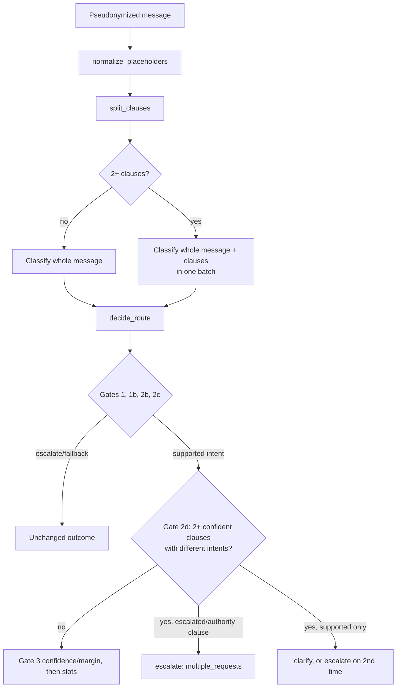

# Design: Clause-level detection of multi-request messages

- **Status:** Draft
- **Owner:** ML engineer
- **Reviewers:** team; contract owner for the `AiReasonCode` change
- **Last reviewed:** 2026-11-12
- **Related:** NFR-02, ESC-01, ESC-02, ESC-03, FR-05; [intent model retraining](intent-model-retraining.md), [label definitions D3](intent-label-definitions.md#d3-multi-intent-messages-are-not-training-rows), [evaluation protocol](intent-evaluation-protocol.md), [contracts v1](contracts-v1.md#reason-codes); [DATA-25](../rules/data-and-ml.md), [DATA-28](../rules/data-and-ml.md#leakage), [DATA-58](../rules/data-and-ml.md), [DATA-59](../rules/data-and-ml.md)

## Summary

A message that asks for two different things ("cancel my order and tell me when my refund arrives") gets one confident label from the intent classifier, and routing may then send it to drafting. This design adds a deterministic routing gate: the message is split into clauses, each clause is classified by the same model in one batch, and the message is flagged when two clauses are confidently classified as different requests. The flagged message goes to clarification or escalation, never to a direct draft. No training data, label, or model change is needed.

This design adds a routing rule, which the [intent model retraining](intent-model-retraining.md#non-goals) design excludes from its own scope. It is therefore a separate design.

## Goals and non-goals

### Goals

- Meet the NFR-02 target that at least 90% of multi-intent messages are flagged or routed away from drafting, without training on multi-intent text ([D3](intent-label-definitions.md#d3-multi-intent-messages-are-not-training-rows)).
- Keep the single-intent clarify rate within the autoeval gate (≤ 0.15).
- Use the exact preprocessing and model that serving uses, in serving and in autoeval alike (DATA-59).
- Tune every parameter on a development set only; run the frozen set once at the end (DATA-25, DATA-28).

### Non-goals

- Multi-label classification or answering both requests in one draft (requirements §3.1 keeps one intent per message).
- Changing the model, its training data, or the 46 labels.
- Languages other than English, which is the language of the model and of Bitext.

## Background

On the frozen scenario set `data/benchmarks/intent/v1` the retrained candidate `v1.1.0` flags 7 of 15 multi-intent messages (0.467), against 11 of 15 for `v1.0.0`; overall it flags 0.875 of out-of-scope messages, below the 0.90 target. Its training made it more confident on in-domain text, so the confidence (τ) and margin (δ) gates in [`routing.py`](../../apps/core_backend/intent/routing.py) let these messages through. Lowering τ for all messages would raise the clarify rate on single-intent messages, which the gate also limits.

Three approaches were compared (see [Alternatives](#alternatives-considered)). Clause-level detection was chosen because a multi-request message has a visible structure, two requests joined by a conjunction or a sentence break, that the existing model can read clause by clause.

## Design

### Components and responsibilities

| Component | Change |
|---|---|
| `apps/ml_inference/preprocessing.py` | New `split_clauses(text, min_words, max_clauses, request_clauses_only)`. Pure function with no third-party imports, so serving and autoeval share it (DATA-59). |
| `apps/ml_inference/app.py` | `predict` classifies the whole message and its clauses in **one batch** when the message has two or more clauses. The response gains an optional `clauses` list: `{intent, confidence}` per clause, in message order. Clause text is never returned or logged. |
| `apps/core_backend/intent/schemas.py` | `IntentPrediction.clauses: Optional[List[ClausePrediction]]`; `IntentPolicy.multi_request: Optional[MultiRequestPolicy]` with `enabled`, `min_clause_confidence`, `min_words`, `max_clauses`, `request_clauses_only` (default `false`, so the 2026-11-12 behavior stays available). The backend passes the splitting settings to `/predict`. |
| `apps/core_backend/intent/routing.py` | New gate 2d, described below. |
| `apps/core_backend/config/policies/intent_policy.v3.json` (new) | Routing configuration version for `v1.1.0`: tuned τ, δ and `multi_request` values (DATA-58). `v2` stays unchanged for `v1.0.0`. |
| `pipeline/evaluation/autoeval/` | The ML suite builds `clauses` with the same splitter and backend batch, so the gate measures what serving does. |

### Splitting rule

1. Normalize placeholders first (`[ORDER_ID_1]` → `[ORDER_ID]`), so identifiers never split a clause.
2. Split at sentence ends (`.`, `?`, `!`, `;`) and at the coordinating cues `and`, `also`, `then`, `plus`, `as well as`, `but` when they are surrounded by spaces. Placeholders and decimal numbers are never split.
3. Drop clauses shorter than `min_words` (default 3), such as "thanks" or "and also".
4. Keep at most `max_clauses` (default 4), the first ones in the message.
5. **Request clauses only (revision 2026-11-13).** When `request_clauses_only` is set, a clause is kept only if it is a request:
   - it ended with `?`; or
   - it starts with a question word (`how`, `what`, `when`, `where`, `why`, `which`, `who`, `is`, `are`, `do`, `does`, `did`, `has`, `have`, `can`, `could`, `would`, `will`, `should`, `may`); or
   - it starts with an imperative verb (`cancel`, `track`, `refund`, `check`, `stop`, `send`, `tell`, `explain`, `update`, `start`, `change`, `close`, `give`, `return`, `connect`, `reset`, `add`, `show`, `find`, `confirm`, optionally after `please`); or
   - it contains a request phrase (`please`, `I want`, `I'd like`, `I would like`, `I need`, `want to`, `need to`, `like to`, `let me know`, `tell me`, `send me`, `help me`, `connect me`, `show me`, `give me`).

   If the message contains an additive cue (`also`, `plus`, `as well as`, `another thing`, `one more thing`), every clause is kept, because the customer marks the second part as a separate matter even when it is a statement ("Also my parcel has been stuck for a week").
6. A message with fewer than two kept clauses has no `clauses` field, and routing behaves exactly as today.

The request filter exists because statements that give background ("I ordered the wrong colour" after "I need to cancel [ORDER_ID]") are classified as a second intent. See [Dev tuning result](#dev-tuning-result-2026-11-13).

### Routing gate 2d: multiple requests

The gate runs after the human-request, invalid-output, `human_agent` and out-of-scope gates (1, 1b, 2b, 2c) and before the confidence gate (3). A message whose whole-text intent already escalates is therefore unchanged.

A message has **multiple requests** when at least two clauses each have confidence ≥ `min_clause_confidence` and their intents differ. The decision is then:

| Clause intents | Action | Reason codes | Team |
|---|---|---|---|
| Any clause is `human_agent`, an escalated (34) intent, or requires authority (`cancel_order`, `request_refund`, ESC-03) | `escalate` | `multiple_requests` | Team of the first such clause |
| All clauses are supported and none requires authority, first time | `clarify` | `multiple_requests` | Team of the whole-message intent |
| As above, but `clarify_count ≥ 1` | `escalate` | `multiple_requests`, `max_clarify_reached` | Team of the whole-message intent |

The gate does not run when staff have set an intent override with valid provenance (gate 0), because staff then decide what the message asks for.

`predicted_intent` and `final_intent` stay the whole-message prediction, so the contract keeps one intent per message. The clause intents are kept in the routing decision for staff (labels and confidences only).

### Data and contracts

| Item | Change | Rules |
|---|---|---|
| `ai-service` `/predict` response | Optional `clauses: [{intent, confidence}]`. Additive; old clients ignore it. | No clause text in the response or logs (SEC-36). |
| `AiReasonCode` | New value `multiple_requests`, refining ESC-01. | Needs the contract owner's approval ([Open questions](#open-questions)). |
| Multi-request dev set `data/intent/dev_multi/v1/cases.synthetic-dev-only.psv` (new) | 40 multi-request messages and 40 **single-request messages that contain a conjunction or two sentences** (hard negatives), labelled `kind` (`multi` or `single`) per [D3](intent-label-definitions.md#d3-multi-intent-messages-are-not-training-rows). | `synthetic-dev-only` (DATA-03), manifest (DATA-09), leakage-checked against `data/benchmarks/` by `intent_extra.py`, never used for training. Written without reading the frozen set's texts. |

### Errors and guardrails

| Failure | Behavior | Test |
|---|---|---|
| The splitter cuts a single request into two clauses with different labels | The message is clarified; measured as the dev false-flag rate and limited by `min_clause_confidence` | Unit tests with hard negatives; dev report |
| The clause batch fails or times out | The whole-message prediction is used without `clauses`; routing behaves as today and the error is counted | Unit test with a failing backend |
| `clauses` contains an unknown label or an invalid confidence | Gate 1b treats the prediction as invalid (`manual_fallback`) | Unit test |
| `multi_request` is missing from the policy | The gate is off; behavior equals `v2` | Unit test |
| Latency | One batched forward pass of at most 5 sequences of 64 tokens; measured in the autoeval latency report against NFR-08 | Autoeval latency |

The gate only adds routes away from drafting. It never turns an escalation or clarification into a draft, so it cannot weaken an existing guardrail.

## Alternatives considered

- **Soft-label training on multi-intent messages** (target spread across the constituent intents). Rejected for now: needs new training text, contradicts D3, takes a 40-minute retraining per attempt, and a single-label model can still pick one intent confidently.
- **Lower τ or δ for every message.** Cannot separate multi-request messages from confident single-request ones and raises the clarify rate.
- **An LLM that detects multiple requests.** Adds egress, cost, and latency before routing; the classifier already sees the text.
- **A dedicated `multi_intent` label.** Rejected: the contract and requirements fix 46 labels.

## Testing and evaluation

- Unit tests: splitting (sentence ends, conjunctions, placeholders, decimals, minimum length, maximum clauses, request clauses, additive cues); gate 2d for each row of the decision table; the gate is off without `multi_request`; serving and autoeval use the same splitter.
- Tuning on the multi-request dev set and the existing dev set only: choose `min_clause_confidence` and `min_words` that give a flag rate ≥ 0.90 on multi-request messages with a false-flag rate ≤ 0.10 on hard negatives and a total dev clarify rate ≤ 0.15. Tune τ and δ for `intent_policy.v3` on the same data (DATA-58).
- Gate: one autoeval run on the frozen set `data/benchmarks/intent/v1` with `v1.1.0` and policy `v3`, compared with `v1.0.0` and policy `v2` under the [evaluation protocol](intent-evaluation-protocol.md) tolerances. The result is reported as measured, pass or fail (DATA-48, DATA-57).

### Dev tuning result (2026-11-13)

`python -m pipeline.evaluation.tune_routing` searched 300 settings (`min_clause_confidence` 0.5–0.9, `min_words` 2–4, a uniform τ shift of −0.10 to +0.10 that never lowers a sensitive-action threshold, δ 0.05–0.20) for `v1.1.0` on `dev`, `oos_dev`, and `dev_multi` only. Report: `artifacts/training/intent-v1.1.0/routing_tuning.json`.

| Metric (dev) | Policy `v2`, no gate | Selected | Target |
|---|---|---|---|
| Multi-request messages flagged | 0.375 | 0.925 | ≥ 0.90 |
| Single-request hard negatives flagged as `multiple_requests` | 0 | 0.125 (5/40) | ≤ 0.10 |
| Clarify rate on draftable dev messages | 0.150 | 0.131 | ≤ 0.15 |
| Out-of-domain messages flagged | 1.0 | 1.0 | ≥ 0.90 |
| Correct drafts on draftable dev messages | 0.813 | 0.822 | maximize |

Selected: `min_clause_confidence` 0.6, `min_words` 3, τ shift −0.05, δ 0.10, written to `intent_policy.v3.json` with `approved: false`. **No setting met every target**: thresholds that bring false flags to 0.10 drop the multi-request flag rate below 0.90. The false flags are single requests followed by a background clause (for example a cancellation followed by the reason), which the model classifies as a second intent. A false flag leads to one clarification question, not to an unsafe draft. Grouping clause intents by team instead of by intent lowered the multi-request detection rate to 0.725–0.75 at the same false-flag level and was not adopted.

**Revision: request clauses only.** Gate 2d alone (before the other routes are counted), at `min_clause_confidence` 0.6 and `min_words` 3, on `dev_multi` and the 181 single-request dev messages:

| Clause rule | Multi-request messages caught by the gate | Hard negatives flagged | Single-request dev messages flagged |
|---|---|---|---|
| Every clause (2026-11-12) | 35/40 | 5/40 | 1/181 |
| Questions and request cues only | 26/40 | 0/40 | 0/181 |
| **Request clauses, or every clause after an additive cue** | **33/40** | **0/40** | **0/181** |

The third rule is proposed. Of its seven misses, four come from a clause the model scores below 0.6 and three from a request that follows statements without an additive cue ("The parcel arrived late and the box was crushed, and I want to talk to an agent"). Some of these misses are still flagged by other gates; the full grid is rerun with the rule before `v3` is written.

The cue lists were chosen after reading the dev false flags and misses, so the dev numbers above are optimistic. The rule is fixed before the gate run, and only the frozen set run counts as evidence. The cue lists are English only, like the model.

**Rerun with the rule (600 settings, `request_clauses_only` false or true).** Every target is met. Selection now ranks must-escalate dev messages sent to drafting first; that count is 2 in every setting, because the model confidently gives two unsupported dev messages a supported label, which no routing threshold changes.

| Metric (dev) | Policy `v2`, no gate | `v3` (selected) | Target |
|---|---|---|---|
| Multi-request messages flagged | 0.375 | 0.900 | ≥ 0.90 |
| Single-request hard negatives flagged as `multiple_requests` | 0 | 0 | ≤ 0.10 |
| Clarify rate on draftable dev messages | 0.150 | 0.122 | ≤ 0.15 |
| Out-of-domain messages flagged | 1.0 | 1.0 | ≥ 0.90 |
| Correct drafts on draftable dev messages | 0.813 | 0.832 | maximize |

`intent_policy.v3.json`: `min_clause_confidence` 0.6, `min_words` 3, `max_clauses` 4, `request_clauses_only` true, τ shift −0.05 (sensitive-action thresholds unchanged), δ 0.10, `approved: false`.

### Gate run on the frozen set (2026-11-13)

One ML run of `v1.1.0` with policy `v3` on `data/benchmarks/intent/v1`, torch backend: `artifacts/evaluation/autoeval/20261113-001925-intent-v1-candidate-v1.1.0-policy-v3/`. Gate 7 rejects a policy with `approved: false`, so the run used a copy outside the repository with `approved: true`, marked as an evaluation-only copy. That copy is not an approval.

| Metric | `v1.0.0` + `v2` (release) | `v1.1.0` + `v2` | `v1.1.0` + `v3` | Target |
|---|---|---|---|---|
| Out-of-scope, vague, multi-intent flagged | 0.931 | 0.875 | **0.931** | ≥ 0.90 |
| Multi-intent slice flagged | 0.733 (4 drafted) | 0.467 (8 drafted) | **0.800 (3 drafted)** | — |
| Single-request messages flagged as `multiple_requests` | — | — | 0 | — |
| Clarify rate on draftable messages | 0.398 | 0.114 | 0.091 | ≤ 0.15 |
| Draftable messages reaching a draft | 0.489 | 0.875 | 0.898 | — |
| Drafts with a wrong intent | 12 | 4 | 5 | — |
| Must-not-draft cases drafted | 4 | 2 | **2** | 0 |
| Macro-F1 drop on noisy text | 0.160 | 0.107 | 0.107 | ≤ 0.10 |
| Out-of-scope low-confidence rate (warning) | 0.764 | 0.778 | 0.736 | ≥ 0.90 |

Classifier metrics (scope accuracy 0.970, Macro-F1 0.819, ECE 0.053, confident errors 3) do not depend on the policy and are unchanged.

**Verdict: the gate fails** under the [evaluation protocol](intent-evaluation-protocol.md#offline-gate). The policy fixed the out-of-scope flag rate, which is now equal to the release, but two must-not-draft messages (`unsupported-product_issue-02`, `unsupported-return_product_in_store-01`) still reach drafting (rules 1 and 2). They are not multi-request messages. The noise-drop target is missed but no worse than the release. `v1.0.0` stays in service. This was the second decision based on the frozen set.

## Observability

Routing records `multiple_requests` with the number of clauses and the clause intents (labels only). The autoeval report adds the multi-request flag rate per slice and the false-flag rate on single-request messages.

## Security and privacy

Clauses are cut from text that is already pseudonymized. No clause text is stored, logged, or sent outside `ai-service`.

## Rollout

1. This design approved; contract owner approves `multiple_requests`.
2. PR: splitter, `/predict` `clauses`, schemas, gate 2d behind `multi_request` (absent from `v2`), autoeval support, unit tests.
3. PR: multi-request dev set with manifest; tuning report; `intent_policy.v3.json`.
4. PR: one gate run on the frozen set; if it passes, pin `v1.1.0` with policy `v3`.

Rollback: select policy `v2`, which has no `multi_request` block.

## Open questions

- Contract change: add `multiple_requests` to `AiReasonCode`, or report it as `low_confidence` with a detail field until a contract v2.
- Whether some intent pairs count as one request (for example `track_order` with `delivery_issue` in "where is my order, it is late"). The request-clause filter removed every dev false flag without a pair list, so none is planned.
- Each gate run on the frozen set uses up some of its independence. [ADR-0016](../decisions/0016-frozen-intent-scenario-set.md) says to revisit the set once it has been used for more than three release decisions. This run was the second; the [return-channel guard](return-channel-guard.md#results-2026-11-13) run was the third.
