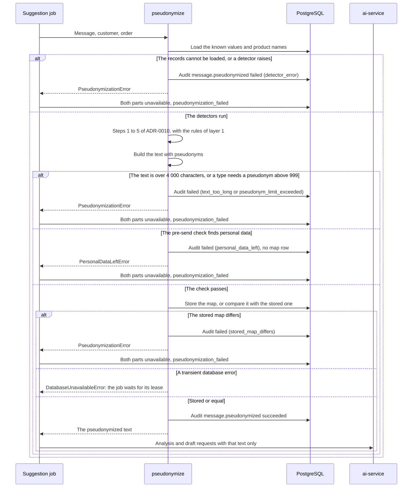

# Design: Fixes for the personal data that pseudonymization leaves

- **Status:** Draft
- **Owner:** backend engineer
- **Reviewers:** project lead, ML engineer
- **Last reviewed:** 2026-11-20
- **Related:** [Requirements](../product/requirements.md) (FR-09, NFR-06), [SEC-36](../rules/security-and-privacy.md#pseudonymization), [LOG-29](../rules/logging-and-observability.md#privacy-in-telemetry), [ADR-0010](../decisions/0010-pseudonymization-and-egress-control.md), [ADR-0017](../decisions/0017-named-entity-model-from-its-release-url.md), [ADR-0020](../decisions/0020-storage-errors-of-the-pseudonym-map.md), [ADR-0029](../decisions/0029-rule-based-detectors-and-a-pre-send-check.md), [backend ticket workflow design](backend-ticket-workflow.md#pseudonymization)

## Summary

A measurement of `backend` on 2026-11-18 found raw names, phone numbers, and addresses in the requests that a fake `ai-service` received: 4 of 33 names, 4 of 16 phone numbers, and 2 of 18 addresses, in 123 of 343 requests. Guardrail 4, [SEC-36](../rules/security-and-privacy.md#pseudonymization), and FR-09 forbid this, so the fix comes before the pull request (PR) into `main`. This design fixes each cause in the detectors of the `pseudonymization` module (layer 1) and adds a pre-send check at the end of pseudonymization that sends nothing while personal data is left (layer 2). Layer 2 cannot replace layer 1: it finds what a detector found only in part, never a value that no detector saw. Three passages of [ADR-0010](../decisions/0010-pseudonymization-and-egress-control.md) stand against this design, so [ADR-0029](../decisions/0029-rule-based-detectors-and-a-pre-send-check.md) replaces them; no contract changes.

## Goals and non-goals

### Goals

- Every leak form that the measurement found is a unit test of `backend` that passes.
- A pseudonymized text in which the pre-send check finds personal data never leaves `backend`: both suggestion parts end `unavailable` with `pseudonymization_failed`, and staff handle the ticket manually.
- The same 50 messages, run again through the same measurement, report 0 raw values of each type, with every one of the 50 messages measured, and the report states how many tickets the pre-send check stopped.

### Non-goals

- A different named-entity model. `en_core_web_sm` stays, as [ADR-0017](../decisions/0017-named-entity-model-from-its-release-url.md) states ([Alternatives considered](#alternatives-considered)).
- Over-detection. The measurement shows some, such as "Order ORD-…" taken for a name; it costs draft quality, not privacy, and belongs to a separate change.
- The masking in `ai-service` (the second layer of ADR-0010). It stays as it is.
- The other backend of the measurement, on the branch `minh`.

## Background

### What the measurement found

The measurement was round 1 of the comparison of two backends, run on 2026-11-18 on GitHub Actions with Ubuntu 24.04. Its files are outside this repository, in the results archive `results-44308559314`: `suites/a/privacy.json` holds the counts, and `suites/a/fake_ai.jsonl` holds every request body that the fake `ai-service` received.

- The input is 50 `synthetic-dev-only` customer messages, made by Faker with the seed 20261118, half with the locale `vi_VN` and half with `en_US`: 10 templates written 4 times each for drafts, 5 for authority, and 5 for human handover. They plant 33 names, 16 phone numbers, 18 addresses, and 19 emails.
- The scan counts a planted value as leaked when it appears verbatim, or JSON-escaped, in a request body. It found 0 of 19 emails and 0 of 4 order IDs.
- 39 of the 50 messages reached the fake `ai-service` at least once in that run; the other 11 have no request in `fake_ai.jsonl`. `backend.log` holds no event `pseudonymization.failed`, and it holds an event `ai_service.called` for each of the 87 tickets created before the first failed call to `ai-service` (12:58:16Z). Every call after that one fails, and the harness runs the sweep before its fault tests (`bin/race.sh:121-128`). The cause is not known ([Open questions](#open-questions)). The counts above still use all 50 messages, so a value whose message was never sent counts as not leaked.

Each request body that the fake `ai-service` received was aligned with its template. That shows, for every planted value, what was replaced and what was left:

| Type | Values left whole | Values left in part | What the detectors did |
|---|---|---|---|
| Name | 4: "Bà Hương Nguyễn", "Phương Hữu Bùi", "Anh Anh Lê", "Kathryn Reynolds" | 2: one word of the name beside its pseudonym ("Vũ [NAME_1]", "Dũng [NAME_2]"). A third, "Bà [NAME_1]", leaves only the title "Bà" (Mrs.) | The model labels the 4 names `ORG`, nothing, `LOC`, and `GPE`, not `PERSON`, so they are dropped. For the other 2, its `PERSON` span stops one word short |
| Phone | 4: "(00)504-5188", "810.651.1446x46429", "590-224-0978x548", "+1-393-722-1568x72928" | 3: the end of the number and its extension beside the pseudonym ("[PHONE_1]-3701x6147") | The pattern does not accept parentheses or an extension such as "x548" |
| Address | 2: "9 Hoàng Dãy, JaneHuyện, 190841", "22 Lê Ngõ, JohnQuận, 217827" | All 16 others: the house number, a street or ward word, or the postal code beside pseudonyms ("72 [NAME_1], [NAME_2] xã, 660877") | An address exists only around a facility (`FAC`) that the model labels. The model labels most street names as persons, places, or numbers |

The labels come from running the detectors of `backend` (`en_core_web_sm` 3.8.0) on the messages rebuilt from their templates, with the leaked values and stand-ins for the email and the order ID.

### Why the detectors miss them

- **Phone** ([`detectors.py:37`](../../backend/src/supportiq_backend/pseudonymization/domain/detectors.py)): a value is digit groups joined by a space, a dot, or a hyphen, with an optional leading `+`, as [ADR-0010, Detection](../decisions/0010-pseudonymization-and-egress-control.md#detection), step 3, states. A parenthesis ends the group, so "(00)504-5188" splits into groups of 2 and 7 digits, both under 9. A letter stuck to the last group stops the value there, so "1446x46429" cannot end at "1446", and the extension stays.
- **Name** ([`named_entity_detector.py:61-66`](../../backend/src/supportiq_backend/pseudonymization/adapters/named_entity_detector.py)): only entities labeled `PERSON` become names. `en_core_web_sm` is an English model, and it labels Vietnamese names, and an English name in parentheses before an email, as an organization, a place, or nothing. The trial of the [backend ticket workflow design, Choice 1](backend-ticket-workflow.md#choice-1-the-named-entity-library) already found 10 of 12 names (2 Vietnamese names missed).
- **Address** ([`named_entity_detector.py:71-88`](../../backend/src/supportiq_backend/pseudonymization/adapters/named_entity_detector.py)): an address grows from a `FAC` entity to the house number before it and the places after it. Without a `FAC` label there is no address, and the words that the model labels `PERSON` become names inside the address. The same trial found 1 of 12 addresses, and the [workflow design, Open questions](backend-ticket-workflow.md#open-questions), already asks for another way to detect them.
- **Known values** do not help here: the messages name third persons and new addresses, which `backend` does not hold, as FR-09 and the appendix of the requirements expect.

### What the other backend shows

The backend of the branch `minh` (`org/minh` at `88a18d9`) checks the request again just before it sends it, and sends nothing if personal data is left (`apps/backend/tickets/jobs.py:288-309`). Its check runs the same patterns again and looks for the values it already found. The same measurement found 2 of 33 names, 3 of 16 phone numbers, and 2 of 18 addresses in its requests. A check that only repeats the first pass finds nothing new, so a pre-send check alone does not close the leaks.

## Design

### Components and responsibilities

Only `backend` changes, and only its `pseudonymization` feature module and its composition root.

| Part | Change |
|---|---|
| `domain/detectors.py`, `PatternDetector` | The phone pattern of [Layer 1, phone](#layer-1-phone) |
| `adapters/named_entity_detector.py` | `PERSON` spans grow over the capitalized words next to them ([Layer 1, names](#layer-1-names)) |
| A new domain module of name rules | The Vietnamese name rule and the person-cue rule ([Layer 1, names](#layer-1-names)) |
| A new domain module of address rules | The address rule of [Layer 1, addresses](#layer-1-addresses) |
| A new domain module, the pre-send check | [Layer 2](#layer-2-the-pre-send-check) |
| `domain/errors.py` | `PersonalDataLeftError`, a `PseudonymizationError` with the failure reason `personal_data_left` |
| `application/pseudonymize.py` | Runs the pre-send check on the built text, before the map is stored or compared |
| Composition root | Adds the two rule detectors to the detectors of step 4 |

The public API of the module keeps its two functions ([ADR-0010, Storage and lifecycle](../decisions/0010-pseudonymization-and-egress-control.md#storage-and-lifecycle), item 6): the check runs inside `pseudonymize`. The `suggestions` module sends only the text that `pseudonymize` returns. The other fields of the request to `ai-service` are typed (`OrderContext`, `Timestamp`, `AssetVersion`, `IntentLabel` in [`ai-service` contract](../../contracts/ai-service.openapi.yaml)) and hold no free text.

### Layer 1: phone

The `PHONE` pattern keeps its 9 to 15 digits and adds two forms:

1. A first group in parentheses, of 2 to 5 digits, after an optional `+` and country group: "(00)504-5188", "+1 (393) 722-1568". A parenthesized group of 1 digit, such as a list number "(1)", starts no value.
2. An extension right after the last group: `x`, `ext`, or `ext.`, then 1 to 6 digits, with no letter or digit after them. The extension is part of the value, and its digits do not count toward the 9 to 15. "0901110001pm" still ends no value.

### Layer 1: names

1. **Span growth.** A `PERSON` span grows over each capitalized word right next to it, up to 4 words in total, so "Vũ" and "Dũng" join the pseudonym. A word on the list of titles (`Mr`, `Mrs`, `Ms`, `Miss`, `Dr`, `Ông`, `Bà`, `Chị`, `Cô`, `Chú`) is not added.
2. **Vietnamese name rule.** 2 to 4 capitalized words, of which the first or the last is on a fixed list of Vietnamese family names, are a `NAME`. This finds "Hương Nguyễn", "Phương Hữu Bùi", and "Anh Anh Lê".
3. **Person-cue rule.** 2 to 4 capitalized words that the model labels `ORG`, `GPE`, or `LOC` are a `NAME` when a cue from a fixed list comes right before them: "my name is", "I am", "this is", "on behalf of", "Regards,", "Thanks,", and "my" with a word for a relative or a neighbour. This finds "Kathryn Reynolds".
4. Product names of the catalog are still excluded ([`drop_product_names`](../../backend/src/supportiq_backend/pseudonymization/domain/detection.py)), for the rule detectors too.
5. The lists are constants of the module, versioned with it. A change of a list is a change of the detector version ([ADR-0010, Placeholder syntax](../decisions/0010-pseudonymization-and-egress-control.md#placeholder-syntax), item 5).

### Layer 1: addresses

An address is a span that:

1. starts with a house number: 1 to 5 digits, optionally followed by a letter or by `/` and digits;
2. continues over up to 5 comma-separated parts, each made of capitalized words, address words, or a postal code of 5 or 6 digits;
3. holds at least one address word from a fixed list, compared without case: the Vietnamese street and administrative words (`Đường`, `Phố`, `Ngõ`, `Ngách`, `Hẻm`, `Kiệt`, `Tổ`, `Khu`, `Dãy`, `Thôn`, `Ấp`, `Xóm`, `Phường`, `Xã`, `Thị trấn`, `Quận`, `Huyện`, `Thị xã`, `Thành phố`, `Tỉnh`) and the English ones (`Street`, `St`, `Avenue`, `Ave`, `Road`, `Rd`, `Lane`, `Ln`, `Drive`, `Boulevard`, `Blvd`, `Apt`, `Suite`, `Unit`).

The span is an `ADDRESS` detection, so the overlap rule lets it replace the names that the model found inside it ([ADR-0010, Detection](../decisions/0010-pseudonymization-and-egress-control.md#detection), step 5: the longer span wins). The `FAC`-based address of the adapter stays.

### Layer 2: the pre-send check

The pre-send check runs on the pseudonymized text that `pseudonymize` built, with the entries of its map and the known values of the ticket. It compares a value with the text outside placeholders in one of two ways, by type:

- **Digits only**, for `PHONE` and `CARD`: the digits of the value, in order and without a gap, inside one run of digits and separators of the text. "0901110001" is found in "0901 110 001" and in "09011100012".
- **Whole words**, ignoring case and diacritics, for `NAME`, `EMAIL`, `ADDRESS`, `ORDER_ID`, `TRACKING_ID`, and `TRANSACTION_ID`, as step 2 compares them ([`find_whole_words`](../../backend/src/supportiq_backend/pseudonymization/domain/detection.py)).

It fails when it finds any of these:

| Finding | Example | Why the detectors do not find it |
|---|---|---|
| A value of the map, again, outside a placeholder: every original value except `LITERAL` ones | A name that the model found in one sentence and not in the next | A detector returns spans, and only those spans are replaced. The model judges each occurrence in its own context |
| A known value of the ticket outside a placeholder | The customer's phone number written with other separators, or inside a longer digit run, such as "09011100012" | Step 2 finds whole words of the stored spelling only |
| Digits or letters joined to a placeholder by nothing or by `-`, `.`, `/`, `x`, or `@` | "[PHONE_1]-3701x6147" | Each detector judges its own spans; nothing looks at what is left beside a replaced span |
| A capitalized word right before or after a `[NAME_n]`, with one space between, that is not on the stoplist: `I`, the titles of [Layer 1, names](#layer-1-names), the words of thanks and greeting (`Thanks`, `Thank`, `Regards`, `Best`, `Dear`, `Hi`, `Hello`), `Please`, and any word that starts a sentence or the text | "Vũ [NAME_1]"; not "Thanks [NAME_1]", "[NAME_1]. Please", or "This is [NAME_1] I want" | The same |
| A number of 1 to 5 digits right before a `[NAME_n]` or `[ADDRESS_n]`, or a number of 5 or 6 digits in the comma-separated part right after one, unless a currency word or sign follows it (`VND`, `đ`, `USD`, `$`) | "72 [NAME_1], [NAME_2] xã, 660877"; not "[ADDRESS_1], 250000 VND" | The same: a house number and a postal code left around a street that the model took for a name |

It does not find a value that no detector found and that stands away from every placeholder, such as "Bà Hương Nguyễn" in round 1. Only layer 1 fixes those.

### Flow

1. The detectors run on the raw message, the overlap rule keeps one detection per character, and the text is built, as today. Building fails for a text over 4 000 characters or a pseudonym above 999 (`domain/pseudonym_map.py:135`, `:170`).
2. The pre-send check runs on that text before any map row is written, so a stopped run keeps no map ([ADR-0010, Storage and lifecycle](../decisions/0010-pseudonymization-and-egress-control.md#storage-and-lifecycle), items 2 and 3).
3. A stopped run raises `PersonalDataLeftError`. The existing failure path does the rest: an audit entry in a transaction of its own, the event `pseudonymization.failed`, both parts `unavailable` with `pseudonymization_failed`, no call to `ai-service`, and no retry, because the check is deterministic.

### Data and contracts

- No contract changes. The reason code `pseudonymization_failed` already means that pseudonymization did not produce a text that may leave `backend`, and that `ai-service` was not called ([`AiReasonCode`](../../contracts/schemas/AiReasonCode.yaml), [contracts v1 design](contracts-v1.md#reason-codes)). A stop by the pre-send check is that case, and staff handle it the same way.
- The audit entry `message.pseudonymized` gets one more value for its field `failure_reason`: `personal_data_left`. The field and its values live in the code of `backend` (`FAILURE_REASON_FIELD`, [`application/pseudonymize.py:56`](../../backend/src/supportiq_backend/pseudonymization/application/pseudonymize.py); `PseudonymizationFailureReason`, [`domain/errors.py:12-18`](../../backend/src/supportiq_backend/pseudonymization/domain/errors.py)), not in a contract.
- No migration. The table `pseudonym_map_entries` does not change.

### Errors and guardrails

| Failure | Behavior | Test |
|---|---|---|
| The pre-send check finds personal data | No map row; audit `failed` with `personal_data_left`; event `pseudonymization.failed` at `error`; both parts `unavailable` with `pseudonymization_failed`; no call to `ai-service`; no retry | Use-case test of `PseudonymizeMessage` with each finding of the table; integration test of the job against PostgreSQL with a fake `ai-service` that records 0 calls |
| A rule detector raises | Fails closed as a detector error, as today | Use-case test with a raising detector |
| A ticket pseudonymized by the old detectors runs again | The computed map differs from the stored one: `stored_map_differs`, fail closed ([ADR-0020](../decisions/0020-storage-errors-of-the-pseudonym-map.md), statement 3) | The existing integration test of a differing map |
| A rule replaces a word that is no personal data | The word becomes a pseudonym and is restored for staff. It can weaken classification and retrieval | Negative unit tests; over-detection measured ([Testing and evaluation](#testing-and-evaluation)) |
| The pre-send check stops a text without personal data | The ticket is handled manually | Negative unit tests; the number of false stops is measured |

The guardrails do not change: staff approve every reply, nothing is sent to a customer automatically, and a ticket that the AI cannot serve goes to manual handling. Every change here makes `backend` send less, never more.

## Alternatives considered

- **Pre-send check only.** It is the way of the branch `minh`, which still leaked 7 of 86 values. A check that repeats the first pass finds nothing new.
- **Layer 1 only.** No detector is complete ([ADR-0010, Detection](../decisions/0010-pseudonymization-and-egress-control.md#detection)), and the partial spans of round 1 show that a found value can still leave a piece behind. The pre-send check catches those pieces.
- **A larger or multilingual model** instead of the name and address rules. It changes [ADR-0017](../decisions/0017-named-entity-model-from-its-release-url.md), needs a new trial, and must fit the memory of the free instance beside `backend` (NFR-08). It stays an option if the rules fail the re-measurement.
- **Block every text with a name-like or digit-like residue anywhere.** It would stop most messages, because order totals, dates, and product names look the same.

## Testing and evaluation

### Unit tests

- One test per leak form of [What the measurement found](#what-the-measurement-found): the 4 names left whole, the 2 names left in part, the 4 phone numbers left whole, the 3 extensions left in part, the 2 addresses left whole, and each kind of address left in part. Each test uses the message rebuilt from its template.
- At least 5 positive and 5 negative examples for each changed or new detector ([ADR-0010, Detection](../decisions/0010-pseudonymization-and-egress-control.md#detection)). The negatives include an ISO date, a list number "(1)", a price, an order total, a time such as "2pm", a product name of the catalog, a city name alone, and a title alone.
- The pre-send check: each finding of its table, positive and negative, and a text with no placeholder. The negatives include each stoplist word beside a `[NAME_n]` ("I", "Thanks [NAME_1]", "[NAME_1]. Please", "This is [NAME_1] I want"), and an amount after an address ("[ADDRESS_1], 250000 VND").
- The use case: a stop keeps no map row, writes the audit entry `failed` with `personal_data_left`, raises `PersonalDataLeftError`, and logs no value of the message ([TEST-26](../rules/testing.md#guardrail-tests), last item).

### Integration tests

- `tests/integration/workflow/test_pseudonymization_runs.py` against PostgreSQL 17: a stopped run ends both parts `unavailable` with `pseudonymization_failed`, stores no map, and makes no call to the fake `ai-service`.

### Evaluation

1. **Trial set.** The named-entity trial of the workflow design ([`named_entity_trial.py`](../../backend/tests/trials/named_entity_trial.py), 32 messages with 12 names and 12 addresses) runs before and after the change, and reports recall and over-detection per type. It was written before round 1, so the rules were not written from it.
2. **Re-measurement.** The privacy sweep and scan of round 1 run again on `backend` with the same 50 messages (the same file, checked by its SHA-256 sum), the same fake `ai-service`, and the same scan. The report states, per type: the values left whole, the values left in part (the alignment of [What the measurement found](#what-the-measurement-found)), the number of the 50 messages that reached the fake `ai-service`, the number of tickets that the pre-send check stopped, and the number of false stops: stopped tickets whose stopped text holds no raw value, by the alignment.
3. The re-measurement passes only when every one of the 50 messages is measured: it reached the fake `ai-service`, or pseudonymization stopped it with a failure reason in the audit log. A message that did neither is reported as not measured, and the run does not pass.
4. The rules of layer 1 are written from the failures of these 50 messages, so the re-measurement shows that each failure is fixed; it is not an unbiased estimate of NFR-06 ([Open questions](#open-questions)).

## Observability

- The event `pseudonymization.failed` keeps its fields and gets the reason `personal_data_left`, at `error`, because a stop means that a detector missed part of a value: a defect ([ADR-0010, Failure handling](../decisions/0010-pseudonymization-and-egress-control.md#failure-handling)). It carries the ticket ID, the reason, and the placeholder type next to the finding, never the value or the text ([LOG-29](../rules/logging-and-observability.md#privacy-in-telemetry)).
- The span of `pseudonymize` keeps its attributes. The audit entry is the evidence for NFR-06 ([ADR-0010, Storage and lifecycle](../decisions/0010-pseudonymization-and-egress-control.md#storage-and-lifecycle), item 5).
- No new metric.

## Security and privacy

- The message, the pseudonymized text, and the map are Confidential. The check reads them inside `backend` only, and nothing new leaves `backend`.
- A stopped run sends nothing to `ai-service`, so no raw value of that ticket reaches the LLM provider.
- The rule lists hold no personal data: titles, cue words, family names, and address words.
- The test messages are `synthetic-dev-only` values made by Faker.

## Rollout

1. [ADR-0029](../decisions/0029-rule-based-detectors-and-a-pre-send-check.md) is accepted first, because this design changes three passages of ADR-0010 and one sentence of [SEC-36](../rules/security-and-privacy.md#pseudonymization).
2. One PR changes the detectors, adds the pre-send check, changes SEC-36, and adds the tests. It goes in before the PR into `main`.
3. The re-measurement runs on that PR. If a type still leaks, the PR does not merge, and the cause goes into this design as a revision.
4. A database that holds maps made by the old detectors keeps them. A later run for such a ticket, such as a retry, ends with `stored_map_differs` and manual handling, which is safe. The deployment after the PR into `main` starts with a new database ([ADR-0021, Merge procedure](../decisions/0021-repository-layout-and-ai-ml-migration.md#merge-procedure), statement 10).
5. To roll back, revert the PR. The maps stored while it was in place differ from the old detectors' maps, so those tickets fail closed in the same way.

## Open questions

- **The 11 messages that never reached the fake `ai-service` in round 1.** `backend` logged a call to `ai-service` for each of their tickets, yet the fake `ai-service` recorded no request for them ([What the measurement found](#what-the-measurement-found)). The cause is needed before the re-measurement, so that the run measures all 50 messages.
- **An independent set for NFR-06.** The re-measurement uses the messages whose failures the rules were written from. An NFR-06 figure without that bias needs a new set: another seed and templates written before the rules are seen. Who writes it, and does the PR into `main` wait for it?
