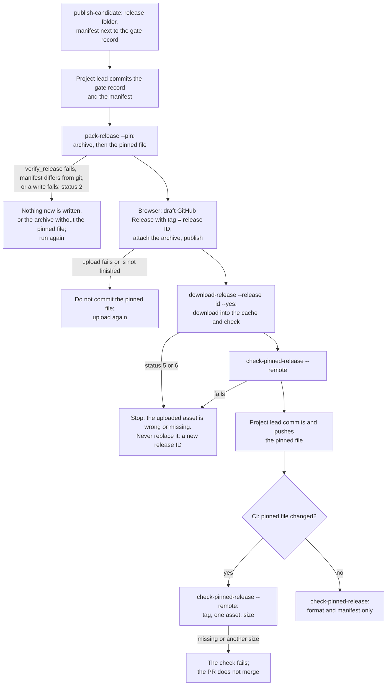

# Design: Release download and the Modal deploy of `ai-service`

- **Status:** Approved
- **Owner:** project lead
- **Reviewers:** ML engineer, backend engineer, and a second reviewer for [SEC-35](../rules/security-and-privacy.md#security-review)
- **Last reviewed:** 2026-11-28
- **Related:** [ADR-0018](../decisions/0018-hosting-of-ai-service-on-modal.md), [ADR-0030](../decisions/0030-release-archives-and-the-modal-function-of-ai-service.md), [ADR-0021, Release and the offline evaluation gate](../decisions/0021-repository-layout-and-ai-ml-migration.md#release-and-the-offline-evaluation-gate), [local run design](local-run.md), [release command README](../../eval/release/README.md), [DATA-36, DATA-56, DATA-57](../rules/data-and-ml.md#models-and-artifacts), [SEC-10](../rules/security-and-privacy.md#secrets), [SEC-40](../rules/security-and-privacy.md#transport-and-runtime), [WF-27 to WF-30](../rules/workflow.md#dependencies), [#41](https://github.com/ml-system-design-nhom-5/SupportIQ/issues/41)

## Summary

No release of contract 1.0.0 is deployed, because the repository has neither the download that [ADR-0018, Deploy](../decisions/0018-hosting-of-ai-service-on-modal.md#deploy) describes nor the Modal app of `ai-service` ([#41](https://github.com/ml-system-design-nhom-5/SupportIQ/issues/41)). This design adds three subcommands to `supportiq-release`. `pack-release` writes one archive per release. `download-release` fetches it, checks it against the manifest in git, and puts it into a cache. `check-pinned-release` keeps the pinned newest release and GitHub in step. The design also adds the Modal app `ai-service/modal_app.py` and one price file of the LLM. The Modal deploy of the project lead and the [local run](local-run.md) use the same download command, cache, and price file. The project lead decided the open points on 2026-11-22 and 2026-11-23. [ADR-0030](../decisions/0030-release-archives-and-the-modal-function-of-ai-service.md) records the parts that change ADR-0018: one archive per release, an optional token, and the settings of the Modal function.

**Amended on 2026-11-23 with the project lead's approval**, during the implementation and its review. No decision of ADR-0030 changes; the passages below now say what the code does:

1. `eval/release` declares two dependencies that `ai-service` already locks, `pydantic` and `pydantic-settings`, so the settings of the download are one settings class with the token as `SecretStr` ([PY-43, PY-44](../rules/python.md#settings)). The lead approved it on 2026-11-23 ([Components and responsibilities](#components-and-responsibilities)).
2. The price parser does not repeat the cap on the sum of both prices, which ai-service defines once ([CODE-48](../rules/code.md#constants-and-configuration)). It checks the model and each price with the field rules of `Settings` of `ai-service`, on the deploying machine; a test checks the committed file with the whole `Settings`, and `ai-service` checks the cap at startup ([The price file](#the-price-file)).
3. A member of an archive must have exactly the size that the manifest states, not at most that size ([Download](#download), Unpacking).
4. The price file allows empty lines and comment lines anywhere, as a Compose env file does, and refuses a CR ([The price file](#the-price-file)).
5. A `401` of a request that sent the token is its own failure, `token_refused`, with status 2 ([Exit statuses](#exit-statuses)); every request asks for no content encoding, and the archive is counted as raw bytes ([Download](#download), HTTP).
6. A declined download, or one that fails before the answer, creates nothing: the free space is measured on the nearest folder that exists, and the cache folder is created only after the answer. A failure after the answer leaves at most the empty cache folder and the parents that it needed. `SUPPORTIQ_RELEASE_CACHE` and `HOME` are checked only when a cache is needed ([Download](#download), The cache).
7. The size in the pinned file has at most 10 digits ([The pinned file](#the-pinned-file)).
8. The server gets the environment of the container without the variables of the Modal runtime, and the function starts it through `start_server` ([The Modal app](#the-modal-app), Function).
9. The download container of the local run mounts only the paths of the repository that the command reads ([Download](#download), In a container).
10. The step by hand that runs `backend` on Render against Modal moves to after the merge, because the `deploy` workflow runs only on `main`; before the PR, the local run with AI proves that path ([Testing and evaluation](#testing-and-evaluation)).
11. The checks of the source of `modal_app.py` run without the `deploy` group, and only the tests that import `modal` skip without it ([Testing and evaluation](#testing-and-evaluation)). The app is defined after every function that the checks of a deploy use, and only the function of the app follows it ([The Modal app](#the-modal-app)).
12. Immutable releases stay off until the system has taken shape, decided by the project lead on 2026-11-23. `release-2026-11-18-02` was uploaded with the setting off, and ADR-0018, Follow-ups stays open until then ([Publish order](#publish-order)).
13. `.gitattributes` keeps LF line ends for the price file and the pinned file on every checkout, whatever `core.autocrlf` says, because both refuse a CR ([The pinned file](#the-pinned-file), [The price file](#the-price-file)).

**Amended on 2026-11-25 with the project lead's approval.** The CI check of the pinned file sends the token of the run, `github.token`, as `SUPPORTIQ_RELEASE_TOKEN` ([The CI check of the pinned file](#the-ci-check-of-the-pinned-file), item 3). ADR-0030, Download, statement 2, already allows an optional token, and the command reads it, so no code and no ADR changes. The reason of the design against the token, that the shared limit of 60 requests does not matter for this check, is disproved:

- The pinned file is not on `main` (`67d8fc4`), so every run of the PR into `main`, and the first push run on `main`, counts as a change of it and reads GitHub.
- On 2026-11-25 the step failed on the pull request run of `e9347db` (run 45544569823) and in both attempts on `682fd11` (run 45551410061). The start of `local-run-compose-ai`, which downloads the release too, failed on `e9347db` (run 45544569326), and passed on `682fd11` (run 45551409903). The logs, read by the reviewer, state `rate_limited` and status `403`; they need a sign-in on GitHub.

**Also amended on 2026-11-25 with the project lead's approval.** The download with a token (step 2) and steps 4, 5, and 6 of the runs by hand follow the merge, before step 7, because the redeploy to Modal and Render comes after the merge. #41 stays open until they are recorded, and their rows stay "Not run yet". Until then, nothing is recorded of a Modal deploy of this app, of the refusal without the Secret, and of the paid tier. No real key of a deployment is used before step 5 is recorded ([Testing and evaluation](#testing-and-evaluation)).

## Goals and non-goals

### Goals

- One command downloads a published release, for the Modal deploy and for the local run, with or without a token, on macOS, Linux, WSL2, and in a container.
- The manifest in git decides whether a downloaded release is valid. A download that fails any check leaves no file behind.
- One archive per release, written by a command, uploaded once in the browser, and never replaced.
- A pinned file in git names the newest published release and the size of its archive, in plain text that bash reads. CI fails a change of it when GitHub does not hold that archive.
- `ai-service` of contract 1.0.0 runs on Modal from `release-2026-11-18-02`, and `backend` on Render calls it.
- One committed price file feeds both the Modal deploy and the local run.

### Non-goals

- Any change to the code of `ai-service` in `app/`, to its Dockerfile, or to a contract. The offline evaluation gate passed on that code ([`gate-run.json`](../../eval/releases/release-2026-11-18-02/gate-run.json)).
- Any change to `publish-candidate` or to the gate.
- Deploying from CI. The project lead deploys from a machine, as ADR-0018 states.
- The local run itself: `deploy/local/`, its guide, and its questions belong to the [local run design](local-run.md).
- A new release. `release-2026-11-18-02` serves no KB document, so no request gets a draft and no LLM call happens ([ai-service README, Known limits](../../ai-service/README.md#known-limits)).
- Retiring the trial Modal app `supportiq-ai` ([ADR-0021, Merge procedure](../decisions/0021-repository-layout-and-ai-ml-migration.md#merge-procedure), statement 10).

## Background

- The release command `supportiq-release` lives in `eval/release/`. Its commands write an output folder through a hidden staging folder that they move into place only when every file is written (`files/output_folder.py`). It imports only `app.release.manifest` and the entry point of the gate from `ai-service` ([release command README](../../eval/release/README.md)). Its exit statuses are 0, 1 for a failed gate run, 2 for an input that cannot be used, and 3 for a quarantine that waits for acceptance (`composition_root/exit_statuses.py`).
- `verify_release` of `app.release.manifest` refuses a release folder with a symbolic link, an entry that the manifest does not name, a wrong size, or a wrong SHA-256. `ai-service serve` calls it at every startup ([ai-service README, Release manifest](../../ai-service/README.md#release-manifest)).
- Only `release-2026-11-18-02` is published: `eval/releases/release-2026-11-18-02/release-manifest.json` is in git. Its folder on the project lead's machine holds 18 files, 403,105,419 bytes, and its manifest is the one in git, byte for byte (checked on 2026-11-23).
- `eval/release/uv.lock` locks no torch: it names torch only in the metadata of the groups of `ai-service`, and an export of every group holds no `torch`, `nvidia`, or `triton` package (checked on 2026-11-23). The download command therefore installs no torch on Linux either.
- The job `ai-service-checks` audits `uv export --all-groups` of `ai-service`, so a new dependency group is audited without a change.
- The GitHub repository of the organization is public. These facts come from the official pages, read on 2026-11-23:

| Platform | Fact | Source |
|---|---|---|
| GitHub | `GET /repos/{owner}/{repo}/releases/tags/{tag}` gets "a published release with the specified tag". Each asset has `id`, `name`, `state` (`uploaded` or `open`), `size`, and `browser_download_url` | [GitHub: Releases](https://docs.github.com/en/rest/releases/releases) |
| GitHub | An asset is downloaded with `Accept: application/octet-stream`. "The API will either redirect the client to the location, or stream it directly if possible", and "API clients should handle both a 200 or 302 response" | [GitHub: Release assets](https://docs.github.com/en/rest/releases/assets) |
| GitHub | Primary rate limits: 60 requests per hour per IP address without authentication, 5,000 per hour with a personal access token, and 1,000 per hour per repository for `GITHUB_TOKEN`. A client over the limit gets `403` or `429` with `x-ratelimit-remaining: 0` | [GitHub: Rate limits](https://docs.github.com/en/rest/using-the-rest-api/rate-limits-for-the-rest-api) |
| GitHub | Each file of a release is under 2 GiB. With immutable releases, "Release assets cannot be modified or deleted", and GitHub recommends a draft release, every asset attached, then publishing | [GitHub: About releases](https://docs.github.com/en/repositories/releasing-projects-on-github/about-releases), [GitHub: Immutable releases](https://docs.github.com/en/code-security/supply-chain-security/understanding-your-software-supply-chain/immutable-releases) |
| Modal | `Image.from_dockerfile(path, *, context_dir=None, ignore=…, add_python=None, …)` returns "An `Image` built from the Dockerfile plus Modal runtime dependencies". "Most Dockerfiles should work out of the box". "Currently this is supported only for single-stage Dockerfiles" is said of `registry_secret` only | [Modal: Image](https://modal.com/docs/sdk/py/latest/Image), [Modal: Existing images](https://modal.com/docs/guide/existing-images) |
| Modal | "Modal containers always run as root (uid 0)". "The USER instruction is ignored" | [Modal: Existing images](https://modal.com/docs/guide/existing-images) |
| Modal | `add_local_dir(local_path, remote_path, *, copy=False, ignore=[])`: with `copy=True`, the files are copied "into an Image layer at build time" | [Modal: Image](https://modal.com/docs/sdk/py/latest/Image) |
| Modal | `web_server(port, *, startup_timeout=5.0, …)`. The server must bind `0.0.0.0`. Web Functions are public by default | [Modal: web_server](https://modal.com/docs/sdk/py/latest/web_server), [Modal: Web endpoints](https://modal.com/docs/guide/webhooks) |
| Modal | "By default, each container will be assigned one input at a time". `@modal.concurrent(max_inputs=…)` lets one container take more. "When you reach the Function's limit on containers, requests will queue for handling" | [Modal: Concurrent inputs](https://modal.com/docs/guide/concurrent-inputs), [Modal: Web endpoints](https://modal.com/docs/guide/webhooks) |
| Modal | A container requests 0.125 CPU cores and 128 MiB by default. `memory` is in MiB. `scaledown_window` is between 2 seconds and 20 minutes | [Modal: Resources](https://modal.com/docs/guide/resources), [Modal: App](https://modal.com/docs/sdk/py/latest/App), [Modal: Cold start](https://modal.com/docs/guide/cold-start) |
| Modal | `Secret.from_name(name, *, required_keys=[])`: "If non-empty, the server asserts these keys exist on the Secret". When it asserts is not stated | [Modal: Secret](https://modal.com/docs/sdk/py/latest/Secret) |
| Modal | Module-level code runs on the local machine and "on the remote worker". `modal.is_local()` returns False only inside a running Modal Function | [Modal: Global variables](https://modal.com/docs/guide/global-variables), [Modal: is_local](https://modal.com/docs/sdk/py/latest/is_local) |
| Modal | A workspace spend limit is "a monthly cap on net charges", set on the Usage & Billing page by Owners and Managers. "When the spend limit is reached, Modal stops workloads that would incur additional out-of-pocket charges" | [Modal: Budgets](https://modal.com/docs/guide/budgets) |
| Modal | The Python package `modal` 1.6.4 was released on 2026-11-12, under Apache-2.0, for Python 3.10 to 3.15 | [PyPI: modal](https://pypi.org/project/modal/) |
| Google | Gemini 3.5 Flash-Lite (`gemini-3.5-flash-lite`), Standard paid tier: input "$0.30 (text / image / video / audio)" and "Output price (including thinking tokens)" "$2.50", per 1,000,000 tokens. The free tier is "Free of charge". The page redirects to `aistudio.google.com/docs/pricing` | [Gemini API pricing](https://ai.google.dev/gemini-api/docs/pricing#gemini-3.5-flash-lite) |

## Design

### Components and responsibilities

| Path | Holds |
|---|---|
| `eval/release/src/supportiq_release/distribution/domain/` | The rules without file or network access: the text of the pinned file, the members that an archive may hold, the choice of a release, and the size checks |
| `eval/release/src/supportiq_release/distribution/adapters/` | The GitHub client over httpx, the archive writer and reader over `tarfile` and `gzip`, the release cache, and the reading of a published manifest with `app.release.manifest` |
| `eval/release/src/supportiq_release/composition_root/distribution_commands.py` | `pack-release`, `download-release`, and `check-pinned-release` |
| `eval/release/src/supportiq_release/composition_root/exit_statuses.py` | Three new statuses: 4, 5, and 6 ([Exit statuses](#exit-statuses)) |
| `eval/releases/pinned-release.txt` | The pinned file ([The pinned file](#the-pinned-file)) |
| `ai-service/modal_app.py` | The Modal app ([The Modal app](#the-modal-app)) |
| `ai-service/pyproject.toml`, `ai-service/uv.lock` | The dependency group `deploy` with `modal==1.6.4`; `modal_app.py` in the pyright `include` |
| `deploy/llm-prices.env` | The model and its two prices, with their source and date ([The price file](#the-price-file)) |
| `.github/workflows/ai-service.yml` | The `deploy` group in the jobs that type-check and test `ai-service`, the step of the pinned file, and a check that the image holds no `modal` |
| `.pre-commit-config.yaml` | The hook `ai-service-types` runs pyright with the `deploy` group |

`eval/release` gets no new package: httpx 0.28.1 is already a runtime dependency, and `tarfile` and `gzip` are in the standard library. Two packages that `ai-service` already locks, `pydantic` 2.14.3 and `pydantic-settings` 2.16.2, become direct dependencies, so the settings of the download are one settings class with the token as `SecretStr` (amended on 2026-11-23 with the project lead's approval: two dependencies that `ai-service` already locks are declared directly, for PY-43 and PY-44). The layer contract of import-linter gets the new adapters, and the domain contract gets the new domain, in a layer above the other domains, because it uses the pattern of a release ID of the candidate domain.

### The release archive

`supportiq-release pack-release --release-folder <folder> --release-records eval/releases --output <new folder> [--pin]` writes `<output>/<release_id>.tar.gz`.

1. It checks `<folder>/release-manifest.json` with `verify_release`, so only a published release with every checksum right is packed. It also checks that the manifest is byte for byte `<records>/<release_id>/release-manifest.json`. A failure prints the reason and exits with status 2, and nothing is written.
2. The archive holds `release-manifest.json` and every file of the manifest, at their paths in the folder, and nothing else. It holds no folder entry and no link.
3. Members are sorted by path. Each is a regular file in the ustar format, with mode `0644`, owner and group 0, empty owner and group names, and modification time 0. gzip gets modification time 0, no file name, and compression level 9. With the same files and the same versions of Python and zlib, the command writes the same bytes, so a second run gives the same size.
4. The archive is written through the staging folder of `new_output_folder`, so the output holds the whole archive or nothing (CODE-52).
5. With `--pin`, the command then writes the pinned file ([The pinned file](#the-pinned-file)). Without it, the pinned file stays as it is, for example when an older release is packed again.
6. It prints `release_id=<id> archive=<path> archive_size_bytes=<n>` on standard output.

A path longer than ustar allows stops the command with status 2. No path of `release-2026-11-18-02` comes close: the longest, `index/encoder/special_tokens_map.json`, has 37 characters.

### The pinned file

`eval/releases/pinned-release.txt` holds exactly two lines, in this order, each ended by LF, in ASCII, without comments or spaces:

```text
release_id=release-2026-11-18-02
archive_size_bytes=<the size that pack-release prints>
```

- `release_id` has the pattern of `release_id` in the contracts, `^[A-Za-z0-9][A-Za-z0-9._-]{0,63}$`, and `eval/releases/<release_id>/release-manifest.json` exists.
- `archive_size_bytes` is a decimal number without a leading zero, of at most 10 digits, from 1 to 2,147,483,647, because GitHub takes files under 2 GiB. A longer value is refused before it becomes a number.
- A file with another line, a comment, CRLF, or a value outside these rules stops `download-release` with status 2, and `check-pinned-release` reports it with status 6.
- `.gitattributes` sets `text eol=lf` for the file, so every checkout keeps its LF line ends, whatever `core.autocrlf` says.
- Only `pack-release --pin` writes it, both lines at once, into a temporary file in `eval/releases/` that it renames over the old one. A failure leaves the old file whole, and the archive in place. Running the command again gives the same bytes.
- `publish-candidate` does not write it. The size exists only after packing, so one writer keeps the file from ever holding a new ID with an old size.
- Release IDs are opaque ([CON-15](../rules/contracts.md#api-conventions)), so "newest" means what the pinned file says, never an order of IDs or GitHub's latest release.
- The name of the file fits the pattern of a release ID. `build-candidate` and `run-gate` already refuse an ID that has an entry in `eval/releases/`, so no release can take it.

The local run reads the two lines in bash, before anything is installed ([local run design](local-run.md)).

### Publish order



1. `publish-candidate` and the commit of its gate record and manifest stay as they are ([release command README, Publish](../../eval/release/README.md#publish)).
2. `pack-release --pin` writes the archive outside the repository and changes the pinned file in the working tree.
3. In the browser, the project lead drafts a GitHub Release whose tag is the release ID, on the commit that holds the manifest, attaches `<release_id>.tar.gz`, and publishes it. Immutable releases stay off until the system has taken shape, as the project lead decided on 2026-11-23, and [ADR-0018, Follow-ups](../decisions/0018-hosting-of-ai-service-on-modal.md#follow-ups) stays open until then.
4. `download-release --release <id> --yes` downloads the archive from GitHub into the cache and runs every check. This proves the upload end to end, and it fills the cache for the Modal deploy.
5. `check-pinned-release --remote` checks the pinned file against GitHub.
6. Only then does the project lead commit and push the pinned file. Every `git pull` after it finds the archive on GitHub.

`eval/release/README.md` (Publish) and `deploy/README.md` (Modal) state this order. An uploaded archive is never replaced. A wrong one stays, and the fix is a new release ID ([DATA-36](../rules/data-and-ml.md#models-and-artifacts)).

Rolling back to the previous release: the project lead reverts the commit of the pinned file, so the local run takes the previous release again. Then `download-release --release <previous id>` and `modal deploy` serve it on Modal. The previous archive is still on GitHub, because no archive is ever deleted.

### Download

`supportiq-release download-release [--release <id>] [--release-records eval/releases] [--yes]`, run from the repository root, `--release-records` defaulting to `eval/releases`.

```mermaid
sequenceDiagram
    participant U as Caller (project lead or local-run.sh)
    participant D as download-release
    participant G as api.github.com
    participant O as Redirect host
    participant C as Release cache
    U->>D: [--release id] [--yes]
    D->>D: Release ID from --release or the pinned file;<br/>manifest in git; cache path
    alt Bad ID, a pinned file that breaks its format, no manifest in git, or a cache path that is not absolute
        D-->>U: Status 2, nothing written
    end
    D->>C: Is cache/release_id there?
    alt In the cache, manifest equals git, verify_release passes
        D-->>U: Status 0, the path on stdout, no request
    else In the cache but a check fails
        D-->>U: Status 6, the folder is left as it is
    else Not in the cache, no terminal, and no --yes
        D-->>U: Status 4, before any request
    end
    D->>G: GET releases/tags/{release_id}, token only when set
    alt Connection error, timeout, 5xx, 403 or 429 over the rate limit, or a 401 without a token
        G-->>D: Failure
        D-->>U: Status 5, nothing written
    else 401 of a request that sent the token
        D-->>U: Status 2, token_refused, nothing written
    else 404, not exactly one asset release_id.tar.gz uploaded, or another size than the pinned file
        D-->>U: Status 6, nothing written
    end
    D->>D: Enough free space, on the nearest folder that exists, for the archive and the files?
    alt Not enough space
        D-->>U: Status 2, nothing written
    end
    D->>U: The plan on stderr: ID, size, cache folder. Proceed? [y/N], unless --yes
    alt Answer not y
        D-->>U: Status 4, nothing written
    end
    D->>C: Create the cache folder if it does not exist
    D->>G: GET releases/assets/{id}, Accept: application/octet-stream
    alt 302 to an HTTPS host
        G-->>D: Location
        D->>O: GET without Authorization
        O-->>D: The archive bytes
    else 200
        G-->>D: The archive bytes
    end
    D->>C: Archive into cache/.release_id.tar.gz.partial-hex,<br/>stopped at the announced size
    D->>C: Unpack into the staging folder cache/.release_id.partial-hex
    alt Member not in the manifest, missing, not a regular file, or of another size than the manifest states; manifest differs from git; verify_release refuses
        D->>C: Remove the archive and the staging folder
        D-->>U: Status 6, the reason, cache unchanged
    else Every check passes
        D->>C: Rename the staging folder to cache/release_id
        D->>C: Remove the archive
        D-->>U: Status 0, the path on stdout
    end
```

**Choosing the release.**

1. `--release <id>` is checked against the pattern of `release_id` before it becomes part of any path. Without it, the release is the one in the pinned file.
2. `<records>/<release_id>/release-manifest.json` must exist and must be a published manifest of that ID: `read_release_manifest` reads it, its `release_id` is the ID, and its `gate_run` is not null. This file is the source of trust ([ADR-0030, Download](../decisions/0030-release-archives-and-the-modal-function-of-ai-service.md#download), statement 3).

**The cache.** The cache folder is `SUPPORTIQ_RELEASE_CACHE` when it is set. It must be an absolute path, or the command stops with status 2. Otherwise it is `$HOME/.cache/supportiq/releases`, without `XDG_CACHE_HOME`, so the bash of the local run computes the same path; `HOME` must then be an absolute path. Both are checked only when a cache is needed, so `check-pinned-release` uses only the token and never checks the cache or `HOME`. A release is the folder `<cache>/<release_id>/`. Staging folders and partial archives are hidden entries in the same folder, so the final rename stays on one file system and is atomic. A declined run, or one that fails before the answer, creates nothing: the free space is measured on the nearest folder above the cache that exists, and the cache folder is created only after the answer. A failure after the answer leaves at most the empty cache folder and the parents that it needed.

- **A cache hit.** `<cache>/<release_id>/` is a folder, not a link, its manifest is byte for byte the one in git, and `verify_release` passes. The command makes no request. Hashing the 403 MB of `release-2026-11-18-02` is the cost of a hit.
- **A cached folder that fails.** It is never repaired, replaced, or deleted. The command exits with status 6, names the folder, and says that removing it makes the next run download the release again.
- **Writing.** Every file is created with `O_EXCL`, so nothing is overwritten and no link is followed. Each file gets mode `0644` and each folder `0755`, whatever the umask, so a server process under another user can read them on Modal and in a container.
- **Failure.** Any error removes the partial archive and the staging folder: `new_output_folder` removes it for every exception, Ctrl+C included. A process that is killed can leave a hidden entry behind. No command reads it, and the README says how to remove it. Two downloads of the same release at once: the second rename fails, the second command exits with status 2, and the next run is a cache hit.

**The question.** The plan goes to standard error: the release ID, the size in bytes and in MiB, and the target folder. Only the answer `y` goes on. A cache hit asks nothing. Otherwise, without a terminal on standard input and without `--yes`, the command exits with status 4 before any request, so it never waits for an answer. The local run asks its own question first and always passes `--yes` ([local run design](local-run.md)).

**HTTP.**

- One httpx client with `trust_env=False`, so no proxy setting and no `.netrc` from the environment is used, and `follow_redirects=False`. A connection timeout of 10 s, a read timeout of 60 s for each read, and no total timeout, because 400 MB takes minutes on a slow line. Each is a named constant. No request is retried ([ERR-12](../rules/errors-and-reliability.md#retries)): the caller runs the command again.
- Every request sends `Accept`, `Accept-Encoding: identity`, `X-GitHub-Api-Version: 2026-03-10` (the version of the releases page, read on 2026-11-23), and `User-Agent: supportiq-release`, which names no person or machine. The body of the archive is counted as raw bytes, never decoded, so a content encoding cannot change its size.
- **Token.** When `SUPPORTIQ_RELEASE_TOKEN` is set and not empty, the two requests to `api.github.com` send `Authorization: Bearer <token>`. The value is held in a type whose `repr` hides it, is never part of a message, and is never written. A `401` of a request that sent it is `token_refused`, status 2, with a message to fix or unset the setting; a `401` of any other request is an unexpected status, 5.
- **Redirects.** The command follows at most 3 redirects of the asset request, only to `https://` URLs, and never sends `Authorization` after the first request, whatever the host. A redirect to `http://`, or a fourth one, is status 5.
- **Sizes.** The archive must be exactly one uploaded asset named `<release_id>.tar.gz`, and GitHub's `size` must equal `archive_size_bytes` for the pinned release. The download stops at that size plus one byte, and a body of another length is status 6.

**Unpacking.** The archive is untrusted until every check has passed. The command never calls `extractall`.

1. The allowed member names are exactly `release-manifest.json` and the `path` of each file of the manifest in git. These paths are relative, use `/`, and hold no `.` or `..` segment, which `read_release_manifest` checks. An absolute name, a name with `..`, or any other name is therefore refused by the name check alone.
2. Each member must be a regular file. A folder entry, a symbolic link, a hard link, a device, or a FIFO is refused.
3. Each name appears once, each member has exactly the size that the manifest states, and the archive holds at most the expected number of members.
4. Each file is streamed into `staging/<name>`, with its parent folders created by the command.
5. Every expected member must be present.
6. `staging/release-manifest.json` must be byte for byte the manifest in git.
7. `verify_release(staging/release-manifest.json)` must pass. It checks every size and SHA-256, and that the folder holds nothing else. The command reuses it instead of a second copy of its rules, as the project lead decided on 2026-11-22 (CODE-52).

**Output.** On status 0, standard output holds exactly one line: the absolute path of `<cache>/<release_id>`. Every other message goes to standard error, names IDs, sizes, paths, and reasons, and never holds the token.

**In a container.** The command runs as the caller's UID and GID, with only the paths of the repository that the command reads mounted read-only, an empty tmpfs over `.local-run/`, and the cache mounted writable at the same absolute path. The [local run design](local-run.md#release) lists the paths; a run on a read-only copy of only those paths, with uv outside it, read and wrote nothing else (2026-11-23). `UV_PROJECT_ENVIRONMENT`, `UV_CACHE_DIR`, `UV_PYTHON_INSTALL_DIR`, and `HOME` point to writable folders, and it runs with `uv run --locked --project eval/release` at uv 0.11.11 and the Python of `.python-version`. The caller always sets `SUPPORTIQ_RELEASE_CACHE` to the absolute path of the cache on the host. `HOME` in the container points into the volume of uv, so the default would put the release into that volume instead of the host's cache, and the printed path would not exist on the host. The command writes only into the cache. Its container belongs to the local run ([local run design](local-run.md)).

### Exit statuses

| Status | Meaning | Commands |
|---|---|---|
| 0 | Done: the release was in the cache and checked, or it was downloaded and checked; or the command succeeded | Every command |
| 1 | A gate run that ran and failed | `run-gate` only, as now |
| 2 | An input that cannot be used, a local file that cannot be written, too little free space, a token that GitHub refuses (`token_refused`: a `401` of a request that sent it), or an unexpected error, which prints only its type | Every command, as now |
| 3 | A quarantine that waits for an accepting issue | `ingest-kb` only, as now |
| 4 | Declined: the answer was not `y`, or there is no terminal and no `--yes` | `download-release` |
| 5 | Network: a connection error, a timeout, a `5xx`, a rate limit (`403` or `429`), another unexpected status such as a `401` without a token, or a redirect that is not allowed | `download-release`, `check-pinned-release --remote` |
| 6 | Check failed: no published GitHub Release for the tag, not exactly one uploaded asset of that name, another size, a member that is not allowed or is missing, a manifest that differs from git, `verify_release` refuses, or a cached folder fails its check | `download-release`, `check-pinned-release` |

A Ctrl+C ends the command as Python does on `SIGINT`, which the shell reports as 130, after the staging folder is removed. The [local run design](local-run.md) maps 5 to "network, try again or use `--without-ai`", 6 to a failed check that names the cache folder, and 2 to bad input.

### The CI check of the pinned file

`supportiq-release check-pinned-release [--release-records eval/releases] [--remote]`:

- Without `--remote`, it reads only the repository. The pinned file has its format, and `eval/releases/<release_id>/release-manifest.json` exists and is a published manifest of that ID. Status 6 when not, without a request.
- With `--remote`, it also runs the lookup of `download-release`: the tag has a published GitHub Release, the release has exactly one asset, `<release_id>.tar.gz`, in the state `uploaded`, and its size equals `archive_size_bytes`. It downloads nothing.

One new step at the end of the job `ai-service-release-command`, which runs the checks of the release command until `eval.yml` exists ([ADR-0021, CI](../decisions/0021-repository-layout-and-ai-ml-migration.md#ci), statement 7). Issue [#34](https://github.com/ml-system-design-nhom-5/SupportIQ/issues/34), which adds `eval.yml`, moves the step there. The job is a required check, so the step runs in every run of the workflow and always reports ([repository checks, Workflow convention](../guides/repository-checks.md#workflow-convention), rule 3):

1. It takes the base commit: `github.event.pull_request.base.sha` for a pull request, `github.event.before` for a push. It fetches that commit with `git fetch --no-tags --depth=1 origin <sha>`, without credentials, because the repository is public.
2. When the base is missing, all zeros, cannot be fetched, or holds another pinned file, it runs `check-pinned-release --remote`. Otherwise it runs `check-pinned-release` without `--remote`, and its log says that the pinned file did not change.
3. The remote check sends the token of the run, `github.token`, as `SUPPORTIQ_RELEASE_TOKEN` in the `env` of this step only. It has `contents: read`, and the command sends it only to `api.github.com` ([Download](#download), Token; [repository checks, Workflow convention](../guides/repository-checks.md#workflow-convention), rules 4 and 13). It raises the limit from 60 requests per hour for each IP address to 1,000 per hour for the repository. The check still runs only for a change of the pinned file. A `403` or `429` is still status 5, and the step is run again by hand (rule 10).

No step-level `if:` skips the step, and no path filter is added.

### The Modal app

`ai-service/modal_app.py`, next to `ai-service/Dockerfile` ([ADR-0030, The Modal function](../decisions/0030-release-archives-and-the-modal-function-of-ai-service.md#the-modal-function), statement 1). Pseudo-code of its shape:

```python
APP_NAME = "supportiq-ai-service"          # not the trial app "supportiq-ai"
SECRET_NAME = "supportiq-ai-service"
SECRET_KEYS = ("GEMINI_API_KEY", "SERVICE_TOKEN")
RELEASE_IN_IMAGE = "/srv/release"
SERVER_STARTUP_TIMEOUT_S = 300             # until the cold start is measured

inputs = deploy_inputs()                   # the checks of a deploy, on the deploying machine
image = (
    modal.Image.from_dockerfile(HERE / "Dockerfile", context_dir=HERE, ignore=outside_the_image)
    .env(inputs.settings)                  # RELEASE_MANIFEST_PATH, GEMINI_MODEL, the two prices
    .add_local_dir(inputs.release_folder, RELEASE_IN_IMAGE, copy=True)
)
app = modal.App(APP_NAME, image=image)     # after every function that the checks use

@app.function(cpu=2.0, memory=2048, scaledown_window=1200, max_containers=1,
              secrets=[modal.Secret.from_name(SECRET_NAME, required_keys=list(SECRET_KEYS))])
@modal.concurrent(max_inputs=10)
@modal.web_server(8000, startup_timeout=SERVER_STARTUP_TIMEOUT_S)
def ai_service() -> None:
    start_server: ["/opt/venv/bin/ai-service", "serve", "--host", "0.0.0.0", "--port", "8000"]
    as the user and group "ai-service", without other groups, with the environment of the
    container without the MODAL_* variables
    until SERVER_STARTUP_TIMEOUT_S has passed:
        if 127.0.0.1:8000 accepts a connection: return
        if the process has exited: raise ServerExitedError(its exit status)
        wait 0.5 s
    raise ServerStartTimeoutError
```

**Image.** `ai-service/Dockerfile` is the image that CI builds and that the local run uses, so Modal serves the same pinned base image, the same `uv.lock`, and torch from the CPU index. `ignore` lets into the build context only `pyproject.toml`, `uv.lock`, `README.md`, and `app/`, the four entries that the Dockerfile copies. A `.env`, a `.venv`, or a cache in `ai-service/` on the deploying machine is therefore never uploaded. `add_local_dir` comes last, so a new release rebuilds only its own layer. The `deploy` group is never installed into the image, and a step of the job `ai-service-image` fails when `import modal` works in the built image.

**Settings.** The image sets four settings: `RELEASE_MANIFEST_PATH=/srv/release/release-manifest.json`, and `GEMINI_MODEL` and the two prices from `deploy/llm-prices.env`. Every other setting keeps its default. The Secret adds `GEMINI_API_KEY` and `SERVICE_TOKEN` to the environment of the container, and the server inherits them. The app never names a value for either key, and never sets a default or a stand-in. A test proves it ([Testing and evaluation](#testing-and-evaluation)).

**Checks before the deploy.** Module-level code also runs in the container, so the checks run only when `modal.is_local()` is True, on the deploying machine. Any failure raises before Modal receives anything, so `modal deploy` stops:

1. `deploy/llm-prices.env` has its format, and the model and both prices pass the rules of their fields in `Settings` of `ai-service` ([The price file](#the-price-file)).
2. `SUPPORTIQ_RELEASE_FOLDER` is set, is an absolute path, and is a folder, not a link.
3. `verify_release(<folder>/release-manifest.json)` passes.
4. That manifest is byte for byte `eval/releases/<release_id>/release-manifest.json` of the repository.

`deploy_inputs()` runs these checks and returns the settings and the folder of the image. In the container it returns no setting and `/srv/release`, and reads nothing: the deploying machine has already built the image. The app is defined after every function that these checks use, and only the function of the app follows it; a test imports the module as the deploying machine does and proves that a missing release folder stops it.

**Function.**

- `@modal.web_server` runs `ai-service serve`, so Modal runs exactly the command that CI and the local run start, with its order of checks and its events: `settings.invalid`, `egress_allow_list.invalid`, and `release.invalid` stop it with status 2 ([ai-service README, Set up](../../ai-service/README.md#set-up)). The port opens only after the release is checked and both models are loaded, so `SERVER_STARTUP_TIMEOUT_S` covers the whole startup. Its first value, 300 s, equals the default `timeout` of a Modal function. The measured cold start sets the final value.
- **Fail fast.** The function returns only when the port accepts a connection on `127.0.0.1:8000`. When `ai-service serve` exits first, as it does with status 2 on `settings.invalid` or `release.invalid`, the function raises `ServerExitedError` with that status at once. The container then fails within seconds, not after 300 s, so a bad release neither waits for the timeout nor spends credit on it. The function itself raises `ServerStartTimeoutError` after `SERVER_STARTUP_TIMEOUT_S`, at the same time as Modal's own timeout. The process, the port check, the clock, and the wait are passed in, so the tests run without a process, a socket, or a real wait ([TEST-14](../rules/testing.md#determinism-and-isolation)).
- After the port is open, a server process that exits leaves the container without a server until Modal stops it. `backend` then gets errors or timeouts, and the part falls back to manual handling. The function does not watch the process after it returns, because Modal states nothing about a web server function that ends its container on purpose.
- Modal runs the container as root, so `start_server` starts the server process as the user `ai-service` (UID 10001) of the Dockerfile with `subprocess.Popen(user=…, group=…, extra_groups=[])` ([SEC-29](../rules/security-and-privacy.md#transport-and-runtime)). The release files are `0644` and their folders `0755` (Download, The cache), so that user reads them.
- The server gets the environment of the container, the two secrets included, without the variables that start with `MODAL_`, which `ai-service` never reads, and with `HOME` of its user. A credential of the Modal runtime therefore stays with the root process.
- 2 CPU cores, 2 GiB, 20 minutes warm, up to 10 concurrent inputs, and 1 container, as [ADR-0030](../decisions/0030-release-archives-and-the-modal-function-of-ai-service.md#the-modal-function) states with its reasons. `min_containers` is not set, so the function scales to zero. The region is not pinned (ADR-0018, Platform and scaling, statement 1).
- No proxy auth: the endpoint is public, `/health/live` and `/health/ready` stay open, and every other route checks the service token in code ([ADR-0018, Access](../decisions/0018-hosting-of-ai-service-on-modal.md#access)).
- Egress: `ai-service` sends text only to the Gemini host through `AllowListedTransport` ([ADR-0018, Egress](../decisions/0018-hosting-of-ai-service-on-modal.md#egress)). The Modal runtime in the container talks to Modal, the host that ADR-0018 (Trust) already trusts.

**Deploy on the project lead's machine.** Once:

1. `uv sync --locked --group deploy` in `ai-service/`, then `uv run --locked --group deploy modal setup`, which signs in to Modal in the browser and keeps its token outside the repository.
2. The spend limit of the workspace, on the Usage & Billing page of Modal ([Modal: Budgets](https://modal.com/docs/guide/budgets); [ADR-0030](../decisions/0030-release-archives-and-the-modal-function-of-ai-service.md#the-modal-function), statement 8). The project lead chooses the amount.
3. A new Gemini API key, created for this deployment only ([SEC-13](../rules/security-and-privacy.md#secrets)), in a Google Cloud project with an active billing account. Only then is the use of the key a Paid Service, whose prompts and responses Google does not use to improve its products, as [SEC-07](../rules/security-and-privacy.md#data-sent-to-llm-providers) requires ([ADR-0030, The Modal function](../decisions/0030-release-archives-and-the-modal-function-of-ai-service.md#the-modal-function), statement 9). No command and no look at the key tells a paid key from a free one, so the project lead checks it by eye when the key is created:
   - in AI Studio, the Projects page shows the tier of the key's project in the column "Billing Tier": it must be a paid tier (Tier 1, Tier 2, or Tier 3), not Free; or the API keys page shows "Paid" under "Plan" ([AI Studio: Billing](https://aistudio.google.com/docs/billing), read on 2026-11-23);
   - a project on the Free tier gets billing through the button "Set up billing" in that column, as the same page describes;
   - the table of the runs by hand in `deploy/README.md` records "paid tier checked", with the date, and never a value or a part of the key.
4. The Secret `supportiq-ai-service` with the keys `GEMINI_API_KEY` and `SERVICE_TOKEN`, in one of two ways, which the project lead chooses. Neither writes a value to a file or to the shell history:
   - **In the Modal dashboard**, where a Secret can be created as well as with the command line ([Modal: Secrets](https://modal.com/docs/guide/secrets), as the platform table of ADR-0018 records). Paste each value into its field. No command line holds the values.
   - **With the command line:** `read -rs GEMINI_API_KEY` for the key, `SERVICE_TOKEN="$(openssl rand -hex 32)"`, then `uv run --locked --group deploy modal secret create supportiq-ai-service GEMINI_API_KEY="$GEMINI_API_KEY" SERVICE_TOKEN="$SERVICE_TOKEN"`. The shell expands both values, so the history holds only their names. While the command runs, its arguments hold the values, so `ps` on that machine shows them for that time.

   The same service token goes into the Render setting `AI_SERVICE_TOKEN`, for example through `printf '%s' "$SERVICE_TOKEN" | pbcopy`. Then `unset GEMINI_API_KEY SERVICE_TOKEN`. In the dashboard way, `openssl rand -hex 32 | pbcopy` makes the token without showing it.

For each deploy, from the repository root:

```bash
release_folder="$(uv run --locked --project eval/release supportiq-release download-release)"
```

```bash
SUPPORTIQ_RELEASE_FOLDER="$release_folder" uv run --locked --project ai-service --group deploy modal deploy ai-service/modal_app.py
```

`modal deploy` prints the URL of the web function. It goes into the Render setting `AI_SERVICE_BASE_URL` ([deploy README, Render settings](../../deploy/README.md#render-settings)). A failed download stops before `modal deploy`, because the variable stays empty and the deploy check refuses it.

### The price file

`deploy/llm-prices.env` is committed deployment configuration ([ARCH-42](../rules/architecture.md#component-boundaries)). The Modal app reads it when it deploys, and the local run when it starts. `ai-service` itself never reads it: each value reaches it as a setting. It is an env file that bash and `docker compose --env-file` read, in ASCII with LF line ends: comment lines that start with `#` and empty lines, anywhere, and exactly these five lines, each once, in any order, as `NAME=value` without quotes, spaces, or `$`:

| Name | Value for the first release |
|---|---|
| `GEMINI_MODEL` | `gemini-3.5-flash-lite`, the model of `ai-service/.env.example` and of `main` |
| `LLM_INPUT_PRICE_MICRO_USD_PER_MILLION_TOKENS` | `300000`: $0.30 per 1,000,000 input tokens |
| `LLM_OUTPUT_PRICE_MICRO_USD_PER_MILLION_TOKENS` | `2500000`: $2.50 per 1,000,000 output tokens, thinking tokens included |
| `LLM_PRICES_SOURCE` | `https://ai.google.dev/gemini-api/docs/pricing#gemini-3.5-flash-lite` |
| `LLM_PRICES_READ_ON` | The date the implementation reads the page again, `YYYY-MM-DD` |

- The prices are those of the Standard paid tier, read on 2026-11-23. The implementation reads the page again on its day and records that date. The comment lines state the tier, that output includes thinking tokens, and that a cost is an estimate at list prices, not an invoiced charge, as the price record of `main` did (`artifacts/evaluation/pricing/gemini-3.1-flash-lite-20261112.json` at `f6c1473`). Nothing reads that record at runtime ([ADR-0028](../decisions/0028-repository-layout-for-the-pull-request-into-main.md)).
- The file names the model, so the model and its prices change together. The local run takes `GEMINI_MODEL` from it as well ([local run design](local-run.md)).
- Prices are no secret, so they are not part of the Modal Secret.
- The parser of the Modal app refuses: a CR, which the bash of the local run would read as part of a value; a missing, unknown, or repeated name; a value with a space, a quote, or a `$`; a price that is not a whole number from 0; a source that is not `https://`; or a date that is not a real date.
- `.gitattributes` sets `text eol=lf` for the file, so every checkout keeps its LF line ends, whatever `core.autocrlf` says.
- On the deploying machine, the model and each price must also pass the rules of their fields in `Settings` of `ai-service`, read from the fields and never copied ([CODE-48](../rules/code.md#constants-and-configuration)), such as the pattern `^gemini-[a-z0-9._-]+$` of the model. The cap of 10,000,000 on the sum of both prices is a rule across fields, which `ai-service` checks at startup; a test checks the committed file with the whole `Settings`.

### Data and contracts

- No contract changes. The release manifest, its format, and `verify_release` stay as they are.
- New interim formats: the archive, the pinned file, and the price file, each defined above and in the README of its owner. The data contract of [#21](https://github.com/ml-system-design-nhom-5/SupportIQ/issues/21) can take them over with the manifest format.

### Errors and guardrails

| Failure | Behavior | Test |
|---|---|---|
| `--release` holds `/`, starts with `.`, or has 65 characters | Status 2 before any path is built | Unit tests with `../x`, `a/b`, `.x`, and 65 characters |
| No published manifest in git for the ID, or a candidate manifest | Status 2, no request | Unit tests |
| `SUPPORTIQ_RELEASE_CACHE` is relative or starts with `~` | Status 2 | Unit tests |
| Not in the cache, no terminal, and no `--yes` | Status 4 before any request | Unit test with a fake transport that records no request |
| In the cache, no terminal, and no `--yes` | Status 0: a cache hit asks nothing | Unit test |
| The pinned file breaks its format | `download-release` status 2; `check-pinned-release` status 6 | Unit tests |
| Answer `N` or empty | Status 4, nothing written | Unit test |
| In the cache and checked | Status 0, the path only on stdout, no request | Unit test |
| In the cache but edited | Status 6, the folder unchanged | Unit tests with an extra file and with a changed byte |
| Connection error, timeout, `500`, `403` or `429` with `x-ratelimit-remaining: 0` | Status 5, nothing in the cache | Unit tests with a fake transport |
| `404` for the tag, no asset, two assets, an asset in the state `open`, or another size than the pinned file | Status 6 before the download | Unit tests |
| `302` to another host | The redirected request has no `Authorization` | Unit test that inspects every request of the fake transport |
| `401` of a request that sent the token | Status 2, `token_refused`, with a message to fix or unset `SUPPORTIQ_RELEASE_TOKEN` | Unit tests of the adapter and of the command |
| `401` of an anonymous request, or after a redirect | Status 5, an unexpected status: it does not blame a token | Unit tests |
| A body with a content encoding | Written and counted as the raw bytes, never decoded | Unit test with a gzip-encoded body |
| `302` to `http://`, or a fourth redirect | Status 5 | Unit tests |
| No token | No request has `Authorization` | Unit test |
| A token is set | The token appears in no output, message, log record, or `repr` of any error, in every failure path above | Unit tests that run each path with a random token and search every output |
| A body longer or shorter than the size | Status 6, nothing in the cache | Unit tests |
| A member named `../x`, `/etc/x`, `./model/config.json`, or not in the manifest | Status 6 | Unit tests |
| A symbolic link, a hard link, a folder, or a FIFO member | Status 6 | Unit tests |
| A member twice, a missing member, or a member larger than the manifest | Status 6 | Unit tests |
| One file with another checksum | Status 6 from `verify_release`, nothing in the cache | Unit test |
| The manifest in the archive differs from git by one byte | Status 6 | Unit test |
| Too little free space | Status 2 before the download | Unit test with a fake of the free space |
| Ctrl+C during the download or the unpacking | The partial archive and the staging folder are removed | Unit test whose fake transport raises `KeyboardInterrupt` |
| A full and correct archive | Status 0; the folder equals the source byte for byte, files `0644`, folders `0755` | Unit test: `pack-release` of a fake published release, then `download-release` through a fake transport that serves those bytes |
| `pack-release` on a candidate, or with a manifest that differs from git | Status 2, nothing written | Unit tests |
| `pack-release` twice | The same bytes | Unit test |
| `pack-release --pin` | The pinned file holds exactly the two lines; without `--pin` it is unchanged; a failed write keeps the old file | Unit tests |
| The pinned file with CRLF, a third line, a comment, size 0, a leading zero, or 2 GiB | Refused by every reader | Unit tests |
| The pinned file names a release without a manifest in git | `check-pinned-release` status 6 | Unit test |
| `--remote`: no release, no asset, an extra asset, or another size | Status 6 | Unit tests |
| `deploy/llm-prices.env` breaks its format, holds a CR, or names a model or a price that a field of `Settings` of `ai-service` refuses | `modal deploy` stops before Modal receives anything | Unit tests of the parser and of the check with `Settings` |
| `SUPPORTIQ_RELEASE_FOLDER` missing, relative, a link, refused by `verify_release`, or with a manifest that differs from git | `modal deploy` stops before Modal receives anything | Unit tests |
| The Modal app sets a secret | Never: no value, default, or stand-in for `GEMINI_API_KEY` or `SERVICE_TOKEN` | Unit test ([Testing and evaluation](#testing-and-evaluation)) |
| The Modal Secret is missing or lacks a key | `required_keys` makes Modal refuse it; if Modal checks only at start, `ai-service` stops with `settings.invalid`. It never runs with another key | By hand at the first deploy, recorded in `deploy/README.md` |
| The release in the image fails at startup | `ai-service serve` exits with status 2 and `release.invalid` before its port opens. The function raises `ServerExitedError` with status 2 at once, so the container fails within seconds. `backend` gets a `5xx`, a timeout, or a connection error, all of which mark the part unavailable: manual handling | Unit test with a fake process that exits with 2: the error names the status, and no wait runs past it. Existing tests of the release check and of the `backend` client. By hand, the status that `backend` gets is recorded |
| The port never opens and the process keeps running | `ServerStartTimeoutError` after `SERVER_STARTUP_TIMEOUT_S` | Unit test with a fake clock |
| The port opens | The function returns, and Modal sends requests | Unit test with a fake port check |
| The server process exits after its port opened | The container has no server until Modal stops it; `backend` falls back to manual handling. Not handled further (Function, Fail fast) | None: a known limit of [ADR-0030](../decisions/0030-release-archives-and-the-modal-function-of-ai-service.md#negative) |
| Modal cannot build the two-stage Dockerfile, or its runtime cannot run beside the virtual environment of the image | `modal deploy` fails before anything is served. The project lead keeps the build log, and the fallback waits for approval ([Alternatives considered](#alternatives-considered)) | By hand at the first deploy |

The change touches no guardrail of `ai-service` or `backend`. Staff still approve every reply, nothing is sent or transacted without a staff action (FR-04, FR-06), drafts still need cited evidence or abstain (FR-03, FR-05), and `backend` still pseudonymizes before any text leaves it (FR-09). The Modal app never supplies a Gemini key, so no text reaches Gemini without the key that the project lead stored.

## Alternatives considered

- **Each file as its own asset, with a required token.** This is ADR-0018 as accepted. It means 18 uploads per release, a token for every guest of a public repository, and a list of assets before the local run has anything installed. The project lead chose one archive and an optional token on 2026-11-22 ([ADR-0030](../decisions/0030-release-archives-and-the-modal-function-of-ai-service.md#pros-and-cons-of-the-options)).
- **`publish-candidate` writes the release ID line, `pack-release` the size line.** This was proposed on 2026-11-22. Between the two commands, the file would hold a new ID with the size of the old archive, and a failure in between would leave it so. One writer that writes both lines after the archive exists has no such state, and `publish-candidate` stays unchanged.
- **The pinned file written by hand for `release-2026-11-18-02`.** This was proposed on 2026-11-22, when `publish-candidate` was to write it. Since `pack-release --pin` writes it, the first release gets it the same way.
- **GitHub's `releases/latest`, or ordering IDs by name.** `latest` returns `v2.0.0-model` today, and a GitHub Release can exist for a release that never passed the gate (DATA-57). IDs are opaque (CON-15).
- **A separate manifest asset.** The manifest in git is the source of trust, so a second copy on GitHub adds an upload and nothing to check against.
- **An archive packed in Finder or with `tar` by hand.** Finder adds `__MACOSX` and `.DS_Store`, which `verify_release` refuses, and the bytes differ on each run.
- **`extractall` with the `data` filter of Python 3.14.** The filter blocks absolute paths, `..`, and links that leave the folder, but it accepts any name inside, folder entries, and links that stay inside. The allow-list of the manifest refuses all of them, and each member is written with `O_EXCL`.
- **Checking the archive with its own SHA-256 in the pinned file.** The project lead fixed the pinned file to the ID and the size on 2026-11-22. Every file is checked against the manifest in git anyway, and the unpacking refuses every member that the manifest does not name.
- **Retrying a failed request.** A download of 400 MB that fails halfway would start again on its own. Status 5 lets the caller decide, and the local run suggests `--without-ai`.
- **`@modal.asgi_app` that builds the application in the Modal process.** The old demo did this with `create_app()`. `ai-service` builds its application only in `ai-service serve`, after the settings, the egress allow-list, and the release are checked. An ASGI function would need a new public entry point in the composition root, which changes the gated code, and a copy of its handling of failures (CODE-52).
- **The Modal defaults: 0.125 cores, one input at a time, any number of containers.** The models would run on an eighth of a core with 2 threads, and each concurrent call of `backend` could start a cold container that the 3,000 ms analysis timeout never waits for.
- **Fallback image: `Image.from_registry` of the pinned Python image, then `uv_sync`.** `uv_sync` exists since Modal 1.1.0, and runs `uv sync --frozen` without installing the project ([Modal: Image](https://modal.com/docs/sdk/py/latest/Image)). It would copy the steps of the Dockerfile into a second definition of the image, so it is kept only as the fallback if Modal cannot build `ai-service/Dockerfile`. Switching to it needs the project lead's approval.
- **The Modal app in `deploy/modal/`, as ARCH-42 places deployment configuration.** No Python toolchain lives there, and the app needs the `modal` package of the `deploy` group of `ai-service`, as the project lead decided on 2026-11-22, for pyright and its tests. `ai-service/` already holds the Dockerfile that the app deploys. [ADR-0030](../decisions/0030-release-archives-and-the-modal-function-of-ai-service.md#the-modal-function) adds the exception to ARCH-42.
- **The `deploy` group as a default group of uv.** A plain `uv sync` would then install `modal` for every teammate, and `uv sync --no-dev` in the Dockerfile would install it into the image too, which the project lead ruled out on 2026-11-22.
- **Every run by hand before the implementation PR is ready.** The design until 2026-11-25. Replaced by the project lead's decision of 2026-11-25: the redeploy to Modal and Render comes after the merge, so the runs that need it do too.
- **An anonymous CI check.** The design until 2026-11-25: `GITHUB_TOKEN` has 1,000 requests per hour, but rule 13 of the workflow convention let only `deploy.yml` read a secret, and the anonymous check runs only for a change of the pinned file, so the shared limit of 60 was said not to matter for it. Replaced on 2026-11-25 by the token of the run in this one step, because every run of the PR into `main` is a change of the pinned file ([Summary](#summary)).
- **A Modal Secret from a `.env` file (`--from-dotenv`).** It would put the key into a file on disk, which the project lead ruled out.

## Testing and evaluation

- **Unit tests in `eval/release/tests/unit/distribution/`**, one for each row of [Errors and guardrails](#errors-and-guardrails) that names a unit test, with:
  - `httpx.MockTransport` for every HTTP exchange, recording each request with its headers, so no test opens a socket (pytest-socket, TEST-16);
  - archives that the tests build at run time with `tarfile`: a full and correct one, one checksum wrong, an extra member, `..`, an absolute name, a link, a hard link, a folder, a FIFO, a repeated member, a missing member, and a member larger than its manifest entry;
  - releases built from the fakes of `tests/unit/candidate/fakes.py`, with a gate run, in a temporary folder, as the tests of `publish-candidate` do;
  - a random token in every test of a failure path, with a search of stdout, stderr, the captured log records, and the `repr` of every raised error.
- **The Modal app**, in `ai-service/tests/unit/modal_app/`:
  - the four image settings come only from the price file and the release path, and none of them is `GEMINI_API_KEY` or `SERVICE_TOKEN`;
  - the function has exactly one Secret, `Secret.from_name("supportiq-ai-service")` with both keys required;
  - a scan of the syntax tree of `modal_app.py` finds no string `GEMINI_API_KEY` or `SERVICE_TOKEN` outside `SECRET_KEYS`, no write to `os.environ`, and no other `modal.Secret` constructor, so no value, default, or stand-in can be set, as the project lead required on 2026-11-22;
  - the server command, its user, and its port;
  - the fail-fast wait: a process that exits before the port opens, a port that opens, and the timeout, each with a fake process, port check, and clock;
  - every check before the deploy, with a fake of `modal.is_local`.

  The checks of the source, the scan included, are in `test_modal_app_secrets.py`, which reads `modal_app.py` without importing it, so it runs without the `deploy` group. The other tests, in `test_modal_app.py`, import `modal` and need no network: `Secret.from_name` is lazy. CI installs the `deploy` group in `ai-service-checks`, `ai-service-tests`, and `ai-service-tests-torch`, so no test skips there. Without the group, `test_modal_app.py` skips with the reason "the deploy group is not installed", as the tests of torch do.
- **CI:**
  - the step of the pinned file ([The CI check of the pinned file](#the-ci-check-of-the-pinned-file));
  - in `ai-service-image`, a run of the built image that fails when `import modal` works;
  - every existing check of `eval/release` and `ai-service`, with coverage floors of 80% overall and 90% for the domain.
- **Dependencies.** `uv lock` in `ai-service/` adds `modal==1.6.4` and its dependencies, and must keep every version that is already locked. `gate/check_locks.py` requires the packages that `ai-service/uv.lock` shares with `eval/release/uv.lock` to keep one version. If `modal` needs another version of a locked package, the implementation stops and asks the project lead. Each new package and its license is listed in the Dependencies of `ai-service/README.md`. A license outside [WF-30](../rules/workflow.md#dependencies) waits for team approval in the PR.
- **By hand**, recorded in `deploy/README.md` without any value of a secret: steps 1 and 3, and step 2 without the token, before the implementation PR is ready; the token part of step 2, and steps 4, 5, and 6, after the merge and before step 7 (amendment of 2026-11-25):
  1. `pack-release --pin` of `~/supportiq-gate/releases/release-2026-11-18-02`, twice, with the same SHA-256 of the archive both times.
  2. The upload ([Publish order](#publish-order)), then `download-release --release release-2026-11-18-02 --yes` into an empty cache, once anonymously and once with a token, and a second run that is a cache hit.
  3. `check-pinned-release --remote`.
  4. `modal deploy` with a relative `SUPPORTIQ_RELEASE_FOLDER`, which deploys nothing. Then `modal deploy` without the Secret, recording what Modal does: refuse the deploy, or fail the container with `settings.invalid` in its logs. Either way, `ai-service` never runs with another key.
  5. The tier of the Gemini key's project is a paid tier, checked by eye in AI Studio (The Modal app, Deploy on the project lead's machine, step 3), and recorded as "paid tier checked".
  6. `modal deploy` with the Secret and the downloaded folder. Then `GET /health/live` and `GET /health/ready` answer `204` without a token, and `POST /v1/analyses` without a token answers `401` ([ADR-0018, Validation](../decisions/0018-hosting-of-ai-service-on-modal.md#validation)).

  Before the PR, the path from `backend` to `ai-service` is proven by the local run with AI on the same release ([local run design](local-run.md)).
- **By hand, after the merge**, with the first run of the `deploy` workflow on `main`, because `deploy.yml` runs only by hand and its job `deploy-migrate` stops on any other ref, so no `backend` with this code reaches Render before the merge:
  7. `backend` on Render with `AI_SERVICE_BASE_URL` and `AI_SERVICE_TOKEN`: a ticket of a demo customer gets an analysis and a routing recommendation in the console. With `release-2026-11-18-02` it abstains or escalates without an LLM call.
- **Measurements of ADR-0018, Validation**, in a table of `deploy/README.md`, empty until measured:
  - the cold start: the time of the first `GET /health/ready` after more than 20 minutes without a request, measured with `curl` from the deploying machine, and `duration_ms` of `model.loaded` in the Modal logs;
  - the latency of `createAnalysis`: `analysis_ms` of the responses and the duration of `request.completed` in the Modal logs. How to measure it from `backend` is an [open question](#open-questions);
  - the memory in use, as Modal reports it for the container.

  The LLM part of the validation (the latency and cost of a draft) waits for the first release that serves a KB document, because `release-2026-11-18-02` makes no LLM call. No number is recorded before it is measured.

## Observability

- The three subcommands print their messages on standard error and the result on standard output, as the other commands do. They send no telemetry.
- `ai-service` on Modal logs its JSON lines to standard output, which the Modal logs keep. It gets no new event, span, or metric.
- No message of the release command or of the Modal app holds the token, the Gemini key, or the service token.

## Security and privacy

- **Data sent out:** the download command sends GitHub only the release ID in the path, fixed headers, and the token when set. The Modal deploy uploads the image context of four entries and the checked release folder to Modal. No customer data is involved: the release holds model weights, an empty KB, prompts, and configuration.
- **Secrets** ([SEC-09, SEC-10](../rules/security-and-privacy.md#secrets)): `SUPPORTIQ_RELEASE_TOKEN` comes only from the environment, goes only to `api.github.com`, and is never printed or written. The Gemini key and the service token live only in the Modal Secret, in Render, and in the shell variables of the project lead for the length of the setup. They are never in the repository, the image, a log, or a file. The build context of the image excludes every file outside the four that the Dockerfile copies, so a local `ai-service/.env` never reaches Modal. gitleaks still scans every commit.
- **Untrusted input:** the archive is untrusted until the allow-list of member names, the member types, the sizes, the byte comparison with git, and `verify_release` have all passed. Members are streamed into files created with `O_EXCL` under the staging folder, never extracted with `extractall`.
- **Terms of the LLM provider** ([SEC-07](../rules/security-and-privacy.md#data-sent-to-llm-providers)): the Gemini key of the Modal deployment belongs to a project with an active billing account, so its prompts and responses are not used to improve Google's products and are logged only for a limited time, for abuse monitoring. [ADR-0030](../decisions/0030-release-archives-and-the-modal-function-of-ai-service.md#context) records those terms. The key of the local run is the local run design's concern.
- **Redirects:** only HTTPS, at most 3, and never with the token.
- **Proxies and `.netrc`:** not read (`trust_env=False`), so no credential from the environment is attached to a request.
- **Non-root:** the server process on Modal runs as UID 10001, though Modal runs the container as root ([SEC-29](../rules/security-and-privacy.md#transport-and-runtime)).
- **Egress of `ai-service`:** unchanged. Only the Gemini host of the allow-list, enforced in code, with its guardrail test ([SEC-40](../rules/security-and-privacy.md#transport-and-runtime)).
- **Public endpoint and cost:** anyone can call the two open health checks. Calls more often than every 20 minutes keep a container warm, about $79 a month, which is beyond the $30 credit ([ADR-0030](../decisions/0030-release-archives-and-the-modal-function-of-ai-service.md#the-modal-function), statement 7). One container at most bounds the cost per hour. The spend limit of the workspace bounds the cost per month (statement 8): when it is reached, Modal stops the function, and `backend` falls back to manual handling.
- **Review:** the PR touches the hosting of the LLM calls and the egress of `ai-service`, so it needs two approvals ([SEC-35](../rules/security-and-privacy.md#security-review)).

## Changes to approved documents

| Document | Change |
|---|---|
| [ADR-0018](../decisions/0018-hosting-of-ai-service-on-modal.md) | Not edited. [ADR-0030](../decisions/0030-release-archives-and-the-modal-function-of-ai-service.md#passages-of-adr-0018-that-this-adr-replaces) names the replaced passages, and [decisions README](../decisions/README.md) gets its row now and its note when it is accepted |
| [ARCH-42](../rules/architecture.md#component-boundaries) | One more part that lives with its component: the Modal app of `ai-service`, next to its Dockerfile ([RULE-06](../rules/README.md#changing-a-rule), through ADR-0030) |
| [Release command README](../../eval/release/README.md) | The three subcommands, the archive, the pinned file, the exit statuses 4 to 6, the settings of the download, the publish order in Publish, the layout, the dependencies `pydantic` and `pydantic-settings`, and Known limits |
| [deploy README](../../deploy/README.md) | A section Modal: setup, the spend limit, the Gemini key of a project with billing and its check by eye, the Secret in the dashboard or with the command line, the download, the deploy, the Render settings, the publish order, the runs by hand before and after the merge, and the table of measurements. "Runs with the real AI" no longer waits for #41 |
| [Glossary](../glossary.md) | Two terms: Pinned file and Release archive |
| [ai-service README](../../ai-service/README.md) | The group `deploy` in Dependencies with each new package and its license; `modal_app.py` in Layout; Known limits no longer says that no Modal app exists |
| [README.md](../../README.md#project-status) | Project status: the Modal deploy and the release download |
| [Repository checks](../guides/repository-checks.md#what-runs-where) | The step of the pinned file in What runs where, and in The first CI run |
| `.pre-commit-config.yaml` | `ai-service-types` runs `uv run --locked --group deploy pyright`. The local run also changes this file, so the two changes are committed one after the other |
| [Local run design](local-run.md) | Not edited here. The revision of 2026-11-22 takes the names of this design when both are approved |

## Rollout

1. The project lead approves this design and ADR-0030 together with the revision of the local run design, and the issue #41 is updated.
2. One commit for the design: this document, ADR-0030, and the row in the decisions README.
3. One commit for the code and tests: the three subcommands, `modal_app.py`, the `deploy` group and both lockfiles if needed, the price file, the CI steps, and the hook.
4. One commit for the documents of [Changes to approved documents](#changes-to-approved-documents).
5. The project lead: `pack-release --pin`, the upload, the download, `check-pinned-release --remote`, the commit of the pinned file, the Modal Secret, `modal deploy`, and the Render settings, then the runs by hand and the measurements.
6. The trial app `supportiq-ai` is stopped after the whole flow works on the new app ([ADR-0021, Merge procedure](../decisions/0021-repository-layout-and-ai-ml-migration.md#merge-procedure), statement 10).

Rolling back: before the pinned file is pushed, nothing outside the working tree changed. After it, revert the commit of the pinned file. On Modal, deploy the previous release again, or stop the app `supportiq-ai-service`, so `backend` falls back to manual handling.

## Open questions

The first deploy on 2026-11-26 answered the two questions on the Modal build and on when Modal checks `required_keys` ([deploy README, Runs by hand](../../deploy/README.md#runs-by-hand), steps 4 and 6). Two remain:

- **The latency from `backend`.** `ai_service.called` of `backend` holds no duration, and traces are off on Render ([deploy README, Open questions](../../deploy/README.md#open-questions)). The proposal: record `analysis_ms` and the duration of `request.completed` on Modal, and the round trip of `curl` from the deploying machine, and state that this is not the path from Render. A duration on `ai_service.called` would be a change of `backend` with its own review.
- **`min_containers` on demo days.** ADR-0018 keeps one container running on demo days when the measured cold start requires it. How the project lead turns it on for one day, by a deploy with another value or in the Modal dashboard, waits for the measured cold start.
