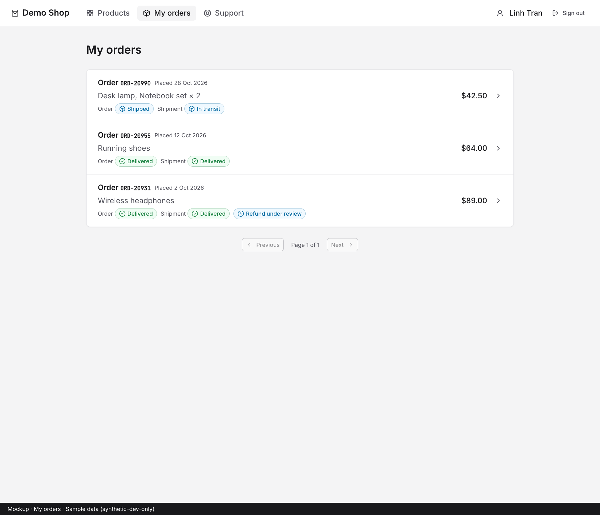
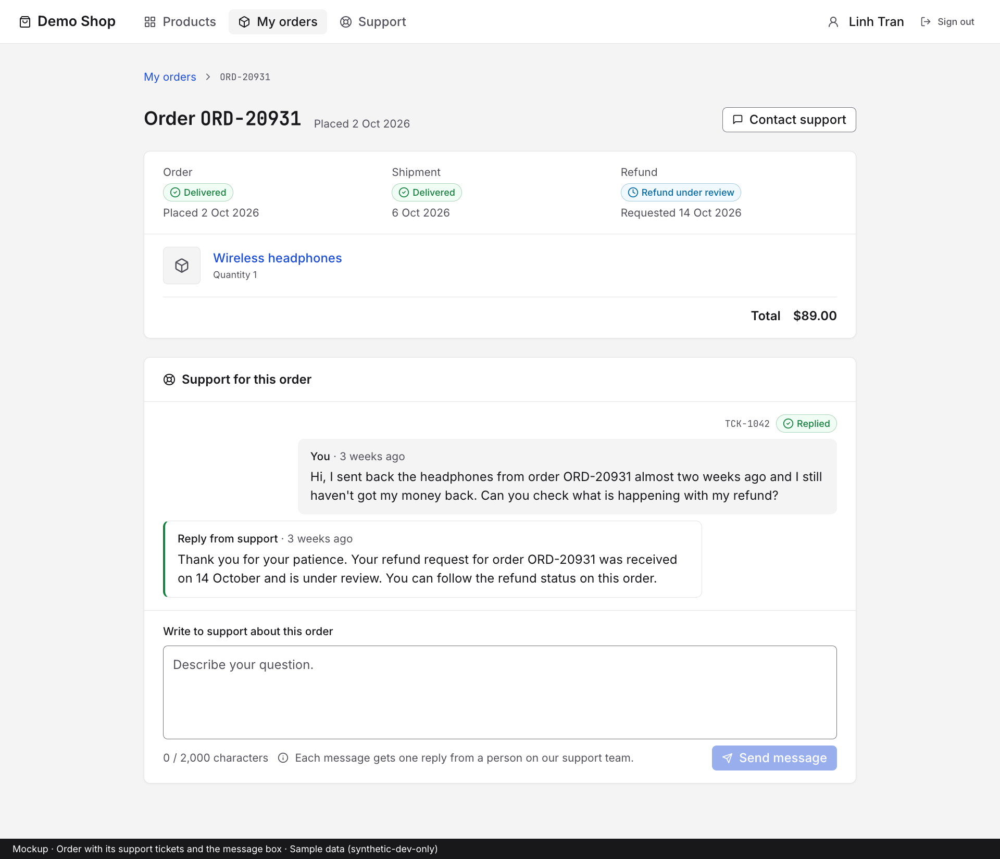
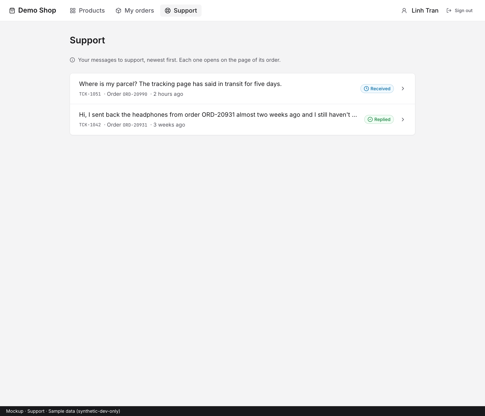
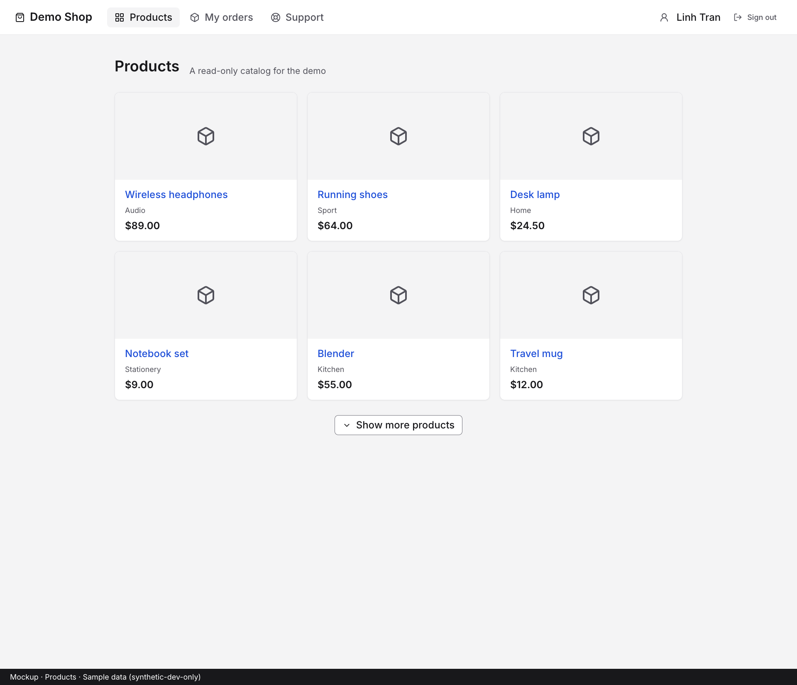
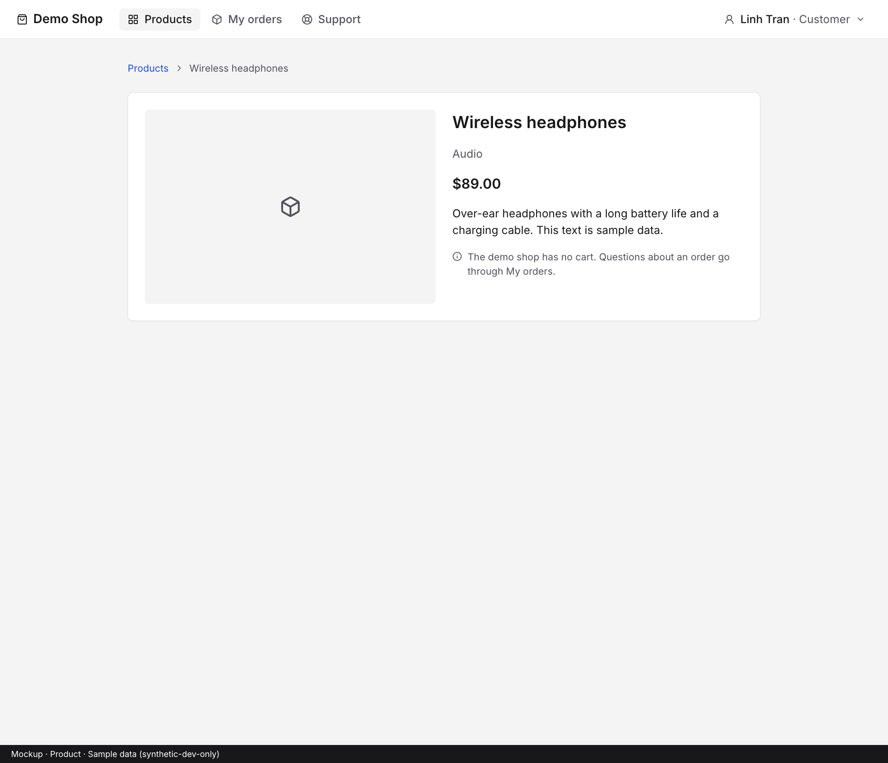
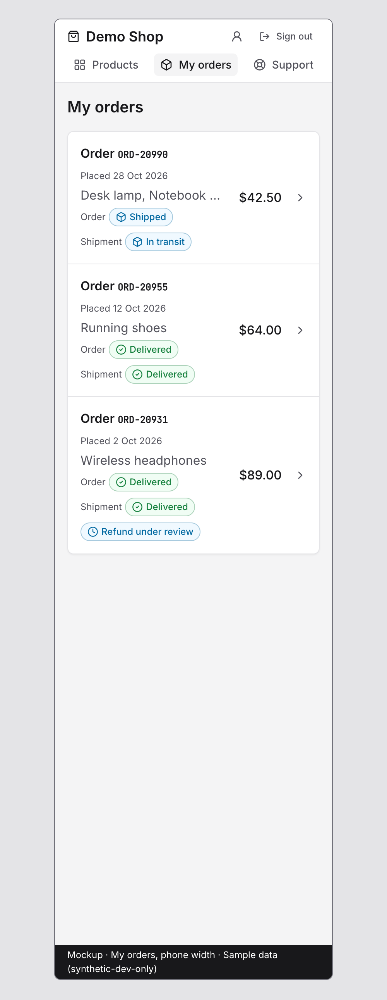
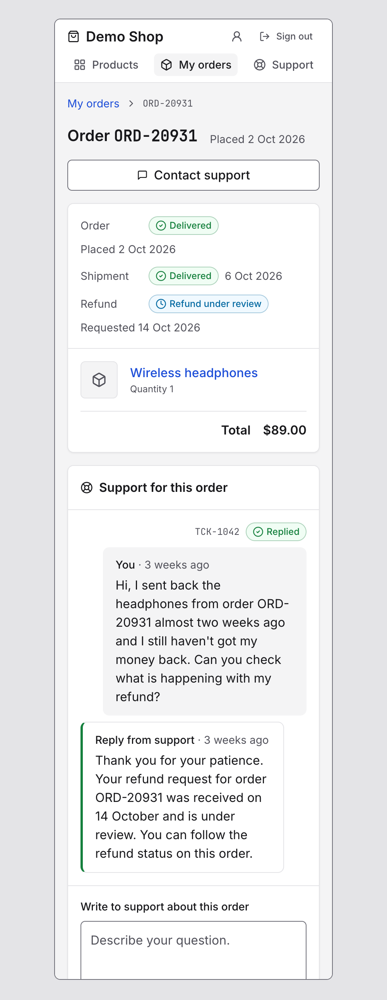
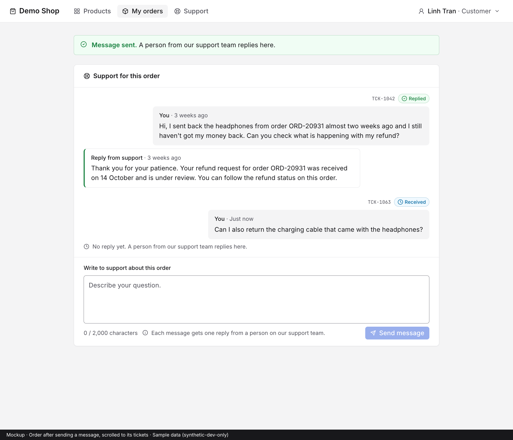
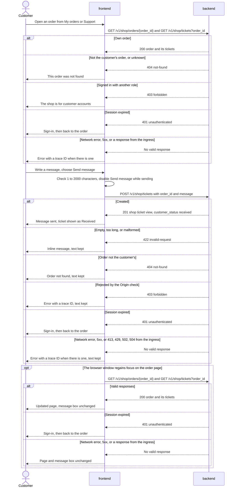
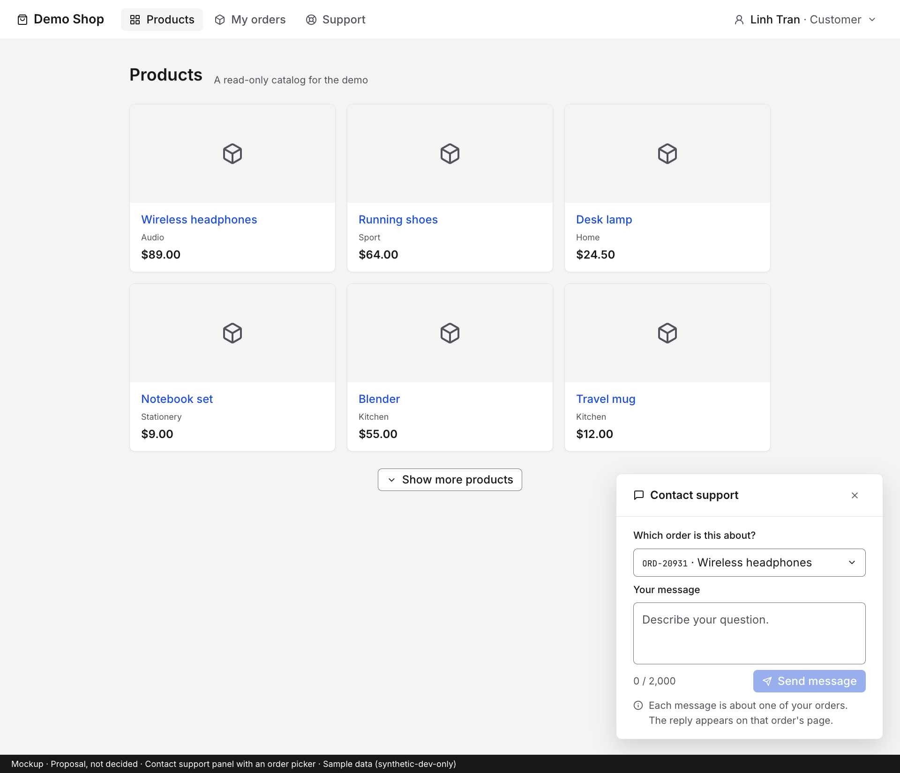

# Design: Shop UI

- **Status:** Approved
- **Owner:** frontend engineer
- **Reviewers:** backend engineer, contracts gatekeeper
- **Last reviewed:** 2026-11-05
- **Related:** [Requirements](../product/requirements.md) (FR-08, FR-11), [ADR-0008](../decisions/0008-ui-design-system.md), [ADR-0009](../decisions/0009-demo-accounts-and-cookie-sessions.md), [ADR-0012](../decisions/0012-roles-v1.md), [ADR-0013](../decisions/0013-shop-demo-with-read-only-catalog.md), [contracts v1 design](contracts-v1.md) (revision 2, in review), [console UI design](console-ui.md) (tokens), [UI rules](../rules/ui.md#shop)

## Summary

This design fixes the screens of `/shop`, where simulated customers browse a read-only catalog, see their orders, write to support about an order, and read the reply once staff send it. Its scope is fixed by [ADR-0013](../decisions/0013-shop-demo-with-read-only-catalog.md), and it reuses the design tokens and primitives of the [console UI design](console-ui.md#design-tokens).

On 2026-11-05 the team chose the layout: My orders is a list, and each order page holds the order details, every ticket about that order with its reply, and a message box. A Support page lists every ticket, and each one opens on the page of its order.

## Goals and non-goals

### Goals

- Every screen reads and writes only through the `/v1/shop/` operations ([UI-39](../rules/ui.md#boundaries)).
- From an open order, a customer sends a message by typing it and choosing Send message.
- The shop never shows AI output, before or after the reply ([ADR-0013](../decisions/0013-shop-demo-with-read-only-catalog.md)).
- Every screen works from 360 px wide ([UI-33](../rules/ui.md#layout-and-performance)) and meets WCAG 2.2 AA ([UI-30](../rules/ui.md#accessibility)).
- Each status has exactly one presentation ([UI-12](../rules/ui.md#visual-semantics)).

### Non-goals

- Everything that ADR-0013 excludes: sign-up, profile editing, a cart, a checkout, payment, search, filters, reviews, and any action that changes an order.
- A conversation with several messages per ticket ([contracts v1](contracts-v1.md#non-goals)).
- Support questions that are not about an order (ADR-0013).
- `/console` and `/admin`, which have their own designs: [console UI](console-ui.md) and [admin UI](admin-ui.md).

## Background

- Shop scope and the neutral product image: [ADR-0013](../decisions/0013-shop-demo-with-read-only-catalog.md) and [UI-38](../rules/ui.md#shop).
- Operations and view models: `listShopProducts`, `getShopProduct`, `listShopOrders`, `getShopOrder`, `createShopTicket`, `listShopTickets`, `ShopProductView`, `ShopOrderView`, and `ShopTicketView` in the [`backend` contract section of contracts v1](contracts-v1.md#backend-contract-backendopenapiyaml).
- A ticket holds one customer message and one reply. `ShopTicketView` shows `customer_status` (`received` or `replied`) and shows the reply only after staff send it.
- Sign-in uses the shared `/sign-in` screen of the [console UI design](console-ui.md#screens) and [ADR-0009](../decisions/0009-demo-accounts-and-cookie-sessions.md).

## Design

### Components and responsibilities

Only `frontend` changes. It reads and writes through the `backend` contract only, checks the message length before sending as a convenience, and leaves every permission check to `backend` ([UI-40](../rules/ui.md#boundaries)).

### Layout

- A top bar with the shop name, "Demo Shop" (decided by the project lead on 2026-11-05), the navigation (Products, My orders, Support), the customer's display name, and Sign out. At phone width the navigation moves to a second row.
- One content column, at most 960 px wide, with 32 px padding on desktop and 16 px at phone width.
- Body text is 16 px ([UI-08](../rules/ui.md#tokens)). Products and order lines show the neutral product image of the design system ([UI-38](../rules/ui.md#shop)).
- After sign-in, `frontend` opens the area of the role that `getCurrentSession` returns: `/shop` for a customer.

### Screens

| Screen | Route (proposed) | Content | Mockup |
|---|---|---|---|
| Sign in | `/sign-in` | Shared with the console | [sign-in.png](assets/console-ui/sign-in.png) |
| Products | `/shop` | Catalog cards: neutral image, name, category, price. Show more products loads the next page ([CON-14](../rules/contracts.md#api-conventions)) | [products.png](assets/shop-ui/products.png) |
| Product | `/shop/products/{product_id}` | Name, category, price, description, neutral image | [product.png](assets/shop-ui/product.png) |
| My orders | `/shop/orders` | List, newest first, with Show more when there is a next page: order ID, `placed_at`, product names, order and shipment status, refund status when there is a refund, total | [orders.png](assets/shop-ui/orders.png) |
| Order | `/shop/orders/{order_id}` | Order, shipment, and refund status with dates; lines that link to their products; total; Support for this order (below) | [order.png](assets/shop-ui/order.png) |
| Support | `/shop/support` | Every ticket of the customer, newest first: excerpt, ticket ID, order ID, time, status. Each row opens the order page at that ticket | [support.png](assets/shop-ui/support.png) |











At phone width:





### Support for this order

The order page ends with one card that holds the tickets of the order and the message box.

- **Tickets:** oldest first. `listShopTickets` returns them newest first, so the order page reverses the list, and Show earlier tickets loads the next page when an order has more tickets than one page holds. The customer's message sits on the right, marked "You". The reply sits on the left, marked "Reply from support", because `ShopTicketView` carries no staff name. Each ticket shows its ID and its status.
- **Message box:** a visible label, "Write to support about this order"; a counter from 0 to 2 000 characters (`MessageText`); and Send message, disabled while the box is empty, over the limit, or sending. The help line says that each message gets one reply from a person on the support team, so the box does not read as a live chat.
- **Contact support:** the button at the top of the order page moves focus to the message box. It helps on long pages and at phone width.
- **After sending:** the box empties, a banner says "Message sent. A person from our support team replies here.", and the new ticket appears as Received.



### Flow



1. The customer opens an order from My orders, or a ticket from Support, which opens its order page at that ticket.
2. The customer writes a message of 1 to 2 000 characters and chooses Send message.
3. `frontend` sends `createShopTicket` with an `Idempotency-Key` created once per Send message. Automatic retries follow [TS-29](../rules/typescript.md#api-access) and [ERR-12](../rules/errors-and-reliability.md#retries) and reuse the key, so a retry never creates a second ticket.
4. On `201`, the new ticket appears as Received with "No reply yet. A person from our support team replies here."
5. When staff send the reply, the ticket shows Replied and the reply. The shop does not poll. The order page loads its order and tickets again in the background when the browser window regains focus, so the reply appears then, or the next time the customer opens the page. The page and the text in the message box stay as they are while it loads.
6. To ask again, the customer sends another message, which creates a new ticket.

### States

| State | When | Shown | Mockup |
|---|---|---|---|
| Loading | A screen waits for `backend` | Skeletons in the place of the content ([UI-24](../rules/ui.md#states)) | [order-loading.png](assets/shop-ui/order-loading.png) |
| No products | `listShopProducts` returns no item | "No products to show." | — |
| No orders | `listShopOrders` returns no item | "You have no orders yet." | — |
| No tickets | The customer has no ticket about this order, or none at all | Order page: only the message box. Support: "You have not written to support yet." | — |
| Sending | After Send message | The button shows progress; the text stays | — |
| Reloading on focus | The browser window regains focus on the order page | No skeleton: the page and the message box stay until the new data arrives. A network error, `5xx`, or a response from the ingress changes nothing | — |
| Loading more | After Show more | The button shows progress; the items already shown stay. On an error, a message under the list and the button again. The button is hidden when there is no next page | — |
| Received | `customer_status` is `received` | Badge Received and the "No reply yet" line | [order-sent.png](assets/shop-ui/order-sent.png) |
| Replied | `customer_status` is `replied` | Badge Replied and the reply | [order.png](assets/shop-ui/order.png) |
| Not found | `404` | "This order was not found.", with Back to My orders | [order-not-found.png](assets/shop-ui/order-not-found.png) |
| Permission denied | `403` on loading a screen: a `staff`, `manager`, or `admin` session opens `/shop` | "The shop is for customer accounts", Sign out, and a copyable trace ID | [permission-denied.png](assets/shop-ui/permission-denied.png) |
| Error | Network error, `5xx`, or a response from the ingress | A plain-language message and a copyable trace ID when there is one ([UI-25](../rules/ui.md#states)) | — |

Times of messages and replies show a relative value, as [UI-29](../rules/ui.md#content) requires. On a touch screen, a tap on the time shows the absolute local time.

### Status presentations (UI-12)

Each badge has an icon and a label, so color is never the only signal. The tones use the color roles of the [console UI design](console-ui.md#design-tokens).

| Status | Value | Tone | Label |
|---|---|---|---|
| Order | `placed`, `processing`, `shipped`, `delivered`, `cancelled` | neutral, info, info, success, neutral | Placed, Processing, Shipped, Delivered, Cancelled |
| Shipment | `not_shipped`, `in_transit`, `delivered`, `delayed`, `lost` | neutral, info, success, warning, danger | Not shipped, In transit, Delivered, Delayed, Lost |
| Refund | `requested`, `under_review`, `approved`, `rejected`, `paid` | info, info, success, danger, success | Refund requested, Refund under review, Refund approved, Refund rejected, Refund paid |
| Refund absent | No refund on the order | neutral | No refund, "Not requested" |
| Ticket | `received`, `replied` | info, success | Received, Replied |

### Data and contracts

- Every screen maps to `ShopProductView`, `ShopOrderView`, or `ShopTicketView` in [contracts v1](contracts-v1.md#backend-contract-backendopenapiyaml) revision 2. The shop schemas have no field that can hold AI output.
- The order page lists the tickets of one order with the optional `order_id` query parameter of `listShopTickets` (contracts v1 revision 2, a compatible change under [CON-19](../rules/contracts.md#evolution)).
- Order lines show the product name and quantity, and the order shows its total. `ShopOrderView` has no price per line, so the shop shows none.
- `getShopTicket` has no screen in this design, because every ticket opens on its order page. Contract PR 2 keeps it, because the Goals of the [backend foundation design](backend-foundation.md#goals) list it.
- Every list requests the default page of 20 items, and Show more requests the next page with `next_cursor` ([CON-14](../rules/contracts.md#api-conventions)). The contract fixes the orders: products by name, orders newest first by `placed_at`, and tickets newest first by `created_at`.

### Errors and guardrails

| Failure or risk | Behavior | Test |
|---|---|---|
| A customer sees AI output | Impossible: shop schemas have no AI fields | Schema test over every `/v1/shop/` response (contracts v1); guardrail test |
| A customer sees another customer's order or ticket | `404`, shown as "not found", so its existence is not revealed ([SEC-17](../rules/security-and-privacy.md#authentication-and-authorization)) | Permission test; component test |
| Another role opens `/shop` | `403`: the permission-denied state | Permission table test; component test |
| A double click or a retry creates two tickets | The `Idempotency-Key` makes the second request return the first result; Send message is disabled while sending | Idempotency test; component test |
| The message is empty or over 2 000 characters | Send message disabled; `422` from `backend` as the backstop, text kept | Component test |
| The message box reads as a live chat with instant replies | The label and help line say that a person replies once to each message | Story review |
| Session expired | `401`: sign-in, then back to the same page; the text of an unsent message is lost | Component test |
| Network error, `5xx`, or a response from the ingress | Plain-language error, trace ID when there is one, text kept | Component test |
| Customer or staff text contains HTML or Markdown | Rendered as plain text ([SEC-22](../rules/security-and-privacy.md#input-and-output-handling)) | Component test |
| The shop changes an order or a payment | Impossible: no such operation exists ([ADR-0013](../decisions/0013-shop-demo-with-read-only-catalog.md)) | Contract test that lists operations |

## Alternatives considered

- **Option A, the form and the tickets only on the order page, without a Support page:** not chosen. A customer who forgets which order a ticket was about has to open the orders one by one.
- **Option B, a separate Support area with its own form page and ticket pages:** not chosen. The reply sits away from the order it is about, and writing a message takes one more step.
- **Option C as first drawn, with the form on its own page:** changed by the team. The form moved into the order page, and My orders became a list like Support.
- **A chat window on every page, including Products:** not chosen. ADR-0013 attaches every message to one of the customer's orders, a ticket holds one message and one reply, and a chat window would read as the autonomous chatbot that the requirements exclude. A Contact support panel with an order picker is drawn as a proposal (Open questions).
- **Polling for the reply while the page is open:** not chosen, because the customer does not wait on the page. On 2026-11-05 the project lead decided that the order page loads its data again when the window regains focus instead.

## Testing and evaluation

- **Storybook:** a story for every block (top bar, product card, order row, order summary, ticket item, message box) in every state, with axe checks ([UI-32](../rules/ui.md#accessibility)).
- **Component tests:** the message counter and Send message enablement, Contact support moving focus to the message box, the status presentations, the mapping of every problem type to a state, the reload on window focus, which keeps the text in the message box also when it fails, and the 360 px layout.
- **End-to-end tests (Playwright):** a customer signs in, opens an order, and sends a message; staff send the reply in the console; the customer sees Replied and the reply on the order page and in Support. The same flow runs at a 360 px viewport.
- No model metric changes.

## Observability

- `frontend` exports no telemetry in v1 ([LOG-04](../rules/logging-and-observability.md)).
- `backend` already logs `ticket.created`. The shop adds no event.

## Security and privacy

- A customer reaches only their own orders and tickets; `backend` enforces it and returns `404` otherwise.
- The shop shows the customer's own Confidential data: messages, order details, and replies. `ShopOrderView` has no shipping address.
- Unsent message text is not written to browser storage, because it is Confidential.
- The mockups use sample data only (`synthetic-dev-only`). Their names, IDs, messages, dates, and prices are not policy or evaluation data.

## Rollout

1. Done on 2026-11-05: the team chose the layout.
2. Done on 2026-11-05: the backend and frontend owners approved this design.
3. Contract PR 2 implements `ShopTicketView` with `replied` and the `order_id` filter of `listShopTickets`.
4. Implementation: the shop blocks join the design system with stories first ([UI-38](../rules/ui.md#shop)), then the screens, against Prism mocks.

### Mockup sources

The mockups in [assets/shop-ui/](assets/shop-ui/) are review material, not `frontend` code. `shop.css` adds the shop layout to the tokens and primitives of [../console-ui/mockup.css](assets/console-ui/mockup.css), `mockup.js` holds the sample data and draws each screen, and `mockup.html?screen=<name>` shows one screen. Screens whose name ends in `-mobile` render inside a 360 px frame. To render every PNG on macOS with Google Chrome:

```bash
docs/design/assets/shop-ui/render.sh
```

## Open questions

- A Contact support panel on every shop page, including Products, with a picker of the customer's orders. It stays within ADR-0013, because each message is still about one order, and the reply still appears on the order page. The team decides whether to add it.

  

- Whether the console order popover adopts the status badges above, so that order, shipment, and refund statuses look the same in both areas (UI-12).
- This design was approved on 2026-11-05 while contracts v1 revision 2 was still in review. If it changes, this design is revised.
