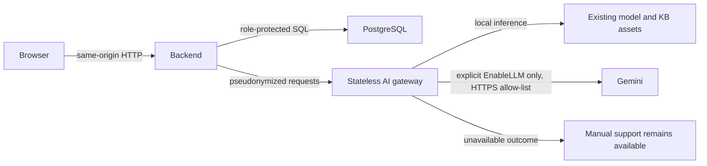

# Run the application on Windows

> **Status:** Active · **Owner:** application · **Last reviewed:** 2026-11-12

For developers running the rebuilt application directly on Windows. The implementation follows the approved [shop](../design/shop-ui.md), [console](../design/console-ui.md), [admin](../design/admin-ui.md), and [backend foundation](../design/backend-foundation.md) designs, with the native runtime requested by the user.

## Start

Install Python, Node 22 or later, pnpm, PostgreSQL binaries, and the existing ML environment. From the project root, run `./scripts/start-app.ps1`, then open `http://127.0.0.1:8080`. First-run account passwords are in the ignored `.local/application.json`; names are listed in [the backend README](../../apps/backend/README.md). Use `-WithoutAI` when the model dependencies are unavailable.

The script prepares a workspace-specific PostgreSQL cluster, migrates and seeds explicitly, builds the frontend, and starts hidden background processes. `stop-app.ps1` validates process identity before stopping those processes. `-StopDatabase` additionally stops the workspace's database without deleting it.



## Runtime Preflight and Windows Application Control

On Windows machines where Windows Application Control (WDAC, AppLocker, or Software Restriction Policies) blocks binary Python C extensions (such as `psycopg_binary` `.pyd`), the application uses the pure-Python ctypes driver (`PSYCOPG_IMPL=python`) together with the allowed native PostgreSQL client library (`libpq.dll`).

1. **Discovery:**
   The startup script and `scripts/native_runtime.py` dynamically discover PostgreSQL binaries:
   - User override via `SUPPORTIQ_PG_BIN` (points to the PostgreSQL `bin/` directory).
   - System `PATH` for `initdb.exe` or `pg_ctl.exe`.
   - Windows Registry (`HKLM\SOFTWARE\PostgreSQL\Installations`).
   - Standard drive installation prefixes (`Program Files/PostgreSQL`, `PostgreSQL`) across available drives.
2. **Environment Configuration:**
   - Preflight sets `PSYCOPG_IMPL=python` if not already specified.
   - Discovered PostgreSQL bin directory is prepended to `PATH` and added to Python's DLL directory list (`os.add_dll_directory`).
3. **Preflight Diagnostics:**
   Run preflight standalone without starting services:
   ```powershell
   python scripts/native_runtime.py preflight
   ```
   If libpq or PostgreSQL is missing, preflight outputs clean diagnostic guidance without printing database credentials or connection strings.

## Source data

The user selected `data/knowledge/mock_orders.json`: 100 synthetic orders. The importer preserves source IDs and stores an unchanged source snapshot in the backend-owned order record; it never edits the JSON file.

| Source | Application mapping |
|---|---|
| `customer_id` | Ownership key. First-occurrence order assigns `customer-1`, `customer-2`, etc. |
| Repeated customer IDs with different names | The first name labels the customer account; all known names and phone values are pseudonymized before AI calls. Names never establish ownership. |
| `items` | Read-only catalog products and order lines, preserving product IDs, names and quantities |
| `total_amount`, `price`, `refund_amount` | VND `amount_minor`; VND has no two-decimal scaling |
| Missing shipping cost | Nonnegative difference between source order total and summed line prices |
| Missing placement date | Deterministic synthetic October 2026 seed dates, marked `date_is_synthetic`; not source facts or evaluation measurements |
| Shipping / In_Transit / Delivery_Delayed | Order `shipped`; shipment `in_transit` / `in_transit` / `delayed` |
| Returned | Order `delivered`; original source status retained |
| Payment_Failed | Order `placed`; original payment status retained |
| Refund Processing | `under_review`; the source's expected refund-time text is preserved |
| Missing product description/category | Explicit synthetic catalog description and `Catalog`; the approved neutral product-image component is used |

For other statuses, see `apps/backend/seed.py`. Normalized enums support the v1 views without inventing an order write operation. Catalog IDs are not merged merely because products share a name.

## Verification and limits

Run Python tests from the repository root and frontend checks from `apps/frontend`, as listed in the component READMEs. End-to-end checks exercise customer-to-staff-to-customer replies at desktop, tablet, 390px and 360px, with axe accessibility checks.

Frontend unit and component tests run via Vitest:
```powershell
cd apps/frontend
pnpm test
```
The test configuration in `vite.config.ts` specifies `pool: 'threads'` to prevent Windows child-process fork timeouts while executing tests accurately.

The current application adds the essential interactive screens and guardrails. Storybook coverage, a full telemetry deployment, import-linter enforcement, CI contract-generation pipelines, production TLS and independent security/load evaluations remain release work; this native setup is a local demonstration, not a deployment of the proposed multi-replica topology. The AI service uses the existing retrieval behavior and model artifacts; it does not claim to implement a newly evaluated retrieval algorithm or calibrator. Unknown-name/address PII recall and semantic grounding must be measured separately. No paid external generation was used in verification.

## General support extension

The user requested support beyond an order on 2026-11-05, superseding the order-required constraint of the original shop design for this application. `/shop/support` now provides topic entry points and a form with an optional owned order. `/shop/support/requests` lists all requests, and `/shop/support/:ticketId` shows general requests and sent replies. Migration 0002 makes the order reference nullable without changing existing tickets. General requests send empty order context to AI and remain subject to customer ownership and human review.

## Editable profile

`/profile` supports display name, email, phone, address and an uploaded avatar. All fields persist in PostgreSQL `accounts` columns (`display_name`, `email`, `phone`, `address`, `avatar_data_url`), introduced by migration 0003. Avatar data is stored in the database, not browser storage; PNG/JPEG/WebP inputs are resized by the client and decoded/verified by the server. GET and PATCH `/v1/profile` access only the authenticated account. Role and account identifiers are not shown in the profile form and cannot be edited. Profile contacts are not exposed through admin account lists or session responses, and are added to known-value pseudonymization for AI requests.

## Demo orders

The user requested Buy to create an order, superseding the earlier read-only-order restriction. A signed-in customer with a phone number and address can create a single-item order at the server-recorded catalog price. The operation uses an idempotency key, checks ownership on reads, and stores status `placed` in PostgreSQL. It does not charge a payment or arrange delivery.

Customers can cancel their own orders while status is `placed`. Cancellation is an explicit confirmed action, uses an idempotency key and changes only the local demo order status. Customer support requests remain available under Support.

## Current KB release and raw scores

The application AI gateway requires `apps/ai_service/kb-release.json`. Only its exact document ID/version pairs enter the embedding index, retrieval results, full-document endpoint or LLM context. The current list contains 14 policy documents and excludes the three legacy `b1000000-…` documents carried over from `approved_kb.v1.json`. Individual current documents may still have version `1.0`; the release list determines eligibility, rather than comparing version numbers across unrelated documents. Approval, role, intent and validity-date checks still apply. The KB/index fingerprint includes the release file, so changes create a distinct asset version. Historical suggestion snapshots retain their original provenance.

Model softmax scores, alternative scores and cosine similarities retain their full returned floating-point values. The console displays raw scores on the 0–1 scale without rounding or percent conversion; raw softmax scores are not calibrated confidence estimates.
