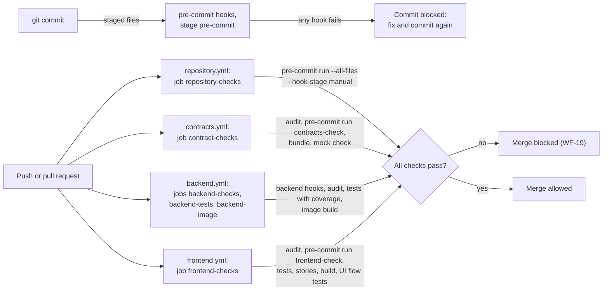

# Repository checks and CI

> **Status:** Active · **Owner:** team · **Last reviewed:** 2026-11-12

How to run the repository-wide checks locally, which GitHub Actions workflows run them, and the convention that every workflow file follows. Read it before you add hooks to `.pre-commit-config.yaml` or a workflow to `.github/workflows/`. The contract tooling itself is described in [contracts/README.md](../../contracts/README.md).

## What runs where

pre-commit is the single runner for the repository-wide checks, on each commit and in CI, so every hook version is pinned once, in [`.pre-commit-config.yaml`](../../.pre-commit-config.yaml) ([WF-20](../rules/workflow.md#continuous-integration), [RULE-03](../rules/README.md#enforcement)).



Each tool is justified here, as [WF-27](../rules/workflow.md#dependencies) requires. All of them have a permissive license ([WF-30](../rules/workflow.md#dependencies)), apart from the frontend licenses that [frontend/README.md](../../frontend/README.md#dependencies) says were approved.

| Check | Tool and license | Why this tool | On commit | In CI |
|---|---|---|---|---|
| File hygiene: large files, case conflicts, shebangs, JSON and YAML syntax, merge markers, final newline, line endings, trailing whitespace | `pre-commit-hooks` 6.0.0, MIT | The standard hooks of pre-commit, one repository for every hygiene check | Yes | `repository-checks` |
| Secrets in the staged changes | gitleaks 8.30.1 (`gitleaks`), MIT | The secret scanner of [ADR-0003](../decisions/0003-tech-stack.md) | Yes | — |
| Secrets in every commit reachable from `HEAD` | gitleaks 8.30.1 (`gitleaks-history`), MIT | The same scanner, over the history of the checked-out branch | — | `repository-checks` |
| Markdown style ([docs/README.md](../README.md#files-and-formatting)), and every relative link and `#fragment` | markdownlint-cli2 0.24.0 with `markdownlint-rule-relative-links` 5.1.4, both MIT | The Markdown linter of the [enforcement table](../rules/README.md#enforcement). The rule plugin checks links and anchors offline, so no website can fail the check | Yes | `repository-checks` |
| Workflow files | actionlint 1.7.12, MIT | Checks the syntax, expressions, and action inputs of GitHub Actions workflows, which no other tool here understands | Yes | `repository-checks` |
| The workflow convention ([Who checks each rule](#who-checks-each-rule)) | The `workflow-*` pygrep hooks of pre-commit 4.7.0 | Pattern checks that need no new tool | Yes | `repository-checks` |
| Contract lint, custom rules, example validation, and the TypeScript checks | `contracts-check`, with the tools of [contracts/README.md](../../contracts/README.md#tools) | [RULE-03](../rules/README.md#enforcement), CON-04 to CON-18 | Yes | `contract-checks` |
| High and critical vulnerabilities in the contract tools | `pnpm audit --audit-level=high` in `contracts/` | [WF-31](../rules/workflow.md#dependencies) | — | `contract-checks` |
| Contract bundles, and the sign-in flow, the `ai-service` service token, and example files through the Prism mock of each contract | `pnpm run bundle`, `pnpm run check:mock` in `contracts/` | Proves that consumers can generate code from the bundle and use the mock | — | `contract-checks` |
| `backend` formatting, lint, strict types, layer and feature boundaries, and generated models | The hooks `backend-format`, `backend-lint`, `backend-types`, `backend-imports`, and `backend-generated`, with the tools of the [`backend` README](../../backend/README.md#dependencies) | [RULE-03](../rules/README.md#enforcement), CON-26 | Yes | `backend-checks` |
| Known vulnerabilities in every locked `backend` dependency | pip-audit 2.10.1, Apache-2.0 | [WF-31](../rules/workflow.md#dependencies) | — | `backend-checks` |
| `backend` tests against PostgreSQL 17, with branch coverage | pytest 9.2.0, MIT, and coverage 7.17.2, Apache-2.0 | TEST-21 | — | `backend-tests` |
| The `backend` image build | `docker build` of `backend/Dockerfile` | ARCH-10 | — | `backend-image` |
| Format, lint, types, boundaries, and the generated client of frontend | `frontend-check`, with the tools of [frontend/README.md](../../frontend/README.md#dependencies) | [RULE-03](../rules/README.md#enforcement), [TS-02](../rules/typescript.md#toolchain), [TS-27](../rules/typescript.md#api-access) | Yes | `frontend-checks` |
| High and critical vulnerabilities, unit tests, stories, the build, and the UI flow tests | `pnpm audit`, `test:unit`, `test:stories`, `build`, `test:e2e` in `frontend/` | [WF-31](../rules/workflow.md#dependencies), [TEST-21](../rules/testing.md#coverage), [UI-32](../rules/ui.md#accessibility) | — | `frontend-checks` |

pre-commit installs the runtimes of the hooks at the versions in `default_language_version`: Go 1.27.3 for gitleaks and actionlint, and Node.js 24.22.2 for markdownlint-cli2.

## Set up pre-commit

1. Install [uv](https://docs.astral.sh/uv/) ([ADR-0003](../decisions/0003-tech-stack.md)).
2. Install pre-commit 4.7.0, the version that CI installs. `.pre-commit-config.yaml` refuses older versions:

   ```bash
   uv tool install --python 3.12 pre-commit==4.7.0
   ```

3. Install the git hook in your clone:

   ```bash
   pre-commit install
   ```

4. Install the contract tools, which the `contracts-check` hook calls ([contracts/README.md](../../contracts/README.md#set-up)):

   ```bash
   cd contracts && pnpm install --frozen-lockfile
   ```

5. Install the frontend tools, which the `frontend-check` hook calls ([frontend/README.md](../../frontend/README.md#set-up)):

   ```bash
   cd frontend && pnpm install --frozen-lockfile
   ```

The first run downloads Go and Node.js for the hooks and builds gitleaks and actionlint, which takes several minutes. Later runs reuse `~/.cache/pre-commit`.

## Commands

Run every command in the repository root.

| Command | What it does |
|---|---|
| `pre-commit run --all-files` | Runs the commit hooks on every tracked file |
| `pre-commit run --all-files --hook-stage manual` | Runs what the `repository-checks` job runs, including the history scan for secrets |
| `pre-commit run contracts-check --all-files` | Runs what the `contract-checks` job runs before the bundle and the mock check |
| `pre-commit run frontend-check --all-files` | Runs what the `frontend-checks` job runs before the tests |
| `pre-commit run --files <path> …` | Runs the hooks on the given files, for example new files that are not tracked yet |

`--all-files` covers tracked files only. A file that is not staged yet is checked with `--files`.

## Workflow convention

Every file in `.github/workflows/` follows these rules, including the `backend.yml` and `frontend.yml` files that the component owners add ([WF-19](../rules/workflow.md#continuous-integration)). actionlint checks the syntax of every workflow, the `workflow-*` hooks of `.pre-commit-config.yaml` check every rule that a pattern can check, and reviewers check the rest ([Who checks each rule](#who-checks-each-rule)).

1. **One workflow per area.** The file is `.github/workflows/<area>.yml` with `name: <area>`: `repository`, `contracts`, `backend`, `frontend`.
2. **Triggers.** Exactly these, and nothing else ([ADR-0017, CI](../decisions/0017-repository-layout-and-ai-ml-migration.md#ci), statement 3):

   ```yaml
   on:
     push:
       branches:
         - main
         - "build/**"
     pull_request:
       branches:
         - main
   ```

3. **No path filters.** No `paths` or `paths-ignore`, and no job-level or step-level `if:` that skips a check, so a required check always runs and always reports.
4. **Permissions.** `permissions: contents: read` at the top of the file. No job widens it. No workflow uses `pull_request_target`.
5. **Pinned actions.** Every `uses:` names a full 40-character commit SHA, followed by the version in a comment, for example `actions/checkout@3d3c42e5aac5ba805825da76410c181273ba90b1  # v7.0.1`. `actions/checkout` sets `persist-credentials: false`.
6. **Pinned runners.** Jobs run on `ubuntu-24.04`, not on `ubuntu-latest`.
7. **Concurrency.** Each workflow has:

   ```yaml
   concurrency:
     group: ${{ github.workflow }}-${{ github.ref }}
     cancel-in-progress: true
   ```

8. **Timeouts.** Every job sets `timeout-minutes`.
9. **Frozen installs.** Tools come from the pinned files only: `.nvmrc`, `packageManager`, and `pnpm install --frozen-lockfile` for Node.js; `.python-version` and `uv sync --locked` for Python; pre-commit 4.7.0 installed with `uv tool install --python 3.12 pre-commit==4.7.0`.
10. **Failures stay failures.** No `continue-on-error`, no `|| true` or other way to ignore an exit code, no automatic reruns, and no retry actions.
11. **Unique job names.** Every job sets a `name` that is unique across all workflows and starts with its area: `repository-checks`, `contract-checks`, `backend-…`, `frontend-…`. Branch protection matches required checks by these names.
12. **Hooks through pre-commit.** A component's repository-wide hooks go in its marked section of `.pre-commit-config.yaml`:
    - each hook sets `stages: [pre-commit]`, so the `repository-checks` job does not run it;
    - each hook calls the component's own locked toolchain, as `contracts-check` runs `pnpm run check` inside `contracts/`, so its tool versions stay pinned in the component's lockfile;
    - the component's workflow runs its hooks with `pre-commit run <hook-id> --all-files`.

### Who checks each rule

The `workflow-*` hooks are pygrep hooks, which come with pre-commit. Each one fails when its pattern matches a line of a workflow or, for a required pattern, when the pattern is missing from the file. A hook cannot see what YAML means, so a rule it cannot express as a pattern stays with the reviewers.

| Rule | Checked by |
|---|---|
| 1. One workflow per area, `name: <area>` | Reviewers |
| 2. Exactly the push and pull request triggers | `workflow-triggers` |
| 3. No path filters, and no `if:` on a job or a step | `workflow-no-path-filters`, `workflow-no-if` |
| 4. `permissions: contents: read` at the top, no job-level permissions, no `pull_request_target` | `workflow-permissions-read`, `workflow-no-job-permissions`, `workflow-no-pull-request-target` |
| 5. Every `uses:` names a 40-character SHA and a `# v` comment; `actions/checkout` sets `persist-credentials: false` | `workflow-pinned-actions`, `workflow-checkout-credentials`. Reviewers check that the comment names the version of that SHA |
| 6. Jobs run on `ubuntu-24.04` | `workflow-pinned-runner` |
| 7. The concurrency group | `workflow-concurrency` |
| 8. `timeout-minutes` on every job | `workflow-has-timeout`, `workflow-timeout-on-every-job`. Reviewers check that each value is reasonable |
| 9. Frozen installs: `pnpm install` with `--frozen-lockfile`, `uv sync` with `--locked`, no `pip install` or `npm install`, and pre-commit 4.7.0 | `workflow-frozen-installs`. Reviewers check that runtimes come from `.nvmrc`, `packageManager`, and `.python-version` |
| 10. No `continue-on-error`, no `\|\| true` or `\|\| :`, no retry actions or reruns | `workflow-no-continue-on-error`, `workflow-no-ignored-exit-code`, `workflow-no-retries`. Reviewers check other ways to ignore an exit code |
| 11. Job names unique across workflows and prefixed with their area | Reviewers |
| 12. Component hooks set `stages: [pre-commit]`, call the component's locked toolchain, and run with `pre-commit run <hook-id> --all-files` | Reviewers |

## Branch protection

Set these on GitHub for `chore/fe-be-supportiq-ecom` (Settings → Branches, or a ruleset):

- Require a pull request before merging, with at least one approval ([WF-15](../rules/workflow.md#reviews)).
- Require status checks to pass, with the branch up to date before merging. Required checks: `repository-checks`, `contract-checks`, `backend-checks`, `backend-tests`, `backend-image`, and `frontend-checks`.
- Block force pushes and deletions ([WF-07](../rules/workflow.md#branches)).

## The first CI run

GitHub Actions cannot run locally. On the first push, check:

1. All four workflows start, and the jobs `repository-checks`, `contract-checks`, `backend-checks`, `backend-tests`, `backend-image`, and `frontend-checks` appear. A missing workflow means a trigger or syntax problem. `frontend-checks` installs Chromium with `playwright install --with-deps chromium`.
2. Every `uses:` step resolves. "Unable to resolve action" means a wrong commit SHA.
3. `contract-checks` installs pnpm 12.16.1 and Node.js 24.22.2, and `pnpm install --frozen-lockfile` neither reports an outdated lockfile nor stops on an ignored build script.
4. `repository-checks`, `contract-checks`, `backend-checks`, and `frontend-checks` install pre-commit 4.7.0. The first `repository-checks` run downloads Go 1.27.3 and Node.js 24.22.2 for the hooks and saves the cache; the second run is faster.
5. `repository-checks` passes `Detect hardcoded secrets in the git history`. It scans only the commits reachable from `HEAD`: other branches of the clone, such as `main`, are not scanned.
6. `pnpm audit --audit-level=high` reports no high or critical advisory except the one ignored in `contracts/pnpm-workspace.yaml`, and `pnpm run check:mock` prints seven `ok` lines: three for `backend.openapi.yaml` and four for `ai-service.openapi.yaml`.
7. `backend-tests` reaches the PostgreSQL 17 service, creates `supportiq_owner` and `supportiq_app`, and passes both coverage reports. `backend-image` builds `backend/Dockerfile`, which only CI builds.
8. All jobs finish within their `timeout-minutes`. Then set the branch protection above.

## Open questions

- External links are not checked yet, because a check that depends on other websites fails at random and must not block a merge. The proposal: a third workflow, `links.yml`, triggered only by `schedule` (weekly) and `workflow_dispatch`, runs lychee on every Markdown file and reports broken external links. It is never a required check, and broken links are fixed in a normal pull request. It needs a team decision, because it adds a workflow and a tool.
