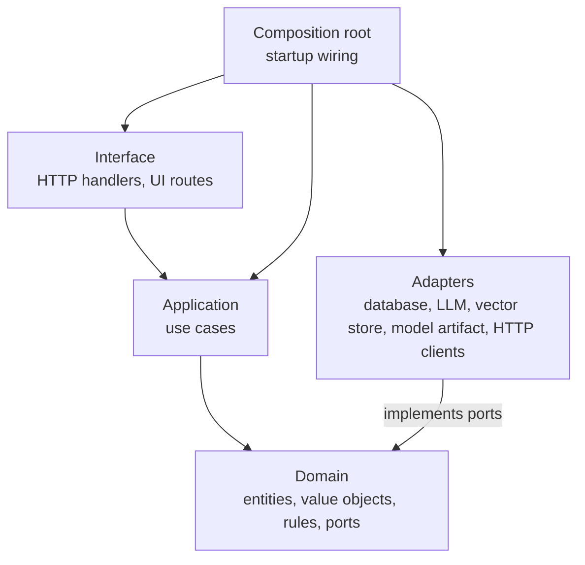

# Architecture rules

> **Status:** Active · **Owner:** team · **Last reviewed:** 2026-11-23

Rules for where code lives, how parts depend on each other, and how the system grows without rewrites. The component map and its reasons are in [ADR-0001](../decisions/0001-system-architecture.md).

## Principles for long-term extensibility

1. **Stable core, replaceable edges.** Business rules stay put; frameworks, providers, and storage are swappable adapters.
2. **Extend by adding, not by editing.** New behavior arrives as a new adapter, a new feature module, a new configuration entry, or a new versioned data file, not as another branch in an existing `if` chain.
3. **Data-driven where the business changes.** Intent routing, thresholds, prompts, and the KB are versioned data or configuration, not code.
4. **Explicit dependencies.** Everything a unit needs is passed in. Nothing is fetched from a global.
5. **One owner per piece of data and per decision.**

## Component boundaries

**ARCH-01.** `frontend`, `backend`, and `ai-service` MUST NOT import each other's code. They share only `contracts/`, and each generates its own code from it.

**ARCH-02.** `frontend` calls only `backend`. `backend` is the only caller of `ai-service`.

**ARCH-03.** Components MUST NOT share a database, a file system location, or an in-memory store. Each component owns its data.

**ARCH-04.** `ai-service` MUST NOT read `backend` data. `backend` sends only pseudonymized text and the minimal order context each request needs ([security-and-privacy.md](security-and-privacy.md#data-sent-to-llm-providers), [SEC-36](security-and-privacy.md#pseudonymization)).

**ARCH-05.** Only `backend` MAY send a reply to a customer, and only as the result of a staff action.

**ARCH-06.** `ai-service` recommends; `backend` enforces ticket state, permissions, and manual handling; staff decide. No component makes a decision that belongs to another.

**ARCH-07.** LLM API keys and prompt templates exist only in `ai-service`.

**ARCH-08.** `ml/`, `pipeline/`, and `eval/` are not on the serving path. `ml/` and `pipeline/` produce versioned artifacts; `ai-service` only loads them.

**ARCH-09.** `ai-service` keeps no per-ticket state between requests. Every request carries what it needs.

**ARCH-10.** Each component has its own README, configuration, Dockerfile, test suite, and dependency lockfile.

**ARCH-42.** Deployment configuration (the setup steps and the settings of each hosting platform, without secret values, and observability provisioning) lives in `deploy/` ([ADR-0016](../decisions/0016-hosting-on-free-tiers.md)). Three parts live elsewhere. Two live where their platform reads them: the deploy workflow in `.github/workflows/`, and the Pages Function with its routes in `frontend/`. The third is the Modal app of `ai-service`, `ai-service/modal_app.py`, next to the Dockerfile whose image it deploys, so the toolchain of `ai-service` checks and tests it ([ADR-0030](../decisions/0030-release-archives-and-the-modal-function-of-ai-service.md#the-modal-function)). Components never read files from `deploy/` at runtime; they receive values through their settings. The Modal app reads `deploy/llm-prices.env` only on the deploying machine and passes its values to `ai-service` as settings.

## Layers

Each component uses ports and adapters (hexagonal architecture). Dependencies point inward only. In the diagram, an arrow means "depends on".



| Layer | Contains | MAY import | MUST NOT import |
|---|---|---|---|
| Interface | HTTP handlers, request and response mapping, UI routes | Application, its own contract models | Adapters, database drivers, LLM SDKs |
| Application | Use cases that orchestrate the domain through ports; transaction boundaries | Domain | Interface, adapters, frameworks, SDKs |
| Domain | Entities, value objects, business rules, domain errors, port interfaces | Standard library; the public API of `platform`, for the root error (PY-20) and for shared errors, types, and pure functions; the public API of a lower feature, for its identifiers and errors | Frameworks, drivers, SDKs, adapters, interface code |
| Adapters | Port implementations | Domain, third-party SDKs and drivers | Interface, application, other adapters |
| Composition root | Creates adapters, wires them into use cases, configures the framework | Everything | — |

**ARCH-11.** Layer imports follow the table above. The rule is enforced by import-linter (Python) and dependency-cruiser (TypeScript).

**ARCH-12.** Domain code MUST be testable with fakes alone: no network, no database, no file system, no API keys.

**ARCH-13.** Decision logic (routing, abstention, escalation, validity checks) is pure domain code. It MUST NOT live in prompts, HTTP handlers, adapters, or the UI.

**ARCH-14.** HTTP handlers are thin: parse the request, call exactly one use case, map the result to the contract.

**ARCH-15.** Contract models (generated from `contracts/`) and ORM models never enter the domain. The interface layer and adapters map them to domain types.

## Feature modules

**ARCH-16.** Code is organized by feature first, then by layer inside each feature.

```text
backend/app/
├── tickets/
│   ├── domain/
│   ├── application/
│   ├── adapters/
│   ├── api/
│   └── __init__.py      # public API of the feature
├── commerce/
├── decisions/
├── platform/            # cross-cutting infrastructure: settings, logging setup, database session
└── main.py              # composition root
```

The layout is illustrative. Each component fixes its exact layout in its README at scaffold.

**ARCH-17.** A feature exposes a public API through its package entry point (`__init__.py` with `__all__`, or `index.ts`). Other features import only that API, never internal modules.

**ARCH-18.** Features MUST NOT form import cycles. When two features need each other, extract the shared concept into a third feature or communicate through an application-level interface.

**ARCH-19.** `platform/` holds only cross-cutting infrastructure (settings, logging setup, database session, HTTP client factory). It contains no business logic.

**ARCH-20.** Folders or modules named `utils`, `helpers`, `common`, `shared`, or `misc` are forbidden. Name modules after what they do.

## Composition root and dependency injection

**ARCH-21.** Each component has exactly one composition root, where all adapters are created and wired. No other place constructs adapters.

**ARCH-22.** Dependencies are passed through constructors or function parameters. Service locators, global registries, and module-level singletons are forbidden.

**ARCH-23.** Importing a module MUST NOT cause side effects: no I/O, no network, no environment reads, no registration. Startup work happens in the composition root.

**ARCH-24.** Long-lived resources (HTTP clients, database engines, loaded models) are created once at startup and closed at shutdown through the framework's lifespan hooks.

## Ports and adapters

**ARCH-25.** Ports are defined in the domain and named for what the domain needs: `IntentClassifier`, `Retriever`, `DraftGenerator`, `CommerceGateway`, `DecisionLog`, `Clock`. They are never named after technologies (`PostgresRepo`, `OpenAiClient` are adapter names).

**ARCH-26.** Ports are small and focused (interface segregation). A port with more than five methods is split.

**ARCH-27.** Every port has an in-memory fake used by unit tests, kept next to the tests of the feature that owns the port.

**ARCH-28.** Adapters translate third-party errors into domain errors. No third-party exception type crosses into the application layer.

**ARCH-29.** Replacing a provider (LLM, vector store, database) MUST require only a new adapter and a change in the composition root. If it requires changes elsewhere, the port is wrong.

## State, time, and side effects

**ARCH-30.** Persistent state lives only in a component's own data store. In-memory caches are never a source of truth; every cache is explicit, bounded, has a documented expiry, and can be disabled by configuration. Adding a cache needs an ADR ([ADR-0011](../decisions/0011-deployment-and-runtime-topology.md#caching-and-updates)).

**ARCH-31.** Time, randomness, and identifier generation are dependencies (`Clock`, random generator, ID factory) injected into the code that needs them.

**ARCH-32.** I/O happens only in adapters and the composition root.

**ARCH-41.** `backend` replicas share no in-process state. Sessions, sign-in failure counters, idempotency records, suggestion jobs, audit log entries, and pseudonym maps live in PostgreSQL. Background work runs only through the suggestion job queue; no other in-process scheduler or queue exists ([ADR-0011](../decisions/0011-deployment-and-runtime-topology.md#suggestion-job-queue)).

## Configuration

**ARCH-33.** Configuration comes from environment variables or configuration files, read in one typed settings object per component. No other code reads the environment.

**ARCH-34.** Settings are validated at startup. A missing or invalid value stops startup with a message naming the setting.

**ARCH-35.** `.env` files are git-ignored. `.env.example` lists every setting with a safe placeholder and a one-line comment.

**ARCH-36.** Every tunable value is either a setting or an entry of a versioned asset, never a literal in code. Operational values (top-k, timeouts, retry counts, queue settings) are settings whose name includes their unit (`llm_timeout_ms`) and whose comment links their origin: an ADR, a requirement, or an evaluation run. Values tuned on data for one model (τ, δ, the rerank weight λ, the list of sensitive intents, and the sensitive-term list) live in the routing configuration ([DATA-58](data-and-ml.md#models-and-artifacts)).

**ARCH-37.** Defaults are safe: when a setting controls a guardrail, its default is the most conservative value.

## Versioned assets

**ARCH-38.** Model artifacts, KB versions, prompt templates, the routing configuration, the document-to-intent mapping, the retrieval index, and the release manifest that names them together are versioned assets. Each has an explicit version string ([DATA-56](data-and-ml.md#models-and-artifacts)).

**ARCH-39.** Every suggestion reports the `release_id` and the versions of all assets that produced it (`model_version`, `kb_version`, `prompt_version`, and others defined in the contract).

**ARCH-40.** A versioned asset is immutable once published. A change produces a new version.

## Extension recipes

Follow these recipes when extending the system. If a change does not fit a recipe, it needs a design doc.

### Add a feature

1. Create a feature folder with `domain/`, `application/`, `adapters/`, and `api/` (only the layers it needs).
2. Define domain types and ports first, with unit tests against fakes.
3. Expose the public API through the package entry point.
4. Wire adapters in the composition root.
5. Document the feature in the component README.

### Add an API endpoint

1. Change the contract first ([contracts.md](contracts.md#contract-first-process)).
2. Regenerate models and mocks.
3. Add a use case in the application layer with unit tests.
4. Add a thin handler in the interface layer.
5. Add provider contract tests for every outcome, including errors.

### Add or replace an external provider

1. Confirm the domain port covers the need. If not, change the port in a design doc.
2. Write an adapter that implements the port and maps provider errors to domain errors.
3. Add adapter tests against a fake or a local instance, including timeouts and malformed responses.
4. Select the adapter in the composition root through a setting.
5. Record the choice in an ADR if it is framework-level or a new LLM provider.

### Add a setting

1. Add a typed field to the settings object, with validation and a safe default (or no default if it is required).
2. Add it to `.env.example` with a comment.
3. Inject it where it is used; never read it from the environment directly.
4. Document its origin if it is tunable.

### Change routing, thresholds, or prompts

1. Treat it as a change to a versioned asset: create a new version.
2. Create a candidate release manifest that names the new version ([DATA-56](data-and-ml.md#models-and-artifacts)).
3. Run the offline evaluation gate on the candidate and compare it against the current release and the baseline ([DATA-57](data-and-ml.md#models-and-artifacts)).
4. Report the numbers in the PR ([data-and-ml.md](data-and-ml.md#evaluation-and-reporting)). Publish the release only if the gate passes.
