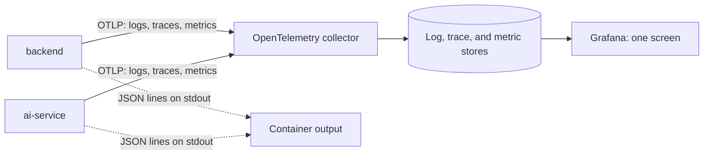

# Logging and observability rules

> **Status:** Active · **Owner:** team · **Last reviewed:** 2026-10-23

Telemetry that is easy to read, collected in one place, and viewed on one screen. It must trace any ticket across components, help reconstruct any suggestion (FR-07), and measure latency, cost, and product value, without carrying confidential data. The stack is defined in [ADR-0007](../decisions/0007-observability-stack.md).

## Goals

1. **One place.** Logs, traces, and metrics from every server component go to the same observability stack.
2. **One screen.** Grafana shows all three signals, linked by trace ID.
3. **Readable.** A developer understands what happened to a ticket from its trace and its log lines alone.
4. **Private.** Telemetry never contains confidential or secret data.



## Setup

**LOG-01.** `backend` and `ai-service` are instrumented with OpenTelemetry and export logs, traces, and metrics over OTLP to the collector address in settings.

**LOG-02.** Each component also writes its logs to stdout as JSON lines, so logs remain available when the collector is down. A telemetry export failure never fails a request.

**LOG-03.** Each component has exactly one logging and telemetry setup module (in `platform/`). It configures format, redaction, and export. No other code configures logging.

**LOG-04.** `frontend` does not export telemetry in v1. Traces start at the `backend` HTTP entry point. `backend` returns the trace ID in Problem Details responses (`trace_id` extension member) and stores it with each suggestion, so the UI can show it ([UI-35](ui.md#developer-views)).

## Correlation

**LOG-05.** Trace context propagates in the W3C `traceparent` header on every HTTP call between components, through the HTTP server and client instrumentation.

**LOG-06.** Every log record carries `trace_id` and `span_id`. Work outside a request (startup, scheduled jobs) starts its own span.

**LOG-07.** Business identifiers (`ticket_id`, `suggestion_id`, `decision_id`) are attributes on spans and log records, never embedded in the message text, so they are searchable.

**LOG-08.** Correlation never relies on free text or timestamps.

## Log record schema

**LOG-09.** Every log record has these fields, with these exact names, in every component:

| Field | Type | Meaning |
|---|---|---|
| `timestamp` | RFC 3339, UTC | When the event happened |
| `level` | `debug`, `info`, `warning`, `error` | Severity ([Levels](#levels)) |
| `service` | string | `backend` or `ai-service` |
| `event` | string | Stable event name from the event catalog |
| `message` | string | One short, human-readable sentence |
| `trace_id`, `span_id` | string | Trace context |
| `ticket_id` | string, optional | The ticket concerned |
| `reason_code` | string, optional | The reason code, when relevant |
| `duration_ms` | integer, optional | Duration of the operation |
| `error_type` | string, optional | Domain error type name |
| `model_version`, `kb_version`, `prompt_version` | string, optional | Versions involved |

**LOG-10.** Additional attributes are allowed only from an allow-list kept in the setup module. Attribute values are scalars (string, number, boolean). Logging whole objects, dictionaries, request bodies, or response bodies is forbidden.

## Event names

**LOG-11.** Every event has a stable name made of `lower_snake_case` segments: `<area>.<past_tense_verb>`, for example `ticket.created`, `draft.abstained`, `ai_service.call_failed`.

**LOG-12.** Event names are constants defined once per component in an event catalog module and listed in the component README. Ad-hoc event names are forbidden.

**LOG-13.** Renaming or removing an event updates every dashboard and alert that uses it in the same PR.

## Messages

**LOG-14.** A message is one sentence that starts with a capital letter, has no trailing period, states the outcome, and contains no variable data. Variable data goes in attributes.

```text
Good: event=draft.abstained message="Draft abstained because no valid document was found" reason_code=no_valid_document
Bad:  message="error!!!"
Bad:  message="draft failed for ticket 123, msg='where is my order...'"
```

## Levels

**LOG-15.** Levels have exactly these meanings:

| Level | Use when | Example |
|---|---|---|
| `error` | A defect or an unhandled failure that needs a developer | Unexpected exception; model artifact failed to load |
| `warning` | Degraded but handled; the system behaved safely | `ai-service` timed out and the ticket moved to manual handling; LLM circuit breaker opened |
| `info` | A normal business or lifecycle event | Ticket created; draft generated; decision recorded |
| `debug` | Developer detail; off by default in shared environments | Retrieval scores per candidate |

**LOG-16.** Business outcomes such as abstention or escalation are `info`. They are correct behavior, not failures.

**LOG-17.** Each failure is logged once, where it is handled ([ERR-05](errors-and-reliability.md#handling-rules)).

**LOG-18.** No log line per element of a large collection. Log a summary with counts instead.

## Required events

**LOG-19.** At minimum, components emit these events:

| Component | Events |
|---|---|
| Both | `startup.completed`, `settings.loaded`, `settings.invalid`, `shutdown.started` |
| `backend` | `ticket.created`, `ai_service.called`, `ai_service.call_failed`, `ticket.manual_handling_started`, `decision.recorded`, `reply.sent`, `permission.denied` |
| `ai-service` | `model.loaded`, `kb.loaded`, `analysis.completed`, `draft.generated`, `draft.abstained`, `escalation.recommended`, `llm.call_failed`, `grounding.check_failed` |

## Traces

**LOG-20.** There is one span per pipeline step and per external call. Span names are low-cardinality `snake_case` operations: `classify_intent`, `retrieve_documents`, `filter_valid_documents`, `rerank_documents`, `route_ticket`, `generate_draft`, `check_grounding`, `call_ai_service`, `save_decision`. HTTP and database spans come from auto-instrumentation.

**LOG-21.** Spans carry the asset versions, counts (`candidate_count`, `citation_count`), the outcome status, and reason codes. `generate_draft` carries token usage using the OpenTelemetry generative AI conventions (`gen_ai.usage.input_tokens`, `gen_ai.usage.output_tokens`) and the estimated cost in integer micro-dollars (`supportiq.llm.cost_micro_usd`).

**LOG-22.** A failure is recorded on its span (error status and exception event) in addition to its single log line.

## Metrics

**LOG-23.** Metric names follow OpenTelemetry semantic conventions where one exists, for example `http.server.request.duration`. Custom metrics are named `supportiq.<area>.<name>` and declare their unit.

**LOG-24.** Required metrics:

| Metric | Type | Unit | Attributes |
|---|---|---|---|
| `http.server.request.duration` | Histogram | `s` | route, method, status code |
| `supportiq.pipeline.step.duration` | Histogram | `ms` | step |
| `supportiq.suggestion.outcomes` | Counter | `{suggestion}` | status, reason code |
| `supportiq.llm.tokens` | Counter | `{token}` | direction (`input`, `output`) |
| `supportiq.llm.cost` | Counter | micro-USD | — |
| `supportiq.ai_service.unavailable` | Counter | `{event}` | — |
| `supportiq.staff.decisions` | Counter | `{decision}` | decision, reason code |
| `supportiq.ticket.handling.duration` | Histogram | `s` | mode (`assisted`, `manual`) |

**LOG-25.** Metric attributes have low cardinality. Identifiers (`ticket_id`, `trace_id`) and free text are forbidden as metric attributes.

## Dashboards

**LOG-26.** Dashboards are provisioned from JSON files in the repository (dashboards as code). A dashboard changed in the UI is exported and committed in the same PR.

**LOG-27.** Required dashboards:

| Dashboard | Shows |
|---|---|
| System overview | End-to-end p50 and p95 against the 12 s target, error rate, cost per request, readiness of each component |
| AI pipeline | Latency per step, suggestion outcomes by status and reason code, abstention and escalation rates, LLM tokens and cost |
| Staff outcomes | Approve, edit, reject, and escalate rates by intent; handling time assisted versus manual |
| Ticket trace | Search by ticket ID or trace ID; the full trace with its linked log lines |

**LOG-28.** Every panel states its unit. Target lines on panels come from the [requirements](../product/requirements.md#5-quality-requirements).

## Privacy in telemetry

**LOG-29.** Telemetry MUST NOT contain Confidential or Secret data ([data classification](security-and-privacy.md#data-classification)): no customer message text, draft text, reply text, staff note text, names, emails, phone numbers, addresses, payment data, credentials, or tokens.

**LOG-30.** The setup module drops attributes that are not allow-listed and masks known personal-data patterns. A test sends confidential samples through the logger and asserts they never appear in the output ([TEST-26](testing.md#guardrail-tests)).

**LOG-31.** Prompt and completion capture is off by default. It may be enabled only in a local environment, only with synthetic data, only inside `ai-service`, and only to a git-ignored local file. It is never exported to the collector.

## Alerts and retention

**LOG-32.** Alerts are actionable: they name the slice, the threshold, the affected decision, the owner, and the first action. In the prototype, alerts are dashboard thresholds; nobody is paged.

**LOG-33.** Telemetry is disposable. Evaluation data comes from `backend` decision records and evaluation runs, never from logs.
