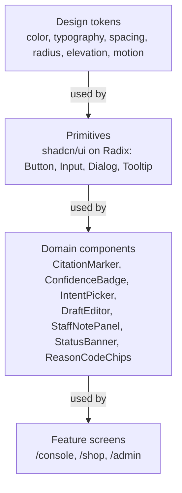

# UI rules

> **Status:** Active · **Owner:** frontend · **Last reviewed:** 2026-11-12

A strict design system and interaction rules, so every screen looks and behaves the same, staff can work quickly and safely, and developers can build and review UI with confidence. The console exists to help staff check the AI, not to make them trust it blindly. Design-system structure: [ADR-0008](../decisions/0008-ui-design-system.md). Shop scope: [ADR-0013](../decisions/0013-shop-demo-with-read-only-catalog.md). Roles: [ADR-0012](../decisions/0012-roles-v1.md).

## Principles

1. **Clarity over decoration.** Every element helps staff decide.
2. **Consistency everywhere.** The same thing looks and behaves the same on every screen.
3. **Transparent AI.** AI content is always marked, sourced, and correctable.
4. **Staff in control.** Nothing irreversible happens without a deliberate staff action.
5. **Accessible by default.** WCAG 2.2 AA is the floor.

## Design system structure

**UI-01.** The design system lives in `frontend/src/design-system/` with `tokens/`, `format/`, `primitives/`, and `components/` ([TS-05](typescript.md#project-layout)).

**UI-02.** Feature screens are composed only of design-system components, including layout primitives (stack, grid, panel). Feature code does not style raw HTML elements.

**UI-03.** A new visual pattern is added to the design system first, with stories, and only then used in a feature.

**UI-04.** Every design-system component has Storybook stories for every variant and every state, and passes automated accessibility checks.

## Tokens

**UI-05.** All visual values come from tokens. Feature code MUST NOT contain color literals (hex, `rgb`, `hsl`), pixel values, arbitrary Tailwind values (`p-[13px]`), or inline styles. Lint rules enforce this.

**UI-06.** Color tokens are semantic roles. Components never use raw palette names.

| Token role | Use |
|---|---|
| `background`, `surface`, `surface-raised` | Page background and panels |
| `border`, `border-strong` | Dividers and input borders |
| `text`, `text-muted`, `text-inverse` | Text |
| `primary`, `primary-foreground` | The single main action of a view |
| `focus-ring` | Keyboard focus |
| `success` | Grounded, approved, sent |
| `warning` | Needs attention: low confidence, stale source, missing information |
| `danger` | Blocked, failed, irreversible actions |
| `info` | Neutral system information |
| `ai` | Marks AI-generated content |
| `success-subtle`, `warning-subtle`, `danger-subtle`, `info-subtle`, `ai-subtle` | Tinted backgrounds behind the matching role |

**UI-07.** Spacing uses a 4 px grid with these steps only: 0, 4, 8, 12, 16, 24, 32, 48, 64 px.

**UI-08.** Typography uses Inter for UI text and JetBrains Mono for IDs and versions. Sizes: 12, 14, 16, 18, 20, 24, 30 px. Weights: 400, 500, 600. Console body text is 14 px; shop body text is 16 px.

**UI-09.** Radius has three steps (small, medium, large). Elevation has three levels. Motion uses two durations (100 ms and 200 ms) with one easing curve and respects `prefers-reduced-motion`.

**UI-10.** The light theme is required. A dark theme MAY be added later, only by overriding tokens.

## Visual semantics

**UI-11.** Color is never the only signal. Status is always shown with an icon and a text label as well.

**UI-12.** Each ticket and suggestion status has exactly one presentation (token, icon, label), defined once in the design system and used everywhere. Screens never define their own status colors.

**UI-13.** AI-generated content always carries the `ai` marker and a label ("AI draft", "AI suggestion"). Text written by staff never carries it.

**UI-14.** Confidence is shown as the band label and percentage provided by `backend`. The UI never computes bands or applies thresholds.

## Console interaction

**UI-15.** The console uses one fixed workspace layout, defined in the console design doc. Panels and actions never move between tickets.

**UI-16.** The main actions are always visible, in the same place: Edit, Reject draft, Escalate, and Send reply. When authority is required, staff see Submit for approval instead of Send reply; otherwise it sits in a secondary menu, and in the manual-handling state it is a visible button. Actions that `backend` does not list in `allowed_actions` are disabled, with the reason shown. There is no automatic send.

**UI-17.** Irreversible actions (Send reply, Submit for approval, Reject draft, Escalate) never have single-key shortcuts. Their shortcuts use a modifier (`Ctrl` or `Cmd` with `Enter`), and Send reply shows a confirmation step.

**UI-18.** When a suggestion has warnings (signal disagreement, stale or conflicting sources, sensitive ticket), Send reply stays disabled until staff acknowledge each warning. Low confidence is not a warning: it produces no draft at all (UI-42).

**UI-19.** Tickets where authority is required (FR-06) show a persistent banner: the AI output is supporting information, and the decision belongs to a manager. Managers see the staff proposal next to the AI draft and send it as proposed or edited.

**UI-20.** Each draft segment shows inline citation markers. Hovering or focusing a KB marker shows the document title, version, effective dates, and snippet; activating it opens the full document version. Hovering or focusing an order marker shows each cited order field with its value; activating it opens the order details.

**UI-21.** Staff notes appear in a separate panel labeled "For staff only", never inside the draft editor.

**UI-22.** Confirming the predicted intent or choosing another takes one interaction from where the intent is shown. After a confirmation or a correction, the draft area shows that a new draft is being generated and marks the previous draft as outdated. A correction is available as soon as the intent is shown, also while a draft is generating.

**UI-41.** Editing and sending a draft, or rejecting it and sending a reply, takes at most three deliberate actions (NFR-11). Typing text is not an action. Steps that guardrails require are not counted: acknowledging warnings (UI-18) and confirming Send reply (UI-17). The console design doc states the action count of each flow, and an end-to-end test checks it.

**UI-42.** When a draft abstained for low confidence (ESC-01), the console shows the top three candidate intents with their confidence, each with a "Use this intent" action, and says that no draft is created until staff choose. The draft area shows no draft and no filler text.

**UI-43.** AI text is shown exactly as `backend` returns it. Every text that matches the placeholder syntax ([ADR-0010](../decisions/0010-pseudonymization-and-egress-control.md#placeholder-syntax)), whether a mask, a pseudonym that `backend` could not restore, or customer text that only looks like a placeholder (a restored `LITERAL`), is highlighted with one label: "Personal data or reserved text: replace before sending" ([ADR-0018](../decisions/0018-one-placeholder-label-and-retried-map-storage-errors.md)). Send reply and Submit for approval stay disabled while the reply editor contains text in the placeholder syntax. The UI never tries to restore or remove placeholders itself.

## States

**UI-23.** Every screen and every data-bound component implements all of its states: loading, empty, error, partial (analysis shown, draft pending), abstained, escalation recommended, manual handling, and permission denied. Each state has a story.

**UI-24.** Loading uses skeletons in the affected area only. The whole screen never blocks. The analysis appears as soon as it arrives.

**UI-25.** Error states say what happened and what to do next, in plain language. They never show stack traces, raw codes, or internal names, but offer a copyable trace ID under "Details".

**UI-26.** The manual-handling state shows the manual-process instructions, a reminder to route refund decisions and disputes to a manager, Submit for approval, and Try AI again when a retry is allowed. It keeps every non-AI tool working.

## Content

**UI-27.** UI text uses [glossary](../glossary.md) terms and sentence case. Buttons are verbs that name the result ("Send reply", "Escalate ticket"), never "OK" or "Submit".

**UI-28.** Staff-facing text contains no ML jargon. "Confidence" is allowed; "logit", "embedding", "rerank weight" are not.

**UI-29.** Times show a relative value ("5 min ago") with the absolute local time on hover. Numbers, money, and dates use shared formatters only.

## Accessibility

**UI-30.** WCAG 2.2 AA: text contrast at least 4.5:1, UI component contrast at least 3:1, visible focus on every interactive element, full keyboard operation, a label on every input, and no information conveyed by color or position alone.

**UI-31.** Interactive widgets use the Radix-based primitives. Custom dialogs, menus, or comboboxes built from generic elements are forbidden.

**UI-32.** Automated accessibility checks (axe) run on every story and on end-to-end flows. Violations fail CI.

## Layout and performance

**UI-33.** The console and the admin area target desktop widths of 1280 px and above. The shop supports widths from 360 px.

**UI-34.** Every interaction gives visible feedback within 100 ms.

## Developer views

**UI-35.** Dev mode adds developer details to the screens of `staff`, `manager`, and `admin`, and changes nothing else. It has two layers:

- An environment setting makes dev mode available. It is on in local development and off in the demo deployment.
- Where dev mode is available, each `staff`, `manager`, and `admin` user switches it on or off for themselves. The choice is a display preference stored in the browser.

Customers never get dev mode. It never changes permissions, never shows data that the role cannot already see, and offers no sign-in as another account. In dev mode, the ticket workspace shows a collapsible "Developer details" panel: trace ID with a link to the trace in Grafana ([ADR-0007](../decisions/0007-observability-stack.md)), the release ID with the model, KB, and prompt versions, latency per step, and raw statuses and reason codes.

**UI-36.** Storybook is the catalog of every design-system component and the place to review UI changes in isolation. A UI PR links the affected stories.

**UI-37.** Tests select elements by role and accessible name. `data-testid` is allowed only when no accessible selector exists.

## Shop

**UI-38.** The shop uses the same design system and adds no components outside it. Its scope is fixed by [ADR-0013](../decisions/0013-shop-demo-with-read-only-catalog.md) and [ADR-0015](../decisions/0015-account-creation-and-password-changes.md): a read-only catalog, "My orders", the support form, sent replies, and the own password change. Every product shows the same neutral product image from the design system.

## Reports

**UI-44.** Managers see reports at `/console/reports` (FR-10). The page shows the figures that `backend` returns for a chosen period, each with its unit, and with its target from the [requirements](../product/requirements.md#5-quality-requirements) where one exists. The UI computes no figure, rate, or percentile itself (UI-14). Staff never see the page or a link to it.

## Admin

**UI-45.** The admin area `/admin` has exactly two screens: accounts (list `staff`, `manager`, and `admin` accounts; create a `staff` or `manager` account; reset the password of a `staff` or `manager` account; change a role between `staff` and `manager`; deactivate; reactivate) and versions in use. Account creation and password resets are dialogs on the accounts screen. Every change asks for confirmation and names the account and the change. The area uses the design system and never shows customer accounts, tickets, messages, orders, or reports ([ADR-0012](../decisions/0012-roles-v1.md), [ADR-0015](../decisions/0015-account-creation-and-password-changes.md)).

## Password fields

**UI-46.** Every password field uses the design-system `PasswordInput`. It has a show and hide toggle: a button at the end of the field with a fixed accessible name, "Show password", and `aria-pressed` for its state. The password is hidden on every load and after every successful submission, and the toggle never changes the value or the focus of the field. The field never blocks paste or autofill, never truncates, and sets `autocomplete` to `current-password` or `new-password`.

## Boundaries

**UI-39.** The UI reads and writes data only through the `backend` contract. It contains no business logic and no AI logic.

**UI-40.** The UI never decides permissions. It reflects what `backend` allows ([SEC-20](security-and-privacy.md#authentication-and-authorization)).

## UI review checklist

- [ ] Only design-system components and tokens are used; no literals or arbitrary values.
- [ ] Every state is implemented and has a story.
- [ ] AI content is marked; citations work; staff notes are separate.
- [ ] Irreversible actions need a deliberate action; warnings must be acknowledged.
- [ ] Placeholders are highlighted and block sending; flows stay within the NFR-11 action budget.
- [ ] Keyboard and screen reader work; axe passes.
- [ ] Every password field is a `PasswordInput` with the show and hide toggle (UI-46).
- [ ] Text uses glossary terms and contains no jargon.
