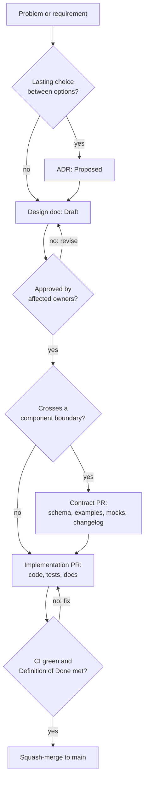
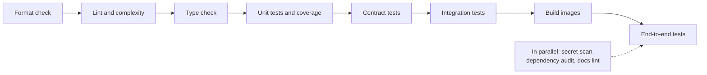

# Workflow rules

> **Status:** Active · **Owner:** team · **Last reviewed:** 2026-10-24

How a change moves from an idea to `main`: design, branches, commits, pull requests (PRs), reviews, CI, and technical debt. Applies to every contributor, human or AI agent.

## Design-first gate

A change is **non-trivial** if it does any of the following:

- adds a component, a feature module, or an external dependency;
- changes `contracts/` (an API or a data contract);
- changes a database schema;
- changes AI behavior that can move a metric or a guardrail: routing, thresholds, retrieval, prompts, or models;
- changes permissions, security, privacy, or data handling;
- touches more than one component.

**WF-01.** Implementation of a non-trivial change MUST NOT start before its design (an ADR, a design doc, or both) is approved.

**WF-02.** A design is approved when every owner of an affected component has approved its PR. An ADR is approved when its status is Accepted.



1. Write an ADR if the change chooses between lasting options. A design doc MAY be skipped when the ADR fully describes the change.
2. Get approval from every owner whose component is affected.
3. If a boundary moves, merge the contract change first ([contracts.md](contracts.md#contract-first-process)).
4. Implement, with tests and docs in the same PR.

**WF-03.** Trivial changes (a bug fix inside one module, a refactor with no behavior change, a docs fix) skip the design doc but MUST still include tests and pass review.

## Definition of Ready

**WF-04.** Work starts only when the task states the problem, links the requirement (FR or quality target) it serves, lists acceptance criteria that can be tested, and links the approved design for non-trivial work.

## Branches

**WF-05.** Branch from `main`. Name branches `<type>/<short-kebab-summary>` using the commit types below, for example `feat/ticket-inbox` or `fix/stale-source-check`.

**WF-06.** A branch SHOULD be merged or closed within three working days. Long-running work is split into smaller PRs behind a feature flag or behind an unused code path that tests cover.

**WF-07.** `main` is protected: no direct pushes, no force-pushes, merges only through PRs with green CI. `main` always builds and passes all tests.

## Commits

**WF-08.** Commit messages follow [Conventional Commits](https://www.conventionalcommits.org/en/v1.0.0/): `type(scope): summary`.

| Part | Allowed values |
|---|---|
| `type` | `feat`, `fix`, `refactor`, `perf`, `test`, `docs`, `build`, `ci`, `chore`, `revert` |
| `scope` | `frontend`, `backend`, `ai-service`, `ml`, `eval`, `contracts`, `docs`, `repo` |

**WF-09.** The summary uses the imperative mood, has at most 72 characters, and has no trailing period. The body explains why, and references the ADR, design doc, or issue.

```text
Good: feat(ai-service): flag expired documents before reranking
Good: fix(backend): reuse idempotency key when retrying decision writes
Bad:  update code
Bad:  feat: Added some fixes for the AI stuff.
```

**WF-10.** One logical change per commit. Formatting-only changes are never mixed with behavior changes.

## Pull requests

**WF-11.** One purpose per PR. A PR SHOULD stay under about 400 changed lines, excluding generated code and lockfiles. Larger work is split into a sequence of PRs that each leave `main` working.

**WF-12.** Refactors and behavior changes go in separate PRs.

**WF-13.** The PR description MUST contain:

- **Why:** the problem, with links to the requirement, ADR, design doc, or issue.
- **What:** the change, in a few bullets.
- **How to verify:** exact commands and expected results.
- **Contract impact:** none, or a link to the contract PR.
- **Metric impact:** none, or before and after numbers with links to the evaluation runs.
- **Docs:** the documents updated.
- **Debt:** none, or the `tech-debt` issues created.

**WF-14.** The author reviews their own diff before requesting review and runs every check locally.

## Reviews

**WF-15.** Every PR needs approval from at least one member other than the author. Changes to `contracts/` also need the contracts gatekeeper. ADRs need every affected owner. Changes to authentication, permissions, privacy, or LLM prompts need two approvals.

**WF-16.** Review in this order: contract diff, tests, code, docs. Reviewers check the [Definition of Done](#definition-of-done) and cite rule IDs.

**WF-17.** Review comments start with a label: `blocking:` (must be fixed before merge), `suggestion:` (optional improvement), `question:` (needs an answer). Style comments are not allowed; the formatter decides style.

**WF-18.** Reviewers respond within one working day. Authors resolve every `blocking:` comment with a change or an agreed explanation.

## Continuous integration

**WF-19.** Every PR runs the full pipeline. Any failure blocks the merge. No check may be skipped, retried until green, or marked optional to unblock a merge.



**WF-20.** CI runs with the same tool versions as local development, pinned in lockfiles and configuration.

## Definition of Done

**WF-21.** A PR is done only when every applicable item is true:

- [ ] Design doc or ADR approved (non-trivial changes).
- [ ] Contract changed first, mocks regenerated, contract tests pass (boundary changes).
- [ ] Formatter, linter, and type checker pass with no new suppressions.
- [ ] Required tests from [testing.md](testing.md#required-tests-per-change) exist and pass; coverage meets the thresholds.
- [ ] Every new error path has a test.
- [ ] Guardrails hold: staff approve every reply, nothing is sent or transacted automatically, and the AI abstains without evidence.
- [ ] If AI behavior changed: metrics re-measured and reported against the baseline.
- [ ] Logs and metrics follow [logging-and-observability.md](logging-and-observability.md); no confidential data is logged.
- [ ] Documentation updated in the same PR.
- [ ] No secrets, no dead or commented-out code, no `TODO` without an issue link.

## Technical debt

**WF-22.** Technical debt is never hidden. Every shortcut, workaround, or known gap is recorded as an issue labeled `tech-debt`, linked from the code with `TODO(#<issue>)`, and listed in the PR description.

**WF-23.** A PR MUST NOT add technical debt without a linked issue and the reviewer's explicit agreement.

**WF-24.** "Temporary" code states its removal condition in its issue. Debt without a removal condition is rejected in review.

**WF-25.** Open `tech-debt` issues are reviewed at the end of each milestone: fix them, keep them with a written reason, or close them.

**WF-26.** Leave the code you touch cleaner than you found it, within the PR's purpose. Larger cleanups get their own PR.

## Dependencies

**WF-27.** Every new dependency is justified in its PR: what it does that the standard library or an existing dependency does not, and why this library.

**WF-28.** Versions are pinned exactly through lockfiles. Lockfiles are committed.

**WF-29.** A framework-level dependency (web framework, ORM, UI library, LLM SDK, test framework) needs an ADR.

**WF-30.** Only permissive licenses (MIT, BSD, Apache-2.0, ISC) are allowed without discussion. Any other license needs team approval in the PR.

**WF-31.** Dependency vulnerability audits run in CI. A known high or critical vulnerability blocks the merge until it is fixed or explicitly accepted in an issue.

## Reproducibility

**WF-32.** Each component's README gives one command to run it and one command to test it. The whole system starts with one command ([ADR-0003](../decisions/0003-tech-stack.md)).

**WF-33.** A fresh clone, following only the READMEs, reaches a running system and passing tests. Steps that only work on one person's machine are bugs.

## AI agents

**WF-34.** AI agents MUST NOT change git state. Forbidden: `add`, `commit`, `stash`, `push`, `pull`, `reset`, `rebase`, `merge`, `cherry-pick`, `revert`, `checkout`, `switch`, `restore`, `clean`, `rm`, `mv`, `tag`, `am`, `apply`, and branch deletion, in any form. Agents may run only read-only git commands (`status`, `diff`, `log`, `show`, `blame`). The human author stages, commits, and pushes. Contributors configure their agent tools to block these commands where the tool supports it. Getting around a block with another form (`git -C`, aliases, scripts, configuration changes) is itself a violation.

**WF-35.** AI agents MUST NOT stash, reset, or discard uncommitted work at any point in a task, including their own. Work in progress stays visible in the working tree until the human author commits it.
