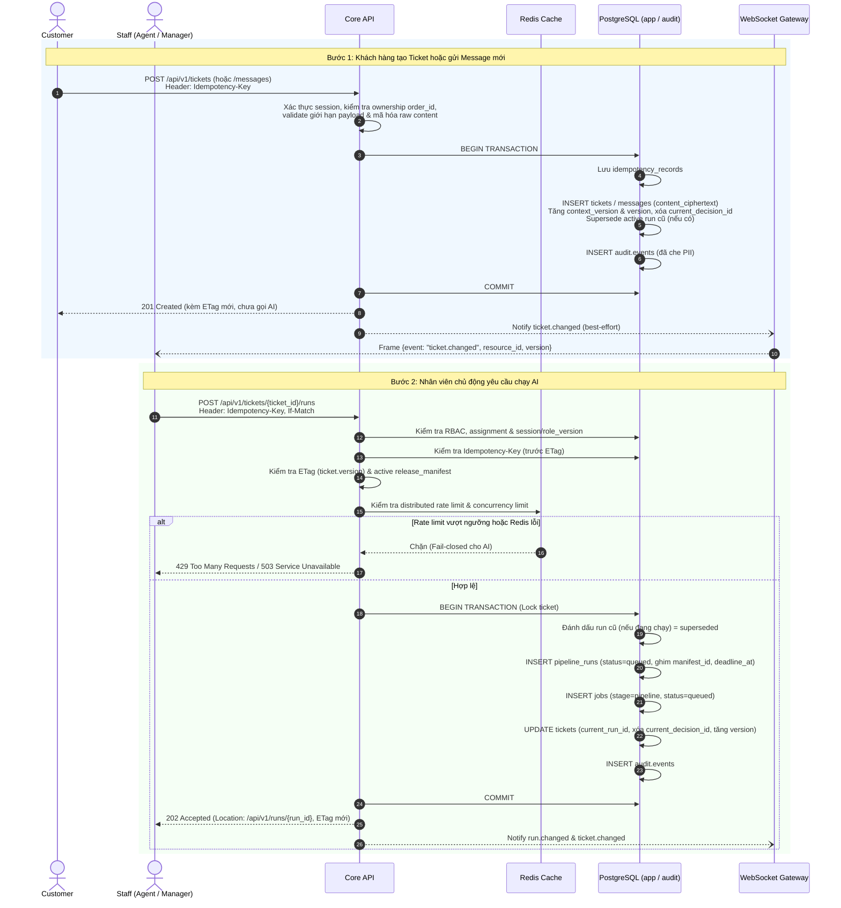

# 01. Tiếp nhận Ticket/Message và Khởi tạo AI Run

Tham chiếu đặc tả:
- [Mục 5.1 — Ticket, run và context](../superpowers/specs/2026-10-27-core-backend-design.md#51-ticket-run-và-context)
- [Mục 6.1 — Tiếp nhận và tạo draft (Bước 1–3)](../superpowers/specs/2026-10-27-core-backend-design.md#61-tiếp-nhận-và-tạo-draft)
- [Mục 8.2 — Các endpoint](../superpowers/specs/2026-10-27-core-backend-design.md#82-các-endpoint)

