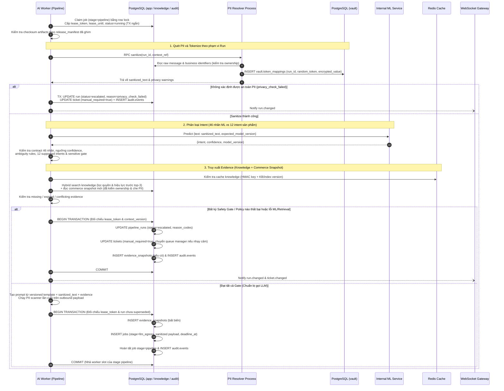

# 02. AI Worker xử lý Pipeline (Sanitize, Intent, Retrieval & Safety Gate)

Tham chiếu đặc tả:
- [Mục 6.1 — Tiếp nhận và tạo draft (Bước 4–9)](../superpowers/specs/2026-10-27-core-backend-design.md#61-tiếp-nhận-và-tạo-draft)
- [Mục 6.2 — Phạm vi intent và chuyển cấp](../superpowers/specs/2026-10-27-core-backend-design.md#62-phạm-vi-intent-và-chuyển-cấp)
- [Mục 9.1–9.3 — Hợp đồng AI, evidence và bảo vệ dữ liệu](../superpowers/specs/2026-10-27-core-backend-design.md#9-hợp-đồng-ai-evidence-và-bảo-vệ-dữ-liệu)

