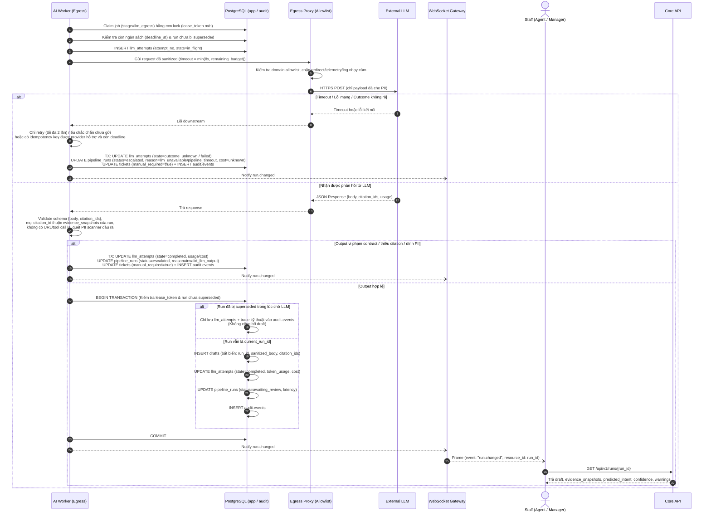

# 03. Egress Buffer gọi External LLM & Xác thực Draft

Tham chiếu:
- Kiến trúc tổng quan: [ARCHITECTURE.md](../ARCHITECTURE.md)
- Quyết định kiến trúc: [ADR-0006 LLM Egress Isolation](../decisions/0006-llm-egress-isolation.md)
- Luồng xử lý: Egress Proxy allowlist, gọi External LLM, và xác thực Draft grounding/evidence

