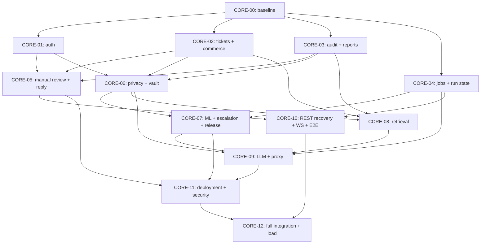

# Core Backend — Kế hoạch triển khai và phân công 4 thành viên

> **For agentic workers:** REQUIRED SUB-SKILL: Use superpowers:subagent-driven-development (recommended) or superpowers:executing-plans to implement this plan task-by-task. Steps use checkbox (`- [ ]`) syntax for tracking.

**Goal:** Bốn thành viên triển khai backend core có luồng xử lý thủ công hoàn chỉnh, tích hợp AI có kiểm soát và demo được trên hai API replica.

**Architecture:** Modular monolith theo 13 module hiện có. PostgreSQL giữ workflow, durable jobs, audit và các schema phân quyền; Redis giữ cache/counter. ML inference, resolver process và egress proxy tuân theo ranh giới trong đặc tả.

**Tech Stack:** PostgreSQL và Redis theo thiết kế đề xuất; ngôn ngữ/framework, thư viện và test runner được cả nhóm chốt ở CORE-00 trước khi viết code. Plan này phân công theo module/hợp đồng hiện có, không tự chọn stack thay nhóm.

**Spec:** [Đặc tả backend core](../specs/2026-10-27-core-backend-design.md), [OpenAPI v1](../../api/core-backend.openapi.yaml), [kiến trúc và FR/NFR](../../ARCHITECTURE.md).

## 1. Phạm vi và cách dùng

Phạm vi đã được xác nhận: **backend core và các tích hợp cần thiết**. Không bao gồm xây storefront/staff frontend, huấn luyện và nghiên cứu model mới, tích hợp giao dịch thật hoặc hoàn thiện toàn bộ hạ tầng AWS. Mock và API client được dùng để kiểm thử backend; không coi chúng là sản phẩm frontend.

Phân công dưới đây là đề xuất theo khối lượng và ranh giới module, chưa dựa trên sở trường từng người. Mỗi task có một người chịu trách nhiệm chính, một reviewer khác người làm, đầu ra và điều kiện nhận bàn giao. Có thể hỗ trợ chéo nhưng không đổi owner ngầm.

Chưa có deadline hoặc số giờ làm việc của nhóm nên plan dùng mốc bàn giao, không gán ngày hoàn thành giả định. Sau CORE-00, từng owner ước lượng task của mình và nhóm gắn lịch vào bốn mốc ở mục 4.

Đây là kế hoạch giao việc cho người trong nhóm; không phải lệnh để agent tự triển khai hoặc gửi thông báo cho các thành viên.

## 2. Global Constraints

- Giữ 13 module trong `apps/core-backend/src/modules`; không tách microservice cho từng nghiệp vụ.
- API, tên trường, enum, thông báo và nội dung sản phẩm dùng tiếng Anh; JSON `snake_case`, `/api/v1`.
- ML đánh giá 46 nhãn; sản phẩm hỗ trợ đúng 12 intent trong đặc tả. Nhãn còn lại phải fallback.
- `approve`/`edit` không gửi trả lời; chỉ lệnh gửi riêng của staff có quyền mới tạo reply. Worker không được ghi reply hay giao dịch commerce.
- Decision/reply và audit ghi cùng transaction; audit runtime chỉ INSERT. Không có audit thì mutation thất bại.
- Chỉ resolver có credential vault. Không PII thô trong egress, queue, cache, audit hoặc log.
- Chỉ decision hiện hành, đúng context/evidence/quyền mới được gửi; replay request và worker chạy lại không nhân đôi tác động.
- Tổng deadline AI 12 giây gồm queue wait; LLM mỗi attempt không quá 10 giây, tối đa hai retry và không vượt deadline chung.
- Ít nhất năm phiên; mục tiêu p50 ≤ 4 giây, p95 ≤ 12 giây, lỗi ≤ 1%, p95 không quá hai lần single-user; đo cả stack khoảng ≤ 5 GB RAM trên máy 8 GB.
- Chỉ dữ liệu giả lập, secret inject lúc chạy; manual workflow còn hoạt động khi ML/retrieval/LLM lỗi và DB/audit còn sống.
- Không cài dependency, tạo source/migration hay deploy chỉ để hoàn thành tài liệu plan này. Các task sau là việc phải thực hiện khi bắt đầu triển khai.

## 3. Phân công và quyền sở hữu

| Thành viên | MSSV | Phụ trách chính | Task owner | Reviewer chính cho |
| --- | --- | --- | --- | --- |
| **Đoàn Anh Minh** | 24021565 | Nền tảng, auth/RBAC, privacy/vault, môi trường chạy và bảo mật | CORE-00, CORE-01, CORE-06, CORE-11 | CORE-02, CORE-04, CORE-07 |
| **An Đức Minh Trí** | 24021645 | Ticket, commerce demo, review/feedback/reply, phục hồi trạng thái và E2E | CORE-02, CORE-05, CORE-10 | CORE-01, CORE-03, CORE-12 |
| **Nguyễn Công Phúc** | 24021598 | State machine, worker/jobs, intent, escalation, release và tích hợp ML | CORE-04, CORE-07, CORE-12 | CORE-06, CORE-08, CORE-09 |
| **Phạm Gia Bách** | 24021382 | Audit/report, retrieval/evidence, LLM/egress và đánh giá grounding | CORE-03, CORE-08, CORE-09 | CORE-00, CORE-05, CORE-10, CORE-11 |

### 3.1. Thư mục và file dùng chung

| Phạm vi | Người được sửa chính | Quy tắc phối hợp |
| --- | --- | --- |
| `apps/core-backend/src/modules/auth`, `privacy` | Minh | Module khác dùng service công khai, không tự đọc vault hoặc tự kiểm JWT |
| `apps/core-backend/src/modules/tickets`, `commerce`, `review`, `feedback` | Trí | Trí sở hữu transaction cập nhật ticket/decision/reply và các pointer hiện hành |
| `apps/core-backend/src/modules/orchestration`, `intent`, `escalation` | Phúc | Phúc sở hữu job lease, deadline, run state và adapter gọi ML |
| `apps/core-backend/src/modules/retrieval`, `llm`, `audit`, `reports` | Bách | Audit append phải nhận transaction của caller; LLM adapter không tự gửi reply |
| `db/migrations/app` | Từng owner tạo migration riêng theo task | Không sửa migration đã merge; Minh điều phối thứ tự bootstrap, Trí điều phối FK ticket/decision/run |
| `db/migrations/knowledge`, `audit` | Bách | Quyền writer/reader phải có test, không chỉ tạo bảng |
| `db/migrations/token-vault` | Minh | Vault role không cấp cho API/worker |
| `apps/core-backend/config/policies`, `ml/releases` | Phúc | Minh review safety rules; Bách cung cấp version KB/index/prompt |
| `apps/core-backend/config/prompts`, `data/knowledge` | Bách | Chỉ dùng KB được duyệt; prompt có version và fixture grounding |
| `data/business` | Trí | Dữ liệu synthetic, version cố định để test ownership/snapshot |
| `services/ml-inference/src`, `infra/ml-balancer`, `infra/queue` | Phúc | Job queue chính là PostgreSQL theo thiết kế; không thêm broker nếu chưa có lý do |
| `services/egress-proxy/config` | Bách | Minh review network/credential; worker gọi adapter, không bypass proxy |
| `infra/compose`, `edge`, `cache`, `secrets` | Minh | Mỗi người bàn giao command chạy process của mình; Minh ráp môi trường chung |
| `infra/observability` | Bách | Phúc cung cấp metric pipeline; Minh kiểm sanitization |
| `docs/api/core-backend.openapi.yaml`, bootstrap và dependency manifest | Minh điều phối | Chủ module đề xuất diff, reviewer kiểm tương thích; không tự đổi DTO dùng chung |
| `tests/*` | Owner logic tương ứng | Mỗi task tự có test; CORE-12 không viết bù test cho cả nhóm |

CORE-00 phải ghi **tên file source/migration/test thực tế và lệnh test chạy được** cho từng task vào `docs/superpowers/plans/core-backend-execution-baseline.md`. Plan hiện tại dùng đường dẫn module vì chưa có ngôn ngữ/framework để xác định đuôi file. Không bắt đầu source implementation khi baseline chưa chốt; không bịa lệnh pytest/npm cho một repo chưa có stack.

## 4. Mốc bàn giao và phụ thuộc

| Mốc | Task phải đạt | Demo / bằng chứng để qua mốc |
| --- | --- | --- |
| **M0 — Chốt cách ghép** | CORE-00 | Stack, file map, command chạy/test, DB roles, interface và fixture chung đã chốt |
| **M1 — Xử lý thủ công** | CORE-01, CORE-02, CORE-03, CORE-05 | Customer tạo ticket; staff xem/duyệt manual/bấm gửi; customer thấy reply; audit đủ; không cần AI |
| **M2 — AI có kiểm soát** | CORE-04, CORE-06, CORE-07, CORE-08, CORE-09, cộng bước ghép M2 bên dưới | Run thật tạo draft có nguồn hoặc chuyển manual có lý do; không PII egress, không tự gửi |
| **M3 — Ghép và nghiệm thu backend** | CORE-10, CORE-11, CORE-12 | Reload/reconnect, concurrency, failure injection, load/resource report và runbook tái hiện được |



Sau M0, bốn người có thể làm CORE-01/02/03/04 đồng thời bằng interface đã chốt. Test local được dùng fake adapter; việc **nhận task Done** phải dùng dependency thật đã bàn giao theo phần Depends on. Minh tiếp tục privacy khi auth xong; Trí ráp manual; Phúc tiếp tục ML; Bách đi retrieval rồi LLM. Không chờ AI để ghép M1 và không chờ AWS để chạy integration local.

**Bước ghép M2 — Phúc chịu trách nhiệm, Bách phối hợp, Minh review:** sau CORE-08/09, hoàn thiện manifest với phiên bản và report thật, activate qua API bằng Admin có quyền, nối các adapter đã bàn giao vào pipeline CORE-04 và chạy một luồng tạo draft cùng một luồng fallback. Đây là bước ghép bắt buộc trước khi công nhận M2, không để tới load test CORE-12 mới phát hiện các module chưa gọi được nhau. CORE-07 làm registry/validation bằng candidate manifest; CORE-09 có thể kiểm provider trên candidate đã pin trong test nội bộ, nhưng không công bố nó như release đã qua gate.

## 5. Giao diện bàn giao chung

Tên dưới đây là hợp đồng logic, chuyển sang type/signature của stack trong CORE-00. Đây là adapter theo ranh giới đã có, không phải yêu cầu tạo một framework abstraction mới.

| Owner / interface | Input → output | Điều kiện caller phải giữ |
| --- | --- | --- |
| Minh — `auth.authorize(principal, capability, resource_ref)` | Session/actor và tài nguyên → `AccessScope` tin cậy | Mutation kiểm DB session/role version; scope gồm actor, role, customer/ticket được phép |
| Bách — `audit.append(tx, event)` | Transaction hiện hành + sanitized event → event ID | Không commit riêng; lỗi append phải rollback mutation |
| Trí — `tickets.get_context(ticket_id, scope)` | Ticket + scope → context ref/version và order ref đã kiểm quyền | Raw content chỉ đi App DB/resolver; job không mang raw body |
| Minh — `privacy.sanitize(run_id, context_ref, scope)` | Context có quyền → sanitized text/refs + warnings | Không an toàn thì fail gate; không trả mapping vault |
| Phúc — `intent.classify(sanitized_text, release, deadline)` | Text đã scan → predicted intent/confidence/model version | Không tự reset deadline; model/version/nhãn sai phải báo reason |
| Bách — `retrieval.retrieve(context, intent, release, scope)` | Sanitized context → tối đa ba evidence + warnings | Knowledge lọc quyền/hiệu lực; business snapshot đọc mới |
| Bách — `llm.build_payload(context, evidence, release)` | Sanitized input → payload đã scan + hash | Không chứa secret, raw PII, tool hoặc URL tùy ý |
| Bách — `llm.call_via_proxy(payload, deadline, attempt_ref)` | Egress job → validated body/citations, usage/cost status | Outcome không rõ phải phân biệt với chưa gửi; không retry mù |
| Phúc — `orchestration.create_run(ticket_id, request, scope, preconditions)` | RunCreate + ETag/idempotency → RunAccepted | Tạo run/job/audit nguyên tử; supersede run/decision cũ |
| Trí — `review.record_decision(...)`, `review.send_reply(...)` | OpenAPI DecisionCreate/ReplyCreate + scope/preconditions → Decision/Reply | Chỉ current decision, context/evidence mới còn hợp lệ; không tự gửi khi approve |

Trí giữ logic thay đổi pointer của ticket; Phúc gọi cùng thao tác này trong transaction create/supersede run, không tạo cách cập nhật ticket thứ hai. Bách không đọc bảng workflow ngoài query/report được giao; Minh không dựng một hệ auth riêng trong resolver.

## 6. Task cụ thể

Mỗi task bên dưới áp dụng chu kỳ chung: viết test nêu ở **Check** → chạy thấy thất bại vì hành vi chưa có → viết phần tối thiểu → chạy lại test và contract liên quan → owner bàn giao evidence → reviewer khác người làm xác nhận. Dùng lệnh thật đã ghi trong baseline, không chỉ ghi “đã test”. Mỗi task là một thay đổi review được; tạo PR/commit nhỏ khi repo đã được nhóm đưa vào Git.

### CORE-00 — Chốt baseline và bootstrap chạy được

**Owner:** Minh. **Reviewer:** Bách. **Depends on:** không có.

**Files:** tạo `docs/superpowers/plans/core-backend-execution-baseline.md`; bootstrap trong `apps/core-backend`; môi trường tối thiểu trong `infra/compose`; migration bootstrap theo stack tại `db/migrations`.

**Consumes / produces:** consumes đặc tả và OpenAPI; produces app shell, kết nối DB/Redis, database roles và chữ ký/DTO cho các interface mục 5. Chỉ dùng dependency được nhóm chọn, không tạo sẵn tầng trống cho tất cả module.

- [ ] Cả nhóm chốt runtime/framework, DB/migration/test tooling, thư viện auth/crypto, cách chạy API/worker/resolver; ghi phiên bản và người xác nhận.
- [ ] Ghi đường dẫn file thực tế và lệnh chạy/test cho CORE-01…12; quy ước migration để bốn người không đụng một file. Xác định ranh giới transaction và `AccessScope` trước khi chia nhánh.
- [ ] Bootstrap liveness/readiness và DB roles từ cấu hình runtime; seed secret lấy từ môi trường, không hardcode. API shell chưa có AI vẫn boot được.
- [ ] **Check:** shell healthy khi DB/audit sống; readiness lỗi khi persistence hỏng; liveness còn sống khi Redis/ML/LLM tắt; CI/local thực thi được ít nhất một test DB thực và OpenAPI lint.

**Done:** mọi người chạy lại baseline trên môi trường local; không ai cần tự đoán DTO, tên file hoặc lệnh test.

### CORE-01 — Authentication, session và RBAC

**Owner:** Minh. **Reviewer:** Trí. **Depends on:** CORE-00.

**Files:** `apps/core-backend/src/modules/auth`; migration user/session tại `db/migrations/app`; auth/security tests trong `tests/unit`, `tests/integration`, `tests/security`.

**Consumes / produces:** consumes DB/cache/transaction baseline; produces `auth.authorize`, `/sessions`, `/sessions/refresh`, `/sessions/current`, `/me`, `/users`, `/users/{user_id}` theo OpenAPI.

- [ ] **Check:** Customer không giả customer ID; Admin không mặc nhiên đọc ticket; Agent không có quyền queue manager; đổi role/logout vô hiệu hóa mutation/WS khi cache nóng và lạnh; không hạ quyền Admin cuối cùng.
- [ ] Làm access JWT 15 phút, refresh 8 giờ xoay token, CSRF/Origin/cookie và seed bốn role; dùng thư viện chuẩn, không tự viết crypto.
- [ ] Thực hiện DB check cho mutation, cache TTL tối đa 30 giây cho read, fallback DB khi cache lỗi; cung cấp hook invalidate session cho các caller.
- [ ] Chạy suite auth với DB/Redis thật và bàn giao `AccessScope` cho Trí/Phúc; audit role change dùng adapter CORE-03 khi ghép M1.

**Done:** route được bảo vệ và object scope kiểm ở backend; test auth local trước CORE-03 được phép fake audit, nhưng M1 phải audit thật.

### CORE-02 — Tickets, conversation và commerce demo

**Owner:** Trí. **Reviewer:** Minh. **Depends on:** CORE-00.

**Files:** module `tickets`, `commerce`; `data/business`; migration tương ứng ở `db/migrations/app`; tests ownership/ETag trong `tests/integration`, `tests/security`.

**Consumes / produces:** consumes `auth.authorize`, `audit.append` để ghép M1; produces `tickets.get_context`, ticket/message APIs, `/products`, `/orders`, `/orders/{order_id}` và DTO đúng OpenAPI.

- [ ] **Check:** customer chỉ đọc/ghi ticket và order của mình; staff order lookup bắt buộc ticket context hợp lệ; không nhận giá/total từ client; thêm message mới tăng context, hủy approval cũ.
- [ ] Làm pagination, assignment/status, ETag `428/412`, idempotency cùng key/cùng body và `409` khi đổi body; raw message lưu mã hóa, không log.
- [ ] Làm seed catalog/order/shipping/refund synthetic có version; checkout chỉ ghi demo order, không payment integration. Reply công khai chưa được tạo từ đường message inbound.
- [ ] Ghép auth/audit thật trước M1; bàn giao context/pointer transaction cho Phúc và business snapshot có ownership cho Bách.

**Done:** ticket/conversation và checkout demo dùng được; state/ownership/version có test DB, không chỉ test response shape.

### CORE-03 — Audit bất biến và báo cáo

**Owner:** Bách. **Reviewer:** Trí. **Depends on:** CORE-00.

**Files:** module `audit`, `reports`; migration `db/migrations/audit`; `infra/observability`; tests audit/report trong `tests/integration`.

**Consumes / produces:** consumes transaction/event DTO baseline; produces `audit.append(tx,event)`, `/tickets/{ticket_id}/events`, `/reports/summary` và role reader/writer.

- [ ] **Check:** audit lỗi làm rollback decision/reply; runtime writer không UPDATE/DELETE/TRUNCATE; log/event không chứa synthetic PII; retry không sinh trùng event.
- [ ] Làm audit timeline có phân quyền/phân trang và request/run/version references; không ghi raw prompt hay provider error body.
- [ ] Report theo fixture đã biết: manual approval không tính vào AI acceptance; draft chỉ đếm quyết định kết thúc đầu tiên; unknown cost không thành zero; cache report 30 giây, có `generated_at`, range tối đa 31 ngày.
- [ ] Bàn giao adapter sớm cho Minh/Trí/Phúc; kiểm lại aggregate bằng dữ liệu M2 khi có AI thật.

**Done:** chứng minh atomicity bằng rollback trên DB thật; số liệu fixture đúng cả trường hợp không có dữ liệu và chi phí chưa biết.

### CORE-04 — Durable jobs và state machine của run

**Owner:** Phúc. **Reviewer:** Minh. **Depends on:** CORE-00; ghép thật cần CORE-01/02/03.

**Files:** module `orchestration`; run/job/attempt migrations tại `db/migrations/app`; `infra/queue`; worker tests trong `tests/integration`.

**Consumes / produces:** consumes auth scope, ticket context/pointer transaction, audit adapter; produces create/read run APIs và worker claim/lease/deadline, với fake downstream chỉ trong test.

- [ ] **Check:** create run/job/audit nguyên tử; hai worker không hoàn tất trùng stage; lease cũ không commit muộn; run mới supersede run cũ kể cả đã awaiting review và xóa pending decision.
- [ ] Làm `queued/running/awaiting_review/escalated/superseded`, claim/lease token, deadline 12 giây gồm queue wait; worker release slot sau khi tạo egress job, không đợi job cùng pool.
- [ ] Theo dõi attempt outcome; crash sau gửi LLM chuyển `outcome_unknown`, không retry mù. Không reset deadline/attempt khi job được giao lại.
- [ ] Ghép API/rate limit với dependency thật; giữ downstream fake có kiểm contract cho tới CORE-07/08/09. Bàn giao test crash/recovery và cách chạy worker.

**Done:** infrastructure worker và state transitions qua test DB; chưa được ghi “AI chạy thật” chỉ vì fake trả được draft.

### CORE-05 — Review, manual approval, feedback và explicit send

**Owner:** Trí. **Reviewer:** Bách. **Depends on:** CORE-01, CORE-02, CORE-03.

**Files:** module `review`, `feedback`, phần pointer transaction trong `tickets`; decision/reply migrations; `tests/integration/review`, `tests/e2e/manual` theo baseline.

**Consumes / produces:** consumes auth, ticket context, audit; produces GET/POST decisions và POST replies; manual không phụ thuộc model, retrieval, LLM hay resolver availability.

- [ ] **Check:** approve/edit không tạo reply; reject/escalate không gửi; chỉ current decision gửi được; approval cũ sau reject/edit/regeneration/reassignment/message mới bị chặn; hai request send đồng thời chỉ tạo một reply/audit.
- [ ] Làm decision bất biến, manual body mã hóa, reason/final intent/feedback đã scan; sensitivity gate vẫn áp dụng manual và intent override.
- [ ] Gửi kiểm pointer/quyền/context/evidence trong transaction; source thay đổi trả `409`; unresolved placeholder yêu cầu edit/manual; send không chèn PII ngầm.
- [ ] Demo M1 với ML/retrieval/LLM/resolver tắt: login → ticket → manual approve → send → customer đọc reply; audit đầy đủ. AI-specific evidence recheck hoàn tất khi CORE-08 bàn giao.

**Done:** luồng manual chạy end-to-end bằng API thật; không cần đợi frontend hoặc AI để bàn giao M1.

### CORE-06 — Privacy scanner và resolver/vault

**Owner:** Minh. **Reviewer:** Phúc. **Depends on:** CORE-01, CORE-02, CORE-03.

**Files:** module `privacy`; `db/migrations/token-vault`; resolver config tại `infra/secrets`, `infra/compose`; tests tại `tests/security/privacy`.

**Consumes / produces:** consumes trusted scope/context và audit; produces `privacy.sanitize`, resolver identity/credential riêng, `resolve_identifiers` theo quyền và sanitized fixtures cho Bách/Phúc.

- [ ] **Check:** tên/địa chỉ/điện thoại/email/order ID synthetic không lọt egress/log/cache/queue/audit; token run khác hoặc order không thuộc customer bị chặn; API/AI worker role không đọc vault.
- [ ] Tách resolver process từ core codebase, token ngẫu nhiên scope theo run, mapping mã hóa; uncertain scanner trả reason để manual thay vì gửi raw.
- [ ] Làm expiry 24 giờ hoặc ticket đóng, purge chỉ qua resolver maintenance role; reply đã gửi vẫn xem được từ App DB sau purge.
- [ ] Bàn giao scanner thuần để manual validation không phụ thuộc vault availability; kill resolver kiểm manual còn chạy và AI dừng an toàn.

**Done:** có evidence quét PII ở từng boundary và DB permission test; không nhận việc chỉ vì đã mask bằng một regex.

### CORE-07 — ML adapter, intent policy, escalation và release

**Owner:** Phúc. **Reviewer:** Minh. **Depends on:** CORE-04, CORE-06. Metadata/release thật được hoàn thiện ở bước ghép M2 sau CORE-08/09; không làm prerequisite vòng tròn cho hai adapter này.

**Files:** module `intent`, `escalation`; `services/ml-inference/src`; `infra/ml-balancer`; policy trong `apps/core-backend/config/policies`; manifest tại `ml/releases`; release APIs/metadata migrations.

**Consumes / produces:** consumes sanitized context, run deadline, ML artifact đã tự huấn luyện và model contract trong đặc tả; produces validated intent result, reason codes, manager routing và `/releases`, `/releases/current`.

- [ ] **Check:** 46 nhãn/12 intent đúng tập; low confidence/ambiguous/OOS/human request/sensitive action được route đúng; NaN/confidence ngoài `[0,1]`, version/checksum sai bị chặn; override vẫn giữ predicted intent gốc và safety gate.
- [ ] Làm ML client/inference wrapper tối thiểu và health routing; không huấn luyện lại model trong task adapter. Phúc làm đầu mối nhận artifact, label map và evaluation report từ workstream ML; thiếu chúng thì báo dependency chưa đạt, không thay bằng output giả cho nghiệm thu.
- [ ] Làm manifest pin model/prompt/policy/KB/index/business versions; chỉ activate khi offline gate passed; revoke phải ngăn gửi decision dùng release bị thu hồi.
- [ ] Test fake ML cho lỗi/nhãn xấu; integration tối thiểu một artifact thật, ghi model/version đã dùng. Ngưỡng phải đến từ validation/policy được duyệt, không tự tuyên bố đạt NFR từ giá trị hardcode.

**Done:** model interface chạy với artifact thật, registry/validation và policy gate qua test có version; activation release đầy đủ được nghiệm thu ở M2. Bằng chứng chất lượng ML do workstream ML cung cấp, không bị đánh đồng với test backend.

### CORE-08 — Retrieval và evidence snapshot

**Owner:** Bách. **Reviewer:** Phúc. **Depends on:** CORE-02, CORE-03, CORE-06.

**Files:** module `retrieval`; `data/knowledge`; `db/migrations/knowledge`; evidence migrations tại `db/migrations/app`; generated index tại `artifacts/search-index` không commit; `tests/evaluation/retrieval`.

**Consumes / produces:** consumes sanitized context/scope, knowledge được duyệt và business seed có version; produces `retrieval.retrieve`, evidence snapshot có citation/version/hash/validity và validator dùng ở approve/send.

- [ ] **Check:** lọc quyền trước top-3; cache hit vẫn kiểm hết hiệu lực; cùng query khác scope không lộ nguồn; business đổi version làm send trả `409`; missing/expired/conflicting fixtures luôn được gắn cờ.
- [ ] Làm hybrid retrieval theo index implementation đã chốt; metadata policy key/effective interval/rule values để phát hiện mâu thuẫn; không dùng Bitext response làm chính sách đã xác thực.
- [ ] Cache knowledge 60 giây với scope + version; không cache business snapshot; lưu evidence bất biến và validator gọi lại lúc review/send.
- [ ] Bàn giao tập câu hỏi/evidence và đo Recall@3 ≥ 0,80 trên bộ chung có tài liệu đáp ứng; chưa có KB được duyệt thì giữ fixture chỉ cho test, báo thiếu đầu vào M2.

**Done:** citation truy về snapshot đúng quyền/version; report nêu tập đánh giá và kết quả thực, không suy ra chất lượng từ một query demo.

### CORE-09 — LLM draft, egress proxy và grounding

**Owner:** Bách. **Reviewer:** Phúc. **Depends on:** CORE-04, CORE-06, CORE-07, CORE-08; release thật nghiệm thu ở bước ghép M2.

**Files:** module `llm`; `apps/core-backend/config/prompts`; `services/egress-proxy/config`; `tests/security/egress`, `tests/evaluation/grounding`.

**Consumes / produces:** consumes sanitized question/evidence, pinned release, deadline/attempt reference từ Phúc; produces payload builder, proxy-only call adapter, validated draft/citation và known/unknown usage/cost. Phúc giữ worker/job lifecycle; Bách không tạo worker orchestration khác.

- [ ] **Check:** raw PII, foreign citation, citation thiếu, arbitrary URL/tool và prompt injection không vượt gate; host/redirect ngoài allowlist bị chặn; worker không gọi provider trực tiếp.
- [ ] Làm prompt có version, output `{body, citation_ids}`, timeout theo deadline còn lại, retry tạm thời tối đa hai lần trong budget; ambiguous provider outcome không retry tự động nếu không có guarantee idempotency.
- [ ] Không đưa provider key vào core API; secret chỉ inject cho egress path cần dùng. Ghi cost unknown khi không có usage; không cache draft và không log raw prompt.
- [ ] Ghép provider thật bằng dữ liệu synthetic, ghi phiên bản; chấm grounding ≥ 90% theo rubric chung và mọi AI draft có citation. Nếu chỉ có mock thì ghi rõ chưa đạt gate provider/grounding thật.

**Done:** draft có nguồn hoặc fallback có reason; không gọi commerce write, không có bất kỳ đường tự tạo public reply.

### CORE-10 — REST recovery, WebSocket và kịch bản E2E

**Owner:** Trí. **Reviewer:** Bách. **Depends on:** CORE-04, CORE-05; E2E AI thật cần CORE-07/08/09.

**Files:** module `tickets`, `review`, WebSocket adapter của core theo baseline; `tests/e2e`, `tests/security/websocket`.

**Consumes / produces:** consumes current run/decision pointers và event metadata; produces staff recovery DTO, WS auth/subscribe/change notification và API-only acceptance scripts.

- [ ] **Check:** reload sau approve/send lỗi tìm lại decision chưa gửi; customer không thấy draft/unsent body/current pointers; WS reconnect GET lại trạng thái; role revoke/token hết hạn ngắt quyền; hai staff race không gửi approval cũ.
- [ ] Làm WS first-frame auth trong 5 giây, Origin/scope check; chỉ phát `event/resource_id/version/occurred_at`, không draft/PII; polling fallback hai giây không tạo run mới.
- [ ] Chạy luồng approve/edit/reject/escalate/manual và evidence_changed; thất bại notify sau commit không mất dữ liệu REST. Có thể test bằng client/script, không cần xây UI.
- [ ] Bàn giao kịch bản demo và kết quả E2E manual/AI riêng; điều kiện tối đa ba thao tác UI thuộc frontend ngoài phạm vi plan này.

**Done:** phục hồi trạng thái không phụ thuộc ID giữ trong RAM trình duyệt hoặc WebSocket luôn sống.

### CORE-11 — Môi trường tích hợp, quyền và bảo mật vận hành

**Owner:** Minh. **Reviewer:** Bách. **Depends on:** CORE-05, CORE-06, CORE-07, CORE-09; cấu hình local tối thiểu đã có từ CORE-00.

**Files:** `infra/compose`, `edge`, `cache`, `secrets`; ghép cấu hình module từ các owner; hướng dẫn tại `docs/core-backend-runbook.md`.

**Consumes / produces:** consumes command API/worker/resolver/ML/proxy và manifest của mỗi owner; produces stack local hai API replica, LB/health checks, DB roles, Redis counter/cache, egress restrictions và runbook.

- [ ] **Check:** một API replica chết thì replica còn lại phục vụ; API/AI worker không đọc vault, không tạo reply/giao dịch trái quyền; backend không có đường bypass proxy; cache lỗi vẫn auth DB và manual chạy, AI mới fail-closed.
- [ ] Tách credential/mạng theo đặc tả, inject secrets, giới hạn RAM/cache; chỉ expose gateway, không expose vault/DB/ML/proxy admin port ra public.
- [ ] Ghép shared rate counters, sanitized gateway/app/proxy logging và metric labels; không dùng job queue trong Redis LRU. Bách kiểm metric/report, Phúc kiểm worker deadline/health.
- [ ] Viết runbook từ máy sạch: cấu hình môi trường, migrate/seed, chạy stack, smoke check, failure recovery và tắt stack; không xóa dữ liệu/volume như bước mặc định. AWS production/IaC đầy đủ tách khỏi task này.

**Done:** một thành viên khác chạy lại bằng runbook; có bảng endpoint/quyền/mạng và smoke check của cả manual lẫn AI.

### CORE-12 — Ghép pipeline thật, resilience và báo cáo nghiệm thu

**Owner:** Phúc. **Reviewer:** Trí. **Depends on:** CORE-07, CORE-08, CORE-09, CORE-10, CORE-11.

**Files:** phần ghép thật trong `orchestration`; `tests/integration`, `tests/performance`; báo cáo `docs/core-backend-verification.md`. Module nào hỏng do owner module đó sửa, Phúc điều phối và chạy lại phần liên quan.

**Consumes / produces:** consumes adapters thật và stack của tất cả owner; produces pipeline chạy thật, failure matrix, load/resource metrics, versioned test evidence và danh sách giới hạn còn lại.

- [ ] Ghép sanitize → intent/gates → retrieval → egress job → validated draft/reason; chứng minh mọi run pin release/context và không ghi đè kết quả mới; worker/job retry không nhân đôi reply/decision/cost đã biết.
- [ ] **Check:** kill/restart worker, timeout ML/retrieval/LLM, vault/cache/proxy lỗi, evidence đổi trước send, audit unavailable. Phải giữ manual khi DB/audit sống và chặn mutation khi audit hỏng.
- [ ] Chạy một phiên rồi ít nhất năm phiên, ghi p50/p95/error/queue wait/RAM trên cùng máy/dữ liệu/release; áp đúng ngưỡng Global Constraints, phân biệt latency draft và latency fallback, không lấy thời gian `202` làm latency AI.
- [ ] Gộp báo cáo RBAC/PII của Minh, manual/E2E của Trí, retrieval/grounding/report của Bách, ML artifact provenance/worker/load của Phúc. Không gắn “pass” cho phần chỉ chạy mock hoặc chưa có dữ liệu đánh giá.

**Done:** bốn người xác nhận report tái hiện được; những NFR chưa đạt/không thuộc backend được liệt kê rõ, không che bằng demo happy path.

## 7. Review Focus

Năm lỗi dễ lọt khi chỉ kiểm happy path, đã có owner và task kiểm riêng:

1. Approval cũ còn gửi được sau reject/edit/regenerate/reassign → CORE-05 và CORE-10, Trí chịu trách nhiệm; send phải trả conflict và không sinh reply.
2. Worker chết sau khi provider nhận request → CORE-04/09/12, Phúc điều phối; outcome unknown không được retry mù hoặc giả cost zero.
3. Quyền bị thu hồi nhưng permission cache/WS còn nóng → CORE-01/10/11, Minh và Trí; không nhận mutation/subscription trái quyền.
4. Knowledge cache còn dữ liệu hết hiệu lực hoặc khác scope → CORE-08/05, Bách và Trí; recheck nguồn khi review/send, không lộ nguồn khác người dùng.
5. Resolver/AI hỏng khiến manual cũng không dùng được → CORE-05/06/11/12; scanner manual không phụ thuộc vault, API readiness không phụ thuộc ML/LLM.

## 8. Điều kiện Done và cách bàn giao

- [ ] Task có đường dẫn file thực tế, commit/PR nếu đã dùng Git, người owner và reviewer; không để trạng thái “xong code, chờ người khác test”.
- [ ] Test hành vi mới và failure case nêu trong task chạy thật bằng command baseline; ghi kết quả, release/data versions và môi trường.
- [ ] Caller/DTO/migration/config liên quan được cập nhật; OpenAPI thay đổi được lint và reviewer kiểm tương thích.
- [ ] Không commit secret, raw dataset/model binary/generated index/log chứa PII; credential quyền hẹp được kiểm bằng process role thật.
- [ ] Mock-only, upstream input thiếu và ngưỡng chưa đạt được ghi đúng trạng thái; chỉ task đã nhận bàn giao dependency mới được tính Done ở mốc tương ứng.

Template ghi trong PR hoặc task board, không cần thêm hệ thống quản lý việc mới:

```text
Task: CORE-xx
Owner / reviewer:
Depends on / bằng chứng bàn giao dependency:
File và contract thay đổi:
Lệnh kiểm tra / kết quả:
Release, dữ liệu, môi trường đã dùng:
Giới hạn hoặc lỗi còn lại:
```

## 9. Đối chiếu phạm vi và phụ thuộc ngoài plan

| Yêu cầu | Task / owner | Điều kiện hoặc phần nằm ngoài backend |
| --- | --- | --- |
| FR-01 phân loại/sửa intent, FR-07 fallback | CORE-04/07/12 — Phúc; CORE-05 — Trí | Phúc nhận model đã tự huấn luyện/46 labels và report từ workstream ML |
| FR-02 retrieval, FR-03 draft | CORE-08/09 — Bách; CORE-06 — Minh | KB chung được duyệt, LLM quota/provider hợp lệ; không lấy câu trả lời Bitext làm KB |
| FR-04 commerce demo, FR-06 review | CORE-02/05/10 — Trí | Backend/API demo; hai frontend có workstream riêng |
| FR-05 tiếng Anh, FR-08 audit, FR-11 report | CORE-00 — cả nhóm; CORE-03 — Bách; mọi owner ghi audit | Luồng report dùng dữ liệu thật đã ghi, không báo cáo mẫu giả |
| FR-09 RBAC, FR-10 privacy | CORE-01/06/11 — Minh; mỗi owner kiểm object scope | Zero-PII phải có scan evidence, không chỉ tuyên bố |
| NFR-01/02 chất lượng ML | CORE-07/12 — Phúc kiểm artifact/contract/uncertainty | Huấn luyện, 10-fold CV, frozen split/seed và báo cáo model là đầu vào workstream ML, không tự tính là đã hoàn thành trong plan backend |
| NFR-03/04 retrieval/grounding | CORE-08/09 — Bách | Có bộ đánh giá chung và rubric chấm; thiếu đầu vào thì chưa qua gate chất lượng |
| NFR-05/06/09 safety/security/trace | CORE-01/03/05/06/10/11/12 — owner tương ứng | Không tự gửi/giao dịch, audit đầy đủ, scope/vault/egress thật |
| NFR-07/08 reliability/performance | CORE-04/09/11/12 — Phúc điều phối | Đo môi trường demo; chưa cam kết production availability/AWS HA |
| NFR-10 usability/value | CORE-10 — Trí cung cấp API/kịch bản, CORE-03 — Bách cung cấp số liệu | Ba thao tác UI và giảm thời gian ≥ 20% trên ≥ 30 yêu cầu phải được đo cùng frontend/người dùng ở workstream khác |

Ba đầu vào có thể chặn M2/M3 dù code backend đã xong: model thật kèm provenance/report; KB/data/evaluation set chung đã duyệt; provider LLM có key/quota. Phúc theo dõi đầu vào ML, Bách theo dõi KB/provider, Minh xác nhận secrets và môi trường; Trí vẫn bàn giao được M1 khi các đầu vào AI chưa có.

Plan kết thúc ở phân công và tiêu chí bàn giao. Tất cả checkbox còn mở; không task triển khai nào được coi là đã thực hiện bởi việc viết tài liệu này.
