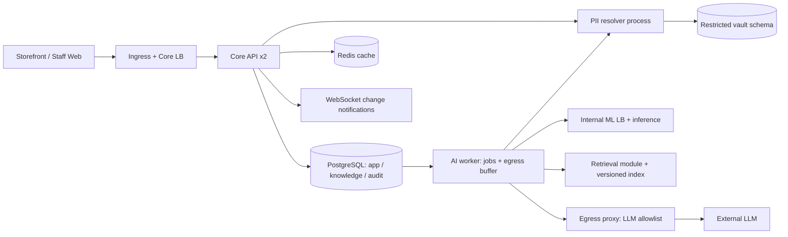
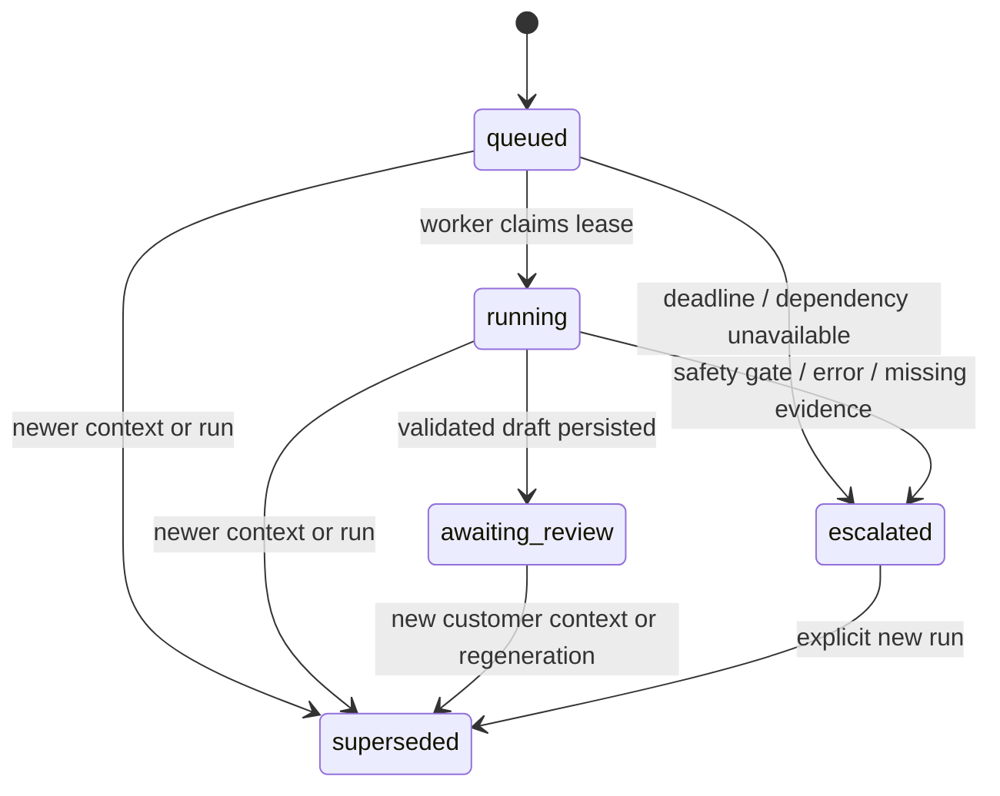
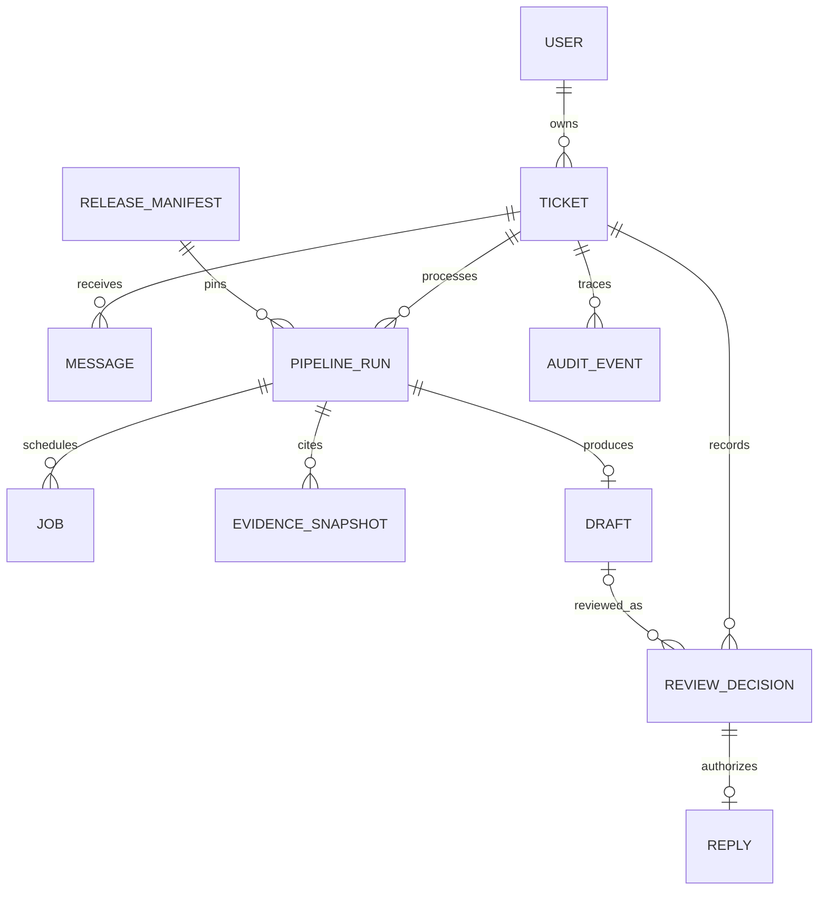

# Đặc tả thiết kế Core Backend — SupportIQ

Ngày: 2026-10-27. Trạng thái: bản thiết kế đề xuất để lập kế hoạch triển khai; chưa có mã ứng dụng.

## 1. Căn cứ và phạm vi

- [ARCHITECTURE.md](../../ARCHITECTURE.md) là nguồn mã FR/NFR dùng trong tài liệu này.
- [CHỦ ĐỀ 1.md](../../CHỦ%20ĐỀ%201.md), mục 2.2, xác định rõ 46 nhãn đánh giá ML và 12 intent sản phẩm. Hai con số phục vụ hai phạm vi khác nhau.
- [README](../../../README.md) xác định các thư mục và ranh giới thành phần hiện có.
- [Hợp đồng REST OpenAPI](../../api/core-backend.openapi.yaml) đi kèm thiết kế này; API, tên trường, enum, thông báo và nội dung sản phẩm dùng tiếng Anh. Phần giải thích thiết kế dùng tiếng Việt.

Core Backend tiếp nhận ticket, điều phối AI, cung cấp dữ liệu kiểm duyệt, ghi quyết định của nhân viên và công bố câu trả lời khi nhân viên chủ động gửi. Backend cũng cung cấp nghiệp vụ thương mại điện tử demo và báo cáo quản lý.

Không xây chatbot tự gửi, giao dịch do AI thực hiện, tích hợp thanh toán/giao vận thật, hệ thống nhiều tenant, event bus tổng quát hay microservice cho từng module. Huấn luyện ML, giao diện và cấu hình AWS chi tiết thuộc các phần khác; backend chỉ đặc tả điểm kết nối cần thiết.

## 2. Quyết định thiết kế đề xuất

Các lựa chọn dưới đây là đề xuất của người viết, chưa phải quyết định công nghệ đã được nhóm phê duyệt.

| Hạng mục | Thiết kế cho bản demo | Lý do / giới hạn |
| --- | --- | --- |
| Tổ chức code | Modular monolith trong `apps/core-backend`; mỗi module sở hữu dữ liệu và thao tác của mình | Giao dịch review, reply, audit cần nhất quán; không cần network call giữa các module nghiệp vụ |
| Ngôn ngữ/framework | Để nhóm triển khai lựa chọn; không gắn hợp đồng với ORM hay framework | Repo chưa có stack; không tự thêm dependency trong đặc tả |
| CSDL | Một PostgreSQL instance; schema `app`, `knowledge`, `audit`, `vault`, role riêng | `app` và `audit` cùng database để ghi quyết định và audit trong một transaction; vault có quyền tách biệt |
| Cache | Redis dùng chung giữa hai API replica | Không giữ permission/rate counter cục bộ làm nguồn chính |
| Hàng đợi | Bảng job bền vững trong PostgreSQL, worker claim theo lease | Đáp ứng async pipeline và AI egress buffer mà không dùng dữ liệu queue trên cache LRU; chưa cần broker riêng |
| Process | Hai API replica; AI worker và resolver chạy process riêng từ cùng codebase | AI không chiếm worker HTTP; API/AI worker không nhận credential vault; ML inference và egress proxy vẫn là dịch vụ ngoài core |
| Cập nhật UI | REST là nguồn trạng thái; WebSocket chỉ gửi thông báo có thay đổi | Reconnect không cần replay một event log riêng; client đọc lại tài nguyên sau kết nối |
| Phát hành | Manifest bất biến ghim model, prompt, KB, index, policy và bộ dữ liệu demo | Một run dùng một manifest; đổi release không làm thay đổi bằng chứng của run cũ |

Không cần thêm thư mục module mới. Job/egress buffer thuộc `orchestration`; adapter CSDL đặt trong module sở hữu. Chỉ thêm file `routes`, `service`, `repository`, `schemas` khi framework và logic thực tế cần chúng; không tạo sẵn nhiều tầng trống.



## 3. Bất biến bắt buộc

1. Worker AI không có quyền tạo reply công khai hay sửa trạng thái giao dịch commerce. Mọi reply bắt nguồn từ quyết định được duyệt và một lệnh gửi của nhân viên còn quyền.
2. `approve` và `edit` chỉ tạo nội dung đã duyệt; không gửi cho khách. `reject` và `escalate` không tạo reply.
3. Mỗi thao tác đọc/ghi kiểm tra role và quyền trên đối tượng ở backend. JWT, ID khó đoán và ẩn nút trên UI không thay thế kiểm quyền.
4. Không đưa PII thô vào ML/retrieval bên ngoài miền tin cậy, LLM, queue, cache, audit hay application/access log. Mọi payload egress phải qua scanner, kể cả dữ liệu nghiệp vụ và nội dung nguồn.
5. Chỉ resolver có credential đọc/ghi `vault`. Core API và AI worker không có credential đó; không cung cấp API công khai để giải token tùy ý.
6. Draft, evidence snapshot, review decision và release manifest bất biến sau khi tạo. Chỉnh sửa tạo decision mới; chạy lại tạo run mới. Audit chỉ insert; không cập nhật sự kiện cũ.
7. Kết quả run cũ không được ghi đè run mới; gửi reply dựa trên phiên bản ticket/context đã kiểm duyệt. Các điều kiện này được kiểm tra trong transaction.
8. Thiếu audit thì không ghi thành công quyết định hay reply. Lỗi AI không được làm mất khả năng đăng nhập, đọc ticket và duyệt thủ công.

## 4. Module và hợp đồng nội bộ

| Module hiện có | Trách nhiệm / dữ liệu sở hữu | Phụ thuộc được phép |
| --- | --- | --- |
| `auth` | User, session, role, role version; JWT; quyền trên đối tượng | App DB, cache, audit |
| `tickets` | Ticket, message khách hàng, reply công khai, context version, phân công | Auth, review, audit, orchestration |
| `commerce` | Catalog, checkout, đơn/giao hàng/hoàn tiền demo; đọc dữ liệu đã kiểm ownership | Auth, App DB, audit, privacy |
| `orchestration` | Pipeline run, deadline, job, lease, egress buffer, version snapshot | Intent, retrieval, llm, escalation, privacy, audit |
| `intent` | Client ML; kiểm nhãn, confidence, model version; không huấn luyện | ML LB, policy, cache |
| `retrieval` | Hybrid search, bộ lọc quyền/hiệu lực, evidence bất biến, cảnh báo | Knowledge Store/index, commerce, privacy, cache |
| `llm` | Prompt có phiên bản, giới hạn context/output, request/response schema, citation validation | Orchestration buffer, egress proxy, privacy |
| `review` | Quyết định approve/edit/reject/escalate; intent cuối cùng; nội dung được duyệt | Auth, tickets, retrieval, escalation, audit, feedback |
| `escalation` | Reason code, queue manager, chuyển manual; chặn hành vi nhạy cảm | Tickets, orchestration, policy, audit |
| `privacy` | Scanner, tokenizer, resolver RPC; phân quyền giải token; mã hóa PII | Vault qua resolver process; business lookup có ownership |
| `feedback` | Sửa intent, phản hồi nhân viên, đề xuất cải tiến đã che PII | Review, audit; không tự retrain hay sửa policy |
| `audit` | Sự kiện bất biến, trace đã che PII; truy vấn theo quyền | Schema audit; không gọi ngược orchestration |
| `reports` | Tổng hợp quyết định, escalation, latency, lỗi, chi phí | Audit read role, cache; không sửa audit |

Module khác gọi service công khai của module sở hữu; không truy cập trực tiếp bảng vault hay tự xây client LLM. Không cần một base repository/service dùng chung.

## 5. Mô hình nghiệp vụ và trạng thái

### 5.1. Ticket, run và context

- `ticket.status`: `open`, `resolved`, `closed`. Không cho khách thêm message khi `closed`; message mới trên ticket `resolved` mở lại thành `open`.
- `ticket.handling_queue`: `standard` hoặc `manager`. `manual_required` cho biết AI đã abstain. Chuyển manager không đóng ticket; Manager có thể nhận và duyệt thủ công.
- `ticket.context_version` tăng khi có message khách hàng mới, đổi order liên quan hoặc sửa intent. `ticket.version` tăng cho mọi thay đổi ảnh hưởng thao tác staff; dùng làm ETag.
- `run.status`: `queued`, `running`, `awaiting_review`, `escalated`, `superseded`. `awaiting_review` và `escalated` là kết quả cuối của AI, không phải trạng thái gửi trả lời.
- Chỉ một active run cho một ticket/context. Tạo run mới khi run cũ đang chạy: đánh dấu cũ `superseded`; response đến muộn chỉ được lưu trace kỹ thuật, không công bố draft và không tiếp tục gọi LLM.
- Review lưu `context_version` và `run_id` đã xem. Reply chỉ được gửi khi context còn khớp, decision chưa bị dùng và người gửi có quyền với ticket hiện tại.
- Ticket giữ `current_run_id` và `current_decision_id` để staff khôi phục công việc qua REST. Mỗi decision mới thay pointer decision cũ; chỉ decision đang được pointer trỏ đến và có action approve/edit mới được gửi. Reject/escalate vì thế vô hiệu hóa approval trước đó, kể cả cùng context.
- Message khách mới, regeneration, đổi order/intent, đổi assignee/queue hoặc đóng ticket đều xóa `current_decision_id`; regeneration supersede run cũ kể cả đã awaiting review. Manual approval supersede run AI chưa hoàn tất. Gửi thành công xóa pointer decision; quyết định và reply cũ vẫn bất biến trong lịch sử.



### 5.2. Quyết định kiểm duyệt và gửi trả lời

| Action | Điều kiện | Kết quả |
| --- | --- | --- |
| `approve` | Draft hiện hành, citations hợp lệ; người có quyền queue đó | Decision chứa chính xác nội dung draft và evidence; chưa gửi |
| `edit` | Draft hiện hành; nội dung sửa không rỗng, đã scan; lý do sửa | Decision chứa nội dung cuối và nguồn đã xem; draft gốc giữ nguyên; chưa gửi |
| `reject` | Có draft hiện hành; có lý do | Decision ghi từ chối; ticket chuyển manual, không tự chạy AI lại |
| `escalate` | Có lý do; không cần draft | Decision và audit; queue `manager`, dừng active run |
| `approve` với `source=manual` | Có nội dung staff viết; không cần run/draft hay AI khả dụng | Decision được đánh dấu manual, lưu lý do và context hiện hành; không bị giả thành draft AI có citations |

Manual decision không phải bản nháp LLM nên không buộc có citation LLM. Nhân viên vẫn phải kiểm chứng thông tin; yêu cầu nhạy cảm vẫn cần Manager và không thực hiện giao dịch từ luồng review.

`POST .../replies` tham chiếu decision hiện hành `approve`/`edit`. Cùng transaction kiểm pointer, quyền, context, evidence còn hiệu lực, decision chưa dùng; tạo reply, đánh dấu ticket `resolved`, ghi audit. Reply chỉ hiện với khách sau commit. Cùng decision chỉ có tối đa một reply. Có thể gửi bằng một thao tác UI `Approve and send` nhưng UI gọi hai API tách biệt; hỏng bước gửi không làm mất decision và không gửi ngầm khi tải lại trang. Sau reload, staff đọc ticket lấy pointer, GET run hoặc danh sách decisions để tiếp tục; không cần ID lưu trong bộ nhớ trình duyệt.

Intent sửa tay không được coi là kết quả ML: giữ `predicted_intent`, `confidence`, `model_version` gốc; lưu `final_intent`, người sửa, lý do trong decision. Nếu cần tạo draft mới theo intent sửa, tạo run với `intent_override`; vẫn áp dụng các gate về phạm vi và yêu cầu nhạy cảm.

Nếu `final_intent` trong một AI decision khác intent đã dùng tạo draft, không cho approve/edit với evidence cũ: trả `409 state_conflict`, yêu cầu run mới với override hoặc duyệt manual sau xác minh. Intent sửa trong manual decision tăng context version và decision lưu version sau thay đổi; run cũ bị superseded. Mọi decision/reply đều chạy rule nhạy cảm ở backend trên nội dung và intent, kể cả manual hoặc override, không chỉ tin nhãn client gửi.

Staff phải nhìn thấy đúng nội dung cuối trước khi duyệt. `approve` giữ đúng body draft; nếu body còn token placeholder, trả `409 state_conflict` để staff edit hoặc viết manual bằng dữ liệu đã được phân quyền. Không giải token hay chèn dữ liệu mới ngầm trong bước send. Manual vẫn dùng được khi resolver lỗi vì staff có thể viết nội dung từ dữ liệu App DB; không gửi placeholder chưa giải như câu trả lời hoàn chỉnh.

## 6. Luồng xử lý

### 6.1. Tiếp nhận và tạo draft

1. Customer tạo ticket/message. Backend lấy `customer_id` từ session, kiểm ownership của `order_id`, giới hạn input; lưu raw content đã mã hóa ở App DB, không log body.
2. Tạo ticket/message, tăng context version và append audit đã che PII trong cùng transaction. Chưa gọi LLM; khách nhận `201` và trạng thái ticket.
3. Agent/Manager tạo run rõ ràng. Backend kiểm quyền, ETag và idempotency, rate limit dùng chung, active manifest; ghi run và job trong cùng transaction, trả `202` ngay. UI đọc run hoặc nhận thông báo thay đổi.
4. Worker claim job bằng transaction ngắn; tạo deadline từ thời điểm nhận run, pin manifest/context. Không giữ transaction/row lock trong lúc gọi mạng.
5. Resolver scan raw message và business identifiers; tạo token ngẫu nhiên theo run, ánh xạ trong vault; trả sanitized text và cảnh báo. Không xác định được an toàn thì dừng AI, chuyển manual.
6. Intent service gọi ML nội bộ, kiểm `model_version`, nhãn thuộc 46 nhãn, confidence hữu hạn trong `[0,1]`. Áp dụng ngưỡng/ambiguity rule của policy; nhãn hỗ trợ không đồng nghĩa được phép làm giao dịch.
7. Retrieval dùng sanitized query + final intent; lọc quyền trước khi xếp hạng. Lấy tối đa ba evidence có nguồn/version/đoạn trích, bổ sung trạng thái commerce đã xác minh ownership và che PII. Evidence kiểm hết hiệu lực, thiếu và mâu thuẫn cả khi cache hit.
8. Có gate thất bại thì lưu lý do, `escalated`, cho staff xử lý manual; không gọi LLM để bịa câu trả lời thiếu nguồn. UI có thể hiện thông báo làm rõ thông tin theo template cố định; template không phải LLM draft.
9. LLM module tạo payload chỉ gồm sanitized question, intent, evidence, template version và giới hạn output; scan lần cuối; lưu job egress buffer có deadline và payload đã che PII. Worker chỉ gửi qua egress proxy, không có đường mạng trực tiếp tới Internet.
10. Kiểm output schema, citation IDs thuộc evidence đã cấp, không có URL/tool call tự sinh, không PII thô. Lưu draft/evidence/run outcome/audit nguyên tử sau khi kiểm run còn hiện hành. Output sai không được đưa vào `awaiting_review`.
11. API trả dữ liệu để staff xem intent/confidence, nguồn, cảnh báo, lý do escalation và draft. Không bước nào của worker tạo reply.

### 6.2. Phạm vi intent và chuyển cấp

12 intent được hỗ trợ theo tài liệu đề bài:

`track_order`, `cancel_order`, `delivery_time`, `delivery_issue`, `shipping_costs`, `return_policy`, `return_product`, `refund_policy`, `request_refund`, `refund_status`, `payment_issue`, `human_agent`.

Policy release phải liệt kê đủ 46 nhãn của model và đúng tập hỗ trợ trên. Model trả nhãn khác là lỗi contract; 34 nhãn còn lại là ngoài phạm vi sản phẩm. `human_agent` chuyển staff trực tiếp. Yêu cầu hành động như cancel/refund, khiếu nại giao dịch hoặc ngoại lệ chính sách đi queue Manager; có thể cung cấp tài liệu hỗ trợ nội bộ nhưng không gọi commerce write. Câu hỏi thuần thông tin như `refund_policy`/`refund_status` không mặc nhiên là yêu cầu hoàn tiền.

| Reason code | Kích hoạt | Xử lý |
| --- | --- | --- |
| `low_confidence`, `ambiguous_request` | Dưới ngưỡng đã hiệu chỉnh; nhiều ý/không rõ | Abstain; manual standard, lưu điểm và rule version |
| `unsupported_intent` | Nhãn ngoài 12 intent | Manual standard; không gọi LLM |
| `human_requested`, `sensitive_request`, `agent_escalated` | Yêu cầu người thật, nhạy cảm, staff chuyển cấp | Queue manager; giữ reason và người quyết định |
| `missing_information`, `no_evidence`, `expired_evidence`, `conflicting_evidence` | Thiếu dữ liệu/nguồn đáng tin | Manual; chỉ ra phần cần làm rõ, không khẳng định |
| `ml_unavailable`, `retrieval_unavailable`, `llm_unavailable`, `pipeline_timeout` | Timeout/lỗi downstream | Manual; ghi component/code đã làm sạch |
| `privacy_check_failed`, `invalid_model_output`, `invalid_llm_output`, `release_mismatch` | Không đạt kiểm tra an toàn/contract | Không gửi/tái gửi payload sai; cảnh báo vận hành |

Ngưỡng confidence, bộ rule nhạy cảm và tiêu chí mâu thuẫn nằm trong policy có version, hiệu chỉnh trên validation set. Không tự nhận một ngưỡng cố định đạt NFR-02. Thiếu policy/manifest hợp lệ thì tính năng AI không sẵn sàng; manual workflow vẫn chạy.

### 6.3. Worker, timeout và retry

- Jobs gồm `pipeline` và `llm_egress`. `available_at`, `lease_until`, `lease_token`, `attempt_count`, `deadline_at`, `status` nằm trong DB. Worker claim hàng đủ điều kiện bằng row lock; worker khác chỉ nhận lại khi lease hết. Mỗi lần claim có token mới; ghi kết quả phải đối chiếu token và run/context để worker cũ không commit muộn. Cơ chế row lock dựa trên [PostgreSQL explicit locking](https://www.postgresql.org/docs/current/explicit-locking.html).
- Delivery là at-least-once. Unique `(run_id, stage)` và unique draft per run ngăn nhân đôi kết quả; job hết hạn không được khởi tạo cuộc gọi mới. Recovery scan queued/running jobs và đưa run quá deadline về manual sau crash/restart.
- Sau khi tạo job `llm_egress`, worker pipeline lưu trạng thái rồi nhả slot; không giữ worker chờ đồng bộ một job cùng pool. Egress worker lưu kết quả và hoàn tất run theo lease/context hiện hành. Concurrency limit áp dụng theo run đang hoạt động, không đếm hai stage của cùng run thành hai yêu cầu.
- Tổng ngân sách AI là 12 giây từ khi backend nhận run đến khi có `awaiting_review` hoặc `escalated`, gồm cả queue wait. Budget khởi điểm: preprocessing + ML 1 giây, retrieval 1 giây, LLM tối đa 8 giây, persistence/notify 1 giây, dự phòng 1 giây. Đây là cấu hình đề xuất cần load test, không phải số đo đã đạt.
- Mỗi LLM attempt có timeout `min(8 giây, ngân sách còn lại)`, không vượt trần 10 giây của NFR-07; retry tối đa hai lần và chỉ khi còn đủ deadline. Backoff có jitter và tôn trọng `Retry-After` trong phần ngân sách còn lại. Không retry validation/PII/4xx không tạm thời. Không retry mỗi attempt 10 giây vì sẽ phá p95 12 giây.
- Lưu trạng thái `not_started`, `in_flight`, `completed`, `outcome_unknown` cho egress attempt. Crash sau khi provider nhận request có thể phát sinh phí dù chưa lưu draft; chỉ retry tự động khi chắc chưa gửi hoặc provider hỗ trợ khóa idempotency được kiểm chứng. Outcome không rõ chuyển manual, ghi chi phí chưa biết; không hứa exactly-once với dịch vụ ngoài.
- ML/retrieval lỗi chuyển manual ngay trong budget. Không retry job vô hạn; một retry HTTP/queue không được tự reset deadline hay số lần gọi LLM. Giới hạn concurrency AI khởi điểm hai run cho toàn core, còn tối thiểu năm phiên HTTP vẫn hoạt động; đo tải rồi mới tăng.

## 7. Dữ liệu và tính nhất quán

Đây là mô hình logic, chưa phải migration SQL. UUID cho khóa công khai, thời điểm UTC, số tiền nguyên theo đơn vị tiền nhỏ nhất kèm currency; confidence bị ràng buộc `[0,1]`. Trường nhạy cảm dùng mã hóa ở tầng ứng dụng với key runtime; không lưu key cạnh ciphertext.

| Schema / thực thể | Trường và ràng buộc chính |
| --- | --- |
| `app.users`, `app.sessions` | User role `customer/agent/manager/admin`, password hash, active, role_version; session có refresh-token hash, expiry, revoked_at; không audit credential |
| `app.tickets` | customer_id, optional order_id đã kiểm ownership, assignee_id, queue, manual_required, status, context_version, version, current_run_id, current_decision_id |
| `app.messages` | ticket_id, customer author, content_ciphertext, created_at; không đưa raw message vào audit |
| `app.pipeline_runs` | ticket_id, context_version, manifest_id, predicted/final intent, confidence, override actor, status, reason codes, deadline, latency, cost status; dữ liệu context đã sanitized |
| `app.jobs` | run_id, kind/stage, sanitized payload hoặc ID, lease fields, deadline, trạng thái, attempt; unique `(run_id, stage)` |
| `app.llm_attempts` | run_id, attempt_no, state, timestamps, provider request ref nội bộ, token usage, cost/currency; unique `(run_id, attempt_no)`; không lưu secret/raw payload lỗi |
| `app.evidence_snapshots` | run_id, citation_id, type `knowledge/business`, opaque source_id, source_version, content_hash, sanitized excerpt, valid_from/to, observed_at, warnings; unique `(run_id, citation_id)` |
| `app.drafts` | run_id unique, sanitized body, citation_ids, prompt/model version, created_at; immutable |
| `app.review_decisions` | ticket_id, nullable run/draft, context_version, action, source `ai/manual`, final_intent, reason, feedback đã scan, final_body_ciphertext nếu approve/edit, reviewer, created_at; immutable |
| `app.replies` | ticket_id, decision_id unique, author, final_body_ciphertext, created_at; chỉ reply đã gửi mới xuất hiện với Customer |
| `app.idempotency_records` | actor_id, method, route, key, request HMAC, resource_id, status, expires_at; unique actor/route/key; không cache body PII |
| `app.products`, `app.orders`, `app.order_items`, `app.shipments`, `app.refunds` | Dữ liệu demo; order gắn customer, total tính ở server; snapshots có version/observed_at; không chứa dữ liệu thanh toán thật |
| `knowledge.documents`, `knowledge.document_versions` | stable document ID, immutable version, source, policy key, effective interval, status, checksum, sanitized content; index luôn gắn KB/index version |
| `app.release_manifests` | immutable manifest ID, model/prompt/policy/KB/index/business dataset versions, checksum, approved_by, activated_at; chỉ một active manifest |
| `audit.events` | event_id, event_type, correlation_id, ticket/run IDs, actor opaque ID, timestamp, sanitized payload, versions, cache hit/miss, metrics; unique event_id, chỉ INSERT cho runtime writer |
| `vault.token_mappings` | random token, run_id, encrypted value, type, expiry; unique `(run_id, token)`; chỉ resolver có quyền |



### 7.1. Transaction và đồng thời

- Tạo ticket/message/run/job và sự kiện audit tương ứng cùng transaction theo từng thao tác. Không có khoảng hở “đã commit run nhưng quên enqueue”.
- Review và reply lock ticket, kiểm ETag/context, quyền hiện hành và trạng thái liên quan; ghi domain record + audit cùng transaction. Lock theo cùng thứ tự ticket → run → decision để tránh deadlock.
- Evidence knowledge được kiểm hiệu lực lại lúc approve và lúc send; business snapshot phải khớp version hiện hành lúc send. Nếu nguồn thay đổi, trả `409 evidence_changed`, giữ decision cũ để truy vết; staff tạo run/decision mới hoặc dùng manual với nội dung đã xác minh.
- API `If-Match` dựa trên `ticket.version`; thiếu trả `428`, sai trả `412`. Xung đột nghiệp vụ dù ETag khớp trả `409`. Response mutation trả ETag mới để UI không phải đoán version.
- Runtime audit writer chỉ có INSERT; reports/audit reader có SELECT; không có UPDATE/DELETE/TRUNCATE. Migration/retention dùng credential quản trị riêng không được mount vào runtime. Không cascade delete audit khi user/ticket thay đổi; event giữ opaque actor ID.
- App DB/audit không khả dụng: từ chối mutation `503`, không tuyên bố đã duyệt/gửi. Redis/ML/LLM không phải dependency của quyết định manual.

### 7.2. Index và truy vấn chính

Tạo index theo truy vấn thực tế: `tickets(customer_id, created_at DESC, id DESC)`, `tickets(handling_queue, status, updated_at DESC, id DESC)`, `messages(ticket_id, created_at, id)`, `pipeline_runs(ticket_id, created_at DESC)`, `jobs(status, available_at, deadline_at)` và `audit.events(ticket_id, occurred_at, event_id)`. Index các FK hay join thường xuyên; chưa partition hay thêm read replica. Unique constraints nêu ở mô hình phải là constraint DB, không chỉ kiểm trong code.

### 7.3. Retention đề xuất cho demo

Chỉ dùng dữ liệu giả lập. Raw ticket, reply và business data giữ trong thời gian đánh giá chung; audit/evidence/manifest giữ qua thời điểm chấm và báo cáo. Vault mapping hết hạn sau 24 giờ hoặc khi ticket đóng, tùy điều kiện nào đến trước; worker chỉ purge bằng resolver maintenance role. Không phụ thuộc vault để xem lại câu trả lời đã gửi: final reply được mã hóa trong App DB.

Sau khi purge vault, trace vẫn tái dựng được chuỗi xử lý đã sanitized và version; không hứa phục hồi PII từ audit hay tái tạo LLM output bằng cách gọi lại model. Chốt thời hạn lưu/xóa cụ thể trước khi dùng dữ liệu ngoài demo; không tự thêm cơ chế giữ vô thời hạn.

## 8. API bên ngoài

Base path `/api/v1`; JSON `snake_case`; resource ID dạng UUID; response đơn `{data: ...}`, collection `{data: [...], pagination: {next_cursor, has_more}}`. Cursor opaque, `limit` mặc định 20, tối đa 100; sort ổn định theo `(created_at, id)` trừ ticket queue dùng `(updated_at, id)`. Filter được allowlist; không nhận SQL/sort field tùy ý. Cursor không chứa PII và vẫn kiểm quyền khi dùng.

### 8.1. Xác thực và quyền

- Seed account demo cho bốn role; chưa cần tự đăng ký, reset password, SSO. Password dùng thuật toán hash do thư viện bảo mật chuẩn của stack cung cấp; không tự viết crypto.
- Login trả access JWT sống 15 phút; refresh token ngẫu nhiên trong cookie `HttpOnly`, `Secure`, `SameSite=Strict`, sống 8 giờ, xoay mỗi refresh; DB chỉ giữ hash. Login/refresh/logout kiểm origin cho frontend allowlist; refresh/logout kiểm CSRF token. Dùng cùng site qua gateway; không đưa token vào URL/local storage.
- CSRF token gắn với session được trả trong login/refresh và cookie riêng có `Secure`, `SameSite=Strict`, `Path=/`, không `HttpOnly` để frontend khôi phục sau reload. Refresh/logout yêu cầu header khớp token session/cookie và Origin hợp lệ. Cookie CSRF không chứa credential đăng nhập; refresh/logout xoay hoặc xóa cùng session.
- Backend xác minh chữ ký, allowlist thuật toán, issuer, audience, expiry và session còn hiệu lực. Quyền lấy từ role hiện hành, không chỉ tin role claim trong JWT. Session/permission cache TTL tối đa 30 giây; đổi role/logout invalidate chủ động.
- Mutation nhạy cảm và WebSocket subscription luôn kiểm role/session version từ DB để thu hồi quyền có hiệu lực ngay; đọc thông thường có thể stale tối đa TTL. Logout xóa refresh session; access JWT bị chặn qua session check. Cache hỏng thì đọc DB, không bỏ xác thực.

| Khả năng | Customer | Agent | Manager | Admin |
| --- | --- | --- | --- | --- |
| Tạo/đọc ticket, message, reply | Chỉ của mình | Queue standard được phân công; được nhận ticket standard chưa có người xử lý | Mọi ticket/queue; được phân công lại | Không mặc định có quyền đọc nội dung ticket |
| Chạy AI, sửa intent, duyệt/gửi manual | Không | Ticket standard được phân công | Mọi ticket, gồm manager queue | Không |
| Duyệt yêu cầu nhạy cảm/chuyển cấp | Không | Chỉ chuyển cấp | Có | Không |
| Xem đơn hàng | Chỉ của mình | Chỉ khi phục vụ ticket được phân công | Theo ticket và quyền hỗ trợ | Không mặc định |
| Checkout demo | Chỉ cho mình | Không | Không | Không |
| Báo cáo / audit | Không | Timeline ticket được phân công | Báo cáo và audit đã sanitized | Audit vận hành đã sanitized |
| Quản lý role / active release | Không | Không | Không | Có; role change có audit và chống xóa Admin cuối cùng |

Tài nguyên không thuộc phạm vi người gọi trả `404`; role không có chức năng đó trả `403`. Không cho client tự truyền customer_id, actor_id, chi phí, confidence hay trạng thái đã approve. Khuyến nghị kiểm quyền và xác thực JWT đối chiếu [OWASP REST Security](https://cheatsheetseries.owasp.org/cheatsheets/REST_Security_Cheat_Sheet.html).

### 8.2. Các endpoint

Hợp đồng kiểu dữ liệu, required fields và response nằm trong [OpenAPI](../../api/core-backend.openapi.yaml). Các dòng dưới là phạm vi v1, không phải gợi ý thêm tính năng.

| Method / path dưới `/api/v1` | Người dùng / kết quả |
| --- | --- |
| `POST /sessions`, `POST /sessions/refresh`, `DELETE /sessions/current`, `GET /me` | Login/rotate/logout/current user |
| `GET /tickets`, `POST /tickets`, `GET /tickets/{ticket_id}` | Danh sách theo scope, tạo ticket, đọc detail theo role |
| `PATCH /tickets/{ticket_id}` | Staff đổi assignee/status theo quyền; Manager xử lý queue manager |
| `GET /tickets/{ticket_id}/messages`, `POST /tickets/{ticket_id}/messages` | Lịch sử inbound và reply công khai; Customer thêm câu hỏi của mình |
| `POST /tickets/{ticket_id}/runs`, `GET /runs/{run_id}` | Staff yêu cầu xử lý AI; đọc trạng thái/intent/draft/evidence hoặc reason |
| `GET /tickets/{ticket_id}/decisions`, `POST /tickets/{ticket_id}/decisions` | Staff đọc lịch sử/nội dung decision chưa gửi hoặc ghi approve/edit/reject/escalate, approve manual |
| `POST /tickets/{ticket_id}/replies` | Staff gửi một decision đã duyệt; Customer không có quyền gọi |
| `GET /tickets/{ticket_id}/events` | Timeline audit đã sanitized cho staff có quyền |
| `GET /products`, `POST /orders`, `GET /orders`, `GET /orders/{order_id}` | Catalog và checkout/order demo; không gọi payment gateway |
| `GET /reports/summary` | Manager; khoảng thời gian UTC, tối đa 31 ngày |
| `GET /users`, `PATCH /users/{user_id}` | Admin xem account metadata/đổi role hoặc trạng thái; không trả password hash |
| `GET /releases`, `PUT /releases/current` | Admin chọn manifest đã qua offline gate; không upload model tùy ý |
| `GET /health/live`, `GET /health/ready` | Endpoint nội bộ; liveness không phụ thuộc AI/cache, readiness yêu cầu DB/audit |

`POST /tickets`, `/messages`, `/runs`, `/decisions`, `/replies`, `/orders` yêu cầu `Idempotency-Key` ngẫu nhiên, scope theo actor + method + route; TTL 24 giờ. Cùng key/cùng payload trả lại resource và không tạo side effect mới; cùng key/khác payload trả `409 idempotency_conflict`. Kiểm quyền hiện hành trước cả replay; request fingerprint là HMAC trên canonical body để không lưu PII. Idempotency được kiểm trước ETag sau khi đã xác thực/phân quyền để retry request thành công không bị từ chối do version đã tăng.

Ví dụ tạo run (giá trị ID minh họa):

```http
POST /api/v1/tickets/00000000-0000-4000-8000-000000000001/runs
Authorization: Bearer <access-token>
Idempotency-Key: 71c67bbf-33bd-4539-9673-f4c956ee1841
If-Match: "7"
Content-Type: application/json

{}
```

```json
{
  "data": {
    "id": "00000000-0000-4000-8000-000000000002",
    "ticket_id": "00000000-0000-4000-8000-000000000001",
    "status": "queued",
    "context_version": 3,
    "reason_codes": []
  }
}
```

Response `202`, `Location: /api/v1/runs/...`, ETag ticket mới. Chi tiết draft/evidence chỉ trả cho staff đã có quyền, không gộp vào customer ticket DTO.

Staff ticket DTO luôn có `current_run_id`, `current_decision_id` (nullable); Customer DTO bỏ hai trường này. Danh sách decisions được phân trang và kiểm quyền staff; field `final_body` có thể có PII nên chỉ trả qua kết nối staff được phép, không đưa vào audit/log hay WebSocket.

### 8.3. Lỗi, giới hạn và versioning

Lỗi dùng `application/problem+json` theo [RFC 9457](https://www.rfc-editor.org/rfc/rfc9457.html), thêm `code`, `request_id`, `errors` đã lọc giá trị nhạy cảm. `type` là URI ổn định dạng `urn:supportiq:problem:<code>`. Không trả stack trace, downstream payload hay câu hỏi thô trong detail.

| HTTP | Code / tình huống |
| --- | --- |
| `400` | `invalid_request`: JSON/cursor/filter sai |
| `401` | `unauthenticated`: token/session không hợp lệ; kèm `WWW-Authenticate` |
| `403` | `forbidden`: role không được thực hiện chức năng |
| `404` | `not_found`: không tồn tại hoặc ngoài object scope |
| `409` | `state_conflict`, `evidence_changed`, `idempotency_conflict`, `release_not_approved` |
| `412`, `428` | `version_conflict`, `precondition_required` |
| `413`, `415`, `422` | `payload_too_large`, `unsupported_media_type`, `validation_failed` |
| `429` | `rate_limited`; kèm `Retry-After` |
| `500` | `internal_error`: lỗi ngoài dự kiến, detail chung |
| `503` | `dependency_unavailable`, `ai_unavailable`, `rate_limiter_unavailable`; manual vẫn chạy nếu DB/audit còn sống |

Giới hạn khởi điểm: JSON tối đa 64 KiB; message/final reply tối đa 8.000 ký tự; feedback/reason 1.000 ký tự; login 5 lần/phút/IP; AI 10 lần/phút/user và tối đa một active run/ticket, hai run xử lý đồng thời toàn hệ thống; API thông thường 60 lần/phút/user. Giá trị là cấu hình cần đo, không phải kết quả NFR. Redis lỗi: bỏ qua limiter đọc/manual nhưng vẫn auth/audit; tạo run AI bị chặn `503`, không âm thầm cho qua. Gateway không được log raw IP, query chứa dữ liệu nhạy cảm hoặc auth header; counter IP dùng HMAC.

Thay đổi tương thích chỉ thêm trường optional; client bỏ qua trường lạ. Không đổi nghĩa enum/required field trên `/v1`; breaking change dùng `/v2`, cập nhật OpenAPI và hai frontend trong cùng kế hoạch chuyển đổi. Bản demo không cần phục vụ song song nhiều phiên bản trước khi có client thật.

### 8.4. WebSocket

Gateway cung cấp `/api/v1/ws`, bắt buộc TLS và kiểm Origin. Client mở kết nối rồi gửi access token trong frame auth đầu tiên trong 5 giây; không gửi dữ liệu trước khi xác thực, không đưa token vào query. Subscribe theo ticket/run, kiểm ownership/assignment/role version trong DB; quyền thay đổi thì ngừng subscription. Token hết hạn thì đóng kết nối để client refresh và kết nối lại.

Frame server chỉ có `{event, resource_id, version, occurred_at}` với event `ticket.changed` hoặc `run.changed`, không chứa PII/draft. Notify là best effort sau commit; một replica có thể theo dõi thay đổi DB để notify kết nối mình đang giữ. Client GET lại resource sau reconnect và có thể polling mỗi hai giây khi đang chờ AI; polling không tăng số run. Không dùng WebSocket làm nơi duy nhất lưu trạng thái hay quyết định.

## 9. Hợp đồng AI, evidence và bảo vệ dữ liệu

### 9.1. ML và release

Request nội bộ tới ML: `{text: sanitized_text, expected_model_version, request_id}`; response `{intent, confidence, model_version}`. ML LB chỉ nội bộ, timeout nằm trong budget. Nhãn/confidence/version sai chuyển `invalid_model_output`/`release_mismatch`, không đoán nhãn mặc định. `intent_override` do staff có quyền chọn phải hợp lệ với manifest và được audit; không xóa dự đoán gốc.

Manifest tham chiếu model đã tự huấn luyện, baseline/evaluation report, 46 labels, 12 supported intents, thresholds, prompt/policy versions, KB/index/business dataset versions và checksum. Admin chỉ activate manifest có gate offline pass và người phê duyệt; không tự train hay publish khi có feedback. Worker kiểm artifact tồn tại và khớp checksum trước khi nhận job. Run đã ghim release tiếp tục dùng release đó; emergency revoke đánh dấu run liên quan không gửi được, staff xử lý manual hoặc chạy lại.

### 9.2. Evidence và grounding

Evidence knowledge có citation ID, document/version, excerpt/hash, hiệu lực; evidence business có entity token, snapshot version, observed_at và các field đã che PII. Citation API phục vụ staff từ snapshot có kiểm quyền, không để client tải URL do LLM cung cấp. Customer chỉ thấy câu trả lời đã gửi và nhãn nguồn được phép công khai, không thấy internal evidence payload.

Retrieval loại tài liệu chưa được phê duyệt hoặc sai scope trước top-3. Kiểm mâu thuẫn theo policy key, effective interval và normalized rule values trong KB metadata; điều không xác định được đánh dấu `conflicting_evidence` để staff xem, không dùng LLM tự quyết nguồn đúng. `missing_information` phải nêu field cần bổ sung bằng mã, không ghi raw identifier vào audit.

Prompt phân tách instruction với câu hỏi/evidence không tin cậy; không cấp tool gọi DB, hoàn tiền, gửi reply hoặc truy cập URL. Output chỉ `{body, citation_ids}`. Tất cả citation phải tồn tại trong snapshot của chính run; response rỗng, citation lạ, thiếu citation, nội dung vi phạm scanner đều bị chặn. Citation tồn tại không chứng minh câu văn được nguồn hỗ trợ: NFR-04 vẫn cần chấm thủ công grounding và human review, không tuyên bố đã tự kiểm chứng 90% bằng schema.

### 9.3. Privacy và quyền truy cập vault

- Raw message đi qua HTTPS vào App DB mã hóa; chỉ API trả cho Customer sở hữu hoặc staff được phân công. Trước mọi bước AI, resolver tạo token ngẫu nhiên, scope theo run; token cũ/của run khác không được giải.
- Lookup business dùng customer/order ownership do backend xác định. Có token mã đơn không đồng nghĩa có quyền xem đơn; scanner/LLM không được chọn tùy ý customer scope.
- Resolver process có API nội bộ tối thiểu `sanitize(run_id, context_ref)` và `resolve_identifiers(run_id, scoped_refs)` để tra cứu nghiệp vụ theo quyền, xác thực service identity và actor scope. Không nhận SQL/URL tùy ý; không trả cả bảng ánh xạ. Core/worker credential không được đọc vault bằng DB client khác.
- Token resolution chỉ dùng cho ngữ cảnh staff/customer được phép. Nội dung đã resolve phải được scan lại trước khi log/egress; queue và audit luôn giữ bản sanitized. Output cuối lưu mã hóa ở App DB, không giữ mapping trong Redis.
- PII scanner bao phủ tên, địa chỉ, điện thoại, email, order ID theo FR-10; rule phải có test trên synthetic fixtures. Scanner không phải bảo đảm phát hiện mọi tên tự do: trường hợp chưa chắc chắn chuyển manual; zero-PII là tiêu chí kiểm thử phải chứng minh, không phải giả định.
- Tách mạng core/worker/vault/proxy; chỉ egress worker qua proxy được tới host LLM cho phép. Chặn host override, redirect ra host khác, URL từ prompt, telemetry ra ngoài và logging của proxy có body/header nhạy cảm.

## 10. Cache và chế độ suy giảm

Key dùng HMAC thay cho lưu query/identifier thô; quyền luôn kiểm trước cache access. Cache không dùng làm nguồn trạng thái workflow.

| Namespace | Key / TTL đề xuất | Kiểm soát |
| --- | --- | --- |
| Session/permission | opaque session ID + role version; 30 giây | Invalidate logout/role change; mutation và WS kiểm DB |
| Rate limit | opaque actor/IP HMAC + cửa sổ thời gian | Counter atomic dùng chung; AI fail-closed khi Redis lỗi |
| Retrieval | query HMAC + final intent + scope fingerprint + KB/index/policy versions; 60 giây | Chỉ cache knowledge đã sanitized; business snapshot đọc mới; kiểm hiệu lực lại |
| Intent | text HMAC + model version; 60 giây, mặc định tắt | Giữ confidence/cờ uncertainty; chỉ bật khi số đo cho thấy có lợi |
| Reports | time range + metric version + scope; 30 giây | Response có `generated_at`; không dùng làm chứng cứ audit |

Cache timeout ngắn, lỗi bỏ qua để dùng DB/ML/retrieval gốc; không bỏ RBAC hay privacy gate. Không cache draft LLM, vault, business snapshot, audit write. Redis cache maxmemory có thể LRU vì durable jobs nằm ở DB, không chung key chứa queue quan trọng.

| Thành phần lỗi | Hành vi |
| --- | --- |
| ML / index / LLM / egress proxy | Run escalated có reason; ticket, login, review manual vẫn dùng được |
| Resolver / vault | AI dừng; staff vẫn đọc ticket được phép từ App DB, viết và duyệt manual; không giải token bừa hoặc gửi raw ra ngoài |
| Cache | DB fallback; AI mới bị chặn nếu không giữ được distributed rate limit |
| AI worker chết | HTTP tiếp tục; lease hết được recover, deadline quá hạn chuyển manual |
| Một core API replica chết | LB loại replica; client retry cùng idempotency key; replica còn lại xử lý |
| DB / audit lỗi | Mutation `503`; không approve/send thiếu audit; không hứa availability khi persistence chung hỏng |

## 11. Audit, báo cáo và vận hành

Mỗi HTTP request có `request_id` do server tạo và trả `X-Request-ID`; mỗi run có correlation ID bền vững, event có ID riêng. ID log không chứa order ID hoặc user text. Audit event gồm ticket/run, actor opaque ID, quyết định, predicted/final intent và confidence, source/model/prompt/policy/release versions, escalation reasons, thời gian, cache hit/miss. Free-text feedback được scan; raw/final content chỉ lưu mã hóa trong App DB, audit giữ content hash và reference.

Ghi stage start/end và duration, queue wait, ML/retrieval/LLM timeout, provider usage/cost có version bảng giá. Không ghi prompt nguyên bản ở application log. Giá trị tiền/chi phí dùng decimal chính xác hoặc integer micro-unit kèm currency, không float. Provider không trả usage thì cost `unknown`; báo cáo có số lượng unknown, không gán bằng 0. Chi phí trung bình/request tính trên mọi run đã hoàn tất trong khoảng, gồm escalation/lỗi; tách known-cost average và coverage để không đánh tráo số liệu.

Tỷ lệ approve/edit/reject dùng mỗi draft có quyết định kết thúc đầu tiên, denominator là draft đã được quyết định; approve manual không nằm trong tỷ lệ chấp nhận AI. Escalation count theo run và reason; staff escalation được báo cáo riêng để tránh đếm trùng. Báo cáo nêu rõ `from`, `to`, `generated_at`, số run, số draft đã review, số reply, lỗi và chi phí unknown.

Readiness API chỉ phụ thuộc khả năng truy cập App DB và ghi audit; AI có trạng thái availability riêng trong health nội bộ. Liveness không gọi ML/LLM/cache. Worker readiness kiểm artifacts/policy/proxy; không làm LB loại API đang phục vụ manual vì model bị lỗi. Log sanitization áp dụng cả gateway, resolver, worker và proxy. Metrics label chỉ dùng stage/reason/component, không dùng user/ticket ID để tránh cardinality cao và lộ dữ liệu.

## 12. Kiểm chứng và tiêu chí nghiệm thu

Đường dẫn kiểm thử là các thư mục đã tạo; phần này là yêu cầu kiểm chứng khi triển khai, không phải báo cáo đã chạy.

| Nhóm / yêu cầu | Kịch bản phải chứng minh |
| --- | --- |
| `tests/unit` — FR-01/02/03/07 | 46 nhãn vs 12 intent; threshold/override; sensitive gate; hiệu lực/mâu thuẫn evidence; citation validation; transition hợp lệ |
| `tests/integration` — FR-08, NFR-09 | Decision/reply + audit nguyên tử; audit chỉ insert; duplicate request/job; worker crash/lease; stale worker không ghi đè; outcome LLM không rõ không retry tốn phí vô hạn; approval cũ không gửi được sau reject/edit/regeneration/reassignment |
| `tests/e2e` — FR-04/06, NFR-05/10 | Customer hỏi → draft → approve/edit → bấm gửi → customer thấy; approve đơn thuần không gửi; reject/escalate không gửi; manual hoàn thành khi AI chết; reload sau approve/gửi lỗi tìm lại decision để tiếp tục |
| `tests/security` — FR-09/10, NFR-06 | Ma trận bốn role + ownership/assignment; Admin không tự có ticket access; revoke quyền khi cache nóng/lạnh và WS; giả token/order; PII scan outbound/log/queue; prompt injection; proxy allowlist; worker không tạo reply/giao dịch |
| `tests/integration` — NFR-07 | ML/retrieval/LLM timeout; Redis/vault/proxy lỗi; một API chết; manual vẫn chạy khi DB/audit sống; audit lỗi chặn decision/send |
| `tests/performance` — NFR-08 | Một phiên vs ít nhất năm phiên; p50 ≤ 4 giây, p95 ≤ 12 giây và không quá hai lần single-user; lỗi ≤ 1%; đo cả stack ≤ khoảng 5 GB RAM trên máy 8 GB |
| `ml/evaluation` — NFR-01/02 | 10-fold CV, Macro-F1 ≥ 0,85 và vượt baseline; per-class F1/confusion matrix; frozen splits/seed; robustness giảm ≤ 10 điểm; ≥ 90% câu mơ hồ/multi-intent/OOS bị flag |
| `tests/evaluation` — NFR-03/04 | Recall@3 ≥ 0,80; toàn bộ fixture nguồn hết hiệu lực/thiếu/mâu thuẫn được cảnh báo; mọi AI draft có nguồn; grounding ≥ 90% theo rubric chấm thủ công |
| NFR-10, FR-11 | Staff sửa/từ chối tối đa ba thao tác UI; so sánh ít nhất 30 yêu cầu để đo giảm thời gian ≥ 20%; báo cáo không gộp manual approval vào AI acceptance |

Đo latency AI từ lúc backend nhận yêu cầu tạo run đến khi có kết quả review/manual, không dùng thời gian trả `202` thay cho thời gian AI và không tính thời gian nhân viên suy nghĩ. Báo riêng auto-escalation và LLM draft completion để kết quả nhanh do fallback không che việc pipeline lỗi. Load test ghi phiên bản dữ liệu, release, máy, concurrency và cache state.

## 13. Những gì còn để nhóm triển khai quyết định

- Chọn ngôn ngữ/framework, ORM, JWT/password/encryption library theo năng lực nhóm; không đổi hợp đồng và ranh giới quyền vì tiện thư viện.
- Chọn model tự huấn luyện, embedding/index implementation, LLM provider và model ID; đưa phiên bản/checksum, ngân sách token và báo cáo đánh giá vào manifest trước khi bật AI.
- Chốt threshold/sensitive fixtures, tài liệu KB đã được duyệt, metadata để phát hiện mâu thuẫn và version dữ liệu chung. Chưa có căn cứ thì để AI unavailable và dùng manual, không điền dữ liệu giả vào báo cáo đánh giá.
- Xác nhận cấu hình timeout/concurrency/cache và retention bằng số đo trên môi trường demo. Mức cấu hình trong tài liệu là điểm bắt đầu, không phải kết quả đạt NFR.

Những lựa chọn trên là đầu vào cho kế hoạch triển khai. Đặc tả này không phê duyệt việc cài dependency, tạo migration, triển khai hạ tầng hay phát hành ứng dụng.
