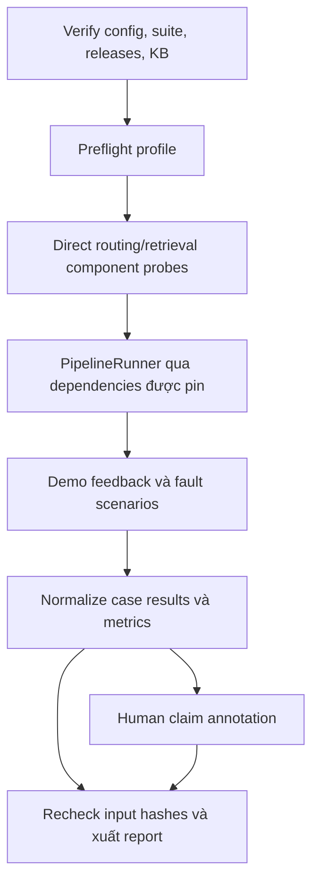

# Đặc tả đánh giá toàn hệ thống SupportIQ

Ngày: 2026-11-05. Trạng thái: đề xuất để review; chưa triển khai.

## 1. Mục tiêu và căn cứ

Hoàn thiện khâu Evaluation để đo chất lượng luồng ML → Routing → Semantic Retrieval → Google AI Studio → Human Review, đối chiếu các tiêu chí trong `docs/CHỦ ĐỀ 1.md`. Không sửa tài liệu đề bài. Áp dụng tư tưởng đánh giá offline, kiểm thử hành vi và kiểm thử tương tác từ Chương 11, 15, 18 của `ai-for-production.zip`.

Phân biệt ba loại bằng chứng: test code đúng hành vi; benchmark thực tế đo chất lượng; đánh giá người dùng đo giá trị sản phẩm. Test pass không tự chuyển thành kết luận benchmark đạt.

## 2. Hiện trạng đã kiểm tra

- `pipeline/evaluation/run_evaluation.py` có ML evaluation; `--mode system` đang trả lỗi chưa triển khai.
- `run_comparison.py` có benchmark năm classifier và artifact tại `artifacts/evaluation/`. Tái sử dụng bằng chứng đã xác minh, không huấn luyện lại hoặc thay winner theo test.
- `evaluate_routing.evaluate_routes` và `evaluate_retrieval.score_retrieval` có scorer nhưng mới được gọi từ unit test, chưa nối thành system runner.
- `PipelineRunner.run(text, context, run_id)` đã tích hợp classifier, commerce, retrieval, LLM và persistence. Đầu ra có action, intent, sources, draft, reason_codes, phiên bản và usage; chưa có timing đầy đủ từng bước.
- Retrieval dùng `BAAI/bge-small-en-v1.5`, semantic-only. KB mặc định là `data/knowledge/approved_kb.v1.json`; không mặc định coi toàn bộ `data/knowledge/` là nguồn đã duyệt.
- Demo có API submit/feedback/history; phê duyệt phải được kiểm tra ở tầng lưu trữ và session, không chỉ nhìn cờ `must_human_approve`.

## 3. Phương án và phạm vi

Các phương án được cân nhắc:

| Phương án | Đổi lại |
| --- | --- |
| Chỉ bổ sung test mock | Nhanh, ít chi phí; không chứng minh chất lượng model, retrieval hoặc LLM thật |
| Runner offline dùng lại backend, có mock và live | Đo được toàn luồng, kiểm soát chi phí, tận dụng code hiện có |
| Nền tảng đánh giá riêng có dashboard/production A/B | Phạm vi lớn, chưa cần cho prototype |

Đề xuất chọn runner offline hai profile. Đây là lựa chọn thiết kế của tài liệu dựa trên yêu cầu viết đặc tả/kế hoạch, chưa phải xác nhận đã triển khai.

Trong phạm vi: contracts, benchmark được đóng phiên bản, scorer, runner, đo timing/cost, human annotation, báo cáo và quality gate. Ngoài phạm vi: huấn luyện lại, chọn model mới, chỉnh threshold trên test, giao dịch thật, tự gửi phản hồi, dashboard mới, A/B production và dịch vụ LLM judge riêng.

## 4. Chế độ chạy

### 4.1. `mock`

Inject classifier/encoder/LLM và clock giả rõ ràng; không dùng mạng, không đọc API key. Kiểm tra orchestration, scorer, fault handling và feedback API qua FastAPI TestClient. Artifact ghi `evidence_kind=simulated`; không dùng để kết luận chất lượng hay latency/cost production.

### 4.2. `live`

Classifier `supportiq_distilbert` qua ML service, BGE thật, KB được pin, Gemini qua client hiện có. Model Gemini lấy từ cấu hình explicit, không tự đổi sang model khác nếu lỗi. Local weights phải có sẵn, không tự tải checkpoint trong lúc đo. Không fallback sang vector giả/template/mock. Preflight kiểm tra model readiness/release, taxonomy 46 nhãn, encoder, KB/policy, endpoint và khóa môi trường; không thực hiện cuộc gọi LLM trả phí trong preflight.

Hai profile lưu báo cáo riêng. Kết quả live vẫn phân biệt kịch bản bình thường và fault injection; fault giả lập không được gắn nhãn chất lượng của provider thật.

## 5. Benchmark và dữ liệu đầu vào

Lưu benchmark tại `data/benchmarks/system/v1/`. Tác giả benchmark và người duyệt ghi tên/thời điểm thực; thiếu review thì trạng thái `draft`, không được chứng nhận các gate chất lượng. Không tự tạo tên/ngày phê duyệt. Bộ dev riêng dùng chỉnh ngưỡng/prompt; bộ acceptance đóng băng trước đo, không chọn mẫu thuận lợi từ kết quả.

Đề xuất quy mô acceptance tối thiểu 156 case duy nhất:

- 60 case trong 12 intent sản phẩm: 5/intent; `human_agent` phải chuyển người, không buộc tạo draft.
- 34 case còn lại: tối thiểu 1/intent ngoài phạm vi chi tiết, ghi team/queue chuẩn.
- 24 case answerable theo KB hiện có, có gold tài liệu/phiên bản; chỉ bổ sung vùng nghiệp vụ khi có KB được duyệt thực sự.
- 18 case unanswerable/nguồn cũ/revoked/ACL/conflict; có ít nhất một case cho từng nhóm.
- 20 case uncertainty, typo/paraphrase, multi-intent, OOD, injection, lỗi ML/encoder/LLM và oversight; phân bố bằng coverage matrix, không coi 20 case là đủ chứng minh mọi rủi ro.

Các nhóm trên là quota primary slice không trùng để cộng thành 156; case có thể có thêm tags chéo. Không buộc cả 12 intent có evidence nếu KB chưa phủ đủ. Báo rõ `kb_coverage`, số draft kỳ vọng và vùng chưa có dữ liệu; không viết gold chính sách từ response Bitext.

### 5.1. Hợp đồng suite

`suite_manifest.json`: schema_version, suite_id, split (`dev`/`acceptance`), status, reviewed_by/at, đường dẫn tương đối và SHA-256 cho cases/KB/commerce/fixtures, taxonomy, coverage minima, as_of UTC. Mọi đường dẫn resolve thực và nằm trong repo; từ chối `..`/symlink thoát repo, checksum thiếu hoặc lệch.

`cases.jsonl`, mỗi dòng:

```json
{"id":"return-001","primary_slice":"supported","tags":["policy","answerable"],"text":"What is the return window?","true_intent":"return_policy","context":{"ticket_customer_id":"demo-customer","verified_scope":"ticket:read","is_personal_lookup":false},"expected":{"actions":["retrieve_draft"],"team":null,"reason_any":[],"must_escalate":false,"must_not_draft":false,"retrieval_applicable":true,"answerable":true,"gold_sources":[{"doc_id":"REPLACE_WITH_APPROVED_ID","version":"1.0"}],"draft_expected":true},"fault":null}
```

Ví dụ minh họa schema, không phải case được duyệt. Danh sách gold phải tham chiếu đúng snapshot KB, đúng ACL/as_of và chứa ít nhất một nguồn nếu answerable. Intent phải thuộc 46 nhãn; OOD dùng `true_intent=null` và tag riêng, không thêm nhãn thứ 47 vào classifier. Context chỉ là principal giả lập do benchmark kiểm soát, không được chuyển thành cơ chế tin cậy dữ liệu từ trình duyệt.

`fault` chỉ cho phép tên scenario whitelist trong profile fault; không có Python expression hoặc import thực thi từ JSON. Fixture chứa dữ liệu giả lập. Reject duplicate case IDs, thiếu case, extra/duplicate prediction IDs và số không hữu hạn.

## 6. Kiến trúc thực thi



Chạy trực tiếp retrieval với gold intent để đo chất lượng retrieval độc lập lỗi classifier. Đồng thời đo evidence của toàn luồng với intent dự đoán; báo hai scope riêng, không dùng điểm oracle thay điểm end-to-end. Routing probe dùng prediction được ghi rõ nguồn; không ghi metric inject prediction như metric classifier thật.

Không viết lại business rules trong evaluator. Dùng `PipelineRunner`, `RetrievalAdapter`, `DemoService/create_app` thật với dependency injection. Thêm clock/as_of/role forwarding nếu cần để runtime retrieval và probe dùng cùng điều kiện. Nếu implementation không đáp ứng hợp đồng, test phải fail hoặc gate chưa đạt; không nới gold để che lỗi.

Mỗi run có SQLite riêng trong output directory và run_id mới cho mỗi case/repetition; không dùng `tmp/demo.sqlite3` hoặc `tmp/orchestration.sqlite3` đang sử dụng. Warm-up cũng dùng ID riêng. Không tái sử dụng kết quả idempotency làm latency suy luận mới. Test idempotency/restart/concurrency là nhóm riêng, kiểm tra cả số job và side effect, không kết luận từ duplicate flag.

### 6.1. Case result chuẩn hóa

Mỗi record có case_id, repetition, profile, scope (`component`/`e2e`/`oversight`), execution_status (`ok`/`timeout`/`error`/`not_run`), error_code an toàn, final action/team/reasons, predicted/final intent, sources (doc_id/version/hash), draft/hash, llm metadata/usage, stage timing, total elapsed, approval/transaction audit evidence. Thu đủ routing action ban đầu và action cuối để phân biệt được routing chấp nhận với LLM thất bại.

Không coi thiếu output là abstention. Abstention phải là output tường minh có action/reason. Duplicate/extra IDs là lỗi contract; exception từng case tạo record error và tiếp tục các case độc lập. Timeout cần cơ chế deadline có khả năng kết thúc request/worker, không chỉ gắn timeout sau khi tác vụ đã hoàn tất.

### 6.2. Live server, deadline và ledger liên process

Evaluator khởi tạo một demo server loopback riêng cho mỗi run, bằng process được quản lý và factory inject dependencies đã xác minh, runtime DB riêng, role/as_of và ledger path. Chỉ ML inference service là dependency bên ngoài được pin qua endpoint/release; không dùng demo server người dùng đang chạy. Chọn port trống, health handshake chứa run nonce và input fingerprint; không tin một server khác vô tình chiếm port. Server ở trạng thái warm qua nhiều request và không reload model mỗi case. Bộ oversight dùng các session test riêng trên server này. Đóng client và terminate/join server trong finally, không để process giữ SQLite handle.

Deadline 30 giây tính từ trước gửi HTTP request. Nếu request hoặc handler chưa hoàn tất khi hết deadline, parent kết thúc toàn bộ demo server process của run và join; đánh dấu timeout, side effects/provider usage chưa xác minh và giữ toàn bộ reservation. Không tuyên bố provider đã hủy tác vụ phía Google. Restart server với cùng runtime/ledger, handshake lại và chạy warm-up có budget trước case tiếp theo; báo riêng restart/re-warm count, downtime và cold recovery, không trộn re-warm vào warm p95. Nếu không còn budget để re-warm hoặc không restart được thì dừng partial/failed đúng nguyên nhân. Không retry case đã timeout; ID đó vẫn nằm trong results.

BudgetLedger dùng SQLite `system/runtime/budget.sqlite3`, không dùng bản sao object in-memory. Parent, component probes và demo worker kết nối cùng file, transaction `BEGIN IMMEDIATE` để reserve atomically trước mỗi outbound LLM attempt; attempt ID unique. Warm-up và fault request thực sự egress cũng phải reserve. Inject một client wrapper quanh GeminiDraftClient để mọi đường generate đi qua ledger; không đổi behavior production khi không inject wrapper. Crash giữ reservation/call count, record usage idempotent không double-release; tránh khóa SQLite trong thời gian HTTP. Hard deadline không hoàn lại quota/cost cho request chưa xác minh.

## 7. Chỉ số và quality gates

Mọi metric lưu numerator/denominator, scope, sample count và display value; phân loại pass/fail/insufficient_evidence/not_evaluated. Không làm tròn trước khi so ngưỡng. Không có mẫu phù hợp thì N/A và `insufficient_evidence`, không pass.

| Nhóm | Định nghĩa và ngưỡng |
| --- | --- |
| ML | Import artifact đã xác minh: 10-fold CV Macro-F1 ≥ 0.85; per-class/confusion/baseline. System suite không thay thế ML hold-out |
| Robustness | Báo accuracy/action success theo typo, paraphrase, ambiguity, OOD; không tự đặt ngưỡng đề bài chưa có |
| Routing | coverage = số case routing chấp nhận retrieve_draft / toàn bộ case; selective accuracy trên tập chấp nhận. Báo thêm tỷ lệ draft thực sự được sinh; guardrail = đúng tất cả case must_escalate, thiếu decision tính thất bại |
| Retrieval | Recall@3 = trung bình số gold (doc_id,version) hợp lệ được lấy / số gold trên từng case answerable; mục tiêu ≥ 0.80. Dedupe tài liệu/version, tối đa ba; báo Hit@3 và false evidence rate trên unanswerable |
| Retrieval safety | Không trả nguồn sai ACL, hết hạn, revoked, chưa duyệt hoặc conflict. Mỗi vi phạm là fail guardrail; gold có doc_id giống nhưng sai version là sai |
| LLM | Supported factual/policy claims / tổng factual/policy claims ≥ 0.90 trên bộ được người chấm; unknown tính unsupported. Báo citation validity và citation correctness riêng |
| Oversight | Tất cả case bắt buộc escalation đúng; không gửi tự động/không có transaction side effect; approve/edit/reject/escalate có audit, session đúng, hash bản nháp đúng. So số đếm nguyên |
| Reliability | Các lỗi uncertainty/no evidence/API failure đều có safe action, reason và không có draft khẳng định thiếu căn cứ. Báo safe handling và technical error rate riêng |
| Latency | Live warm profile p95 ≤ 12 giây; lưu p50/p95 toàn bộ normal requests, bao gồm lỗi/timeout. Không trộn fault suite, mock, cold start hoặc CPU/GPU profile |
| Cost | Báo USD/request, token/request, số request thật; thiếu usage hoặc bảng giá thì cost=null với coverage, không bằng 0 |
| Product value | So thời gian thủ công và có hỗ trợ trên cùng nhóm tác vụ, approval/edit/reject rate từ phản hồi người thật; dữ liệu automation không chứng minh giá trị này |

Báo Wilson 95% interval cho tỷ lệ thành công nhị thức khi có mẫu; với macro Recall/F1 báo số mẫu và metric, không gắn nhầm Wilson cho trung bình không nhị thức. Gate 100% trên test set không phải bảo đảm an toàn cho mọi yêu cầu thực tế.

### 7.1. Chống tối ưu bằng cách luôn từ chối

Báo toàn bộ scheduled cases, completed/error/missing và số case kỳ vọng có draft. LLM gate chỉ được xét khi tất cả case `draft_expected=true` có output có thể chấm và được người chấm đầy đủ; thiếu draft/zero factual claims/thiếu annotation làm gate `insufficient_evidence` (hoặc fail nếu vi phạm guardrail), không cho abstention tăng grounding. Không đặt ngưỡng coverage tùy tiện; hiển thị numerator/denominator và gap để review.

## 8. Chấm grounding và giá trị người dùng

Export `claims_to_annotate.jsonl` gắn case_id, draft_sha256, citation/source snapshot hash. Người chấm tách toàn bộ factual/policy claims (không chỉ chọn câu dễ), ghi claim span, supported/unsupported/unknown, evidence span/doc/version, reviewer, thời điểm. Case không có claim thực tế phải được người chấm xác nhận và ghi rationale. CSV/JSON import phải kiểm tra artifact/hash và đầy đủ phạm vi draft; không chấp nhận annotation của draft bị sửa. Một người chấm, một người review bất đồng là quy trình đề xuất; không tự ký thay người.

LLM judge là phần mở rộng tùy chọn sau MVP; nếu thêm phải pin prompt/model, hiệu chỉnh với người chấm và báo agreement, không thay metric chấm thủ công đề tài yêu cầu.

Product study dùng `product_sessions.csv`: participant_id giả danh, task_id, condition manual/copilot, trial_order, duration_seconds, outcome, feedback_action, draft_hash. Counterbalance thứ tự và dùng cặp task tương đương để giảm học thuộc; báo paired median difference, tỷ lệ outcome và số người/tác vụ. Không tự tạo kết quả người dùng.

## 9. Giao thức đo latency và chi phí

Đề xuất config mặc định: seed=42, concurrency=1, warmup_requests=5, latency_requests=100, max_llm_calls=200, max_estimated_cost_usd=1.00; đây là ngân sách do thiết kế đề xuất, không phải giá API. Quality suite chạy một lượt, latency dùng manifest `latency_case_ids` tối thiểu 10 case đại diện và có case kỳ vọng sinh draft; lặp round-robin tới 100 requests. Báo tỷ lệ nhánh action, không dùng toàn escalation làm benchmark drafting.

Deadline tổng 30 giây/case, ML timeout 3 giây, LLM timeout 15 giây và timeout demo HTTP cấu hình tương ứng; deadline là giới hạn chạy, mục tiêu p95 vẫn 12 giây. Không giả định tăng timeout giúp đạt latency. Warm-up và load model loại khỏi warm p95 nhưng thời gian/cost được báo riêng. Đo bằng perf_counter, sync CUDA nếu profile GPU; ghi CPU/GPU/RAM, threads, versions, concurrency, network và timeout. Ghi cold readiness riêng.

MVP đo `pipeline_total` từ trước classify đến sau persist; acceptance latency dùng `api_total` qua endpoint demo (gồm serialization/store), không gán số pipeline cho API. `api_total` live đo qua loopback HTTP; TestClient chỉ là integration evidence. Không bao gồm thời gian người đọc/duyệt; browser rendering ngoài scope đo này, ghi rõ giới hạn.

Tổng run không được vượt max_llm_calls; budget check trước mỗi attempt, warm-up/probe cũng tính vào ledger. Không tự retry sinh nội dung. Với cost cap: config chứa pricing snapshot do người vận hành cập nhật gồm model, currency USD, input/output per-million, fetched_at/source và chế độ thinking/cache; áp dụng conservative reservation từ giới hạn request input/output. Nếu không có giá/cận token an toàn thì từ chối chế độ cap USD, cho chạy call-cap only explicit và báo cost unknown. Không hứa cap chính xác hóa đơn; reservation/ước tính tách actual provider billing. Thiếu usage vẫn giữ reservation, không hoàn tiền ước tính. Khi hết budget: case còn lại not_run, run partial, gate không pass.

## 10. Provenance, lỗi và artifacts

Config/suite/KB/commerce/model-release/tokenizer/encoder/policy/prompt/pricing/ML benchmark nhập vào đều phải có checksum bắt buộc và được kiểm tra trước/sau chạy. Local index nếu tái dùng phải pin fingerprint; nếu build trong run thì ghi input lineage/hash output. Không chỉ tin trường version do service tự trả: đối chiếu với release đã pin và handshake, thiếu bằng chứng thì chưa xác minh. Không cần hash lại weights trên từng request.

Output dưới `artifacts/evaluation/<run-id>/system/`; refuse existing run directory, không có overwrite cho run đã phát hành. Atomic publish manifest cuối sau recheck; lỗi vẫn lưu state và records đã thu được. Execution state `completed`/`partial`/`failed` tách quality decision: completed có thể fail hoặc insufficient_evidence. Report chờ annotation vẫn completed nhưng grounding chưa đủ bằng chứng. Import annotation tạo assessment version mới, không sửa run gốc.

```text
system/
  config.resolved.json, environment.json, inputs.json
  results.jsonl, component_results.jsonl, oversight_results.jsonl
  metrics.json, slices.csv, requirements_matrix.csv
  latency.json, cost.json, claims_to_annotate.jsonl
  product_sessions.template.csv, report.md, run_state.json, manifest.json
  runtime/  # SQLite run riêng, không đưa secret vào DB
  assessments/<assessment-id>/  # annotations snapshot, metrics, report, manifest mới
```

Manifest chứa schema_version, run_id, profile, source git/dirty state, hashes inputs/outputs, số planned/executed/missing, status, gate statuses. Không ghi API key, Authorization/header, .env content hay raw provider exception. Chỉ dữ liệu giả lập được phép export; redact input trước egress theo client hiện có. Log error code an toàn.

CLI dự kiến (chưa tồn tại):

```powershell
.venv\Scripts\python.exe -m pipeline.evaluation.run_evaluation --mode system --profile mock --suite data/benchmarks/system/v1/suite_manifest.json --config pipeline/configs/system_evaluation.json --run-id system-mock-001
.venv\Scripts\python.exe -m pipeline.evaluation.run_evaluation --mode system --profile live --suite data/benchmarks/system/v1/suite_manifest.json --config pipeline/configs/system_evaluation.json --run-id system-live-001
.venv\Scripts\python.exe -m pipeline.evaluation.run_system_evaluation --assess-run artifacts/evaluation/system-live-001/system --annotations annotations.jsonl --assessment-id review-001
```

Exit code: 0 nếu các gate bắt buộc trong config đều pass; 2 nếu run hợp lệ nhưng fail/insufficient_evidence/partial; 1 nếu contract/preflight/execution infrastructure lỗi. Mock không thể trả 0 cho bộ gate acceptance live. Không tự gọi paid live benchmark trong pytest/CI; chỉ chạy khi người vận hành thực thi live explicit.

## 11. Nghiệm thu

1. Mock suite tái lập offline, không network/secret, phân biệt lỗi hệ thống và abstention.
2. Live đi qua model/service/KB/LLM thật, artifact đủ và pin được provenance.
3. Thành phần và E2E được báo tách biệt; missing/error không biến mất khỏi denominator.
4. Chưa có KB/annotation/user study đủ thì hiển thị thiếu bằng chứng đúng tiêu chí.
5. Có test phát hiện session replay/feedback khác chủ, approve hash cũ, source cũ/sai ACL, idempotency concurrent/restart, provider failure và budget exhaustion; lỗi phát hiện phải sửa trước công bố gate tương ứng pass.
6. Benchmark có thể chạy trên Windows trong .venv với temp nằm trong workspace; không ghi đè dữ liệu demo hoặc benchmark trước.
