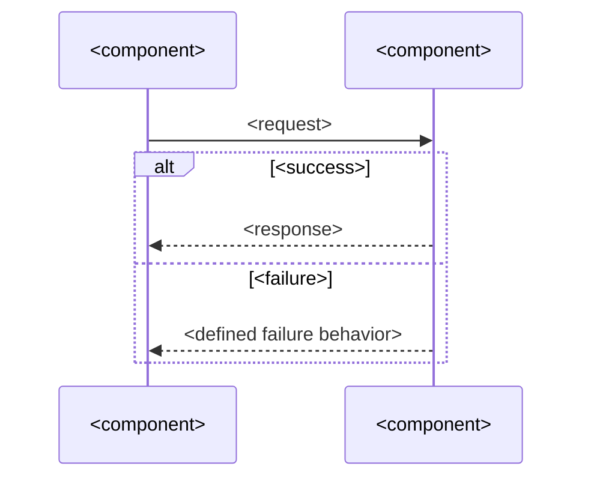

# Design: <Feature name>

- **Status:** Draft | In review | Approved | Implemented | Abandoned
- **Owner:** <role or name>
- **Reviewers:** <roles or names>
- **Last reviewed:** YYYY-MM-DD
- **Related:** <requirements (FR-xx), ADRs, contract changes, issues>

## Summary

<!-- Three to five sentences: what changes, for whom, and why now. -->

## Goals and non-goals

### Goals

- ...

### Non-goals

- ...

## Background

<!-- Only what the reader needs. Link requirements and ADRs instead of repeating them. -->

## Design

### Components and responsibilities

<!-- Which components change and what each one is responsible for. -->

### Flow

<!-- A Mermaid sequence diagram or flowchart. It MUST include failure paths. -->

### Data and contracts

<!-- Schema changes, contract diffs, migrations. Link the contract PR. -->

### Errors and guardrails

<!-- Every failure has a defined behavior and a test. Confirm staff approval, no automatic sending, and abstention without evidence. -->

| Failure | Behavior | Test |
|---|---|---|
| ... | ... | ... |

## Alternatives considered

<!-- What else was considered and why it was not chosen. Large, lasting choices belong in an ADR. -->

## Testing and evaluation

<!-- Unit, contract, and end-to-end tests. Metrics to re-measure and the baseline to compare against. -->

## Observability

<!-- Logs, metrics, and IDs needed to trace a request and reconstruct a suggestion. -->

## Security and privacy

<!-- Data sent to external services, permissions, secrets, untrusted input. -->

## Rollout

<!-- Order of PRs, migration steps, how to roll back. -->

## Open questions

- ...
